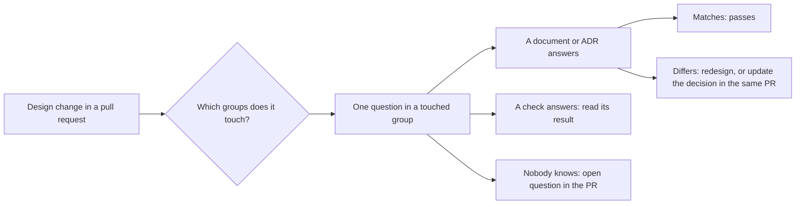

## Before you start

- [[backend.l4.per-shop-limits]] — ADR `0016` caps what one busy shop may use; the checklist's last isolation question points at it.
- [[backend.l4.audit-log]] — `audit-log.md` lists the actions that are audited; the security group asks whether a new action joins them.
- [[backend.l4.message-schema-evolution]] — `OrderMessageContractTests` fails a pull request that renames or retypes a message property; the message question points at it.
- [[design.l4.mapping-fitness-functions]] — `fitness-functions.md` maps each quality attribute to the check that guards it and records what nothing guards.

## The situation

A teammate opens a pull request: a second connection string (the setting that names the database server the app connects to), to `db-replica`, and `GET /api/v1/products` reads through it to take load off the primary. CI is green, and two reviewers comment. One approves, because a read replica is the usual answer to read load. The other blocks, because a replica can return old data. Neither comment names a decision Đơn Hàng has recorded, so the author cannot tell which to follow.

How does a reviewer judge a backend design change against what Đơn Hàng has already decided, and how much of the change needs that review?

## Core concepts

- `backend-review-checklist.md` — Đơn Hàng's questions for a backend design change: a pull request with an ADR or design document, or one that touches a boundary, data or a limit.
- Concern group (a plain phrase, used in this sense here) — the questions about one concern; the document has six: data ownership and consistency, schema and message changes, security, resilience, SLOs and capacity, and isolation between shops.
- Where the answer is (a plain phrase) — the column beside each question: the document or ADR that holds the expected answer, or the check that already tests it.
- Worked example (a plain phrase) — the document's last section, which runs its questions on one proposal: reading the product list from `db-replica`.

## How it works



In the situation above, both reviewers judged the replica from memory. The checklist gives them a place to look instead.

The review starts with scope. The reviewer goes only through the groups the change touches. A small change inside one module may need only one group; a change to a trust boundary or a load limit needs several. The replica proposal changes where a read goes and adds connections, so it meets two groups on four questions: data ownership and consistency, and SLOs and capacity.

Each question then names where its expected answer lives. Most point at a decision: `consistency-per-operation.md` for what an operation does when its source is out of reach, ADR `0013` for filtering by shop, `slo.md` for which requests count as bad, `multi-shop-data-rollout.md` for adding an index to a large table. The reviewer compares the change with that decision. A match passes. A difference is no longer one taste against another: either the change is redesigned, or the decision is changed in the same pull request, where it gets reviewed too.

Some questions already have an answer that runs on every change. Crossing a module boundary is answered by the compiler together with `ModuleBoundaryTests` and `DependencyRuleTests`. Whether a new endpoint needs a load limit points at `Program.cs` and the check `RateLimitTests`. A message's shape is covered by `OrderMessageContractTests`; known vulnerabilities by the CI build, which fails when a package it uses has a known vulnerability, and by Grype, a scanner run per image. There the reviewer reads the check's result instead of asking. What remains for a person is what no check can see, such as a new copy of data with no stated owner.

Last, "don't know" counts as a result: the reviewer writes it into the pull request as an open question.

## In the Đơn Hàng system

The document opens with how to use it, then its first group:

```markdown file=docs/design/backend-review-checklist.md tag=stage-4 lines=11-26
### Cách dùng

Chỉ đi qua những nhóm thay đổi chạm tới. Thay đổi nhỏ trong một module có thể
chỉ cần một nhóm; thay đổi một ranh giới tin cậy hay một giới hạn tải cần
nhiều nhóm. Câu trả lời "không biết" là một kết quả: ghi nó thành câu hỏi mở
trong pull request.

### Chủ dữ liệu và nhất quán

| Câu hỏi | Câu trả lời ở |
|---|---|
| Thay đổi có thêm bản sao của một dữ liệu không? Bản sao đó cập nhật thế nào, và khi lệch thì tin ai? | `data-ownership.md` |
| Có hai nơi cùng ghi một dữ liệu không? | `data-ownership.md`, mục hai nơi cùng muốn sửa |
| Thao tác bị đổi chọn gì khi không tới được nguồn, và khi bình thường? Lựa chọn mới có khớp lý do nghiệp vụ không? | `consistency-per-operation.md` |
| Code có dùng kiểu bên trong của module khác, hay tham chiếu project mà ranh giới không cho không? | Phép kiểm: `ModuleBoundaryTests`, `DependencyRuleTests` |
| Service có kết nối tới database của service khác không? Không phép kiểm nào thấy điều này | `data-ownership.md` |
```

The usage section is the scope rule from the diagram. In the first group, four rows point at a document and one at two tests, marked "Phép kiểm" (check). The last row says outright that no check sees one service connecting to another's database, so a person must ask it. The first row, a new copy of data, is the question the worked example comes back to.

The worked example closes the document:

```markdown file=docs/design/backend-review-checklist.md tag=stage-4 lines=71-89
### Ví dụ: đọc danh sách sản phẩm từ `db-replica`

Đề xuất: thêm connection string tới replica, chuyển `GET /api/v1/products`
sang đó để giảm tải cho primary.

- Nhất quán: `consistency-per-operation.md` cho phép danh sách sản phẩm trả
  dữ liệu hơi cũ, và danh sách không ghi lại gì từ kết quả đọc. Đạt. Một sản
  phẩm đọc qua `ProductCache` không được chuyển: nạp cache từ replica có thể
  đặt giá cũ trở lại.
- Dung lượng: `capacity-plan.md` đặt điều kiện kích hoạt, đỉnh đọc sản phẩm
  vượt khoảng dư của primary. Pull request phải cho thấy điều kiện đó đã tới,
  hoặc ghi lý do làm sớm. Connection string mới là một pool kết nối nữa trong
  mỗi Pod api: tính lại tổng với `max_connections`.
- SLO: S3 trong `slo.md` vẫn đo ở API, nên lỗi của replica hiện ra trong S3.
  Cần đường lui về primary khi replica trễ quá mức hay không trả lời, nếu không
  một replica hỏng tiêu budget của S3.
- Chủ dữ liệu: Catalog vẫn là chủ của `products`; replica là bản sao mới, phải
  thêm vào `data-ownership.md` cùng cách nó cập nhật (replication không đồng
  bộ) và tin ai khi lệch (primary).
```

This is the situation's pull request, reviewed on four points from two groups. Consistency passes: the product list may be slightly old and writes nothing back. A single product read through `ProductCache` stays on the primary, because refilling the cache from a replica could put an old price back for a whole TTL, and placing an order reads prices through that cache too.

Capacity asks for evidence: the pull request shows that the trigger in `capacity-plan.md` has come, peak product reads beyond the primary's headroom, or says why it moves early. The checklist counts the new connection string as one more pool, a set of open database connections, in every api Pod, so the total is checked again against `max_connections`, the setting that caps how many connections PostgreSQL accepts.

S3 in `slo.md` counts product `GET` requests that do not fail, and it is measured at the API. So a failing replica spends S3's error budget unless reads fall back to the primary.

Data ownership: Catalog still owns `products`, but the replica is a new copy, so `data-ownership.md` gains it, with how it updates and whom to trust when they differ: the primary.

The conclusion, below the excerpt, is conditional: accept once the trigger has come, the fallback exists, and `data-ownership.md` changes in the same pull request. Neither reviewer from the situation was right as a verdict.

## Trade-offs

| | Checklist pointing at decisions, groups touched (the document) | Reviewer's judgment alone | Every question on every pull request | Automated checks alone |
|---|---|---|---|---|
| Cost per change | Only design changes, only the groups touched | Low, until reviewers disagree | Every pull request waits for the full list | Nothing beyond CI |
| What a change is compared with | A recorded decision or a check's result | Each reviewer's memory and taste | The same decisions, read less carefully | Only what a check tests |
| What slips through | A question the list does not have yet | Whatever this reviewer has not met | What a reviewer skims past in the hundredth long review | A new copy of data with no owner, a service using another's database |
| What keeps it right | Editing a row when its decision or check changes | Nothing written | The same as the checklist | Adding checks |

## What would you choose if…

- …a pull request renames a private method inside the Ordering module: no checklist. It changes no boundary, data or limit, so it is not a design change in the document's sense. Ordinary code review covers it.
- …the team later adds a check that fails when a service connects to another service's database: the last row of the first group then points at that check, and the reviewer stops asking it by hand.
- …a change might spend error budget on production, but nobody can say: write "don't know" as an open question in the pull request. `slo.md` itself lists, under what is not there yet, that production has no Prometheus, so the answer cannot be measured there.

## Seniors often assume…

- **"With a good checklist, a reviewer no longer needs experience of the system."** → Actually the checklist says where an answer lives, not which groups a change touches or what the list lacks. No question names `ProductCache`; seeing that a cache refilled from a replica can restore an old price takes knowledge of how Đơn Hàng reads prices. You notice this when a change passes every listed question and still breaks something no row describes.
- **"Every pull request has to answer every question on the checklist."** → Actually a change is reviewed against the groups it touches, so a small change gets a short review and a change to a trust boundary or a limit gets a long one. You notice this when small pull requests wait days and reviewers start ticking rows they never read.
- **"A checklist that passes once can be kept unchanged for good."** → Actually each row points at a document, an ADR or a check, and those change: a replica becomes a new copy in `data-ownership.md`, ADR `0016` waits for release 2, and a gap may later get a check. You notice this when a row sends you to a document that no longer says what the question expects.

## Try it (3 minutes)

Work it out from the checklist's groups. For each proposal, name the groups it touches at least, and where the answer to the named question is: a document or ADR, or a check.

1. Add an index to the large `orders` table. Question: is it created without holding a long lock?
2. Add an optional property to `OrderMessage`. Question: can readers that are still running old code read it?
3. A new endpoint lets a shop's staff list that shop's orders. Question: does its query filter by the shop taken from the access token?

Expected result: two short reviews of one group each, and one long review across several groups, each named question answered by a named document, ADR or check.

<details><summary>Suggested answer</summary>

1. Schema and message changes. The row asks whether the index is created `CONCURRENTLY` (built without blocking writes to the table) and with a `lock_timeout` (giving up instead of waiting long for a lock), and points at `multi-shop-data-rollout.md`, a document. No check answers it, so the reviewer compares by hand.
2. Schema and message changes. A check answers: `OrderMessageContractTests`. If the property copies data another service owns, the data ownership group applies too.
3. Isolation between shops, with the answer in ADR `0013`; also security (whether listing a shop's orders is an action for `audit-log.md`) and resilience (whether the endpoint needs a load limit, `Program.cs` and `RateLimitTests`). This is the long review: it touches who may see which shop's data.

</details>

## Connections

- [[backend.l4.per-shop-limits]] — prerequisite: ADR `0016`, which the last isolation question points at.
- [[design.l4.mapping-fitness-functions]] — prerequisite: the list of checks the checklist points at instead of asking again.
- [[backend.l4.threat-modeling]] — the trust-boundary questions point at its `threat-model.md`.
- [[design.l4.architecture-review-findings]] — reviews a whole architecture against scenarios; this checklist reviews one change against decisions already made.
- [[management.l1.reviewing-for-layers]] — line-by-line code review, one level below the design questions here.
- [[backend.l4.read-routing]] — the rules for reads on `db-replica` that the worked example applies.
## Five-line summary

1. A backend review checklist ties each question to the document, ADR or check that holds its answer, so changes meet decisions, not tastes.
2. `backend-review-checklist.md` groups questions by six concerns, from data ownership and consistency to isolation between shops.
3. Questions a test or CI step answers point at that check; people ask what no check sees, such as an unowned copy of data.
4. A change is reviewed only against the groups it touches, and "don't know" becomes an open question in the pull request.
5. Reading the product list from `db-replica` passes on consistency, but needs the capacity trigger, a fallback for S3, and `data-ownership.md` updated.
