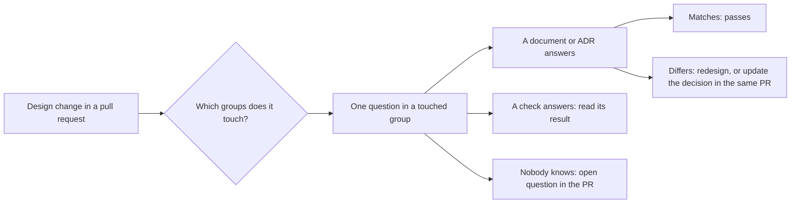

## Bạn cần biết trước

- [[backend.l4.per-shop-limits]] — ADR `0016` đặt trần cho những gì một cửa hàng đông được dùng. Câu hỏi cô lập cuối cùng của checklist trỏ về nó.
- [[backend.l4.audit-log]] — `audit-log.md` liệt kê các thao tác được ghi audit. Nhóm bảo mật hỏi một thao tác mới có phải thêm vào đó không.
- [[backend.l4.message-schema-evolution]] — `OrderMessageContractTests` làm fail pull request nào đổi tên hay đổi kiểu một property của message. Câu hỏi về message trỏ về nó.
- [[design.l4.mapping-fitness-functions]] — `fitness-functions.md` ghép mỗi thuộc tính chất lượng với phép kiểm canh nó, và ghi lại những gì chưa có gì canh.

## Tình huống

Một đồng nghiệp mở pull request: thêm connection string thứ hai (setting nêu tên database server mà app kết nối tới), trỏ tới `db-replica`, và `GET /api/v1/products` đọc qua nó để giảm tải cho primary. CI xanh, hai reviewer để lại bình luận. Người thứ nhất duyệt, vì read replica là câu trả lời quen thuộc cho tải đọc. Người thứ hai chặn, vì replica có thể trả dữ liệu cũ. Không bình luận nào nêu ra một quyết định Đơn Hàng đã ghi, nên người viết không biết nên nghe ai.

Làm sao một reviewer đánh giá một thay đổi thiết kế backend dựa trên những gì Đơn Hàng đã quyết định, và thay đổi đó cần review tới mức nào?

## Khái niệm cốt lõi

- `backend-review-checklist.md` — bộ câu hỏi của Đơn Hàng cho một thay đổi thiết kế backend: pull request kèm ADR hay tài liệu thiết kế, hoặc pull request chạm tới một ranh giới, dữ liệu hay một giới hạn.
- nhóm mối quan tâm (cụm từ thường, dùng theo nghĩa này ở đây) — các câu hỏi về cùng một mối quan tâm. Tài liệu có sáu nhóm: quyền sở hữu dữ liệu và nhất quán, thay đổi schema và message, bảo mật, khả năng chịu lỗi, SLO và dung lượng, cô lập giữa các cửa hàng.
- nơi có câu trả lời (cụm từ thường) — cột cạnh mỗi câu hỏi: tài liệu hay ADR giữ câu trả lời mong đợi, hoặc phép kiểm đã kiểm tra điều đó.
- ví dụ mẫu (cụm từ thường) — mục cuối của tài liệu, chạy các câu hỏi trên một đề xuất: đọc danh sách sản phẩm từ `db-replica`.

## Cơ chế hoạt động



Trong tình huống trên, cả hai reviewer đều đánh giá replica theo trí nhớ. Checklist cho họ một chỗ để tra thay vì nhớ.

Review bắt đầu từ phạm vi. Reviewer chỉ đi qua những nhóm mà thay đổi chạm tới. Một thay đổi nhỏ trong một module có thể chỉ cần một nhóm. Thay đổi một ranh giới tin cậy hay một giới hạn tải thì cần nhiều nhóm. Đề xuất replica đổi nơi một lần đọc đi tới và thêm kết nối, nên nó gặp hai nhóm qua bốn câu hỏi: quyền sở hữu dữ liệu và nhất quán, cùng SLO và dung lượng.

Sau đó mỗi câu hỏi nêu nơi có câu trả lời mong đợi. Phần lớn trỏ về một quyết định: `consistency-per-operation.md` cho biết một thao tác làm gì khi không tới được nguồn, ADR `0013` cho việc lọc theo cửa hàng, `slo.md` cho biết request nào tính là xấu, `multi-shop-data-rollout.md` cho cách thêm index vào một bảng lớn. Reviewer so thay đổi với quyết định đó. Khớp thì đạt. Lệch thì không còn là khẩu vị người này đối chọi khẩu vị người kia: hoặc thiết kế lại thay đổi, hoặc sửa quyết định ngay trong cùng pull request, nơi quyết định mới cũng được review.

Có những câu hỏi đã có câu trả lời chạy trên mọi thay đổi. Vượt ranh giới module do compiler trả lời, cùng với `ModuleBoundaryTests` và `DependencyRuleTests`. Một endpoint mới có cần giới hạn tải không thì trỏ về `Program.cs` và phép kiểm `RateLimitTests`. Hình dạng của message do `OrderMessageContractTests` canh. Lỗ hổng đã biết do build CI canh, build fail khi một package nó dùng có lỗ hổng đã biết, và do Grype, trình quét chạy cho từng image. Ở những chỗ đó, reviewer đọc kết quả của phép kiểm thay vì hỏi. Phần còn lại cho con người là những gì không phép kiểm nào thấy, chẳng hạn một bản sao dữ liệu mới chưa nói ai là chủ.

Cuối cùng, "không biết" cũng là một kết quả: reviewer ghi nó vào pull request thành một câu hỏi mở.

## Trong hệ thống Đơn Hàng

Tài liệu mở đầu bằng cách dùng, rồi tới nhóm đầu tiên:

```markdown file=docs/design/backend-review-checklist.md tag=stage-4 lines=11-26
### Cách dùng

Chỉ đi qua những nhóm thay đổi chạm tới. Thay đổi nhỏ trong một module có thể
chỉ cần một nhóm; thay đổi một ranh giới tin cậy hay một giới hạn tải cần
nhiều nhóm. Câu trả lời "không biết" là một kết quả: ghi nó thành câu hỏi mở
trong pull request.

### Chủ dữ liệu và nhất quán

| Câu hỏi | Câu trả lời ở |
|---|---|
| Thay đổi có thêm bản sao của một dữ liệu không? Bản sao đó cập nhật thế nào, và khi lệch thì tin ai? | `data-ownership.md` |
| Có hai nơi cùng ghi một dữ liệu không? | `data-ownership.md`, mục hai nơi cùng muốn sửa |
| Thao tác bị đổi chọn gì khi không tới được nguồn, và khi bình thường? Lựa chọn mới có khớp lý do nghiệp vụ không? | `consistency-per-operation.md` |
| Code có dùng kiểu bên trong của module khác, hay tham chiếu project mà ranh giới không cho không? | Phép kiểm: `ModuleBoundaryTests`, `DependencyRuleTests` |
| Service có kết nối tới database của service khác không? Không phép kiểm nào thấy điều này | `data-ownership.md` |
```

Mục cách dùng chính là quy tắc phạm vi trong sơ đồ. Trong nhóm đầu tiên, bốn dòng trỏ về một tài liệu và một dòng trỏ về hai test, đánh dấu "Phép kiểm". Dòng cuối nói thẳng rằng không phép kiểm nào thấy một service kết nối tới database của service khác, nên con người phải hỏi. Dòng đầu, một bản sao dữ liệu mới, là câu hỏi mà ví dụ mẫu quay lại.

Ví dụ mẫu khép lại tài liệu:

```markdown file=docs/design/backend-review-checklist.md tag=stage-4 lines=71-89
### Ví dụ: đọc danh sách sản phẩm từ `db-replica`

Đề xuất: thêm connection string tới replica, chuyển `GET /api/v1/products`
sang đó để giảm tải cho primary.

- Nhất quán: `consistency-per-operation.md` cho phép danh sách sản phẩm trả
  dữ liệu hơi cũ, và danh sách không ghi lại gì từ kết quả đọc. Đạt. Một sản
  phẩm đọc qua `ProductCache` không được chuyển: nạp cache từ replica có thể
  đặt giá cũ trở lại.
- Dung lượng: `capacity-plan.md` đặt điều kiện kích hoạt, đỉnh đọc sản phẩm
  vượt khoảng dư của primary. Pull request phải cho thấy điều kiện đó đã tới,
  hoặc ghi lý do làm sớm. Connection string mới là một pool kết nối nữa trong
  mỗi Pod api: tính lại tổng với `max_connections`.
- SLO: S3 trong `slo.md` vẫn đo ở API, nên lỗi của replica hiện ra trong S3.
  Cần đường lui về primary khi replica trễ quá mức hay không trả lời, nếu không
  một replica hỏng tiêu budget của S3.
- Chủ dữ liệu: Catalog vẫn là chủ của `products`; replica là bản sao mới, phải
  thêm vào `data-ownership.md` cùng cách nó cập nhật (replication không đồng
  bộ) và tin ai khi lệch (primary).
```

Đây chính là pull request trong tình huống, được review ở bốn điểm thuộc hai nhóm. Nhất quán đạt: danh sách sản phẩm được phép hơi cũ và không ghi lại gì. Một sản phẩm đọc qua `ProductCache` vẫn ở lại primary, vì nạp lại cache từ replica có thể đặt lại giá cũ trong suốt một TTL, mà lúc đặt đơn cũng đọc giá qua cache đó.

Dung lượng đòi bằng chứng: pull request cho thấy điều kiện kích hoạt trong `capacity-plan.md` đã tới, tức đỉnh đọc sản phẩm vượt khoảng dư của primary, hoặc ghi lý do làm sớm. Checklist tính connection string mới là thêm một pool, tức một nhóm kết nối database đang mở, trong mỗi Pod api, nên tổng số phải kiểm lại với `max_connections`, setting giới hạn số kết nối PostgreSQL chấp nhận.

S3 trong `slo.md` đếm các request `GET` sản phẩm không lỗi, và đo ở API. Vì vậy một replica hỏng sẽ tiêu error budget của S3, trừ khi lần đọc lui về primary.

Quyền sở hữu dữ liệu: Catalog vẫn là chủ của `products`, nhưng replica là một bản sao mới, nên `data-ownership.md` thêm nó vào, kèm cách nó cập nhật và tin ai khi hai bên lệch nhau: primary.

Kết luận, nằm dưới đoạn trích, có điều kiện: chấp nhận khi điều kiện kích hoạt đã tới, đường lui đã có, và `data-ownership.md` đổi trong cùng pull request. Không reviewer nào trong tình huống đúng nếu xem bình luận của mình là phán quyết.

## Đánh đổi

| | Checklist trỏ về quyết định, chỉ các nhóm bị chạm (tài liệu này) | Chỉ dựa vào phán đoán của reviewer | Mọi câu hỏi trên mọi pull request | Chỉ dựa vào phép kiểm tự động |
|---|---|---|---|---|
| Chi phí mỗi thay đổi | Chỉ thay đổi thiết kế, chỉ các nhóm bị chạm | Thấp, cho tới khi các reviewer bất đồng | Pull request nào cũng chờ đủ danh sách | Không thêm gì ngoài CI |
| Thay đổi được so với gì | Một quyết định đã ghi hoặc kết quả của một phép kiểm | Trí nhớ và khẩu vị của từng reviewer | Cùng các quyết định đó, nhưng đọc kém kỹ hơn | Chỉ những gì phép kiểm kiểm tra |
| Cái gì lọt qua | Một câu hỏi danh sách chưa có | Những gì reviewer này chưa từng gặp | Những gì reviewer lướt qua ở lần review dài thứ một trăm | Một bản sao dữ liệu mới chưa có chủ, một service dùng database của service khác |
| Cái gì giữ nó đúng | Sửa một dòng khi quyết định hay phép kiểm của nó đổi | Không có gì được ghi | Giống checklist | Thêm phép kiểm |

## Bạn sẽ chọn gì nếu…

- …một pull request đổi tên một method private bên trong module Ordering: không cần checklist. Nó không đổi ranh giới, dữ liệu hay giới hạn nào, nên không phải thay đổi thiết kế theo nghĩa của tài liệu. Code review thông thường là đủ.
- …sau này đội thêm một phép kiểm fail khi một service kết nối tới database của service khác: khi đó dòng cuối của nhóm đầu tiên trỏ về phép kiểm đó, và reviewer thôi hỏi bằng tay.
- …một thay đổi có thể tiêu error budget trên production, nhưng không ai nói chắc được: ghi "không biết" thành câu hỏi mở trong pull request. Chính `slo.md` ghi, trong phần những gì chưa có, rằng production chưa có Prometheus, nên ở đó không đo được câu trả lời.

## Senior hay nhầm rằng…

- **"Có checklist tốt thì reviewer không cần kinh nghiệm với hệ thống nữa."** → Thực ra checklist chỉ nói câu trả lời nằm ở đâu, không nói thay đổi chạm tới nhóm nào hay danh sách còn thiếu gì. Không câu hỏi nào nêu tên `ProductCache`. Muốn thấy một cache nạp lại từ replica có thể đưa giá cũ trở lại, phải biết Đơn Hàng đọc giá ra sao. Bạn sẽ nhận ra khi một thay đổi qua hết mọi câu hỏi trong danh sách mà vẫn làm hỏng một thứ không dòng nào mô tả.
- **"Pull request nào cũng phải trả lời mọi câu hỏi trong checklist."** → Thực ra một thay đổi chỉ được review theo những nhóm nó chạm tới, nên thay đổi nhỏ được review ngắn, còn thay đổi một ranh giới tin cậy hay một giới hạn thì review dài. Bạn sẽ nhận ra khi các pull request nhỏ phải chờ nhiều ngày và reviewer bắt đầu đánh dấu những dòng họ chưa từng đọc.
- **"Checklist đã đạt một lần thì giữ nguyên mãi được."** → Thực ra mỗi dòng trỏ về một tài liệu, một ADR hay một phép kiểm, và những thứ đó thay đổi: một replica trở thành bản sao mới trong `data-ownership.md`, ADR `0016` chờ release 2, và một chỗ chưa có gì canh sau này có thể có phép kiểm. Bạn sẽ nhận ra khi một dòng đưa bạn tới một tài liệu không còn nói điều câu hỏi mong đợi.

## Thử ngay (3 phút)

Làm dựa trên các nhóm của checklist. Với mỗi đề xuất, nêu ít nhất các nhóm nó chạm tới, và câu trả lời cho câu hỏi đã nêu nằm ở đâu: một tài liệu hay ADR, hay một phép kiểm.

1. Thêm một index vào bảng lớn `orders`. Câu hỏi: index có được tạo mà không giữ khóa lâu không?
2. Thêm một property tùy chọn vào `OrderMessage`. Câu hỏi: nơi đọc vẫn đang chạy code cũ có đọc được nó không?
3. Một endpoint mới cho nhân viên của một cửa hàng liệt kê đơn của cửa hàng đó. Câu hỏi: truy vấn của nó có lọc theo cửa hàng lấy từ access token không?

Kết quả mong đợi: hai lần review ngắn, mỗi lần một nhóm, và một lần review dài qua nhiều nhóm, mỗi câu hỏi đã nêu được trả lời bằng một tài liệu, ADR hay phép kiểm có tên.

<details><summary>Gợi ý đáp án</summary>

1. Thay đổi schema và message. Dòng đó hỏi index có được tạo với `CONCURRENTLY` (dựng mà không chặn ghi vào bảng) và với `lock_timeout` (bỏ cuộc thay vì chờ lâu để lấy khóa) không, và trỏ về `multi-shop-data-rollout.md`, một tài liệu. Không phép kiểm nào trả lời, nên reviewer so bằng tay.
2. Thay đổi schema và message. Một phép kiểm trả lời: `OrderMessageContractTests`. Nếu property đó chép dữ liệu mà service khác làm chủ, nhóm quyền sở hữu dữ liệu cũng áp dụng.
3. Cô lập giữa các cửa hàng, câu trả lời ở ADR `0013`. Thêm bảo mật (liệt kê đơn của một cửa hàng có phải là thao tác cần đưa vào `audit-log.md` không) và khả năng chịu lỗi (endpoint có cần giới hạn tải không, `Program.cs` và `RateLimitTests`). Đây là lần review dài: nó chạm tới việc ai được thấy dữ liệu của cửa hàng nào.

</details>

## Liên hệ

- [[backend.l4.per-shop-limits]] — bài tiên quyết: ADR `0016`, nơi câu hỏi cô lập cuối cùng trỏ về.
- [[design.l4.mapping-fitness-functions]] — bài tiên quyết: danh sách phép kiểm mà checklist trỏ về thay vì hỏi lại.
- [[backend.l4.threat-modeling]] — các câu hỏi về ranh giới tin cậy trỏ về `threat-model.md` của bài đó.
- [[design.l4.architecture-review-findings]] — review cả một kiến trúc theo các kịch bản. Checklist này review một thay đổi theo các quyết định đã có.
- [[management.l1.reviewing-for-layers]] — code review từng dòng, thấp hơn một tầng so với các câu hỏi thiết kế ở đây.
- [[backend.l4.read-routing]] — các quy tắc cho lần đọc trên `db-replica` mà ví dụ mẫu áp dụng.

## Tóm tắt 5 dòng

1. Checklist review backend gắn mỗi câu hỏi với tài liệu, ADR hay phép kiểm giữ câu trả lời, nên thay đổi được so với quyết định chứ không với khẩu vị.
2. `backend-review-checklist.md` chia câu hỏi theo sáu mối quan tâm, từ quyền sở hữu dữ liệu và nhất quán tới cô lập giữa các cửa hàng.
3. Câu hỏi nào đã có test hay bước CI trả lời thì trỏ về phép kiểm đó. Con người hỏi những gì không phép kiểm nào thấy, như một bản sao dữ liệu chưa có chủ.
4. Một thay đổi chỉ được review theo những nhóm nó chạm tới, và "không biết" trở thành câu hỏi mở trong pull request.
5. Đọc danh sách sản phẩm từ `db-replica` đạt về nhất quán, nhưng cần điều kiện dung lượng đã tới, đường lui cho S3, và `data-ownership.md` được cập nhật.
