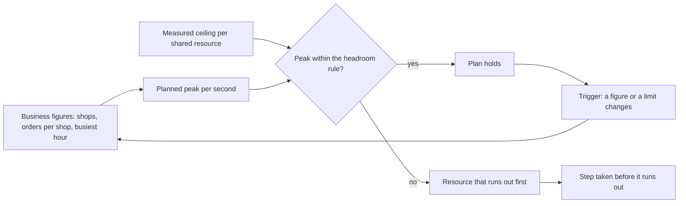

## Before you start

- [[backend.l4.load-testing]] — its steps measure how many product reads the api answers; here you compare that with what the shops will ask.
- [[design.l4.a-thousand-shops]] — `multi-shop-requirements.md` assumes 1,000 shops and leaves sizing their load to separate work; this lesson is that work.
- [[k8s.l1.requests-and-limits]] — a Pod starts only where a node has room for its requests, so an extra Pod is not free.
- [[backend.l3.sharding]] — spreading rows over several databases gets past one server's limit; here you first find which limit the plan reaches.

## The situation

The product owner plans to sign shops until Đơn Hàng serves 1,000, and asks whether today's setup will hold on the busiest day. One teammate divides the expected orders by the seconds in a day, gets less than one order per second, and says nothing needs to change. Another says Kubernetes can start more api Pods whenever load grows. You have the curve from `load-steps.sh`, but it shows what the api can answer, not what the shops will ask. Nobody has put the two side by side.

How do you know, before the busiest day arrives, whether the api and its database will carry it, and what to change first if they will not?

## Core concepts

- **capacity planning** — estimating the peak load from business figures, such as shops and orders per shop, and checking it against each shared resource's measured limit before that peak arrives.
- peak — the highest load expected over a short period, here the busiest hour of the busiest day, counted per second.
- ceiling — the most a shared resource or a limit can answer per second, found by measuring, as in the load test.
- **headroom** — the margin kept between the planned peak and a measured ceiling, so the system still copes with a burst or with losing one of its parts.
- trigger — a change in one of the business figures, or in a limit, that makes the plan out of date and calls for a new one.

## How it works



In the situation above, capacity planning starts on the left: the plan multiplies assumed business figures, such as orders per shop and the busiest hour's share of a day, into a planned peak per second. It plans from that hour, not from the daily average, because a shared resource runs out while load is highest, and the average hides that hour.

For product reads, the measured ceiling is Little's law turned round. `catalog-reads` lets 20 reads run at once, each holding a permit, and lets 5 more wait, which is why the load test saw `503` only beyond 25. Only the 20 running reads set the ceiling: the most one api process answers per second is 20 divided by the time one read takes.

The headroom rule compares the two: the peak must fit under the ceiling of all api Pods but one. With the 2 Pods the plan counts, that is half, so one Pod carries the whole peak if the other is lost. `api.yaml` does not require separate nodes, so the rule covers a failed node running one Pod; the plan does not size for a node running both.

If the peak breaks the rule, the plan names the resource that runs out first and the step taken before it does. Each added api Pod brings 20 more permits, but also its own connection pool: a set of database connections the process opens and reuses. Pods times connections per Pod, plus every other service's connections, must stay below `max_connections`, the PostgreSQL setting for the most connections it accepts at once, less a few slots kept for administrator accounts.

If the peak keeps the rule, the plan holds until a trigger fires; then the loop starts again from the left.

## In the Đơn Hàng system

`capacity-plan.md` holds the plan. Its first part turns assumptions into a peak:

```markdown file=docs/design/capacity-plan.md tag=stage-4 lines=12-28
| Đầu vào | Giá trị |
|---|---|
| Số cửa hàng | 1.000 |
| Đơn mỗi cửa hàng mỗi ngày | Trung bình 50 (giả định) |
| Ngày đông nhất so với ngày thường | Gấp 2 (giả định) |
| Phần đơn của ngày rơi vào giờ đông nhất | 12% (giả định) |
| Lần đọc sản phẩm cho mỗi đơn đặt được, kể cả lượt xem không mua | 40 (giả định) |

| Kết quả | Trung bình ngày thường | Giờ đông nhất của ngày đông nhất |
|---|---|---|
| Đơn mỗi ngày | 50.000 | 100.000 |
| Đơn mỗi giây | khoảng 0,6 | khoảng 3,3 (12.000 đơn trong một giờ) |
| Đọc sản phẩm mỗi giây | khoảng 23 | khoảng 133 |

Kế hoạch tính theo giờ đông nhất, không theo trung bình ngày: trung bình ngày
thấp hơn đỉnh hơn năm lần, và hệ thống hỏng vào giờ đông, không vào lúc trung
bình.
```

Every input after the number of shops is marked "(giả định)", an assumption; so are the 1,000 shops in `multi-shop-requirements.md`. 1,000 shops times 50 orders, doubled on the busiest day, make 100,000; 12% of that in one hour is about 3.3 orders per second, and 40 reads per order make about 133. The daily average, about 0.6 orders per second, is the first teammate's number.

The part between the two excerpts derives the ceiling. With all 20 permits of `catalog-reads` in use, a product list read took about 10–12 ms in the lab, so one process answers about 20 / 0.012, roughly 1,600 reads per second; the plan marks the lab time as an assumption. The base `api.yaml` sets `replicas: 2`, and each api Pod runs one api process, so the two together reach about 3,200. The plan counts these 2 Pods, the base value, not the 3 the production overlay sets. It does not say why; counting fewer Pods keeps the check on the safe side, because production's third Pod only raises the read ceiling. Then it compares:

```markdown file=docs/design/capacity-plan.md tag=stage-4 lines=53-73
Quy tắc: tải đỉnh không vượt một nửa trần của 2 Pod api, để một Pod gánh được
toàn bộ khi mất Pod kia (node hỏng, rolling update).

- Đọc sản phẩm: đỉnh khoảng 133 mỗi giây, một nửa trần khoảng 1.600. Đạt.
- Đặt đơn: đỉnh khoảng 3,3 đơn mỗi giây, mỗi đơn một transaction ngắn trên
  primary. Đạt, không phải tài nguyên chặn.

### Tài nguyên hết trước

Trần `catalog-reads` tính theo thời gian một lần đọc. Khi Redis dừng hay
database chậm, mỗi lần đọc lâu hơn và trần tụt theo: nếu một lần đọc mất 200
ms, trần mỗi process còn 100 mỗi giây, một nửa trần của 2 Pod còn 100, thấp
hơn đỉnh 133. Vì vậy `catalog-reads` hết trước, trả `503` cho đọc sản phẩm,
trong khi đặt đơn vẫn chạy.

Bước làm trước khi tới đó, theo thứ tự:

1. Thêm Pod api; mỗi Pod thêm 20 chỗ đọc nhưng cũng thêm một pool kết nối,
   nên số Pod bị chặn bởi `max_connections`.
2. Chuyển danh sách sản phẩm sang replica (mục dưới), khi đỉnh đọc sản phẩm
   vượt khoảng dư của primary.
```

The first lines check the rule: half of about 3,200 is about 1,600, far above 133. The rule names a failed node and a rolling update; with the default rolling-update settings and 2 replicas, a release adds a Pod before removing one, so a failed node is the case the rule really covers. If a read takes 200 ms, half the ceiling of 2 Pods is 100, below 133, so only product reads get `503`. The steps come in order: first more api Pods, as long as the connections fit; second, moving the product list to the replica once product reads exceed what the primary can spare.

Before the second excerpt, the plan says each api Pod keeps one pool from Npgsql, the library the api uses to reach PostgreSQL, for the `ConnectionStrings:Default` config value, at its default size, since that value sets none. The Payments and Notifications services, the migrations and the backup job connect to the same server. Npgsql's default maximum pool size is 100 connections. The plan does not guess `max_connections`; it says to read it with `SHOW max_connections`.

The plan's triggers, listed after the second excerpt, are: shops or orders per shop off by more than a quarter, one shop holding over 10% of the busiest day's orders, or a changed limit, Pod count or measured read time.

## Trade-offs

| Choice | What it gives | What it costs | When it fits |
|---|---|---|---|
| Size from the daily average | one simple number from data you already have | hides the busiest hour, here more than five times the average | totals per day, never a rate the system must answer |
| Plan from the busiest hour of the busiest day, assumptions marked | a peak per second to compare with each ceiling, and a list of what to recheck | assumptions may be wrong, so the plan needs triggers | before a known growth step, such as signing 1,000 shops |
| Buy the biggest server you can afford | fewer parts to change for a while | pays for capacity nobody measured; the 20 permits of `catalog-reads` and `max_connections` stay as they are | when measurement shows that machine's CPU or memory is the limit that runs out first |
| Add api Pods as load grows | 20 more read permits per Pod | each Pod needs room on a node and adds a pool against the same PostgreSQL | while Pods times connections stays below `max_connections` and nodes have room |
## What would you choose if…

…the product owner says one shop's promotion may bring more than 10% of the busiest day's orders? That is one of the plan's triggers. Make a new plan before the promotion, not after the `503` answers; keeping one shop from slowing the others is a later lesson.

…a teammate wants `replicas: 6` to be safe? With Npgsql's default, six pools could ask PostgreSQL for up to 600 connections before Payments, Notifications or a migration connects. Read `max_connections` first, and add Pods only while the sum stays below it.

…staging measures a product list read at 50 ms instead of the lab's 12? That is a trigger too. One process answers 20 / 0.05 = 400 per second; half the ceiling of 2 Pods is 400, still above 133. Write the measured number into the plan.

## Seniors often assume…

- **"Capacity planning means buying the biggest server we can afford."** → Actually the first resource to run out may be a setting, not a machine. In Đơn Hàng that is `catalog-reads`, 20 reads at once per process on any machine. You notice this when the busy hour brings `503` on product reads while the server's CPU is far from full.
- **"The average load over a day is enough to size the system."** → Actually a shared resource runs out while load is highest, and the average hides that hour. In `capacity-plan.md` the daily average of about 0.6 orders per second is over five times below the busiest hour's 3.3. You notice this when a daily graph looks calm, yet one hour of the busiest day had `503` answers.
- **"Kubernetes can always start more Pods, so we do not need a capacity plan."** → Actually a Pod starts only where a node has room for its requests, and every api Pod opens its own connection pool to the same PostgreSQL. Near `max_connections`, PostgreSQL refuses new connections (a few slots are kept for administrator accounts, so the other accounts are refused slightly earlier), so more Pods can turn a slow api into a failing one. You notice this when a new Pod stays `Pending`, or when requests fail to open a database connection right after Pods were added.

## Try it (3 minutes)

1. Suppose the shops double to 2,000, every other input in the plan's table stays the same, and a product list read takes 100 ms.
2. Work out the peak product reads per second, the ceiling of one api process, and whether the headroom rule of 2 Pods still holds.

Expected result: a yes or no for the headroom rule, the resource that runs out first, and the plan's first step.

<details><summary>Suggested answer</summary>

The peak doubles to about 267 product reads per second. One process answers 20 / 0.1 = 200 per second; 2 Pods make 400, and half of that is 200, below 267. The rule fails, and `catalog-reads` runs out first. The first step is a third api Pod in the count the plan uses; production already runs 3, and if one of 3 is lost, the other 2 still answer 400, above 267. Add it only after checking that Pods times connections per Pod, with the other services, stays below `max_connections`. Both changes are also triggers.

</details>

## Connections

- [[backend.l4.load-testing]] — prerequisite: where the measured ceiling of product reads comes from.
- [[backend.l4.read-routing]] — the plan's second step: moving the product list to the replica once its peak crosses the primary's headroom.
- [[backend.l3.read-replicas]] — the replica that step would use, and the lag that comes with it.
- [[k8s.l1.rolling-updates]] — how Pods are replaced during a release; with its defaults and 2 replicas, a third Pod starts before an old one stops, adding one more connection pool for a while.
- [[design.l4.one-deployment-for-all-shops]] — the decision that puts all 1,000 shops on the same Pods and database this plan sizes.

## Five-line summary

1. A capacity plan estimates the peak load from business figures and checks it against each shared resource's measured limit before the peak arrives.
2. `capacity-plan.md` derives about 3.3 orders and 133 product reads per second from marked assumptions, using the busiest hour, not the daily average.
3. Headroom keeps the peak under the ceiling of all api Pods but one, which for the 2 Pods the plan counts is half.
4. More api Pods raise the `catalog-reads` ceiling but add connection pools, so Pods times connections must stay below `max_connections`.
5. The plan names the resource that runs out first, the step before it does, and the changes that trigger a new plan.
