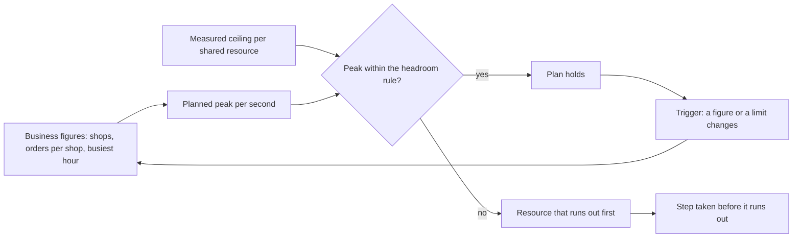

## Bạn cần biết trước

- [[backend.l4.load-testing]] — các bước của nó đo api trả lời được bao nhiêu lượt đọc sản phẩm. Ở đây bạn so con số đó với lượng mà các cửa hàng sẽ hỏi.
- [[design.l4.a-thousand-shops]] — `multi-shop-requirements.md` giả định 1.000 cửa hàng và để phần tính tải của chúng cho một việc riêng. Bài này chính là việc đó.
- [[k8s.l1.requests-and-limits]] — một Pod chỉ khởi động ở node còn chỗ cho requests của nó, nên thêm Pod không phải là miễn phí.
- [[backend.l3.sharding]] — chia các dòng ra nhiều database giúp vượt qua giới hạn của một server. Ở đây bạn tìm trước xem kế hoạch chạm tới giới hạn nào.

## Tình huống

Product owner định ký thêm cửa hàng cho tới khi Đơn Hàng phục vụ 1.000 cửa hàng, và hỏi hệ thống hiện tại có trụ được vào ngày đông nhất không. Một đồng đội lấy số đơn dự kiến chia cho số giây trong một ngày, ra chưa tới một đơn mỗi giây, và bảo không cần đổi gì. Một người khác nói Kubernetes cứ tải tăng là khởi động thêm Pod api được. Bạn có đường cong từ `load-steps.sh`, nhưng nó cho thấy api trả lời được bao nhiêu, không cho thấy các cửa hàng sẽ hỏi bao nhiêu. Chưa ai đặt hai thứ đó cạnh nhau.

Làm sao biết trước ngày đông nhất rằng api và database của nó có gánh nổi không, và nếu không thì phải đổi gì trước?

## Khái niệm cốt lõi

- **lập kế hoạch dung lượng** (capacity planning) — ước lượng tải lúc đỉnh từ các con số nghiệp vụ, như số cửa hàng và số đơn mỗi cửa hàng, rồi so nó với giới hạn đã đo của từng tài nguyên dùng chung trước khi đỉnh đó tới.
- đỉnh — mức tải cao nhất dự kiến trong một khoảng ngắn, ở đây là giờ đông nhất của ngày đông nhất, tính theo mỗi giây.
- trần — mức cao nhất mà một tài nguyên dùng chung hay một giới hạn trả lời được mỗi giây, tìm ra bằng cách đo, như trong kiểm thử tải.
- **khoảng dư** (headroom) — phần chừa lại giữa đỉnh theo kế hoạch và một cái trần đã đo, để hệ thống vẫn chịu được một đợt dồn tải hoặc khi mất một phần của nó.
- điểm kích hoạt — một thay đổi ở một con số nghiệp vụ, hay ở một giới hạn, khiến kế hoạch hết đúng và cần làm kế hoạch mới.

## Cơ chế hoạt động



Trong tình huống trên, lập kế hoạch dung lượng bắt đầu từ bên trái. Kế hoạch nhân các con số nghiệp vụ giả định, như số đơn mỗi cửa hàng và phần của một ngày rơi vào giờ đông nhất, thành đỉnh theo kế hoạch tính mỗi giây. Nó tính từ giờ đó, không từ trung bình ngày, vì tài nguyên dùng chung cạn đúng lúc tải cao nhất, mà trung bình lại che mất giờ đó.

Với lượt đọc sản phẩm, trần đo được là định luật Little đảo chiều. `catalog-reads` cho 20 lượt đọc chạy cùng lúc, mỗi lượt giữ một permit, và cho thêm 5 lượt chờ. Đó là lý do kiểm thử tải chỉ thấy `503` khi vượt quá 25. Chỉ 20 lượt đang chạy quyết định cái trần: một process api trả lời được nhiều nhất bằng 20 chia cho thời gian một lượt đọc.

Quy tắc khoảng dư so hai thứ đó với nhau: đỉnh phải nằm dưới trần của tất cả Pod api trừ một. Với 2 Pod mà kế hoạch tính, đó là một nửa, nên một Pod gánh được cả đỉnh nếu mất Pod kia. `api.yaml` không bắt hai Pod nằm ở hai node khác nhau, nên quy tắc này bao trường hợp hỏng một node đang chạy một Pod. Kế hoạch không tính cho trường hợp một node chạy cả hai.

Nếu đỉnh phá quy tắc, kế hoạch nêu tên tài nguyên cạn trước và bước phải làm trước khi nó cạn. Mỗi Pod api thêm vào mang thêm 20 permit, nhưng cũng mang theo connection pool riêng: một nhóm kết nối database mà process mở ra rồi dùng lại. Số Pod nhân số kết nối mỗi Pod, cộng kết nối của mọi service khác, phải nằm dưới `max_connections`, thiết lập PostgreSQL cho số kết nối tối đa nó nhận cùng lúc, trừ đi vài chỗ giữ cho tài khoản quản trị.

Nếu đỉnh giữ được quy tắc, kế hoạch còn đúng cho tới khi một điểm kích hoạt xảy ra. Khi đó vòng lặp bắt đầu lại từ bên trái.

## Trong hệ thống Đơn Hàng

`capacity-plan.md` chứa kế hoạch. Phần đầu của nó biến các giả định thành một đỉnh:

```markdown file=docs/design/capacity-plan.md tag=stage-4 lines=12-28
| Đầu vào | Giá trị |
|---|---|
| Số cửa hàng | 1.000 |
| Đơn mỗi cửa hàng mỗi ngày | Trung bình 50 (giả định) |
| Ngày đông nhất so với ngày thường | Gấp 2 (giả định) |
| Phần đơn của ngày rơi vào giờ đông nhất | 12% (giả định) |
| Lần đọc sản phẩm cho mỗi đơn đặt được, kể cả lượt xem không mua | 40 (giả định) |

| Kết quả | Trung bình ngày thường | Giờ đông nhất của ngày đông nhất |
|---|---|---|
| Đơn mỗi ngày | 50.000 | 100.000 |
| Đơn mỗi giây | khoảng 0,6 | khoảng 3,3 (12.000 đơn trong một giờ) |
| Đọc sản phẩm mỗi giây | khoảng 23 | khoảng 133 |

Kế hoạch tính theo giờ đông nhất, không theo trung bình ngày: trung bình ngày
thấp hơn đỉnh hơn năm lần, và hệ thống hỏng vào giờ đông, không vào lúc trung
bình.
```

Mọi đầu vào sau số cửa hàng đều ghi "(giả định)". 1.000 cửa hàng trong `multi-shop-requirements.md` cũng là giả định. 1.000 cửa hàng nhân 50 đơn, gấp đôi vào ngày đông nhất, ra 100.000. 12% số đó trong một giờ là khoảng 3,3 đơn mỗi giây, và 40 lượt đọc cho mỗi đơn ra khoảng 133. Trung bình ngày, khoảng 0,6 đơn mỗi giây, chính là con số của đồng đội thứ nhất.

Phần nằm giữa hai đoạn trích tính ra cái trần. Khi cả 20 permit của `catalog-reads` đều đang dùng, một lượt đọc danh sách sản phẩm mất khoảng 10–12 ms trong lab, nên một process trả lời khoảng 20 / 0,012, xấp xỉ 1.600 lượt đọc mỗi giây. Kế hoạch ghi thời gian đo ở lab là một giả định. `api.yaml` của base đặt `replicas: 2`, và mỗi Pod api chạy một process api, nên hai Pod cộng lại được khoảng 3.200. Kế hoạch tính 2 Pod này, giá trị của base, chứ không tính 3 Pod mà overlay production đặt. Nó không nói vì sao. Rồi nó so sánh:

```markdown file=docs/design/capacity-plan.md tag=stage-4 lines=53-73
Quy tắc: tải đỉnh không vượt một nửa trần của 2 Pod api, để một Pod gánh được
toàn bộ khi mất Pod kia (node hỏng, rolling update).

- Đọc sản phẩm: đỉnh khoảng 133 mỗi giây, một nửa trần khoảng 1.600. Đạt.
- Đặt đơn: đỉnh khoảng 3,3 đơn mỗi giây, mỗi đơn một transaction ngắn trên
  primary. Đạt, không phải tài nguyên chặn.

### Tài nguyên hết trước

Trần `catalog-reads` tính theo thời gian một lần đọc. Khi Redis dừng hay
database chậm, mỗi lần đọc lâu hơn và trần tụt theo: nếu một lần đọc mất 200
ms, trần mỗi process còn 100 mỗi giây, một nửa trần của 2 Pod còn 100, thấp
hơn đỉnh 133. Vì vậy `catalog-reads` hết trước, trả `503` cho đọc sản phẩm,
trong khi đặt đơn vẫn chạy.

Bước làm trước khi tới đó, theo thứ tự:

1. Thêm Pod api; mỗi Pod thêm 20 chỗ đọc nhưng cũng thêm một pool kết nối,
   nên số Pod bị chặn bởi `max_connections`.
2. Chuyển danh sách sản phẩm sang replica (mục dưới), khi đỉnh đọc sản phẩm
   vượt khoảng dư của primary.
```

Những dòng đầu kiểm tra quy tắc: một nửa của khoảng 3.200 là khoảng 1.600, cao hơn 133 rất nhiều. Quy tắc nêu node hỏng và rolling update. Với thiết lập rolling update mặc định và 2 replica, một lần phát hành thêm một Pod trước khi bỏ một Pod, nên node hỏng mới là trường hợp quy tắc thật sự bao. Nếu một lượt đọc mất 200 ms, một nửa trần của 2 Pod là 100, thấp hơn 133, nên chỉ lượt đọc sản phẩm nhận `503`. Các bước đi theo thứ tự: trước hết thêm Pod api, miễn là số kết nối còn vừa. Sau đó chuyển danh sách sản phẩm sang replica khi lượt đọc sản phẩm vượt quá phần primary còn dư.

Trước đoạn trích thứ hai, kế hoạch nói mỗi Pod api giữ một pool từ Npgsql, thư viện api dùng để kết nối PostgreSQL, cho giá trị config `ConnectionStrings:Default`, với kích thước mặc định, vì giá trị đó không đặt kích thước. Các service Payments và Notifications, các migration và job backup cũng kết nối vào cùng server đó. Kích thước pool tối đa mặc định của Npgsql là 100 kết nối. Kế hoạch không đoán `max_connections`, nó bảo đọc giá trị đó bằng `SHOW max_connections`.

Các điểm kích hoạt của kế hoạch, liệt kê sau đoạn trích thứ hai, gồm: số cửa hàng hay số đơn mỗi cửa hàng lệch quá một phần tư, một cửa hàng chiếm hơn 10% số đơn của ngày đông nhất, hoặc một giới hạn, số Pod hay thời gian đọc đo được thay đổi.

## Đánh đổi

| Lựa chọn | Nó cho bạn | Cái giá | Khi nào hợp |
|---|---|---|---|
| Tính theo trung bình ngày | một con số đơn giản từ dữ liệu bạn đã có | che mất giờ đông nhất, ở đây cao hơn trung bình hơn năm lần | tổng theo ngày, không bao giờ cho một tốc độ hệ thống phải đáp ứng |
| Lập kế hoạch từ giờ đông nhất của ngày đông nhất, có ghi rõ giả định | một đỉnh mỗi giây để so với từng cái trần, và danh sách những gì cần kiểm lại | giả định có thể sai, nên kế hoạch cần điểm kích hoạt | trước một bước tăng trưởng đã biết, như ký 1.000 cửa hàng |
| Mua server lớn nhất trong khả năng | ít phần phải đổi trong một thời gian | trả tiền cho năng lực chưa ai đo, còn 20 permit của `catalog-reads` và `max_connections` vẫn giữ nguyên | khi đo cho thấy CPU hay bộ nhớ của máy đó là giới hạn cạn trước |
| Thêm Pod api khi tải tăng | thêm 20 permit đọc cho mỗi Pod | mỗi Pod cần chỗ trên một node và thêm một pool vào cùng PostgreSQL | khi số Pod nhân số kết nối còn dưới `max_connections` và node còn chỗ |

## Bạn sẽ chọn gì nếu…

…product owner nói đợt khuyến mãi của một cửa hàng có thể mang tới hơn 10% số đơn của ngày đông nhất? Đó là một điểm kích hoạt của kế hoạch. Hãy làm kế hoạch mới trước đợt khuyến mãi, đừng đợi tới khi đã có các câu trả lời `503`. Cách giữ cho một cửa hàng không làm chậm các cửa hàng khác là chuyện của một bài sau.

…một đồng đội muốn đặt `replicas: 6` cho chắc? Với mặc định của Npgsql, sáu pool có thể xin PostgreSQL tới 600 kết nối, trước khi Payments, Notifications hay một migration kết nối vào. Hãy đọc `max_connections` trước, và chỉ thêm Pod khi tổng vẫn còn dưới nó.

…staging đo được một lượt đọc danh sách sản phẩm mất 50 ms thay vì 12 ms của lab? Đó cũng là một điểm kích hoạt. Một process trả lời 20 / 0,05 = 400 lượt mỗi giây. Một nửa trần của 2 Pod là 400, vẫn cao hơn 133. Hãy ghi con số đo được vào kế hoạch.

## Senior hay nhầm rằng…

- **"Lập kế hoạch dung lượng nghĩa là mua server lớn nhất trong khả năng."** → Thực ra tài nguyên cạn đầu tiên có thể là một thiết lập, không phải một cái máy. Ở Đơn Hàng đó là `catalog-reads`, 20 lượt đọc cùng lúc cho mỗi process trên bất kỳ máy nào. Bạn sẽ nhận ra khi giờ đông mang tới `503` cho lượt đọc sản phẩm trong khi CPU của server còn xa mới đầy.
- **"Tải trung bình trong ngày là đủ để tính cỡ hệ thống."** → Thực ra tài nguyên dùng chung cạn đúng lúc tải cao nhất, và trung bình che mất giờ đó. Trong `capacity-plan.md`, trung bình ngày khoảng 0,6 đơn mỗi giây, thấp hơn 3,3 của giờ đông nhất hơn năm lần. Bạn sẽ nhận ra khi biểu đồ theo ngày trông yên ả, vậy mà một giờ của ngày đông nhất lại có các câu trả lời `503`.
- **"Kubernetes lúc nào cũng khởi động thêm Pod được, nên không cần kế hoạch dung lượng."** → Thực ra một Pod chỉ khởi động ở node còn chỗ cho requests của nó, và mỗi Pod api mở connection pool riêng tới cùng một PostgreSQL. Khi gần chạm `max_connections`, PostgreSQL từ chối kết nối mới (vài chỗ được giữ cho tài khoản quản trị, nên các tài khoản khác bị từ chối sớm hơn một chút). Vì vậy thêm Pod có thể biến một api chậm thành một api lỗi. Bạn sẽ nhận ra khi một Pod mới cứ nằm ở `Pending`, hoặc khi request không mở được kết nối database ngay sau lúc thêm Pod.

## Thử ngay (3 phút)

1. Giả sử số cửa hàng tăng gấp đôi lên 2.000, mọi đầu vào khác trong bảng của kế hoạch giữ nguyên, và một lượt đọc danh sách sản phẩm mất 100 ms.
2. Tính đỉnh lượt đọc sản phẩm mỗi giây, trần của một process api, và xem quy tắc khoảng dư với 2 Pod còn đạt không.

Kết quả mong đợi: có hay không cho quy tắc khoảng dư, tài nguyên cạn trước, và bước đầu tiên của kế hoạch.

<details><summary>Gợi ý đáp án</summary>

Đỉnh tăng gấp đôi, lên khoảng 267 lượt đọc sản phẩm mỗi giây. Một process trả lời 20 / 0,1 = 200 lượt mỗi giây. 2 Pod được 400, một nửa là 200, thấp hơn 267. Quy tắc không đạt, và `catalog-reads` cạn trước. Bước đầu tiên là thêm Pod api thứ ba vào số Pod kế hoạch tính. Production vốn đã chạy 3 Pod, và nếu mất một trong 3, 2 Pod còn lại vẫn trả lời 400, cao hơn 267. Chỉ thêm sau khi kiểm tra số Pod nhân số kết nối mỗi Pod, cộng các service khác, vẫn còn dưới `max_connections`. Cả hai thay đổi này cũng là điểm kích hoạt.

</details>

## Liên hệ

- [[backend.l4.load-testing]] — bài cần trước: nơi cái trần đo được của lượt đọc sản phẩm ra đời.
- [[backend.l4.read-routing]] — bước thứ hai của kế hoạch: chuyển danh sách sản phẩm sang replica khi đỉnh của nó vượt khoảng dư của primary.
- [[backend.l3.read-replicas]] — replica mà bước đó sẽ dùng, và độ trễ đi kèm với nó.
- [[k8s.l1.rolling-updates]] — cách Pod được thay trong một lần phát hành. Với thiết lập mặc định và 2 replica, Pod thứ ba khởi động trước khi một Pod cũ dừng, nên tạm thời có thêm một connection pool.
- [[design.l4.one-deployment-for-all-shops]] — quyết định đặt cả 1.000 cửa hàng lên cùng các Pod và database mà kế hoạch này tính cỡ.

## Tóm tắt 5 dòng

1. Kế hoạch dung lượng ước lượng tải lúc đỉnh từ các con số nghiệp vụ và so nó với giới hạn đã đo của từng tài nguyên dùng chung trước khi đỉnh tới.
2. `capacity-plan.md` tính ra khoảng 3,3 đơn và 133 lượt đọc sản phẩm mỗi giây từ các giả định có ghi rõ, dựa trên giờ đông nhất, không dựa trên trung bình ngày.
3. Khoảng dư giữ đỉnh dưới trần của tất cả Pod api trừ một, với 2 Pod mà kế hoạch tính thì đó là một nửa.
4. Thêm Pod api nâng trần `catalog-reads` nhưng thêm connection pool, nên số Pod nhân số kết nối phải nằm dưới `max_connections`.
5. Kế hoạch nêu tên tài nguyên cạn trước, bước làm trước khi nó cạn, và những thay đổi buộc phải làm kế hoạch mới.
