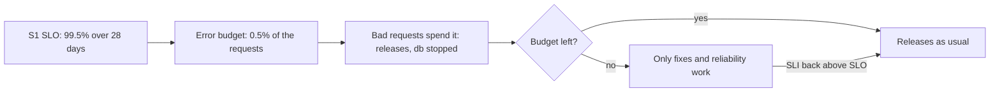

## Before you start

- [[backend.l4.service-level-objectives]] — S1's SLO is 99.5% of order requests without a `5xx` over a rolling 28 days; this lesson turns the 0.5% it leaves into a rule for releases.
- [[devops.l2.cutting-a-release]] — a release is a tag that promotes an image to a version; here the question is when the next one may go out.
- [[devops.l3.rollback-by-revert]] — a revert is the way back from a bad deploy; this lesson asks what the failures before that revert cost.

## The situation

The product owner wants the next api release out this week, with a feature a shop asked for. Earlier in the same 28 days, a release answered order requests with `500` until it was reverted, and `db` stopped once for a few minutes. S1 is now close to 99.5%. One teammate says to ship, because the failures are behind you. Another says nothing new ships until the api is stable. Each time something breaks, the same argument starts again, and nobody can say who decides.

What rule says whether the next feature release goes out, and who agreed to it?

## Core concepts

- **error budget** — the share of events an SLO allows to be bad over its window, 1 minus the target: with 99.5% and 200,000 order requests in 28 days, 1,000 of them may fail.
- budget left — the error budget minus the bad events already counted in the window; it can fall below zero.
- spending — every bad event in the window lowers the budget left, whatever caused it: a release, a stopped `db`, a dependency that failed.
- budget policy — what the team does while budget remains and once it is spent, written in `slo.md` and agreed with the product owner in advance.

## How it works



In the situation above, S1's SLO already leaves 0.5% of the window's order requests to fail. The error budget names that share as a count. With the assumed 200,000 order requests in 28 days, it is 1,000 requests.

The third box, "Bad requests spend it", is what spends it. Every order request answered with a `5xx` lowers the budget left, and the SLI does not record why. The `500` answers from the bad release count the same as those from the stopped `db`. Reverting the release stops the spending, but the failures already counted stay in the window.

The decision box is where the argument from the situation ends. While budget remains, the team may spend it on changes that carry risk, such as a release. A team that never spends any is likely holding back changes it could have shipped.

Once the budget is spent, the policy in `slo.md` applies: feature releases of that service stop. Only fixes and work that makes the service more reliable ship, until the SLI over the window is back above the SLO. With a rolling window, that happens as new good requests arrive and old failures fall out of the last 28 days.

The rule was agreed by the team and the product owner before anything went wrong. When customers are already affected, nobody has to argue features against reliability; both sides read the same number and the same rule.

## In the Đơn Hàng system

The error budget and the policy in `slo.md`:

```markdown file=docs/design/slo.md tag=stage-4 lines=79-94
### Error budget

Error budget là phần sự kiện được phép xấu trong cửa sổ: 1 − SLO, tính theo số
request. Ví dụ giả định: 200.000 request đặt đơn trong 28 ngày, SLO 99,5%,
budget là 0,5% của 200.000, tức 1.000 request lỗi. Quy ra thời gian, 0,5% của
28 ngày là khoảng 3 giờ 22 phút nếu mọi request trong thời gian đó đều lỗi.

### Chính sách

Nhóm và product owner thống nhất trước, không bàn lại trong lúc có sự cố:

- Còn budget: phát hành như thường. Một lần phát hành gây lỗi tiêu budget
  như mọi sự cố khác.
- Hết budget của một service: dừng phát hành tính năng của service đó; chỉ
  phát hành sửa lỗi và việc tăng độ tin cậy, cho tới khi SLI trong cửa sổ trở
  lại trên SLO.
```

The first section defines the budget as 1 minus the SLO, counted in requests, and works the example: 0.5% of an assumed 200,000 order requests is 1,000. The 200,000 is an assumption, not a measured number. The policy opens with who agreed it, the team and the product owner, and that it is not argued again while something is failing. Its first rule says a release that causes failures spends budget like any other failure. Its second says what stops once the budget of a service is spent, and what may still ship.

`slo-report.sh` computes S1's budget left:

```bash file=scripts/backend/slo-report.sh tag=stage-4 lines=43-49
# lesson: backend.l4.error-budget
# S1's budget over the window is (1 - 0.995) of its requests; what is left
# is that budget minus the requests already answered 5xx.
s1_budget_left() {
  promql "(1 - 0.995) * round(sum(increase(http_requests_received_total{$orders}[1h])))
          - (round(sum(increase(http_requests_received_total{$orders,code=~\"5..\"}[1h]))) or vector(0))"
}
```

```text output=true
== a few orders and product reads
  POST /api/v1/orders -> 201
  POST /api/v1/orders -> 201
== the SLIs over the last hour
  S1 orders without 5xx              good ...
  S2 orders within 0.512 s           good ...
  S3 product reads without 5xx       good ...
  S4 refund requests within 2.048 s  good ...
  S1 budget left: ... requests
== db stopped for a few seconds while orders arrive
  POST /api/v1/orders -> 500
  POST /api/v1/orders -> 500
  POST /api/v1/orders -> 500
  POST /api/v1/orders -> 500
  POST /api/v1/orders -> 201
  POST /api/v1/orders -> 201
== the SLIs over the last hour, again
  S1 orders without 5xx              good ...
  S2 orders within 0.512 s           good ...
  S3 product reads without 5xx       good ...
  S4 refund requests within 2.048 s  good ...
  S1 budget left: ... requests
S1 budget left is lower than before: yes
```

`s1_budget_left` is the definition as one query: 0.005 times the order requests of the last hour, minus those answered `5xx`. `$orders` is a variable set earlier in the script to the labels that pick out order requests. The script uses the last hour instead of 28 days because the lab holds far less than 28 days of requests; the formula is the same. The `or vector(0)` makes the second part 0 when no request failed, so the subtraction still returns a number.

The rest of the script, outside the excerpt, stops `db`, places four orders, starts `db` again, places two more, and compares the two results. The captured output masks the numbers, because they change on every run; only the last line is stable. In the lab hour, the budget is 0.5% of a few requests, less than one request unless at least 200 order requests arrived. Unless other scripts placed hundreds of orders in the same hour, four `500` answers are more than the whole budget, and the second number is below zero.

## Trade-offs

| Choice | What it gives | What it costs | When it fits |
|---|---|---|---|
| No written policy; decide each time | freedom to judge every case | the argument starts again whenever something fails, usually while customers are affected | a team with no SLO yet |
| Policy agreed in advance, as in `slo.md` | one rule both sides read from the same number | a feature can wait even when the date matters to a shop | a team with an SLO it measures |
| Stop every release once the budget is spent | the fewest changes while the service is weak | fixes wait too, so the service stays weak longer | rarely; `slo.md` lets fixes ship |
| Count only failures the team caused | no release is blamed for a dependency's failure | customers felt every failure anyway, and each one starts an argument about whose fault it was | not in `slo.md`, which counts every `5xx` |

The table is about who decides and when, not about the number. A policy only works if the measured SLI is trusted; `slo.md` states what it does not count, such as requests that fail at Caddy or the Gateway before they reach the API.

## What would you choose if…

…the budget is spent, and the product owner asks for the shop's feature anyway? Hold the feature. The policy exists for this moment. If the date matters more than the rule allows, change the policy afterwards, calmly, with the product owner, rather than making an exception now.

…the budget is spent by `db` stopping, not by any change of the team? The policy still applies: S1 counts what customers felt, not whose fault it was. The reliability work is then about how the api behaves when PostgreSQL, the `db` service, is gone.

…half the window has passed and almost no budget is spent? The team can afford more risk, such as the release it has been holding back. If it never spends any, the team is being more careful than its SLO asks, and the budget is room it is not using.

## Seniors often assume…

- **"An error budget means some errors are allowed, so we do not have to fix them."** → Actually the budget allows a share of failed requests over the window; it does not allow any cause of failures to stay unfixed. Every failure still spends it, and a spent budget stops feature releases until the cause is fixed. You notice this when the same `500` repeats every day and the budget is gone before the window is half over.
- **"Using up part of the error budget means the team failed."** → Actually the budget is there to be spent on changes that carry risk; missing the SLO is the problem, spending part of the budget below it is not. A team afraid to spend any tends to ship less often, in larger batches that carry more risk each. You notice this when releases are held back for weeks while the budget left stays near its full size.
- **"Only outages count against the budget; a bad release that is rolled back quickly does not."** → Actually S1 counts every `5xx` in the window, whatever caused it: an outage, such as `db` stopping, and a bad release both count; a revert stops the spending but does not give any back. You notice this when the report after a quick revert still shows less budget left than before the release.

## Try it (3 minutes)

1. With the lab started with `COMPOSE_PROFILES=monitoring`, run `scripts/backend/slo-report.sh` on your machine.
2. Compare the two `S1 budget left` lines, and count the `500` answers between them.
3. Work out S1's error budget for 200,000 order requests, and how many failures like those four it would take to spend it.

Expected result: the last line reads `S1 budget left is lower than before: yes`, four orders got `500` while `db` was stopped, and the budget for 200,000 requests is 1,000.

<details><summary>Suggested answer</summary>

0.5% of 200,000 is 1,000 requests, so it would take 250 stops like the one in the script, each costing four failed orders. In the lab the budget is much smaller, because the last hour holds only a few order requests, so four failures spend all of it and more. That is why the lab number drops below zero while the 28-day budget would barely move.

</details>

## Connections

- [[backend.l4.service-level-objectives]] — prerequisite: the target whose 0.5% becomes the budget here.
- [[backend.l4.load-testing]] — the next step: finding the load at which the api starts spending budget.
- [[devops.l3.rollback-by-revert]] — the way to stop spending after a bad release; it ends the failures but does not return the budget.
- [[backend.l3.graceful-degradation]] — one kind of reliability work a spent budget makes room for: deciding what still works when a dependency is gone.
- [[management.l3.technical-debt-register]] — the same trade between features and repair, made with a list instead of a measured number.

## Five-line summary

1. The error budget is 1 minus the SLO over its window, and the agreed policy uses it to decide when features wait.
2. With 99.5% and 200,000 order requests in 28 days, 1,000 may fail; every `5xx` spends it, whatever the cause.
3. While budget remains, releases go out as usual; a release that causes failures spends budget like any other failure.
4. Once it is spent, only fixes and reliability work ship until the SLI is back above the SLO.
5. The team and the product owner agreed the rule in advance, so it is not argued again while customers are affected.
