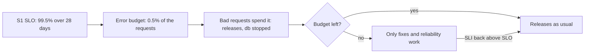

## Bạn cần biết trước

- [[backend.l4.service-level-objectives]] — SLO của S1 là 99,5% request đặt đơn không bị trả `5xx` trong 28 ngày trượt. Bài này biến 0,5% còn lại thành một quy tắc cho việc phát hành.
- [[devops.l2.cutting-a-release]] — một lần phát hành là một tag đưa một image lên thành một phiên bản. Ở đây câu hỏi là khi nào bản tiếp theo được ra.
- [[devops.l3.rollback-by-revert]] — revert là đường quay lại sau một lần deploy hỏng. Bài này hỏi những lần lỗi trước khi revert đã tốn bao nhiêu.

## Tình huống

Product owner muốn bản phát hành api tiếp theo ra trong tuần này, kèm một tính năng mà một cửa hàng đã xin. Trước đó, trong cùng 28 ngày, một bản phát hành đã trả `500` cho request đặt đơn cho tới khi bị revert, và `db` từng dừng vài phút. S1 giờ đã sát 99,5%. Một đồng đội bảo cứ phát hành, vì lỗi đã qua rồi. Người khác bảo không phát hành gì mới cho tới khi api ổn định. Lần nào có gì hỏng, cuộc tranh cãi đó lại bắt đầu, và không ai nói được ai là người quyết.

Quy tắc nào cho biết bản phát hành tính năng tiếp theo có được ra hay không, và ai đã đồng ý với quy tắc đó?

## Khái niệm cốt lõi

- **error budget** (phần sự kiện được phép hỏng theo SLO trong một khoảng thời gian, bằng 1 trừ mục tiêu) — với 99,5% và 200.000 request đặt đơn trong 28 ngày, 1.000 request trong số đó được phép lỗi.
- budget còn lại — error budget trừ đi số sự kiện xấu đã đếm được trong cửa sổ. Con số này có thể xuống dưới 0.
- tiêu budget — mỗi sự kiện xấu trong cửa sổ làm budget còn lại giảm xuống, bất kể nguyên nhân là gì: một lần phát hành, `db` dừng, hay một dependency bị lỗi.
- chính sách budget — điều team làm khi còn budget và khi đã hết, viết trong `slo.md` và thống nhất trước với product owner.

## Cơ chế hoạt động



Trong tình huống trên, SLO của S1 vốn đã chừa 0,5% request đặt đơn của cửa sổ được lỗi. Error budget gọi phần đó bằng một con số đếm được. Với giả định 200.000 request đặt đơn trong 28 ngày, đó là 1.000 request.

Ô thứ ba, "Bad requests spend it", là chỗ budget bị tiêu. Mỗi request đặt đơn bị trả `5xx` làm budget còn lại giảm, và SLI không ghi lại lý do. Các `500` từ bản phát hành hỏng được đếm y như các `500` từ lúc `db` dừng. Revert bản phát hành thì ngừng tiêu, nhưng những lần lỗi đã đếm vẫn nằm lại trong cửa sổ.

Ô quyết định là nơi cuộc tranh cãi trong tình huống kết thúc. Khi còn budget, team được tiêu nó vào các thay đổi có rủi ro, chẳng hạn một lần phát hành. Một team không bao giờ tiêu chút nào có lẽ đang giữ lại những thay đổi đáng lẽ đã ra được.

Khi budget đã hết, chính sách trong `slo.md` có hiệu lực: các bản phát hành tính năng của service đó dừng lại. Chỉ bản sửa lỗi và các thay đổi giúp service đáng tin cậy hơn được ra, cho tới khi SLI trong cửa sổ trở lại trên SLO. Với cửa sổ trượt, điều đó xảy ra khi request tốt mới đến và các lần lỗi cũ rơi ra khỏi 28 ngày gần nhất.

Team và product owner đã thống nhất quy tắc này trước khi có gì hỏng. Khi khách hàng đang bị ảnh hưởng, không ai phải cãi nhau chuyện tính năng hay độ tin cậy nữa. Cả hai bên đọc cùng một con số và cùng một quy tắc.

## Trong hệ thống Đơn Hàng

Error budget và chính sách trong `slo.md`:

```markdown file=docs/design/slo.md tag=stage-4 lines=79-94
### Error budget

Error budget là phần sự kiện được phép xấu trong cửa sổ: 1 − SLO, tính theo số
request. Ví dụ giả định: 200.000 request đặt đơn trong 28 ngày, SLO 99,5%,
budget là 0,5% của 200.000, tức 1.000 request lỗi. Quy ra thời gian, 0,5% của
28 ngày là khoảng 3 giờ 22 phút nếu mọi request trong thời gian đó đều lỗi.

### Chính sách

Nhóm và product owner thống nhất trước, không bàn lại trong lúc có sự cố:

- Còn budget: phát hành như thường. Một lần phát hành gây lỗi tiêu budget
  như mọi sự cố khác.
- Hết budget của một service: dừng phát hành tính năng của service đó; chỉ
  phát hành sửa lỗi và việc tăng độ tin cậy, cho tới khi SLI trong cửa sổ trở
  lại trên SLO.
```

Mục đầu định nghĩa budget là 1 trừ SLO, tính theo số request, và tính luôn ví dụ: 0,5% của 200.000 request đặt đơn giả định là 1.000. Con số 200.000 là giả định, không phải số đo được. Mục chính sách mở đầu bằng việc ai đã đồng ý, team và product owner, và rằng nó không được bàn lại trong lúc có gì đang hỏng. Quy tắc thứ nhất nói một lần phát hành gây lỗi tiêu budget như mọi lần lỗi khác. Quy tắc thứ hai nói cái gì dừng lại khi budget của một service đã hết, và cái gì vẫn được ra.

`slo-report.sh` tính budget còn lại của S1:

```bash file=scripts/backend/slo-report.sh tag=stage-4 lines=43-49
# lesson: backend.l4.error-budget
# S1's budget over the window is (1 - 0.995) of its requests; what is left
# is that budget minus the requests already answered 5xx.
s1_budget_left() {
  promql "(1 - 0.995) * round(sum(increase(http_requests_received_total{$orders}[1h])))
          - (round(sum(increase(http_requests_received_total{$orders,code=~\"5..\"}[1h]))) or vector(0))"
}
```

```text output=true
== a few orders and product reads
  POST /api/v1/orders -> 201
  POST /api/v1/orders -> 201
== the SLIs over the last hour
  S1 orders without 5xx              good ...
  S2 orders within 0.512 s           good ...
  S3 product reads without 5xx       good ...
  S4 refund requests within 2.048 s  good ...
  S1 budget left: ... requests
== db stopped for a few seconds while orders arrive
  POST /api/v1/orders -> 500
  POST /api/v1/orders -> 500
  POST /api/v1/orders -> 500
  POST /api/v1/orders -> 500
  POST /api/v1/orders -> 201
  POST /api/v1/orders -> 201
== the SLIs over the last hour, again
  S1 orders without 5xx              good ...
  S2 orders within 0.512 s           good ...
  S3 product reads without 5xx       good ...
  S4 refund requests within 2.048 s  good ...
  S1 budget left: ... requests
S1 budget left is lower than before: yes
```

`s1_budget_left` là định nghĩa viết thành một câu truy vấn: 0,005 nhân với số request đặt đơn trong giờ vừa qua, trừ đi số request bị trả `5xx`. `$orders` là biến được gán ở phía trên script, chứa các label dùng để lọc ra request đặt đơn. Script dùng một giờ gần nhất thay cho 28 ngày vì lab chứa ít hơn 28 ngày request rất nhiều. Công thức thì vẫn vậy. Phần `or vector(0)` làm vế thứ hai bằng 0 khi không request nào lỗi, nhờ đó phép trừ vẫn trả về một con số.

Phần còn lại của script, nằm ngoài đoạn trích, dừng `db`, đặt bốn đơn, bật lại `db`, đặt thêm hai đơn, rồi so sánh hai kết quả. Output được ghi lại che các con số đi, vì chúng đổi sau mỗi lần chạy. Chỉ dòng cuối là ổn định. Trong giờ của lab, budget là 0,5% của vài request, chưa tới một request trừ khi có ít nhất 200 request đặt đơn đã đến. Trừ khi các script khác đã đặt hàng trăm đơn trong cùng giờ đó, bốn câu trả lời `500` nhiều hơn cả budget, và con số thứ hai xuống dưới 0.

## Đánh đổi

| Lựa chọn | Nó cho bạn | Cái giá | Khi nào hợp |
|---|---|---|---|
| Không có chính sách viết ra, mỗi lần tự quyết | tự do cân nhắc từng trường hợp | cuộc tranh cãi lại bắt đầu mỗi khi có gì hỏng, thường đúng lúc khách hàng đang bị ảnh hưởng | team chưa có SLO |
| Chính sách thống nhất trước, như trong `slo.md` | một quy tắc mà cả hai bên đọc từ cùng một con số | một tính năng có thể phải chờ dù ngày ra mắt quan trọng với một cửa hàng | team có SLO và đang đo nó |
| Dừng mọi lần phát hành khi hết budget | ít thay đổi nhất trong lúc service đang yếu | bản sửa lỗi cũng phải chờ, nên service yếu lâu hơn | hiếm khi; `slo.md` vẫn cho bản sửa lỗi ra |
| Chỉ đếm lỗi do team gây ra | không lần phát hành nào bị đổ lỗi cho sự cố của một dependency | khách hàng vẫn chịu mọi lần lỗi, và lần nào cũng mở ra cuộc cãi nhau xem lỗi của ai | không phải trong `slo.md`, nơi đếm mọi `5xx` |

Bảng này nói về ai quyết và khi nào, không nói về con số. Chính sách chỉ có tác dụng khi SLI đo được là đáng tin. `slo.md` ghi rõ những gì nó không đếm, như các request lỗi ở Caddy hay Gateway trước khi tới được API.

## Bạn sẽ chọn gì nếu…

…budget đã hết, và product owner vẫn đòi tính năng của cửa hàng? Giữ tính năng lại. Chính sách tồn tại chính là cho lúc này. Nếu ngày ra mắt quan trọng hơn mức quy tắc cho phép, hãy sửa chính sách sau đó, bình tĩnh, cùng product owner, thay vì làm ngoại lệ ngay bây giờ.

…budget bị tiêu hết vì `db` dừng, không phải vì thay đổi nào của team? Chính sách vẫn áp dụng: S1 đếm những gì khách hàng chịu, không đếm lỗi của ai. Khi đó, việc tăng độ tin cậy là về cách api hành xử khi PostgreSQL, tức service `db`, không còn.

…đã qua nửa cửa sổ mà gần như chưa tiêu chút budget nào? Team có thể chấp nhận rủi ro nhiều hơn, chẳng hạn bản phát hành đang bị giữ lại. Nếu không bao giờ tiêu chút nào, team đang cẩn thận hơn mức SLO đòi hỏi, và budget là khoảng trống mà team bỏ không.

## Senior hay nhầm rằng…

- **"Error budget nghĩa là được phép có lỗi, nên không cần sửa chúng."** → Thực ra budget cho phép một phần request lỗi trong cửa sổ, chứ không cho phép bất kỳ nguyên nhân gây lỗi nào được để nguyên không sửa. Mỗi lần lỗi vẫn tiêu budget, và budget hết thì các bản phát hành tính năng dừng cho tới khi nguyên nhân được sửa. Bạn sẽ nhận ra khi cùng một `500` lặp lại mỗi ngày và budget hết trước khi cửa sổ qua được một nửa.
- **"Tiêu mất một phần error budget nghĩa là team đã thất bại."** → Thực ra budget có đó để được tiêu vào các thay đổi có rủi ro. Lỡ SLO mới là vấn đề, tiêu một phần budget mà vẫn chưa chạm tới đó thì không. Một team sợ tiêu budget thường phát hành thưa hơn, theo từng đợt lớn hơn, mỗi đợt mang nhiều rủi ro hơn. Bạn sẽ nhận ra khi các bản phát hành bị giữ lại hàng tuần trong lúc budget còn lại vẫn gần như nguyên vẹn.
- **"Chỉ sự cố ngừng dịch vụ mới bị tính vào budget, còn bản phát hành hỏng mà được revert nhanh thì không."** → Thực ra S1 đếm mọi `5xx` trong cửa sổ, bất kể nguyên nhân: một lần ngừng dịch vụ như `db` dừng, hay một bản phát hành hỏng, đều được đếm. Revert ngừng việc tiêu nhưng không trả lại chút budget nào. Bạn sẽ nhận ra khi báo cáo sau một lần revert nhanh vẫn cho thấy budget còn lại ít hơn trước lần phát hành.

## Thử ngay (3 phút)

1. Với lab đã khởi động bằng `COMPOSE_PROFILES=monitoring`, chạy `scripts/backend/slo-report.sh` trên máy bạn.
2. So sánh hai dòng `S1 budget left`, và đếm số câu trả lời `500` nằm giữa chúng.
3. Tính error budget của S1 cho 200.000 request đặt đơn, và cần bao nhiêu lần lỗi giống bốn lần đó để tiêu hết nó.

Kết quả mong đợi: dòng cuối là `S1 budget left is lower than before: yes`, bốn đơn nhận `500` trong lúc `db` dừng, và budget cho 200.000 request là 1.000.

<details><summary>Gợi ý đáp án</summary>

0,5% của 200.000 là 1.000 request, nên phải có 250 lần dừng giống trong script, mỗi lần tốn bốn đơn lỗi. Trong lab, budget nhỏ hơn nhiều, vì một giờ gần nhất chỉ có vài request đặt đơn, nên bốn lần lỗi tiêu hết budget và còn vượt quá. Đó là lý do con số của lab xuống dưới 0, trong khi budget 28 ngày gần như không nhúc nhích.

</details>

## Liên hệ

- [[backend.l4.service-level-objectives]] — bài cần trước: mục tiêu mà 0,5% của nó trở thành budget ở bài này.
- [[backend.l4.load-testing]] — bước tiếp theo: tìm mức tải mà từ đó api bắt đầu tiêu budget.
- [[devops.l3.rollback-by-revert]] — cách ngừng tiêu sau một bản phát hành hỏng. Nó chấm dứt các lần lỗi nhưng không trả lại budget.
- [[backend.l3.graceful-degradation]] — một kiểu việc tăng độ tin cậy mà budget đã hết dành chỗ cho: quyết định cái gì vẫn chạy khi một dependency không còn.
- [[management.l3.technical-debt-register]] — cùng kiểu đánh đổi giữa tính năng và sửa chữa, nhưng dựa vào một danh sách thay vì một con số đo được.

## Tóm tắt 5 dòng

1. Error budget là 1 trừ SLO trong cửa sổ của nó, và chính sách đã thống nhất dùng nó để quyết khi nào tính năng phải chờ.
2. Với 99,5% và 200.000 request đặt đơn trong 28 ngày, 1.000 request được phép lỗi. Mọi `5xx` đều tiêu budget, bất kể nguyên nhân.
3. Khi còn budget, phát hành như thường. Một bản phát hành gây lỗi tiêu budget như mọi lần lỗi khác.
4. Khi budget đã hết, chỉ bản sửa lỗi và việc tăng độ tin cậy được ra, cho tới khi SLI trở lại trên SLO.
5. Team và product owner đã thống nhất quy tắc từ trước, nên nó không bị bàn lại trong lúc khách hàng đang bị ảnh hưởng.
