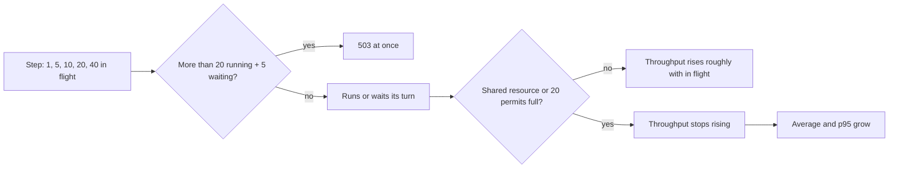

## Before you start

- [[backend.l4.error-budget]] — every `5xx` spends budget; here you see the load at which product reads start getting `503`.
- [[backend.l3.bulkhead]] — the `catalog-reads` limit lets 20 product reads run and 5 wait; this lesson measures what it does under rising load.
- [[backend.l3.slow-dependencies]] — requests that arrive faster than they finish fill a shared limit; here that waiting is measured step by step.
- [[devops.l2.histograms-and-percentiles]] — p95 shows how slow the slower requests are; each step of the test prints it next to the average.

## The situation

Shops will soon list their products through Đơn Hàng, and the product owner asks how many product list reads per second the api can answer. One teammate says to send as many reads as possible and see when it breaks. You remember `bulkhead.sh`: 100 reads at once got some `503` answers, and the api did not crash. Another teammate reasons that ten reads at once must give ten times the answers of one. Nobody has measured either idea, and the number will go into a plan.

How do you find how many reads per second the api can answer, and what happens to the reads beyond that?

## Core concepts

- **load test** — a test that sends a controlled load that rises in steps and records, at each step, the throughput, the response times and the errors.
- **throughput** — the number of answers the system completes per second; in this lesson, mostly product list reads answered `200` per second.
- in flight — the requests already sent and not yet answered at one moment; each step of the test keeps this number at most N and close to N for most of the step.
- **Little's law** — the requests in flight equal the throughput times the average time each one takes, measured over the same period.
- ceiling — the highest throughput the system reaches; past it, a shared resource or a limit is full and extra requests wait.

## How it works



In the situation above, the load test is a series of steps. Each step keeps up to a fixed number of product list reads in flight and records what comes back.

The `catalog-reads` limit is a deliberate ceiling inside the api, and it checks every read at every step. It lets 20 product reads run and 5 wait; a read beyond those 25 is refused with `503` at once. So a step with 40 in flight gets some `503` answers, and the steps up to 20 get none.

Little's law ties the three numbers of a step together. With 10 reads in flight, each taking 20 ms on average, the api answers 10 / 0.02 = 500 reads per second. The arithmetic only illustrates the formula; it is not a measured number of Đơn Hàng.

While nothing shared is full, the average time changes little, so throughput rises roughly with the number in flight, as the second teammate expected.

Once a shared resource is full, or a limit such as `catalog-reads` caps how many run at once, throughput stops rising; by Little's law, more in flight with the same throughput means a longer average time. In the lab, the checks show throughput at 40 grew far less than the load while p95 rose. Each list read queries PostgreSQL, whose connections orders also use; the script does not show whether they fill before the 20 permits do.

The result is the shape of a curve, not one number: the point after which more load only adds waiting.

## In the Đơn Hàng system

`load-steps.sh` runs the steps from the lab container, the Linux container where every script in `scripts/` runs:

```bash file=scripts/backend/load-steps.sh tag=stage-4 lines=15-34
# lesson: backend.l4.load-testing
# Each step sends the same number of reads, keeping N of them in flight at
# all times (curl starts a new one as soon as one ends). For each answer curl
# writes its status and its time; the step's wall clock gives the rate.
step() {
  local n=$1 started ended
  local -a requests=()
  for _ in $(seq "$per_step"); do requests+=(-o /dev/null "$url"); done
  started=$(date +%s.%N)
  curl -sS --parallel --parallel-immediate --parallel-max "$n" -w '%{http_code} %{time_total}\n' "${requests[@]}" > "$tmp/$n"
  ended=$(date +%s.%N)
  # Little's law: requests in flight = answers per second x average time.
  sort -k2 -n "$tmp/$n" | awk -v n="$n" -v wall="$(echo "$ended - $started" | bc -l)" '
    { time[NR] = $2; sum += $2; if ($1 == 200) ok++; else if ($1 == 503) busy++ }
    END {
      avg = sum / NR; p95 = time[int(NR * 0.95 + 0.5)]
      printf "%3d in flight: %6.1f answered 200/s, average %5.1f ms, p95 %5.1f ms, 503: %d, answers/s x average = %.1f\n",
             n, ok / wall, avg * 1000, p95 * 1000, busy, NR / wall * avg
    }'
}
```

```text output=true
...
answers/s x average is close to the number in flight at each step: yes
p95 at 40 is higher than at 1: yes
200/s at 40 is less than 20 times 200/s at 1: yes
no 503 up to 20 in flight: yes
some 503 at 40 in flight: yes
```

Each step sends the same 400 reads of `GET /api/v1/products?limit=20`, set earlier in the script as `per_step` and `url`. curl, the program the script uses to send the reads, keeps up to `n` of them in flight, as the comment says. `awk`, a small program, then reads each line curl wrote: `$1` is the status, `$2` the time and `NR` the number of lines, that is, of answers. The lines are sorted by time first, so the one 95% of the way down is the p95. Rates divide by the time the whole step took, from its start to its end.

The last column multiplies answers of every status per second by the average time: Little's law, checked against `n`. A refused read counts too, because it was in flight until its `503` came back.

The numbers in the captured output are masked, because they change on every run. The five stable lines are the checks at the end of the script. The first allows each step's answers/s x average to be within 30% of the number in flight, which also confirms the average in flight stayed close to `n`. The third compares 40 in flight with 20 times the rate at 1, so it passes only if throughput grew far less than the load.

The limit the last two lines test:

```csharp file=DonHang.Api/Program.cs tag=stage-4 lines=143-148
// lesson: backend.l3.bulkhead
// "catalog-reads": at most PermitLimit product reads run at once and QueueLimit
// more wait for a turn; any read beyond that is refused at once. With Redis
// down every product read needs a database connection, and orders need them too.
var catalogReads = new ConcurrencyLimiterOptions { PermitLimit = 20, QueueLimit = 5 };
builder.Configuration.GetSection("RateLimiting:CatalogReads").Bind(catalogReads);
```

`PermitLimit = 20` and `QueueLimit = 5` are the 20 running and 5 waiting. Configuration may replace them, but the lab's `docker-compose.yml` does not. The product list endpoint in `ProductsController.cs` carries `[EnableRateLimiting("catalog-reads")]`, so every read the script sends passes this limit. The limit is counted inside one api process, and the lab runs one, so 20 running and 5 waiting is the limit for the whole lab; each added process would bring its own 20 and 5.

## Trade-offs

| Choice | What it gives | What it costs | When it fits |
|---|---|---|---|
| Send as many requests as possible at once | a quick sign that something refuses or fails | no curve: you cannot see where waiting began, and errors hide the ceiling | a quick check that the api keeps running through a burst |
| Steps with a fixed number in flight, as `load-steps.sh` | throughput, average, p95 and errors per step; the ceiling shows where throughput stops rising | takes longer, and the test client itself needs resources | finding where more load only adds waiting |
| Run in the lab, every service on one machine | cheap, repeatable, anyone can run it | the test client and the api share one machine, so the numbers are not production's | learning the shape of the curve, checking a limit works |
| Run in an environment shaped like production | numbers to decide how much capacity the system needs | an environment to build and pay for, and test data that looks like real data | deciding capacity before a known peak |

The lab gives the shape, not the size. Its curl, Caddy (the reverse proxy in front of the api), api and PostgreSQL all run on the same machine, so the ceiling it shows belongs to that machine.

## What would you choose if…

…the product owner wants a number for the plan by tomorrow? Give the lab's curve with its limits stated: where waiting began, and that every service shared one machine. Deciding capacity from it is the next lesson's question, and a measured number from a production-shaped environment would replace it.

…a teammate wants to raise `PermitLimit` so the step with 40 in flight gets no `503`? Look at where throughput stops rising first. If throughput already stopped rising before 20, more permits only let more reads wait inside the api, where they hold the resources orders need too. In that case the limit stays as it is in `Program.cs`.

…someone suggests running the test against the live api at night? `slo.md`, the file where Đơn Hàng writes its SLIs, has one for product reads that counts the `503` of `catalog-reads` as bad. So every `503` the test causes spends error budget; agree on it as you would agree on a risky release.

## Seniors often assume…

- **"Twice as many users at once means twice as many answers per second, until the server crashes."** → Actually throughput rises with load only until a shared resource or a limit is full; after that it stops rising while each request waits longer. In Đơn Hàng the api keeps running because `catalog-reads` refuses the excess with `503`. You notice this when the `200/s` at 40 in flight is not twice the value at 20, since only 20 reads run at once at either step, while p95 keeps climbing.
- **"A load test means sending as many requests as possible and seeing when it breaks."** → Actually a load test raises a controlled load in steps and records throughput, times and errors at each one, so you can see where waiting begins. One burst mixes refusals, waiting and failures into one result. You notice this when a burst ends with some `503` answers and nobody can say at what load they started.
- **"If the lab handles a load, production will handle it too."** → Actually the lab runs every service on one machine, so its numbers show the shape of the curve, not production's ceiling. Production has other machines and other data. You notice this when the same steps give a different ceiling on another laptop.

## Try it (3 minutes)

1. With the lab running, run `scripts/backend/load-steps.sh` on your machine; it moves itself into the lab container.
2. For each step, compare the last number on the line with the number in flight, and compare the `200/s` of the 20 and 40 steps.

Expected result: the five lines at the end read `yes`. Each step's last number is within 30% of 1, 5, 10, 20 or 40, and the 40 step shows a `503` count above zero.

<details><summary>Suggested answer</summary>

Little's law predicts the last column: answers per second times the average time comes out near the number in flight. The `200/s` at 40 is not twice the value at 20: `catalog-reads` lets only 20 reads run at once at either step, so the extra reads waited in its queue or were refused with `503`. Your exact numbers differ from anyone else's; the shape is what repeats.

</details>

## Connections

- [[backend.l4.capacity-planning]] — the next step: comparing an expected peak with a measured ceiling like this one.
- [[backend.l3.bulkhead]] — prerequisite: the `catalog-reads` limit whose `503` answers appear at 40 in flight.
- [[backend.l3.rate-limiting]] — the other kind of limit: a fixed window refuses with `429`, while this concurrency limit refuses with `503`.
- [[backend.l4.error-budget]] — why a load test against the live api is not free: its `503` answers spend budget.
- [[k8s.l1.requests-and-limits]] — the resources a Pod gets in a cluster, one reason a lab ceiling does not carry over.
- [[design.l4.trade-off-points]] — the `catalog-reads` limit is one: it trades waiting for refusals.

## Five-line summary

1. A load test raises load in steps to find the point after which more load only adds waiting.
2. Each step of `load-steps.sh` keeps up to 1, 5, 10, 20 or 40 reads in flight and prints throughput, average, p95 and `503` count.
3. Little's law: requests in flight equal throughput times average time, and the script checks it at every step.
4. Once a shared resource or a limit is full, throughput stops rising and p95 climbs; the `catalog-reads` limit refuses reads beyond 25 with `503`.
5. The lab shows the shape of the curve, not production's ceiling; deciding capacity needs an environment shaped like production.
