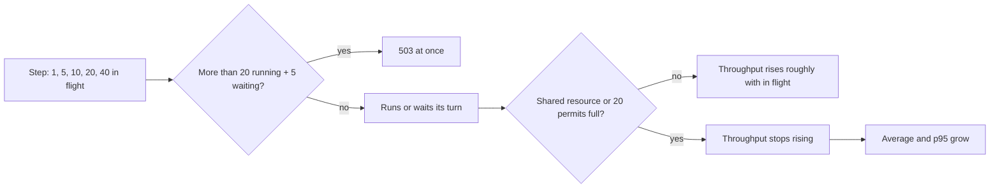

## Bạn cần biết trước

- [[backend.l4.error-budget]] — mọi `5xx` đều tiêu budget. Ở đây bạn thấy từ mức tải nào thì các lượt đọc sản phẩm bắt đầu nhận `503`.
- [[backend.l3.bulkhead]] — giới hạn `catalog-reads` cho 20 lượt đọc sản phẩm chạy và 5 lượt chờ. Bài này đo xem nó làm gì khi tải tăng dần.
- [[backend.l3.slow-dependencies]] — request đến nhanh hơn tốc độ chúng xong sẽ lấp đầy một giới hạn dùng chung. Ở đây phần chờ đó được đo qua từng bước.
- [[devops.l2.histograms-and-percentiles]] — p95 cho thấy các request chậm hơn chậm tới mức nào. Mỗi bước của bài kiểm tra in nó cạnh giá trị trung bình.

## Tình huống

Các cửa hàng sắp đăng sản phẩm qua Đơn Hàng, và product owner hỏi api trả lời được bao nhiêu lượt đọc danh sách sản phẩm mỗi giây. Một đồng đội bảo cứ gửi càng nhiều lượt đọc càng tốt rồi xem lúc nào nó sập. Bạn nhớ tới `bulkhead.sh`: 100 lượt đọc cùng lúc nhận về vài câu trả lời `503`, và api không sập. Một đồng đội khác lập luận rằng mười lượt đọc cùng lúc thì phải cho gấp mười lần số câu trả lời so với một lượt. Chưa ai đo cả hai ý đó, trong khi con số sẽ được đưa vào một bản kế hoạch.

Làm sao tìm ra api trả lời được bao nhiêu lượt đọc mỗi giây, và chuyện gì xảy ra với các lượt đọc vượt quá mức đó?

## Khái niệm cốt lõi

- **kiểm thử tải** (load test) — bài kiểm tra gửi một lượng tải có kiểm soát, tăng theo từng bước, và ở mỗi bước ghi lại thông lượng, thời gian phản hồi và lỗi.
- **thông lượng** (throughput) — số câu trả lời hệ thống hoàn tất mỗi giây. Trong bài này, chủ yếu là số lượt đọc danh sách sản phẩm được trả `200` mỗi giây.
- đang bay (in flight) — các request đã gửi đi mà chưa nhận được câu trả lời tại một thời điểm. Mỗi bước của bài kiểm tra giữ con số này không quá N và sát N trong phần lớn thời gian của bước.
- **định luật Little** (Little's law) — số request đang bay bằng thông lượng nhân thời gian trung bình của mỗi request, đo trên cùng một khoảng thời gian.
- trần — thông lượng cao nhất hệ thống đạt được. Vượt qua nó, một tài nguyên dùng chung hoặc một giới hạn đã đầy, và request thêm vào phải chờ.

## Cơ chế hoạt động



Trong tình huống trên, kiểm thử tải là một chuỗi các bước. Mỗi bước giữ tối đa một số lượt đọc danh sách sản phẩm cố định đang bay, rồi ghi lại những gì nhận về.

Giới hạn `catalog-reads` là một cái trần được đặt có chủ ý bên trong api, và nó kiểm tra mọi lượt đọc ở mọi bước. Nó cho 20 lượt đọc sản phẩm chạy và 5 lượt chờ. Lượt đọc nào vượt quá 25 lượt đó bị từ chối ngay bằng `503`. Vì vậy bước có 40 lượt đang bay nhận về vài câu trả lời `503`, còn các bước tới 20 thì không có cái nào.

Định luật Little nối ba con số của một bước với nhau. Với 10 lượt đọc đang bay, mỗi lượt mất trung bình 20 ms, api trả lời 10 / 0,02 = 500 lượt đọc mỗi giây. Phép tính này chỉ để minh họa công thức, không phải con số đo được của Đơn Hàng.

Khi chưa có gì dùng chung bị đầy, thời gian trung bình thay đổi ít, nên thông lượng tăng gần như theo số request đang bay, đúng như đồng đội thứ hai nghĩ.

Khi một tài nguyên dùng chung đã đầy, hoặc một giới hạn như `catalog-reads` chặn số lượt chạy cùng lúc, thông lượng ngừng tăng. Theo định luật Little, nhiều request đang bay hơn mà thông lượng giữ nguyên thì thời gian trung bình phải dài hơn. Trong lab, các phép kiểm tra cho thấy thông lượng ở mức 40 tăng ít hơn nhiều so với tải, trong khi p95 tăng lên. Mỗi lượt đọc danh sách đều truy vấn PostgreSQL, mà các connection của PostgreSQL thì đơn hàng cũng dùng. Script không cho biết chúng đầy trước hay 20 permit đầy trước.

Kết quả là hình dạng của một đường cong, không phải một con số: điểm mà từ đó tải thêm chỉ làm request chờ lâu hơn.

## Trong hệ thống Đơn Hàng

`load-steps.sh` chạy các bước từ container lab, tức container Linux nơi mọi script trong `scripts/` chạy:

```bash file=scripts/backend/load-steps.sh tag=stage-4 lines=15-34
# lesson: backend.l4.load-testing
# Each step sends the same number of reads, keeping N of them in flight at
# all times (curl starts a new one as soon as one ends). For each answer curl
# writes its status and its time; the step's wall clock gives the rate.
step() {
  local n=$1 started ended
  local -a requests=()
  for _ in $(seq "$per_step"); do requests+=(-o /dev/null "$url"); done
  started=$(date +%s.%N)
  curl -sS --parallel --parallel-immediate --parallel-max "$n" -w '%{http_code} %{time_total}\n' "${requests[@]}" > "$tmp/$n"
  ended=$(date +%s.%N)
  # Little's law: requests in flight = answers per second x average time.
  sort -k2 -n "$tmp/$n" | awk -v n="$n" -v wall="$(echo "$ended - $started" | bc -l)" '
    { time[NR] = $2; sum += $2; if ($1 == 200) ok++; else if ($1 == 503) busy++ }
    END {
      avg = sum / NR; p95 = time[int(NR * 0.95 + 0.5)]
      printf "%3d in flight: %6.1f answered 200/s, average %5.1f ms, p95 %5.1f ms, 503: %d, answers/s x average = %.1f\n",
             n, ok / wall, avg * 1000, p95 * 1000, busy, NR / wall * avg
    }'
}
```

```text output=true
...
answers/s x average is close to the number in flight at each step: yes
p95 at 40 is higher than at 1: yes
200/s at 40 is less than 20 times 200/s at 1: yes
no 503 up to 20 in flight: yes
some 503 at 40 in flight: yes
```

Mỗi bước gửi cùng 400 lượt đọc `GET /api/v1/products?limit=20`, được gán từ trước trong script qua `per_step` và `url`. curl, chương trình script dùng để gửi các lượt đọc, giữ tối đa `n` lượt đang bay, như phần chú thích đã nói. Sau đó `awk`, một chương trình nhỏ, đọc từng dòng curl ghi ra: `$1` là status, `$2` là thời gian, còn `NR` là số dòng, cũng là số câu trả lời. Các dòng được sắp theo thời gian trước, nên dòng nằm ở vị trí 95% từ trên xuống chính là p95. Các tốc độ được chia cho thời gian của cả bước, từ lúc bắt đầu tới lúc kết thúc.

Cột cuối nhân số câu trả lời mỗi giây, tính mọi status, với thời gian trung bình: đó là định luật Little, được đối chiếu với `n`. Lượt đọc bị từ chối cũng được tính, vì nó vẫn đang bay cho tới khi `503` của nó quay về.

Các con số trong output được ghi lại đã bị che đi, vì chúng đổi sau mỗi lần chạy. Năm dòng ổn định là các phép kiểm tra ở cuối script. Dòng đầu cho phép answers/s x average của mỗi bước lệch tối đa 30% so với số đang bay, qua đó cũng xác nhận số đang bay trung bình luôn sát `n`. Dòng thứ ba so sánh mức 40 đang bay với 20 lần tốc độ ở mức 1, nên nó chỉ qua khi thông lượng tăng ít hơn nhiều so với tải.

Giới hạn mà hai dòng cuối kiểm tra:

```csharp file=DonHang.Api/Program.cs tag=stage-4 lines=143-148
// lesson: backend.l3.bulkhead
// "catalog-reads": at most PermitLimit product reads run at once and QueueLimit
// more wait for a turn; any read beyond that is refused at once. With Redis
// down every product read needs a database connection, and orders need them too.
var catalogReads = new ConcurrencyLimiterOptions { PermitLimit = 20, QueueLimit = 5 };
builder.Configuration.GetSection("RateLimiting:CatalogReads").Bind(catalogReads);
```

`PermitLimit = 20` và `QueueLimit = 5` chính là 20 lượt chạy và 5 lượt chờ. Cấu hình có thể thay hai giá trị này, nhưng `docker-compose.yml` của lab không làm vậy. Endpoint danh sách sản phẩm trong `ProductsController.cs` mang `[EnableRateLimiting("catalog-reads")]`, nên mọi lượt đọc script gửi đi đều đi qua giới hạn này. Giới hạn được đếm bên trong một process api, và lab chạy đúng một process, nên 20 lượt chạy và 5 lượt chờ là giới hạn của cả lab. Mỗi process thêm vào sẽ mang theo 20 và 5 của riêng nó.

## Đánh đổi

| Lựa chọn | Nó cho bạn | Cái giá | Khi nào hợp |
|---|---|---|---|
| Gửi càng nhiều request cùng lúc càng tốt | một dấu hiệu nhanh rằng có gì đó từ chối hoặc lỗi | không có đường cong: bạn không thấy được chỗ bắt đầu phải chờ, và lỗi che mất cái trần | kiểm tra nhanh rằng api vẫn chạy qua được một đợt dồn request |
| Các bước với số đang bay cố định, như `load-steps.sh` | thông lượng, trung bình, p95 và lỗi cho từng bước, cái trần hiện ra ở chỗ thông lượng ngừng tăng | lâu hơn, và chính client kiểm thử cũng cần tài nguyên | tìm điểm mà tải thêm chỉ làm request chờ lâu hơn |
| Chạy trong lab, mọi service trên một máy | rẻ, lặp lại được, ai cũng chạy được | client kiểm thử và api dùng chung một máy, nên con số không phải của production | hiểu hình dạng đường cong, kiểm tra một giới hạn có hoạt động |
| Chạy trong môi trường giống production | con số để quyết định hệ thống cần bao nhiêu năng lực | phải dựng và trả tiền cho một môi trường, cùng dữ liệu kiểm thử trông giống dữ liệu thật | quyết định năng lực trước một đợt cao điểm đã biết trước |

Lab cho bạn hình dạng, không cho bạn kích thước. curl, Caddy (reverse proxy đứng trước api), api và PostgreSQL của nó đều chạy trên cùng một máy, nên cái trần nó cho thấy là của máy đó.

## Bạn sẽ chọn gì nếu…

…product owner cần một con số cho bản kế hoạch trước ngày mai? Đưa ra đường cong của lab kèm các giới hạn của nó: chỗ bắt đầu phải chờ, và việc mọi service dùng chung một máy. Quyết định năng lực từ đó là câu hỏi của bài tiếp theo, và một con số đo được trong môi trường giống production sẽ thay thế nó.

…một đồng đội muốn tăng `PermitLimit` để bước có 40 lượt đang bay không còn `503`? Trước hết hãy xem thông lượng ngừng tăng ở đâu. Nếu thông lượng đã ngừng tăng trước mức 20, thêm permit chỉ cho thêm lượt đọc chờ bên trong api, nơi chúng giữ cả những tài nguyên mà đơn hàng cũng cần. Khi đó giới hạn giữ nguyên như trong `Program.cs`.

…có người đề nghị chạy kiểm thử với api thật vào ban đêm? `slo.md`, file nơi Đơn Hàng ghi các SLI của mình, có một SLI cho lượt đọc sản phẩm, đếm `503` của `catalog-reads` là xấu. Vì vậy mỗi `503` bài kiểm tra gây ra đều tiêu error budget. Hãy thống nhất trước, như khi thống nhất một lần phát hành có rủi ro.

## Senior hay nhầm rằng…

- **"Gấp đôi số người dùng cùng lúc thì gấp đôi số câu trả lời mỗi giây, cho tới khi server sập."** → Thực ra thông lượng chỉ tăng theo tải cho tới khi một tài nguyên dùng chung hoặc một giới hạn đầy. Sau đó nó ngừng tăng, trong khi mỗi request phải chờ lâu hơn. Ở Đơn Hàng api vẫn chạy, vì `catalog-reads` từ chối phần dư bằng `503`. Bạn sẽ nhận ra khi `200/s` ở mức 40 đang bay không gấp đôi giá trị ở mức 20, vì ở cả hai bước chỉ 20 lượt đọc chạy cùng lúc, trong khi p95 vẫn tiếp tục tăng.
- **"Kiểm thử tải nghĩa là gửi càng nhiều request càng tốt rồi xem lúc nào nó sập."** → Thực ra kiểm thử tải tăng một lượng tải có kiểm soát theo từng bước và ghi lại thông lượng, thời gian và lỗi ở mỗi bước, để bạn thấy chỗ bắt đầu phải chờ. Một đợt dồn request trộn lẫn từ chối, chờ và lỗi vào một kết quả. Bạn sẽ nhận ra khi một đợt dồn kết thúc với vài câu trả lời `503` mà không ai nói được chúng bắt đầu từ mức tải nào.
- **"Lab chịu được một mức tải thì production cũng chịu được."** → Thực ra lab chạy mọi service trên một máy, nên con số của nó cho thấy hình dạng đường cong, không phải cái trần của production. Production có máy khác và dữ liệu khác. Bạn sẽ nhận ra khi cùng các bước đó cho ra một cái trần khác trên một laptop khác.

## Thử ngay (3 phút)

1. Với lab đang chạy, chạy `scripts/backend/load-steps.sh` trên máy bạn. Script tự chuyển vào container lab.
2. Ở mỗi bước, so sánh con số cuối dòng với số đang bay, và so sánh `200/s` của bước 20 và bước 40.

Kết quả mong đợi: năm dòng ở cuối đều là `yes`. Con số cuối của mỗi bước lệch không quá 30% so với 1, 5, 10, 20 hoặc 40, và bước 40 có số `503` lớn hơn 0.

<details><summary>Gợi ý đáp án</summary>

Định luật Little dự đoán được cột cuối: số câu trả lời mỗi giây nhân thời gian trung bình ra gần bằng số đang bay. `200/s` ở mức 40 không gấp đôi giá trị ở mức 20: `catalog-reads` chỉ cho 20 lượt đọc chạy cùng lúc ở cả hai bước, nên các lượt dư phải chờ trong hàng đợi của nó hoặc bị từ chối bằng `503`. Con số cụ thể của bạn sẽ khác của người khác. Thứ lặp lại là hình dạng.

</details>

## Liên hệ

- [[backend.l4.capacity-planning]] — bước tiếp theo: so sánh một đợt cao điểm dự kiến với một cái trần đo được như ở bài này.
- [[backend.l3.bulkhead]] — bài cần trước: giới hạn `catalog-reads` mà các câu trả lời `503` của nó xuất hiện ở mức 40 đang bay.
- [[backend.l3.rate-limiting]] — loại giới hạn còn lại: fixed window từ chối bằng `429`, còn giới hạn số lượt chạy cùng lúc này từ chối bằng `503`.
- [[backend.l4.error-budget]] — vì sao kiểm thử tải với api thật không miễn phí: các câu trả lời `503` của nó tiêu budget.
- [[k8s.l1.requests-and-limits]] — tài nguyên một Pod nhận được trong cluster, một lý do khiến cái trần của lab không mang sang được.
- [[design.l4.trade-off-points]] — giới hạn `catalog-reads` là một điểm như vậy: nó đổi việc chờ lấy việc từ chối.

## Tóm tắt 5 dòng

1. Kiểm thử tải tăng tải theo từng bước để tìm điểm mà từ đó tải thêm chỉ làm request chờ lâu hơn.
2. Mỗi bước của `load-steps.sh` giữ tối đa 1, 5, 10, 20 hoặc 40 lượt đọc đang bay, rồi in thông lượng, trung bình, p95 và số `503`.
3. Định luật Little: số request đang bay bằng thông lượng nhân thời gian trung bình, và script kiểm tra điều đó ở mọi bước.
4. Khi một tài nguyên dùng chung hoặc một giới hạn đã đầy, thông lượng ngừng tăng và p95 tăng lên. Giới hạn `catalog-reads` từ chối các lượt đọc vượt quá 25 bằng `503`.
5. Lab cho thấy hình dạng đường cong, không phải cái trần của production. Quyết định năng lực cần một môi trường giống production.
