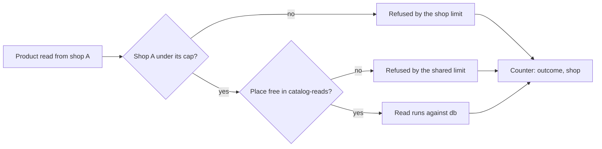

## Before you start

- [[backend.l4.read-routing]] — the replica takes only the reads moved to it; this lesson shares what is left between shops.
- [[backend.l4.shop-id-rollout]] — release 2 is when the api first learns a request's shop from the access token; the limits here wait for it.
- [[design.l4.architecture-review-findings]] — scenario K1 found risks R1 and R2, limits that know no shop; ADR `0016` answers them.
- [[backend.l3.rate-limiting]] — the `orders` policy counts per customer by `sub`, and each api process keeps its own counts.

## The situation

Đơn Hàng is getting ready to serve 1,000 shops from one deployment. Scenario K1 of the architecture review pictures one shop running a promotion that brings it a tenth of the day's orders. During that shop's busiest hour, its customers open the product list again and again. Each api process lets 20 product reads run at once and 5 wait, for every caller together. The promotion's customers fill those places, and a customer of a quiet shop gets `503`. The per-customer order limit does not help: the busy shop has many customers, each under the limit.

How can Đơn Hàng stop one busy shop from taking capacity the others need, without cutting it into 1,000 small pieces?

## Core concepts

- shared limit — a limit counted for every caller of a process together, such as `catalog-reads`.
- per-shop limit — a limit counted separately for each shop, so one shop reaching it leaves the others' counts untouched.
- cap — the most one shop may use at once; whatever it leaves unused stays open to every other shop.
- reserved share — capacity set aside for one shop that no other shop may use, even while it sits idle.
- per-shop outcome count — a count of requests by result with the shop as a label, so a refusal shows against the shop it hit.

## How it works



In the situation above, every check a product read meets is shared. `catalog-reads` counts all callers of a process together. The `orders` limit counts per customer and guards only `POST /api/v1/orders`. Neither knows the shop. ADR `0013`, which put every shop in shared tables, left this noisy-neighbor problem open, and the review recorded it as R1 and R2.

The diagram follows one product read as ADR `0016` plans it. First the per-shop limit: has shop A already reached its cap of reads running at once in this process? If so, the read is refused, and no other shop's count changes. The ADR says neither whether a shop's reads may wait nor which status code a refusal returns; the diagram refuses them at once. If not, the read meets the shared limit as before, which still protects the database every shop uses. The ADR names both checks but not their order; the diagram picks one.

The cap is a ceiling, not a reserved share. Reserving would give each of 1,000 shops a thousandth of a process's 20 places, less than one read at a time, and an idle shop's places would stay empty. With a cap, a quiet shop takes nothing, and what it does not use stays open to the rest.

Last, every outcome is counted with the shop as a label: served, refused by the shop limit, refused by the shared limit. A shop refused most of the time then shows up on its own, even while the SLI over all shops stays above its SLO.

## In the Đơn Hàng system

The limits in force at stage-4 are the ones the review looked at:

```csharp file=DonHang.Api/Program.cs tag=stage-4 lines=150-166
builder.Services.AddRateLimiter(options =>
{
    options.AddPolicy("orders", context =>
    {
        var customer = context.User.FindFirst("sub")?.Value;
        if (customer is null) return RateLimitPartition.GetNoLimiter("signed-out");
        return RateLimitPartition.GetFixedWindowLimiter(customer, _ => new FixedWindowRateLimiterOptions
        {
            PermitLimit = ordersLimit.PermitLimit,
            Window = ordersLimit.Window,
        });
    });
    options.AddConcurrencyLimiter("catalog-reads", limiter =>
    {
        limiter.PermitLimit = catalogReads.PermitLimit;
        limiter.QueueLimit = catalogReads.QueueLimit;
    });
```

The `orders` policy keeps one limiter per value of `sub`, the customer (10 orders a minute each); a signed-out caller gets none. The `catalog-reads` policy has no key at all: one limiter per process for every caller. Its refusals keep the middleware's default `503`; only `orders` answers `429`. Its 20 running and 5 waiting are set in `catalogReads` on line 147, above the excerpt. Nothing here reads a shop: risks R1 and R2 in code.

ADR `0016` weighs the options and decides (the paragraphs after the excerpt say the same in English):

```markdown file=docs/adr/0016-gioi-han-tai-theo-cua-hang.md tag=stage-4 lines=23-44
### Các phương án

- Giữ giới hạn chung như hiện tại: không tốn gì, rủi ro trên còn nguyên.
- Thêm giới hạn đếm theo cửa hàng bên trong API, chồng lên giới hạn chung:
  mỗi cửa hàng chỉ dùng tối đa một phần cố định của số lần đọc đồng thời mỗi
  process; giới hạn chung vẫn giữ để bảo vệ database.
- Tách cửa hàng lớn ra database hoặc bản triển khai riêng: cô lập mạnh nhất
  cho cửa hàng đó, nhưng chỉ giúp những cửa hàng đã biết là lớn, và mỗi lần
  tách là một việc chuyển dữ liệu.

### Quyết định

Chọn phương án thứ hai. Mỗi cửa hàng có một trần: một phần cố định của số lần
đọc đồng thời mỗi process (giả định một phần tư của 20). Trần không phải chỗ
giữ riêng: phần một cửa hàng không dùng vẫn để các cửa hàng khác dùng, nên
1.000 cửa hàng không chia nhỏ dung lượng thành 1.000 phần.

Thêm một counter số request theo kết quả (được phục vụ, bị từ chối theo cửa
hàng, bị từ chối theo giới hạn chung) có nhãn cửa hàng, để thấy một cửa hàng bị
từ chối dù SLI chung vẫn tốt. Không thêm nhãn cửa hàng vào histogram thời gian
trả lời: 1.000 cửa hàng nhân với mọi bucket, endpoint và mã trả lời là quá
nhiều series.
```

Three options: keep the shared limits, which costs nothing and leaves the risk; add per-shop limits inside the api on top of the shared ones; or move a large shop to its own database or deployment, the strongest isolation but only for shops already known to be large, and a data move each time.

The decision takes the second. Each shop's cap is a fixed share of the reads a process runs at once, assumed a quarter of 20, so 5. The new counter carries the shop label; the response-time histogram does not, because 1,000 shops times every bucket, endpoint and status code is too many series, each one more that Prometheus stores and scrapes.

The consequences, below the excerpt, explain why these limits are unchanged. The limit needs the request's shop from the access token, which arrives with release 2 of `multi-shop-data-rollout.md`. Each process also counts on its own, as today: with more Pods, a shop's real ceiling grows with their number.

## Trade-offs

| Choice | What it gives | What it costs | When it fits |
|---|---|---|---|
| Shared limits only, as at stage-4 | nothing to build; the database stays protected | one busy shop can fill a process and others get `503` | one shop, or before the api knows the request's shop |
| A cap per shop on top of the shared limit (ADR `0016`) | a busy shop stops at its cap; unused capacity stays shared | the shop from the token, a second check, a new counter; four shops at their cap together still fill a process's 20 | many shops of mostly similar size on one deployment |
| A reserved share per shop | each shop always has its places | 1,000 shops split 20 places; idle shops' places stay empty | a few shops with contracts that promise capacity |
| A large shop on its own database or deployment | the strongest isolation for that shop | only for shops already known to be large; a data move each time | a shop that keeps needing more than its cap |

## What would you choose if…

…one shop keeps reaching its cap every promotion, and its customers get refused? The ADR says when to look again: a shop that regularly needs more than its share moves to the third option, under the review condition of ADR `0013`: a shop too large for the shared tables, or one that must be restored on its own, gets its own database. Raising every shop's cap would bring back the risk the cap removes.

…a teammate wants the shop label on the response-time histogram too, to compare shops' speed? Keep it on the counter only. The histogram already has a series per bucket, endpoint and status code; multiplying that by 1,000 shops is what the ADR rules out. The counter still shows which shop is being refused.

…the api grows from 2 Pods to 4? Each process counts on its own, so one shop could run up to 4 times 5 product reads at once across them. The cap still bounds a shop per process; the database's total is what the capacity plan checks when Pods are added.

## Seniors often assume…

- **"The existing per-customer rate limit already stops one shop from hurting the others."** → Actually `orders` counts by `sub`, so a shop with many customers passes it while each stays under 10 a minute, and it guards only `POST /api/v1/orders`. You notice this when a promotion slows every shop and no customer was ever refused with `429`.
- **"Giving each shop a fixed reserved share is the fairest way to split capacity."** → Actually 1,000 reserved shares of 20 places leave each shop less than one read at a time, and a quiet shop's share sits empty. A cap gives no shop a guarantee but wastes nothing. You notice this when shops get `503` while most of the process's places are idle.
- **"If the SLO is met overall, every shop is being served well."** → Actually the SLI adds up every shop's requests, so one small shop refused most of the time moves it very little. You notice this when a shop complains of errors on a day the SLO dashboard is green, and only a count labelled by shop shows it.

## Try it (3 minutes)

Work it out on paper. One api process, 20 product reads at once and 5 waiting, as in `Program.cs`; a cap of 5 per shop, as ADR `0016` assumes; the ADR does not say whether a shop's reads may wait, so assume they may not. Shop A sends 30 product reads at once; just after, shops B and C send 3 each.

1. At stage-4, with only `catalog-reads`, what happens to B's and C's reads?
2. Under ADR `0016`, how many of A's reads run at once, and do B's and C's run?
3. With 2 api Pods and A's reads spread across both, what is A's real ceiling?

Expected result: none of B's and C's 6 run (all refused with `503`), then 5 with all 6 of B's and C's running, then 10.

<details><summary>Suggested answer</summary>

At stage-4, 20 of A's reads run, 5 wait, and the remaining 5 are refused with `503`; B's and C's 6 reads find no place and no waiting spot, so they are refused too. Under ADR `0016`, A runs at most 5 at once, and the rest of A's reads are refused by the shop limit. B and C run all 6, and 9 places stay free for any other shop. Each process counts on its own, so with 2 Pods A can run up to 5 in each, 10 in total.

</details>

## Connections

- [[backend.l3.rate-limiting]] — prerequisite: the per-customer limit that cannot see a shop.
- [[design.l4.architecture-review-findings]] — prerequisite: the review whose risks R1 and R2 this ADR decides.
- [[backend.l4.shop-id-rollout]] — prerequisite: release 2 brings the shop the per-shop limit needs.
- [[backend.l3.multi-tenancy]] — the noisy-neighbor problem this lesson answers for Đơn Hàng's shared deployment.
- [[backend.l4.shop-data-layout]] — ADR `0013`, which left the noisy neighbor open and holds the review condition the third option follows.
- [[management.l3.weighing-options-in-an-adr]] — the same way of weighing options, used here for limits.
- [[backend.l4.backend-review-checklist]] — the next lesson: its isolation questions point back to ADR `0016`.

## Five-line summary

1. A cap per shop, on top of the shared limit, stops one busy shop at its share while unused capacity stays open to all shops.
2. At stage-4 `catalog-reads` counts every caller of a process together and `orders` counts per customer, so no limit knows the shop.
3. ADR `0016` prefers caps to keeping the shared limits or moving large shops out, assuming a quarter of 20 reads per process.
4. A counter of outcomes labelled by shop shows a refused shop that the SLI over all shops hides; the histogram stays without the label.
5. The limit needs the shop from the access token, arriving with release 2, so `Program.cs` keeps its `orders` and `catalog-reads` limits at stage-4.
