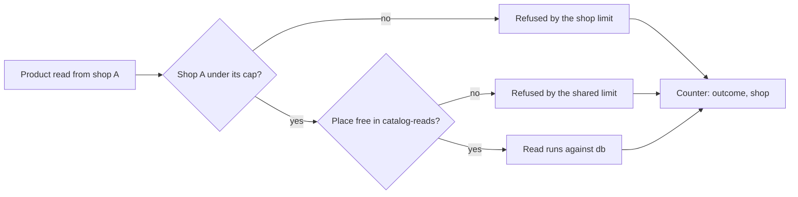

## Bạn cần biết trước

- [[backend.l4.read-routing]] — replica chỉ nhận những lần đọc được chuyển sang nó. Bài này chia phần còn lại giữa các cửa hàng.
- [[backend.l4.shop-id-rollout]] — release 2 là lúc api lần đầu biết cửa hàng của một request từ access token. Các giới hạn ở đây phải chờ nó.
- [[design.l4.architecture-review-findings]] — kịch bản K1 tìm ra rủi ro R1 và R2, những giới hạn không biết tới cửa hàng. ADR `0016` trả lời hai rủi ro đó.
- [[backend.l3.rate-limiting]] — policy `orders` đếm theo từng khách bằng `sub`, và mỗi process api tự giữ bộ đếm của mình.

## Tình huống

Đơn Hàng đang chuẩn bị phục vụ 1.000 cửa hàng từ một bản triển khai. Kịch bản K1 của buổi review kiến trúc hình dung một cửa hàng chạy khuyến mãi và nhận một phần mười số đơn trong ngày. Vào giờ đông nhất của cửa hàng đó, khách của nó mở danh sách sản phẩm hết lần này tới lần khác. Mỗi process api cho 20 lần đọc sản phẩm chạy cùng lúc và 5 lần chờ, tính chung cho mọi người gọi. Khách của đợt khuyến mãi lấp kín các chỗ đó, và khách của một cửa hàng vắng nhận `503`. Giới hạn đơn theo từng khách không giúp được gì: cửa hàng đông có nhiều khách, mỗi người đều dưới giới hạn.

Làm sao để Đơn Hàng ngăn một cửa hàng đông chiếm dung lượng mà các cửa hàng khác cần, mà không cắt dung lượng thành 1.000 mảnh nhỏ?

## Khái niệm cốt lõi

- giới hạn chung — giới hạn đếm chung cho mọi người gọi của một process, chẳng hạn `catalog-reads`.
- giới hạn theo cửa hàng — giới hạn đếm riêng cho từng cửa hàng, nên một cửa hàng chạm giới hạn thì bộ đếm của các cửa hàng khác vẫn nguyên.
- trần — mức nhiều nhất một cửa hàng được dùng cùng lúc. Phần nó không dùng vẫn mở cho mọi cửa hàng khác.
- phần giữ riêng — dung lượng dành sẵn cho một cửa hàng, không cửa hàng nào khác được dùng, kể cả khi nó đang để trống.
- bộ đếm kết quả theo cửa hàng — đếm request theo kết quả, có cửa hàng làm label, nên một lần từ chối hiện ra đúng ở cửa hàng bị nó chặn.

## Cơ chế hoạt động



Trong tình huống trên, mọi phép kiểm tra mà một lần đọc sản phẩm gặp đều là giới hạn chung. `catalog-reads` đếm chung mọi người gọi của một process. Giới hạn `orders` đếm theo từng khách và chỉ canh `POST /api/v1/orders`. Không cái nào biết tới cửa hàng. ADR `0013`, quyết định đặt mọi cửa hàng vào bảng dùng chung, đã để ngỏ bài toán noisy neighbor này, và buổi review ghi nó thành R1 và R2.

Sơ đồ đi theo một lần đọc sản phẩm đúng như ADR `0016` lên kế hoạch. Đầu tiên là giới hạn theo cửa hàng: cửa hàng A đã chạm trần số lần đọc chạy cùng lúc trong process này chưa? Nếu rồi, lần đọc bị từ chối, và bộ đếm của các cửa hàng khác không đổi. ADR không nói lần đọc của một cửa hàng có được chờ không, cũng không nói lần từ chối trả status code nào. Sơ đồ từ chối ngay. Nếu chưa, lần đọc gặp giới hạn chung như trước, giới hạn vẫn bảo vệ database mà mọi cửa hàng dùng. ADR nêu tên cả hai phép kiểm tra nhưng không nói thứ tự. Sơ đồ chọn một thứ tự.

Trần là mức trên, không phải phần giữ riêng. Nếu giữ riêng, mỗi cửa hàng trong 1.000 cửa hàng chỉ có một phần nghìn của 20 chỗ trong một process, chưa tới một lần đọc mỗi lúc, và chỗ của cửa hàng đang rảnh vẫn bỏ trống. Với trần, cửa hàng vắng không chiếm gì, và phần nó không dùng vẫn mở cho các cửa hàng còn lại.

Cuối cùng, mọi kết quả đều được đếm với cửa hàng làm label: được phục vụ, bị giới hạn theo cửa hàng từ chối, bị giới hạn chung từ chối. Nhờ vậy một cửa hàng bị từ chối phần lớn thời gian sẽ hiện ra riêng, kể cả khi SLI trên mọi cửa hàng vẫn ở trên SLO.

## Trong hệ thống Đơn Hàng

Các giới hạn đang áp dụng ở stage-4 chính là những gì buổi review đã xem:

```csharp file=DonHang.Api/Program.cs tag=stage-4 lines=150-166
builder.Services.AddRateLimiter(options =>
{
    options.AddPolicy("orders", context =>
    {
        var customer = context.User.FindFirst("sub")?.Value;
        if (customer is null) return RateLimitPartition.GetNoLimiter("signed-out");
        return RateLimitPartition.GetFixedWindowLimiter(customer, _ => new FixedWindowRateLimiterOptions
        {
            PermitLimit = ordersLimit.PermitLimit,
            Window = ordersLimit.Window,
        });
    });
    options.AddConcurrencyLimiter("catalog-reads", limiter =>
    {
        limiter.PermitLimit = catalogReads.PermitLimit;
        limiter.QueueLimit = catalogReads.QueueLimit;
    });
```

Policy `orders` giữ một limiter cho mỗi giá trị của `sub`, tức mỗi khách (10 đơn một phút cho mỗi người). Người gọi chưa đăng nhập không có limiter nào. Policy `catalog-reads` không có khóa nào cả: một limiter mỗi process cho mọi người gọi. Lần từ chối của nó giữ `503` mặc định của middleware, chỉ `orders` trả `429`. Con số 20 chạy và 5 chờ của nó đặt trong `catalogReads` ở dòng 147, phía trên đoạn trích. Không chỗ nào ở đây đọc tới cửa hàng: đó là rủi ro R1 và R2 hiện ra trong code.

ADR `0016` cân nhắc các phương án và quyết định (các đoạn sau đoạn trích tóm lại cùng nội dung):

```markdown file=docs/adr/0016-gioi-han-tai-theo-cua-hang.md tag=stage-4 lines=23-44
### Các phương án

- Giữ giới hạn chung như hiện tại: không tốn gì, rủi ro trên còn nguyên.
- Thêm giới hạn đếm theo cửa hàng bên trong API, chồng lên giới hạn chung:
  mỗi cửa hàng chỉ dùng tối đa một phần cố định của số lần đọc đồng thời mỗi
  process; giới hạn chung vẫn giữ để bảo vệ database.
- Tách cửa hàng lớn ra database hoặc bản triển khai riêng: cô lập mạnh nhất
  cho cửa hàng đó, nhưng chỉ giúp những cửa hàng đã biết là lớn, và mỗi lần
  tách là một việc chuyển dữ liệu.

### Quyết định

Chọn phương án thứ hai. Mỗi cửa hàng có một trần: một phần cố định của số lần
đọc đồng thời mỗi process (giả định một phần tư của 20). Trần không phải chỗ
giữ riêng: phần một cửa hàng không dùng vẫn để các cửa hàng khác dùng, nên
1.000 cửa hàng không chia nhỏ dung lượng thành 1.000 phần.

Thêm một counter số request theo kết quả (được phục vụ, bị từ chối theo cửa
hàng, bị từ chối theo giới hạn chung) có nhãn cửa hàng, để thấy một cửa hàng bị
từ chối dù SLI chung vẫn tốt. Không thêm nhãn cửa hàng vào histogram thời gian
trả lời: 1.000 cửa hàng nhân với mọi bucket, endpoint và mã trả lời là quá
nhiều series.
```

Ba phương án: giữ giới hạn chung, không tốn gì nhưng rủi ro còn nguyên. Thêm giới hạn theo cửa hàng bên trong api, chồng lên giới hạn chung. Hoặc tách một cửa hàng lớn ra database hay bản triển khai riêng, cô lập mạnh nhất nhưng chỉ cho những cửa hàng đã biết là lớn, và mỗi lần tách là một lần chuyển dữ liệu.

Quyết định chọn phương án thứ hai. Trần của mỗi cửa hàng là một phần cố định của số lần đọc một process chạy cùng lúc, giả định một phần tư của 20, tức 5. Counter mới mang label cửa hàng, còn histogram thời gian trả lời thì không, vì 1.000 cửa hàng nhân với mọi bucket, endpoint và status code là quá nhiều series, mỗi series thêm là một thứ Prometheus phải lưu và scrape.

Phần hệ quả, nằm dưới đoạn trích, giải thích vì sao các giới hạn này chưa đổi. Giới hạn cần cửa hàng của request lấy từ access token, thứ chỉ có từ release 2 của `multi-shop-data-rollout.md`. Mỗi process cũng tự đếm riêng như hiện nay: khi có thêm Pod, mức trần thực của một cửa hàng tăng theo số Pod.

## Đánh đổi

| Lựa chọn | Được gì | Mất gì | Hợp khi |
|---|---|---|---|
| Chỉ giới hạn chung, như ở stage-4 | không phải xây gì, database vẫn được bảo vệ | một cửa hàng đông có thể lấp kín một process và các cửa hàng khác nhận `503` | một cửa hàng, hoặc trước khi api biết cửa hàng của request |
| Một trần cho mỗi cửa hàng, chồng lên giới hạn chung (ADR `0016`) | cửa hàng đông dừng ở trần của nó, dung lượng chưa dùng vẫn dùng chung | cửa hàng lấy từ token, thêm một phép kiểm tra, thêm một counter, bốn cửa hàng cùng chạm trần vẫn lấp kín 20 chỗ của một process | nhiều cửa hàng, phần lớn cỡ tương đương, trên một bản triển khai |
| Một phần giữ riêng cho mỗi cửa hàng | mỗi cửa hàng luôn có chỗ của mình | 1.000 cửa hàng chia nhau 20 chỗ, chỗ của cửa hàng đang rảnh bỏ trống | vài cửa hàng có hợp đồng hứa trước dung lượng |
| Một cửa hàng lớn trên database hoặc bản triển khai riêng | cô lập mạnh nhất cho cửa hàng đó | chỉ cho những cửa hàng đã biết là lớn, mỗi lần là một lần chuyển dữ liệu | một cửa hàng liên tục cần nhiều hơn trần của nó |

## Bạn sẽ chọn gì nếu…

…một cửa hàng chạm trần ở mọi đợt khuyến mãi, và khách của nó bị từ chối? ADR nói khi nào cần xem lại: một cửa hàng thường xuyên cần nhiều hơn phần của mình thì chuyển sang phương án thứ ba, theo điều kiện xem lại của ADR `0013`: cửa hàng quá lớn cho bảng dùng chung, hoặc cần được khôi phục riêng, sẽ có database riêng. Nâng trần của mọi cửa hàng sẽ mang trở lại đúng rủi ro mà trần vừa gỡ bỏ.

…một đồng nghiệp muốn thêm label cửa hàng vào cả histogram thời gian trả lời để so tốc độ giữa các cửa hàng? Chỉ giữ nó trên counter. Histogram đã có một series cho mỗi bucket, endpoint và status code, nhân thêm 1.000 cửa hàng chính là điều ADR loại bỏ. Counter vẫn cho thấy cửa hàng nào đang bị từ chối.

…api tăng từ 2 Pod lên 4? Mỗi process tự đếm riêng, nên một cửa hàng có thể chạy tới 4 lần 5 lần đọc sản phẩm cùng lúc trên các Pod đó. Trần vẫn chặn một cửa hàng trong từng process. Tổng tải lên database mới là thứ kế hoạch dung lượng kiểm tra khi thêm Pod.

## Senior hay nhầm rằng…

- **"Rate limit theo từng khách đang có đã đủ ngăn một cửa hàng làm hại các cửa hàng khác."** → Thực ra `orders` đếm theo `sub`, nên một cửa hàng nhiều khách vẫn lọt qua trong khi mỗi khách vẫn dưới 10 lần một phút, và nó chỉ canh `POST /api/v1/orders`. Bạn sẽ nhận ra khi một đợt khuyến mãi làm chậm mọi cửa hàng mà chưa khách nào bị từ chối bằng `429`.
- **"Giữ riêng cho mỗi cửa hàng một phần cố định là cách chia dung lượng công bằng nhất."** → Thực ra 1.000 phần giữ riêng từ 20 chỗ để lại cho mỗi cửa hàng chưa tới một lần đọc mỗi lúc, và phần của cửa hàng vắng thì bỏ trống. Trần không đảm bảo gì cho cửa hàng nào nhưng không lãng phí gì. Bạn sẽ nhận ra khi các cửa hàng nhận `503` trong lúc phần lớn chỗ của process đang rảnh.
- **"SLO đạt trên tổng thể thì cửa hàng nào cũng đang được phục vụ tốt."** → Thực ra SLI cộng request của mọi cửa hàng lại, nên một cửa hàng nhỏ bị từ chối phần lớn thời gian chỉ làm nó nhích rất ít. Bạn sẽ nhận ra khi một cửa hàng than bị lỗi vào đúng hôm dashboard SLO vẫn xanh, và chỉ một bộ đếm có label cửa hàng mới cho thấy điều đó.

## Thử ngay (3 phút)

Làm trên giấy. Một process api, 20 lần đọc sản phẩm cùng lúc và 5 lần chờ, như trong `Program.cs`. Trần 5 cho mỗi cửa hàng, như ADR `0016` giả định. ADR không nói lần đọc của một cửa hàng có được chờ không, nên giả định là không. Cửa hàng A gửi 30 lần đọc sản phẩm cùng lúc, ngay sau đó cửa hàng B và C mỗi bên gửi 3 lần.

1. Ở stage-4, chỉ với `catalog-reads`, các lần đọc của B và C ra sao?
2. Theo ADR `0016`, bao nhiêu lần đọc của A chạy cùng lúc, và các lần đọc của B và C có chạy không?
3. Với 2 Pod api và các lần đọc của A chia ra cả hai, mức trần thực của A là bao nhiêu?

Kết quả mong đợi: không lần nào trong 6 lần đọc của B và C chạy (tất cả bị từ chối bằng `503`), rồi 5 với cả 6 lần của B và C đều chạy, rồi 10.

<details><summary>Gợi ý đáp án</summary>

Ở stage-4, 20 lần đọc của A chạy, 5 lần chờ, và 5 lần còn lại bị từ chối bằng `503`. 6 lần đọc của B và C không còn chỗ chạy cũng không còn chỗ chờ, nên cũng bị từ chối. Theo ADR `0016`, A chạy nhiều nhất 5 lần cùng lúc, các lần đọc còn lại của A bị giới hạn theo cửa hàng từ chối. B và C chạy đủ 6 lần, và 9 chỗ vẫn trống cho bất kỳ cửa hàng nào khác. Mỗi process tự đếm riêng, nên với 2 Pod, A chạy được tới 5 lần ở mỗi Pod, tổng cộng 10.

</details>

## Liên hệ

- [[backend.l3.rate-limiting]] — bài tiên quyết: giới hạn theo từng khách, thứ không nhìn thấy cửa hàng.
- [[design.l4.architecture-review-findings]] — bài tiên quyết: buổi review có rủi ro R1 và R2 mà ADR này quyết định.
- [[backend.l4.shop-id-rollout]] — bài tiên quyết: release 2 mang tới cửa hàng mà giới hạn theo cửa hàng cần.
- [[backend.l3.multi-tenancy]] — bài toán noisy neighbor mà bài này trả lời cho bản triển khai dùng chung của Đơn Hàng.
- [[backend.l4.shop-data-layout]] — ADR `0013`, quyết định để ngỏ noisy neighbor và giữ điều kiện xem lại mà phương án thứ ba đi theo.
- [[management.l3.weighing-options-in-an-adr]] — cùng cách cân nhắc phương án, ở đây dùng cho giới hạn.
- [[backend.l4.backend-review-checklist]] — bài tiếp theo: các câu hỏi về cô lập trong đó trỏ ngược về ADR `0016`.

## Tóm tắt 5 dòng

1. Một trần cho mỗi cửa hàng, chồng lên giới hạn chung, chặn một cửa hàng đông ở phần của nó trong khi dung lượng chưa dùng vẫn mở cho mọi cửa hàng.
2. Ở stage-4, `catalog-reads` đếm chung mọi người gọi của một process và `orders` đếm theo từng khách, nên không giới hạn nào biết tới cửa hàng.
3. ADR `0016` chọn trần thay vì giữ giới hạn chung hay tách cửa hàng lớn ra, với giả định một phần tư của 20 lần đọc mỗi process.
4. Một counter kết quả có label cửa hàng cho thấy cửa hàng bị từ chối mà SLI trên mọi cửa hàng che mất, còn histogram vẫn không có label đó.
5. Giới hạn cần cửa hàng lấy từ access token, chỉ có từ release 2, nên ở stage-4 `Program.cs` vẫn giữ nguyên giới hạn `orders` và `catalog-reads`.
