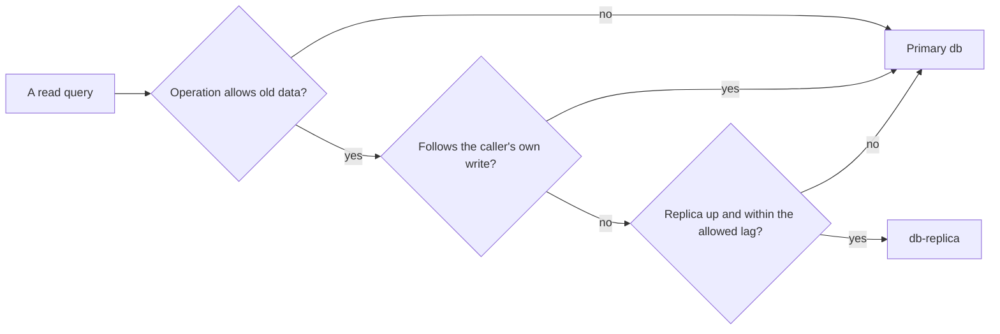

## Before you start

- [[backend.l4.capacity-planning]] — its second step moves the product list to the replica once product reads cross the primary's headroom; this lesson is that step.
- [[backend.l4.pacelc]] — `consistency-per-operation.md` records, per operation, whether a fast answer from a copy is acceptable; routing obeys that record.
- [[backend.l3.read-replicas]] — the replica applies each change after the primary commits it, so a read there can miss a write that just happened.

## The situation

The capacity plan's second step says the product list may move to `db-replica`. A teammate offers to do it in one afternoon: send every `GET` the api serves to the replica, and keep writes on `db`. It sounds safe, because reads change nothing. Then you remember `replica-lag.sh` in the lab, the containers `scripts/up.sh` starts: right after a price change on `db`, `db-replica` still answered with the old price. A customer who has just placed an order and opens it reads straight after a write too.

Which reads can go to the replica, what does moving them take, and what does the primary actually gain?

## Core concepts

- routing reads — the api choosing, query by query, whether a query goes to the primary or to a replica, instead of one server for everything.
- allowed staleness — how old an operation's answer may be without harming the business, recorded per operation in `consistency-per-operation.md`.
- way back — the rule that sends a routed read to the primary when the replica is down or further behind than the operation allows.
- moved reads — the reads routing sends to the replica; only these leave the primary.

## How it works



In the situation above, the teammate proposes routing reads by HTTP method. The diagram routes them by operation instead. At stage-4 there is nothing to route yet: the api reads one database connection string, `Default`, the setting that tells it which database server to connect to, and every query reaches the primary. Routing needs a second connection for the replica and code that chooses between them for each query.

Follow the diagram from the left. The first question is the operation's allowed staleness. `consistency-per-operation.md` lets the product list answer with data a little old; a customer's own orders may not.

The second question catches reads that follow the caller's own write, such as showing the order just placed or its history. The replica may not have applied that write yet, so these reads stay on the primary. That is how routing keeps read-your-writes. The two documents name whole operations here, own orders and their history; neither says how the api would spot any other read right after a write.

The third question is the way back. Replication is asynchronous by default: the primary does not wait for the replica, so no limit on the lag is promised. A routed read must return to the primary when the replica is down or its lag exceeds the operation's allowed staleness. That check runs on every routed query: routing adds work to each one.

Only the moved reads leave the primary. Every write, every read that answered "no" above, and every read sent back still lands on it. The replica also applies every write again, so it is a second server to run, not a free copy.

## In the Đơn Hàng system

`consistency-per-operation.md` states which operations may move, below its table of choices:

```markdown file=docs/design/consistency-per-operation.md tag=stage-4 lines=38-53
### Nếu chuyển đọc sang replica

Ở stage-4 API không đọc `db-replica`: nó chỉ có một connection string,
`ConnectionStrings:Default`, trỏ tới primary. Replica nhận thay đổi không đồng
bộ, nên một lần đọc từ replica có thể chưa thấy lần ghi vừa xong, kể cả lần
ghi của chính người gọi (không có read-your-writes).

- Được phép chuyển: danh sách sản phẩm, vì nó chấp nhận dữ liệu hơi cũ và
  không ghi lại gì từ kết quả đọc.
- Không chuyển: xem đơn của mình và lịch sử của đơn; mọi lần đọc ngay sau
  một lần ghi của cùng người gọi; một sản phẩm đọc qua `ProductCache` (cả khi
  đặt đơn). Ngay sau khi đổi giá, bản sao Redis bị xóa và lần đọc kế tiếp nạp
  lại nó; nạp từ một replica chưa có giá mới sẽ đặt giá cũ trở lại Redis thêm
  trọn một TTL.

Chuyển một thao tác khác sang replica cần sửa bảng trên trước.
```

The product list may move for two reasons: the business accepts a slightly old list, and nothing is written back from what it reads. The table above the excerpt says the list reads the primary every time only because the code has no other copy yet. Your own order and its history stay, and so does any read right after the caller's write.

The third "no" is easy to miss. A single product is read through `ProductCache`, including when an order is placed. After a price change the Redis copy is deleted, and the next read reloads it. If that reload came from a replica without the new price, the old price would go back into Redis for a whole TTL, which the table sets at 5 minutes. The last line makes the table the gate: no other operation moves until its row changes.

`capacity-plan.md` turns that permission into a plan:

```markdown file=docs/design/capacity-plan.md tag=stage-4 lines=83-99
### Đọc từ replica

Ở stage-4 API chỉ có một connection string, `ConnectionStrings:Default`; mọi
lần đọc vào primary. `db-replica` chỉ dùng trong lab.

- Chuyển trước nếu cần: danh sách sản phẩm. `consistency-per-operation.md`
  cho phép nó trả dữ liệu hơi cũ.
- Không chuyển: đơn của chính khách, `GET /api/v1/orders/{id}/history`, mọi
  lần đọc ngay sau một lần ghi của cùng người gọi, vì replica có thể chưa có
  lần ghi đó.
- Điều kiện kích hoạt: đỉnh dự kiến của đọc sản phẩm vượt khoảng dư của
  primary.
- Đường lui: mỗi lần đọc qua replica phải quay về primary khi replica trễ hơn
  mức danh sách sản phẩm chịu được, hoặc không trả lời.

Replica chỉ gánh những lần đọc được chuyển sang nó; mọi lệnh ghi và mọi lần
đọc phải ở primary vẫn nằm trên primary. Stage-4 không có code định tuyến.
```

The plan keeps every read on the primary at stage-4; `db-replica` exists only in the lab. It moves the product list when one condition holds: the planned peak of product reads crosses the primary's headroom. The condition is stated in words, not as a number. The way back has two cases: the replica lags more than the product list tolerates, or it does not answer. The last paragraph limits the gain: the replica carries only the moved reads, and every write and every read that must stay remains on the primary. Its last sentence confirms there is no routing code at this tag.

## Trade-offs

| Choice | What it gives | What it costs | When it fits |
|---|---|---|---|
| Keep every read on the primary, as at stage-4 | no lag anywhere, no routing code, one database connection string | the primary carries every read and every write | while the planned peak of reads fits the primary's headroom |
| Route only operations whose row allows old data | takes those reads off the primary | a second connection, a check per routed query, a way back, and users of that operation may see slightly old data | once the plan's condition holds, starting with the product list |
| Send every `GET` to the replica | the most reads leave the primary | breaks read-your-writes for the caller's own orders and can put an old price back into Redis for a TTL | only if every read in the table allowed old data, which the stage-4 table does not say |

## What would you choose if…

…the product search planned in ADR 0030, not yet built at stage-4, arrives and the team wants it on the replica from the first day? Its row, outside both excerpts, already gives it the same choice as the product list, with the replica only once `capacity-plan.md` allows it. Ship it on the primary, and move it together with the list when the condition holds.

…a teammate wants `GET /api/v1/products/{id}` on the replica too, since it is "just one product"? Keep it on the primary. It goes through `ProductCache`, and a reload from a lagging replica would keep the old price in Redis, and in orders placed with it, for up to 5 minutes.

…the replica falls far behind during the busiest hour? The way back sends the product list to the primary exactly when the primary is busiest. If that happens, the moved reads return all at once, so the plan should still check that the primary can take them back for a while.

## Seniors often assume…

- **"Adding a replica means pointing every `GET` at it."** → Actually a read moves only if its operation allows old data and it does not follow the caller's own write, because the replica applies each change after the primary commits it. You notice this when a customer opens the order they just placed, the api cannot find it, and a refresh a moment later shows it.
- **"A replica is free extra capacity, so we should add one as early as possible."** → Actually routing costs a second connection, a check on every routed query, a way back, and slightly old answers for the moved operation. That is why `capacity-plan.md` waits for a stated condition. You notice this when a product staff just added is missing from the list for a while, at a time the primary was nowhere near busy.
- **"Once reads go to a replica, the primary only has to handle writes."** → Actually only the moved reads leave. Own orders, their history, cache reloads of single products and every read sent back stay on the primary. You notice this when the primary's load drops less than expected after routing, and climbs again whenever the replica falls behind.

## Try it (3 minutes)

With the lab running (`scripts/up.sh`), in the root folder of the example repository:

1. Run `scripts/backend/replica-lag.sh`. It starts `db-replica` as a fresh copy of `db`, changes product 1's price on `db`, then reads it from both servers. Note the two `price_vnd` values straight after the update.
2. For each read, decide whether that replica answer would be acceptable: the product list, the customer opening an order just placed, and the Redis reload of product 1 after its price change.

Expected result: `1300000` on `db` and `1250000` on `db-replica` straight after the update, and one "acceptable" out of the three reads.

<details><summary>Suggested answer</summary>

The product list is acceptable: it may show the old price while the replica lags (5 seconds in this lab, where `db-replica` waits that long on purpose before applying each change), and nothing is written from it. The order just placed is not: the replica may not have it yet, so the customer could be told it does not exist. The Redis reload is not: it would store `1250000` in Redis, and the old price would stay there for the whole 5-minute TTL instead of only as long as the replica lags.

</details>

## Connections

- [[backend.l4.capacity-planning]] — prerequisite: the plan whose second step and condition this lesson works out.
- [[backend.l4.pacelc]] — prerequisite: the per-operation choice between a fast answer from a copy and a current one, which routing obeys.
- [[backend.l3.read-replicas]] — prerequisite: the lag that decides which reads may move.
- [[backend.l2.cache-aside]] — the reason single product reads stay: a stale reload into the cache outlives the lag by a whole TTL.
- [[backend.l4.cap-theorem]] — the other column of the same table: what each operation does when the primary cannot be reached at all.
- [[backend.l4.data-ownership]] — where the owner named in each row of the table comes from.
- [[backend.l4.per-shop-limits]] — the next lesson: sharing the same capacity fairly between shops.

## Five-line summary

1. A read moves to the replica only when its operation can answer with slightly old data and does not follow the caller's own write.
2. At stage-4 the api has one database connection string, `Default`, so every read goes to the primary; routing means choosing per query.
3. `consistency-per-operation.md` lets the product list move; own orders, their history and single products read through `ProductCache` stay.
4. A replica relieves the primary only of the moved reads; every write and every read that must stay still lands on the primary.
5. `capacity-plan.md` moves the product list only once its peak crosses the primary's headroom, and every routed read needs a way back to the primary.
