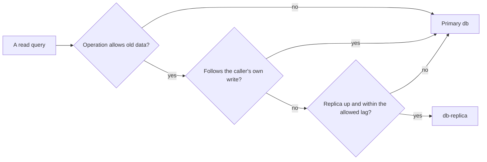

## Bạn cần biết trước

- [[backend.l4.capacity-planning]] — bước thứ hai của kế hoạch là chuyển danh sách sản phẩm sang replica khi lượt đọc sản phẩm vượt khoảng dư của primary. Bài này chính là bước đó.
- [[backend.l4.pacelc]] — `consistency-per-operation.md` ghi cho từng thao tác xem câu trả lời nhanh từ một bản sao có chấp nhận được không. Định tuyến làm theo đúng bản ghi đó.
- [[backend.l3.read-replicas]] — replica áp dụng mỗi thay đổi sau khi primary đã commit nó, nên một lần đọc ở đó có thể chưa thấy lần ghi vừa xảy ra.

## Tình huống

Bước thứ hai của kế hoạch dung lượng nói danh sách sản phẩm có thể chuyển sang `db-replica`. Một đồng nghiệp nhận làm trong một buổi chiều: gửi mọi `GET` mà api phục vụ sang replica, còn lệnh ghi giữ ở `db`. Nghe có vẻ an toàn, vì đọc thì không thay đổi gì. Rồi bạn nhớ tới `replica-lag.sh` trong lab, tức các container mà `scripts/up.sh` khởi động: ngay sau khi đổi giá trên `db`, `db-replica` vẫn trả giá cũ. Một khách vừa đặt đơn rồi mở đơn đó ra xem cũng là đọc ngay sau một lần ghi.

Lần đọc nào được chuyển sang replica, chuyển chúng cần những gì, và primary thực sự nhẹ đi bao nhiêu?

## Khái niệm cốt lõi

- định tuyến đọc — api chọn cho từng truy vấn xem nó đi tới primary hay tới một replica, thay vì một server cho tất cả.
- độ cũ cho phép — câu trả lời của một thao tác được cũ tới mức nào mà không gây hại cho nghiệp vụ, ghi theo từng thao tác trong `consistency-per-operation.md`.
- đường lui — quy tắc đưa một lần đọc đã định tuyến về primary khi replica ngừng chạy hoặc chậm hơn mức thao tác cho phép.
- lần đọc được chuyển — những lần đọc mà định tuyến gửi sang replica. Chỉ những lần này rời khỏi primary.

## Cơ chế hoạt động



Trong tình huống trên, đồng nghiệp đề xuất định tuyến theo HTTP method. Sơ đồ thì định tuyến theo thao tác. Ở stage-4 chưa có gì để định tuyến: api đọc một connection string duy nhất, `Default`, tức thiết lập cho api biết kết nối tới database server nào, và mọi truy vấn đều tới primary. Muốn định tuyến, api cần thêm một kết nối cho replica và code chọn giữa hai kết nối cho từng truy vấn.

Đi theo sơ đồ từ trái sang. Câu hỏi đầu tiên là độ cũ cho phép của thao tác. `consistency-per-operation.md` cho danh sách sản phẩm trả dữ liệu hơi cũ, còn đơn của chính khách thì không.

Câu hỏi thứ hai bắt những lần đọc theo sau lần ghi của chính người gọi, chẳng hạn hiện đơn vừa đặt hay lịch sử của nó. Replica có thể chưa áp dụng lần ghi đó, nên các lần đọc này ở lại primary. Định tuyến giữ read-your-writes bằng cách đó. Ở đây hai tài liệu nêu tên cả thao tác, đơn của mình và lịch sử của đơn. Không tài liệu nào nói api sẽ nhận ra một lần đọc khác ngay sau lần ghi bằng cách nào.

Câu hỏi thứ ba là đường lui. Replication mặc định là không đồng bộ: primary không chờ replica, nên không có giới hạn nào cho độ chậm được hứa trước. Một lần đọc đã định tuyến phải quay về primary khi replica ngừng chạy hoặc chậm hơn độ cũ cho phép của thao tác. Phép kiểm tra đó chạy ở mọi truy vấn được định tuyến, nên định tuyến cộng thêm việc vào từng truy vấn.

Chỉ những lần đọc được chuyển mới rời khỏi primary. Mọi lần ghi, mọi lần đọc trả lời "không" ở trên, và mọi lần đọc bị gửi về vẫn rơi vào primary. Replica cũng áp dụng lại mọi lần ghi, nên nó là thêm một server phải vận hành, không phải một bản sao miễn phí.

## Trong hệ thống Đơn Hàng

`consistency-per-operation.md` ghi những thao tác được chuyển, ngay dưới bảng lựa chọn:

```markdown file=docs/design/consistency-per-operation.md tag=stage-4 lines=38-53
### Nếu chuyển đọc sang replica

Ở stage-4 API không đọc `db-replica`: nó chỉ có một connection string,
`ConnectionStrings:Default`, trỏ tới primary. Replica nhận thay đổi không đồng
bộ, nên một lần đọc từ replica có thể chưa thấy lần ghi vừa xong, kể cả lần
ghi của chính người gọi (không có read-your-writes).

- Được phép chuyển: danh sách sản phẩm, vì nó chấp nhận dữ liệu hơi cũ và
  không ghi lại gì từ kết quả đọc.
- Không chuyển: xem đơn của mình và lịch sử của đơn; mọi lần đọc ngay sau
  một lần ghi của cùng người gọi; một sản phẩm đọc qua `ProductCache` (cả khi
  đặt đơn). Ngay sau khi đổi giá, bản sao Redis bị xóa và lần đọc kế tiếp nạp
  lại nó; nạp từ một replica chưa có giá mới sẽ đặt giá cũ trở lại Redis thêm
  trọn một TTL.

Chuyển một thao tác khác sang replica cần sửa bảng trên trước.
```

Danh sách sản phẩm được chuyển vì hai lý do: nghiệp vụ chấp nhận danh sách hơi cũ, và không có gì được ghi lại từ kết quả đọc. Bảng phía trên đoạn trích ghi rằng danh sách đọc primary mỗi lần chỉ vì code chưa có bản sao nào khác. Đơn của chính khách và lịch sử của nó ở lại, mọi lần đọc ngay sau lần ghi của người gọi cũng vậy.

Chữ "không" thứ ba dễ bị bỏ qua. Một sản phẩm được đọc qua `ProductCache`, kể cả khi đặt đơn. Sau khi đổi giá, bản sao trong Redis bị xóa và lần đọc kế tiếp nạp lại nó. Nếu lần nạp đó lấy từ một replica chưa có giá mới, giá cũ sẽ quay lại Redis thêm trọn một TTL, mà bảng đặt là 5 phút. Dòng cuối biến bảng thành cửa chặn: không thao tác nào khác được chuyển cho tới khi dòng của nó được sửa.

`capacity-plan.md` biến sự cho phép đó thành kế hoạch:

```markdown file=docs/design/capacity-plan.md tag=stage-4 lines=83-99
### Đọc từ replica

Ở stage-4 API chỉ có một connection string, `ConnectionStrings:Default`; mọi
lần đọc vào primary. `db-replica` chỉ dùng trong lab.

- Chuyển trước nếu cần: danh sách sản phẩm. `consistency-per-operation.md`
  cho phép nó trả dữ liệu hơi cũ.
- Không chuyển: đơn của chính khách, `GET /api/v1/orders/{id}/history`, mọi
  lần đọc ngay sau một lần ghi của cùng người gọi, vì replica có thể chưa có
  lần ghi đó.
- Điều kiện kích hoạt: đỉnh dự kiến của đọc sản phẩm vượt khoảng dư của
  primary.
- Đường lui: mỗi lần đọc qua replica phải quay về primary khi replica trễ hơn
  mức danh sách sản phẩm chịu được, hoặc không trả lời.

Replica chỉ gánh những lần đọc được chuyển sang nó; mọi lệnh ghi và mọi lần
đọc phải ở primary vẫn nằm trên primary. Stage-4 không có code định tuyến.
```

Kế hoạch giữ mọi lần đọc ở primary tại stage-4, `db-replica` chỉ có trong lab. Nó chuyển danh sách sản phẩm khi một điều kiện đúng: đỉnh dự kiến của lượt đọc sản phẩm vượt khoảng dư của primary. Điều kiện được nêu bằng lời, không bằng một con số. Đường lui có hai trường hợp: replica chậm hơn mức danh sách sản phẩm chịu được, hoặc nó không trả lời. Đoạn cuối giới hạn phần được lợi: replica chỉ gánh những lần đọc được chuyển, còn mọi lần ghi và mọi lần đọc phải ở lại vẫn nằm trên primary. Câu cuối xác nhận ở tag này chưa có code định tuyến.

## Đánh đổi

| Lựa chọn | Được gì | Mất gì | Hợp khi |
|---|---|---|---|
| Giữ mọi lần đọc ở primary, như ở stage-4 | không có độ chậm ở đâu, không có code định tuyến, một connection string | primary gánh mọi lần đọc và mọi lần ghi | khi đỉnh dự kiến của lượt đọc còn nằm trong khoảng dư của primary |
| Chỉ định tuyến các thao tác có dòng cho phép dữ liệu cũ | lấy các lần đọc đó ra khỏi primary | thêm một kết nối, một phép kiểm tra cho mỗi truy vấn được định tuyến, một đường lui, và người dùng thao tác đó có thể thấy dữ liệu hơi cũ | khi điều kiện của kế hoạch đã đúng, bắt đầu từ danh sách sản phẩm |
| Gửi mọi `GET` sang replica | nhiều lần đọc rời primary nhất | phá read-your-writes với đơn của chính người gọi và có thể đưa giá cũ trở lại Redis thêm một TTL | chỉ khi mọi lần đọc trong bảng đều cho phép dữ liệu cũ, điều bảng ở stage-4 không nói |

## Bạn sẽ chọn gì nếu…

…tính năng tìm kiếm sản phẩm lên kế hoạch trong ADR 0030, chưa xây ở stage-4, ra đời và team muốn đặt nó lên replica ngay từ ngày đầu? Dòng của nó, nằm ngoài cả hai đoạn trích, đã cho nó cùng lựa chọn với danh sách sản phẩm, chỉ dùng replica khi `capacity-plan.md` cho phép. Hãy cho nó chạy trên primary, rồi chuyển cùng lúc với danh sách khi điều kiện đúng.

…một đồng nghiệp muốn chuyển cả `GET /api/v1/products/{id}` sang replica, vì "chỉ là một sản phẩm"? Hãy giữ nó ở primary. Nó đi qua `ProductCache`, và một lần nạp lại từ replica đang chậm sẽ giữ giá cũ trong Redis, cũng như trong các đơn đặt với giá đó, tới 5 phút.

…replica tụt lại xa trong giờ đông nhất? Đường lui đưa danh sách sản phẩm về primary đúng vào lúc primary bận nhất. Khi đó các lần đọc được chuyển quay về cùng một lúc, nên kế hoạch vẫn phải kiểm tra rằng primary gánh lại được chúng trong một khoảng thời gian.

## Senior hay nhầm rằng…

- **"Thêm replica nghĩa là trỏ mọi `GET` sang nó."** → Thực ra một lần đọc chỉ được chuyển nếu thao tác của nó cho phép dữ liệu cũ và nó không theo sau lần ghi của chính người gọi, vì replica áp dụng mỗi thay đổi sau khi primary đã commit. Bạn sẽ nhận ra khi khách mở đơn vừa đặt, api không tìm thấy, rồi tải lại một lúc sau thì đơn hiện ra.
- **"Replica là dung lượng thêm miễn phí, nên thêm càng sớm càng tốt."** → Thực ra định tuyến tốn thêm một kết nối, một phép kiểm tra ở mọi truy vấn được định tuyến, một đường lui, và câu trả lời hơi cũ cho thao tác được chuyển. Đó là lý do `capacity-plan.md` chờ một điều kiện đã nêu. Bạn sẽ nhận ra khi một sản phẩm nhân viên vừa thêm vắng mặt khỏi danh sách một lúc, trong khi primary chẳng hề bận.
- **"Đọc đã chuyển sang replica thì primary chỉ còn phải lo lần ghi."** → Thực ra chỉ những lần đọc được chuyển mới rời đi. Đơn của mình, lịch sử của đơn, các lần nạp lại cache cho từng sản phẩm và mọi lần đọc bị gửi về vẫn ở primary. Bạn sẽ nhận ra khi tải của primary giảm ít hơn mong đợi sau khi định tuyến, và tăng trở lại mỗi lần replica tụt lại phía sau.

## Thử ngay (3 phút)

Khi lab đang chạy (`scripts/up.sh`), ở thư mục gốc của repo ví dụ:

1. Chạy `scripts/backend/replica-lag.sh`. Script khởi động `db-replica` như một bản sao mới của `db`, đổi giá sản phẩm 1 trên `db`, rồi đọc nó trên cả hai server. Ghi lại hai giá trị `price_vnd` ngay sau lệnh cập nhật.
2. Với từng lần đọc, quyết định xem câu trả lời đó từ replica có chấp nhận được không: danh sách sản phẩm, khách mở đơn vừa đặt, và lần nạp lại sản phẩm 1 vào Redis sau khi đổi giá.

Kết quả mong đợi: `1300000` trên `db` và `1250000` trên `db-replica` ngay sau lệnh cập nhật, và một lần "chấp nhận được" trong ba lần đọc.

<details><summary>Gợi ý đáp án</summary>

Danh sách sản phẩm chấp nhận được: nó có thể hiện giá cũ trong lúc replica chậm (5 giây trong lab này, nơi `db-replica` cố ý chờ chừng đó trước khi áp dụng mỗi thay đổi), và không có gì được ghi lại từ nó. Đơn vừa đặt thì không: replica có thể chưa có đơn, nên khách có thể được báo là đơn không tồn tại. Lần nạp lại Redis cũng không: nó sẽ lưu `1250000` vào Redis, và giá cũ nằm đó trọn TTL 5 phút thay vì chỉ trong lúc replica chậm.

</details>

## Liên hệ

- [[backend.l4.capacity-planning]] — bài tiên quyết: kế hoạch có bước thứ hai và điều kiện mà bài này đi vào chi tiết.
- [[backend.l4.pacelc]] — bài tiên quyết: lựa chọn theo từng thao tác giữa câu trả lời nhanh từ bản sao và câu trả lời mới nhất, điều định tuyến phải tuân theo.
- [[backend.l3.read-replicas]] — bài tiên quyết: độ chậm quyết định lần đọc nào được chuyển.
- [[backend.l2.cache-aside]] — lý do lần đọc từng sản phẩm ở lại: một lần nạp dữ liệu cũ vào cache sống lâu hơn độ chậm trọn một TTL.
- [[backend.l4.cap-theorem]] — cột còn lại của cùng bảng: mỗi thao tác làm gì khi hoàn toàn không tới được primary.
- [[backend.l4.data-ownership]] — chủ được nêu trong mỗi dòng của bảng đến từ đâu.
- [[backend.l4.per-shop-limits]] — bài tiếp theo: chia cùng một dung lượng công bằng giữa các cửa hàng.

## Tóm tắt 5 dòng

1. Một lần đọc chỉ chuyển sang replica khi thao tác của nó trả lời được bằng dữ liệu hơi cũ và không theo sau lần ghi của chính người gọi.
2. Ở stage-4 api có một connection string, `Default`, nên mọi lần đọc tới primary, định tuyến nghĩa là chọn cho từng truy vấn.
3. `consistency-per-operation.md` cho danh sách sản phẩm được chuyển, còn đơn của mình, lịch sử của đơn và từng sản phẩm đọc qua `ProductCache` ở lại.
4. Replica chỉ đỡ cho primary những lần đọc được chuyển, mọi lần ghi và mọi lần đọc phải ở lại vẫn rơi vào primary.
5. `capacity-plan.md` chỉ chuyển danh sách sản phẩm khi đỉnh của nó vượt khoảng dư của primary, và mọi lần đọc được định tuyến cần một đường lui về primary.
