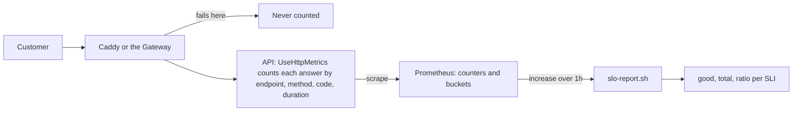

## Before you start

- [[design.l4.mapping-fitness-functions]] — one choice for an unguarded quality attribute is to watch it while the system runs; this lesson is how Đơn Hàng watches its service.
- [[devops.l2.histograms-and-percentiles]] — a histogram counts requests into buckets by upper bound `le`, and p95 is estimated from them; this lesson reads one bucket directly.
- [[devops.l2.counters-and-rate]] — a counter is read through its growth and selected by label, as in `{code=~"5.."}`; this lesson divides one such growth by another.
- [[backend.l3.bulkhead]] — the `catalog-reads` limit answers `503` once it is full; this lesson decides whether that answer counts against the service.

## The situation

A shop owner writes that some customers could not place orders yesterday evening. You open the Grafana dashboard `Đơn Hàng API`. The `p95 response time` panel stayed under half a second all evening, and `5xx responses per second` shows a small bump around eight. Neither panel answers what the shop owner is really asking: out of all the customers who tried to order, how many were let down? A teammate suggests looking at the api Pods' CPU instead.

What one number says how well customers placing orders were served, and which answers should count against it?

## Core concepts

- **service level indicator (SLI)** — a measured ratio of good events to all valid events, such as the share of `POST /api/v1/orders` requests not answered with a `5xx`.
- good event — an answer the team has decided counts as serving the customer; which status codes or times qualify is written down in `slo.md`, not left to whoever reads the dashboard.
- valid event — every request the indicator is about, good or not, such as every `POST` to the order endpoints; it is the bottom of the ratio.
- latency indicator — an SLI whose good events are the requests answered within a time threshold, counted from the histogram bucket at that bound.
- measurement point — the place where requests are counted; in Đơn Hàng it is the metrics the API itself exposes through the prometheus-net library, so it sees only requests that reach the API, not those stopped at Caddy, the lab's reverse proxy, or at the cluster's Gateway.

## How it works



In the situation above, the dashboard shows rates per second and an estimated time, but no ratio. An SLI asks the shop owner's question: of the order requests in a period, what share did the API answer well.

A customer's request passes Caddy or the Gateway first; that arrow comes back below. Start at the API. `UseHttpMetrics` is the first middleware, so every later one, including the one that turns an exception into a `500`, runs inside it, and it sees the final status code. Each answer adds one to `http_requests_received_total` with the labels `endpoint`, `method` and `code`, and its duration lands in the buckets of `http_request_duration_seconds`. Prometheus scrapes these counters. For a ratio over a period, `slo-report.sh` asks how much each counter grew in that period, once for the good events and once for all valid events, then divides.

For "not failed", good means `code` is not `5..`. For "fast enough", good means the request is counted in the bucket at the threshold, such as `le="0.512"`, and all means the histogram's `_count`. A bucket counts every request at or below its bound, so this is an exact count of requests answered within 0.512 seconds; no percentile is estimated. It works only when the threshold is a bucket bound.

Now follow the arrow that leaves before the API. A request Caddy or the Gateway cannot pass on never reaches `UseHttpMetrics`, so it is in neither number. The ratio can read `1.0000` while customers meet failures in front of the API. The measurement point decides what an SLI can see.

## In the Đơn Hàng system

`slo.md` defines four SLIs. Its table and the two paragraphs under it:

```markdown file=docs/design/slo.md tag=stage-4 lines=22-37
| SLI | Tên | Tốt | Mọi sự kiện hợp lệ |
|---|---|---|---|
| S1 | Đặt đơn không lỗi | `POST` `api/v1/orders` và `api/v2/orders` không trả `5xx` | Mọi request `POST` tới hai endpoint đó |
| S2 | Đặt đơn đủ nhanh | Request `POST` tới hai endpoint của S1 trả lời trong bucket `le="0.512"` (0,512 giây) | Như S1 |
| S3 | Đọc sản phẩm không lỗi | Hai `GET` sản phẩm (`api/v1/products`, `api/v1/products/{id:int}`) không trả `5xx`; `503` của giới hạn `catalog-reads` tính là xấu | Mọi request `GET` tới hai endpoint đó |
| S4 | Yêu cầu hoàn tiền trong 2 giây (YC-7) | `POST` `api/v1/orders/{id:int}/refund` trả lời trong bucket `le="2.048"` | Mọi request tới endpoint đó |

S4 không đo đúng 2 giây: 2 giây không phải biên của bucket nào. Hai biên gần
nhất là 1,024 và 2,048; S4 dùng 2,048, biên gần nhất phía trên, nên lỏng hơn
YC-7 một chút. Đo đúng 2 giây cần một bucket riêng ở 2 giây; stage-4 không đổi
bucket.

`429` (giới hạn `orders` theo khách) và các `4xx` khác không tính là xấu:
chúng là câu trả lời đúng cho một request sai hay quá nhiều, hệ thống đã làm
đúng việc của nó. `503` của `catalog-reads` thì khác: request hợp lệ bị từ
chối vì hệ thống không đủ chỗ, khách thấy như một lỗi.
```

S1 counts order requests to `api/v1/orders` and `api/v2/orders` not answered with a `5xx`, out of every `POST` to them; S2 counts the same requests within the bucket `le="0.512"`. S3 counts product reads not answered with a `5xx`, the `503` from `catalog-reads` included as bad. S4 counts refund requests within `le="2.048"`.

The first paragraph explains S4. YC-7, in `refund-requirements.md`, asks that a customer's refund request be answered within 2 seconds, but 2 seconds is not the bound of any bucket; the nearest are 1.024 and 2.048. The buckets cannot tell a request of 1.5 seconds from one of 2.03 seconds: both are counted at `le="2.048"` and neither at `le="1.024"`. So S4 counts against 2.048 and says that this is slightly looser than YC-7; an exact count would need a bucket at 2 seconds, and stage-4 does not change the buckets.

The second paragraph decides what is bad. A `429` from the per-customer `orders` limit and other `4xx` answers are correct answers to a wrong request or to too many, so they count as good. The `503` from `catalog-reads` refuses a valid request because the system has no room, and the customer sees it as a failure. Line 12, above the excerpt, records the gap from the diagram: requests that fail at Caddy or at the Gateway are not counted.

`slo-report.sh` reads each SLI from Prometheus:

```bash file=scripts/backend/slo-report.sh tag=stage-4 lines=23-42
# lesson: backend.l4.service-level-indicators
# Each SLI of slo.md as two numbers over the last hour, from the api's
# prometheus-net metrics: good events and all events. A latency SLI counts
# the requests in the bucket at its bound (le), not an estimated percentile.
orders='method="POST",endpoint=~"api/v1/orders|api/v2/orders"'
products='method="GET",endpoint=~"api/v1/products|api/v1/products/\\{id:int\\}"'
refund='method="POST",endpoint="api/v1/orders/{id:int}/refund"'
sli() { # sli <name> <good query> <total query>
  local good total
  good=$(promql "round(sum(increase($2[1h])))")
  total=$(promql "round(sum(increase($3[1h])))")
  awk -v n="$1" -v g="$good" -v t="$total" 'BEGIN {
    printf "  %-34s good %.0f, total %.0f, ratio %s\n", n, g, t, (t > 0 ? sprintf("%.4f", g / t) : "n/a") }'
}
report() {
  sli "S1 orders without 5xx" "http_requests_received_total{$orders,code!~\"5..\"}" "http_requests_received_total{$orders}"
  sli "S2 orders within 0.512 s" "http_request_duration_seconds_bucket{$orders,le=\"0.512\"}" "http_request_duration_seconds_count{$orders}"
  sli "S3 product reads without 5xx" "http_requests_received_total{$products,code!~\"5..\"}" "http_requests_received_total{$products}"
  sli "S4 refund requests within 2.048 s" "http_request_duration_seconds_bucket{$refund,le=\"2.048\"}" "http_request_duration_seconds_count{$refund}"
}
```

`promql`, defined above the excerpt, sends one query to Prometheus and prints the single number it returns. `sli` asks twice, for the good events and for all events, each as `round(sum(increase(...[1h])))`: `increase` gives how much the counters grew in the hour, and `round` is there because `increase` estimates that growth from the values Prometheus stored at each scrape and can return fractions. The `awk` line divides good by total and prints `n/a` when there were no requests in the hour.

`report` selects the same requests as `slo.md`: `$orders` for S1 and S2, `$products` for S3, `$refund` for S4. S2 and S4 put the `_bucket` series at the bound over the `_count` series. In `$products` the braces are escaped because `=~` reads the value as a pattern, like `5..`, in which braces have a special meaning; `$refund` uses `=`, an exact match. The lab's Prometheus keeps no long history, so the script reads the last hour. The numbers differ on every run.

## Trade-offs

| What you look at | What it tells you | What it cannot tell you | When it is the right tool |
|---|---|---|---|
| CPU and memory of the api Pods | how hard the process is working | whether customers got a right answer in time | finding why the API slowed, after an SLI shows that it did |
| The dashboard's `p95 response time` | how slow the slower requests were, over all endpoints, as an estimate | how many order requests were too slow | spotting a slowdown at a glance |
| An SLI counted at the API | the share of valid requests answered well, per kind of request | requests that never reach the API | saying how well customers were served, as one number per kind of request |
| Counting in front of the API, at Caddy or the Gateway | also the failures before the API | nothing `slo.md` uses today; it needs metrics from those components | when failures in front of the API are a real share of what customers meet |

The rows are not rivals. The SLI says whether customers were served; CPU, memory and the dashboard help find out why they were not.

## What would you choose if…

…the team that owns YC-7 wants refund requests counted at exactly 2 seconds? A new bucket at 2 seconds, as `slo.md` itself says. Until the buckets change, keep S4 at 2.048 and keep the note that it is looser than YC-7.

…customers complain about the `429` answers when they place many orders in a short time, and someone asks to count them as bad in S1? Keep them good. A `429` is the per-customer limit doing what it was set to do; if the limit is wrong for customers, that is a decision about the limit, not about the SLI.

…customers report failed orders while S1 reads `1.0000` for the same hour? Look in front of the API, at Caddy and the Gateway. The API's metrics never saw those requests, as line 12 of `slo.md` warns.

## Seniors often assume…

- **"CPU and memory use are the best measures of whether customers are being served well."** → Actually they measure the process, not the answers it gives. An api Pod at low CPU can answer every order with `500` because the database is gone, and a busy one can still answer every request in time. You notice this when `slo-report.sh` stops `db`: four orders get `500`.
- **"The p95 response time on the dashboard already is the measure of service we need."** → Actually that panel is `histogram_quantile(0.95, ...)` over the buckets of every endpoint together, an estimate of how slow the slower requests were, not a count of requests that were too slow. When product reads far outnumber orders, slow orders hardly move it. You notice this when the panel stays under half a second on an evening a shop owner reports slow ordering.
- **"A request our own limit refused is not a failure, because the system did what it was built to do."** → Actually it depends on why it refused. The `catalog-reads` limit answers `503` to a valid product read because the API has no room, and the customer sees an error, so `slo.md` counts it bad in S3. The `429` from the `orders` limit, 10 orders per customer per window (a minute in `Program.cs`, 10 seconds in the lab), is a correct answer to too many requests. You notice this when the product list shows errors in a busy hour and S3 drops although no code threw.

## Try it (3 minutes)

1. With the lab started with `COMPOSE_PROFILES=monitoring`, run `scripts/backend/slo-report.sh` on your machine. It places two orders and a few product reads, prints the SLIs, then stops `db` while four orders arrive, starts it again, places two more and prints the SLIs again.
2. Read the `POST /api/v1/orders` lines under `== db stopped for a few seconds while orders arrive` and the SLI lines of both reports.

Expected result: each SLI line shows `good`, `total` and `ratio`, with `good` never above `total`; the four orders sent while `db` was stopped get `500` and the two after it get `201`. Ignore the `budget left` lines; a later lesson of this module explains them.

## Connections

- [[backend.l4.service-level-objectives]] — the next step: a target and a time window for each SLI defined here.
- [[devops.l2.histograms-and-percentiles]] — the buckets this lesson counts directly, instead of estimating a percentile from them.
- [[devops.l2.grafana-dashboards]] — the dashboard whose `5xx` and p95 panels show symptoms but no ratio of good to all.
- [[backend.l3.observability]] — the other end of the scale: what happened to one request, where an SLI counts all of them.
- [[design.l4.quality-attribute-scenarios]] — a scenario states the response measure a quality attribute must meet; an SLI is how that measure is counted while the system runs.
- [[backend.l3.bulkhead]] — the source of the `503` that S3 counts as bad.

## Five-line summary

1. An SLI is the ratio of good events to all valid events, counted the way customers feel the answers.
2. `slo.md` counts every `5xx` as bad, including the `503` from `catalog-reads`; `429` and other `4xx` are not bad.
3. A latency SLI counts the requests in the bucket at its bound, such as `le="0.512"`, instead of estimating a p95.
4. A threshold between bucket bounds cannot be counted exactly, so S4 measures YC-7's 2 seconds against 2.048 and says so.
5. The API counts only requests that reach it; `slo-report.sh` prints good, total and ratio for each SLI over the last hour.
