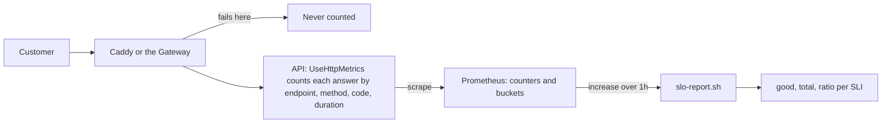

## Bạn cần biết trước

- [[design.l4.mapping-fitness-functions]] — với một thuộc tính chất lượng chưa có gì canh giữ, một lựa chọn là theo dõi nó trong lúc hệ thống chạy. Bài này là cách Đơn Hàng theo dõi service của mình.
- [[devops.l2.histograms-and-percentiles]] — histogram đếm request vào các bucket theo cận trên `le`, và p95 được ước lượng từ các bucket đó. Bài này đọc thẳng một bucket.
- [[devops.l2.counters-and-rate]] — counter được đọc qua mức tăng của nó và được chọn theo label, như `{code=~"5.."}`. Bài này lấy một mức tăng như vậy chia cho một mức tăng khác.
- [[backend.l3.bulkhead]] — giới hạn `catalog-reads` trả `503` khi đã đầy. Bài này quyết định câu trả lời đó có bị tính là lỗi của service hay không.

## Tình huống

Một chủ cửa hàng nhắn rằng tối qua có khách không đặt được đơn. Bạn mở dashboard Grafana `Đơn Hàng API`. Panel `p95 response time` nằm dưới nửa giây suốt buổi tối, còn `5xx responses per second` nhô lên một chút quanh tám giờ. Không panel nào trả lời câu chủ cửa hàng thật sự hỏi: trong số khách đã thử đặt đơn, bao nhiêu người bị phụ lòng? Một đồng đội gợi ý xem CPU của các Pod api.

Con số nào cho biết khách đặt đơn được phục vụ tốt tới đâu, và những câu trả lời nào nên bị tính là xấu?

## Khái niệm cốt lõi

- **chỉ số mức dịch vụ (SLI)** (service level indicator) — tỉ lệ đo được giữa số sự kiện tốt và mọi sự kiện hợp lệ, chẳng hạn phần trăm request `POST /api/v1/orders` không bị trả `5xx`.
- sự kiện tốt — câu trả lời mà team đã quyết định là phục vụ được khách. Status code nào hay thời gian nào được tính là tốt thì ghi trong `slo.md`, không để tùy người đọc dashboard.
- sự kiện hợp lệ — mọi request mà chỉ số nói tới, tốt hay không, chẳng hạn mọi `POST` tới các endpoint đặt đơn. Đây là mẫu số của tỉ lệ.
- chỉ số độ trễ — SLI có sự kiện tốt là các request được trả lời trong một ngưỡng thời gian, đếm từ bucket của histogram ở đúng cận đó.
- điểm đo — nơi request được đếm. Trong Đơn Hàng, đó là metric mà chính API phơi ra qua thư viện prometheus-net, nên nó chỉ thấy request tới được API, không thấy request bị chặn ở Caddy, reverse proxy của lab, hay ở Gateway của cluster.

## Cơ chế hoạt động



Trong tình huống trên, dashboard cho thấy tốc độ mỗi giây và một thời gian ước lượng, nhưng không có tỉ lệ nào. SLI đặt đúng câu hỏi của chủ cửa hàng: trong các request đặt đơn của một khoảng thời gian, API trả lời tốt được bao nhiêu phần.

Request của khách đi qua Caddy hoặc Gateway trước. Mũi tên đó sẽ được nói ở dưới. Hãy bắt đầu từ API. `UseHttpMetrics` là middleware đầu tiên, nên mọi middleware sau, kể cả middleware biến exception thành `500`, đều chạy bên trong nó, và nó thấy status code cuối cùng. Mỗi câu trả lời cộng một vào `http_requests_received_total` với các label `endpoint`, `method` và `code`, còn thời gian của nó rơi vào các bucket của `http_request_duration_seconds`. Prometheus scrape các counter này. Để có tỉ lệ trong một khoảng thời gian, `slo-report.sh` hỏi mỗi counter đã tăng bao nhiêu trong khoảng đó, một lần cho sự kiện tốt và một lần cho mọi sự kiện hợp lệ, rồi chia.

Với "không lỗi", tốt nghĩa là `code` không khớp `5..`. Với "đủ nhanh", tốt nghĩa là request được đếm trong bucket ở ngưỡng, chẳng hạn `le="0.512"`, còn tổng số là `_count` của histogram. Một bucket đếm mọi request bằng hoặc dưới cận của nó, nên đây là số đếm chính xác các request được trả lời trong 0,512 giây, không có percentile nào phải ước lượng. Cách này chỉ dùng được khi ngưỡng là một cận của bucket.

Giờ hãy theo mũi tên rẽ ra trước API. Request mà Caddy hay Gateway không chuyển tiếp được thì không bao giờ tới `UseHttpMetrics`, nên nó không nằm trong số nào cả. Tỉ lệ có thể là `1.0000` trong khi khách gặp lỗi ở phía trước API. Điểm đo quyết định SLI thấy được gì.

## Trong hệ thống Đơn Hàng

`slo.md` định nghĩa bốn SLI. Đây là bảng của nó và hai đoạn ngay dưới:

```markdown file=docs/design/slo.md tag=stage-4 lines=22-37
| SLI | Tên | Tốt | Mọi sự kiện hợp lệ |
|---|---|---|---|
| S1 | Đặt đơn không lỗi | `POST` `api/v1/orders` và `api/v2/orders` không trả `5xx` | Mọi request `POST` tới hai endpoint đó |
| S2 | Đặt đơn đủ nhanh | Request `POST` tới hai endpoint của S1 trả lời trong bucket `le="0.512"` (0,512 giây) | Như S1 |
| S3 | Đọc sản phẩm không lỗi | Hai `GET` sản phẩm (`api/v1/products`, `api/v1/products/{id:int}`) không trả `5xx`; `503` của giới hạn `catalog-reads` tính là xấu | Mọi request `GET` tới hai endpoint đó |
| S4 | Yêu cầu hoàn tiền trong 2 giây (YC-7) | `POST` `api/v1/orders/{id:int}/refund` trả lời trong bucket `le="2.048"` | Mọi request tới endpoint đó |

S4 không đo đúng 2 giây: 2 giây không phải biên của bucket nào. Hai biên gần
nhất là 1,024 và 2,048; S4 dùng 2,048, biên gần nhất phía trên, nên lỏng hơn
YC-7 một chút. Đo đúng 2 giây cần một bucket riêng ở 2 giây; stage-4 không đổi
bucket.

`429` (giới hạn `orders` theo khách) và các `4xx` khác không tính là xấu:
chúng là câu trả lời đúng cho một request sai hay quá nhiều, hệ thống đã làm
đúng việc của nó. `503` của `catalog-reads` thì khác: request hợp lệ bị từ
chối vì hệ thống không đủ chỗ, khách thấy như một lỗi.
```

S1 đếm các request đặt đơn tới `api/v1/orders` và `api/v2/orders` không bị trả `5xx`, trên mọi `POST` tới hai endpoint đó. S2 đếm chính các request ấy nhưng nằm trong bucket `le="0.512"`. S3 đếm các lần đọc sản phẩm không bị trả `5xx`, và `503` từ `catalog-reads` cũng tính là xấu. S4 đếm các yêu cầu hoàn tiền nằm trong `le="2.048"`.

Đoạn thứ nhất giải thích S4. YC-7, trong `refund-requirements.md`, yêu cầu yêu cầu hoàn tiền của khách được trả lời trong 2 giây, nhưng 2 giây không phải cận của bucket nào. Hai cận gần nhất là 1,024 và 2,048. Các bucket không phân biệt được request mất 1,5 giây với request mất 2,03 giây: cả hai đều được đếm ở `le="2.048"` và đều không có ở `le="1.024"`. Vì thế S4 đo theo 2,048 và nói rõ rằng nó lỏng hơn YC-7 một chút. Muốn đếm chính xác thì cần một bucket ở 2 giây, mà stage-4 không đổi bucket.

Đoạn thứ hai quyết định thế nào là xấu. `429` từ giới hạn `orders` theo khách và các `4xx` khác là câu trả lời đúng cho một request sai hoặc cho quá nhiều request, nên chúng được tính là tốt. `503` từ `catalog-reads` từ chối một request hợp lệ vì hệ thống hết chỗ, và khách thấy nó như một lỗi. Dòng 12, phía trên đoạn trích, ghi lại khoảng trống trong sơ đồ: request lỗi ở Caddy hay ở Gateway không được đếm.

`slo-report.sh` đọc từng SLI từ Prometheus:

```bash file=scripts/backend/slo-report.sh tag=stage-4 lines=23-42
# lesson: backend.l4.service-level-indicators
# Each SLI of slo.md as two numbers over the last hour, from the api's
# prometheus-net metrics: good events and all events. A latency SLI counts
# the requests in the bucket at its bound (le), not an estimated percentile.
orders='method="POST",endpoint=~"api/v1/orders|api/v2/orders"'
products='method="GET",endpoint=~"api/v1/products|api/v1/products/\\{id:int\\}"'
refund='method="POST",endpoint="api/v1/orders/{id:int}/refund"'
sli() { # sli <name> <good query> <total query>
  local good total
  good=$(promql "round(sum(increase($2[1h])))")
  total=$(promql "round(sum(increase($3[1h])))")
  awk -v n="$1" -v g="$good" -v t="$total" 'BEGIN {
    printf "  %-34s good %.0f, total %.0f, ratio %s\n", n, g, t, (t > 0 ? sprintf("%.4f", g / t) : "n/a") }'
}
report() {
  sli "S1 orders without 5xx" "http_requests_received_total{$orders,code!~\"5..\"}" "http_requests_received_total{$orders}"
  sli "S2 orders within 0.512 s" "http_request_duration_seconds_bucket{$orders,le=\"0.512\"}" "http_request_duration_seconds_count{$orders}"
  sli "S3 product reads without 5xx" "http_requests_received_total{$products,code!~\"5..\"}" "http_requests_received_total{$products}"
  sli "S4 refund requests within 2.048 s" "http_request_duration_seconds_bucket{$refund,le=\"2.048\"}" "http_request_duration_seconds_count{$refund}"
}
```

`promql`, định nghĩa phía trên đoạn trích, gửi một truy vấn tới Prometheus và in ra con số duy nhất nhận về. `sli` hỏi hai lần, một cho sự kiện tốt và một cho mọi sự kiện, mỗi lần dưới dạng `round(sum(increase(...[1h])))`. `increase` cho biết các counter đã tăng bao nhiêu trong một giờ, còn `round` có mặt vì `increase` ước lượng mức tăng đó từ các giá trị Prometheus lưu ở mỗi lần scrape, nên có thể trả về số lẻ. Dòng `awk` lấy số tốt chia cho tổng và in `n/a` khi trong giờ đó không có request nào.

`report` chọn đúng những request mà `slo.md` nói tới: `$orders` cho S1 và S2, `$products` cho S3, `$refund` cho S4. S2 và S4 đặt chuỗi `_bucket` ở cận lên trên chuỗi `_count`. Trong `$products`, dấu ngoặc nhọn được escape vì `=~` đọc giá trị như một mẫu, giống `5..`, mà trong mẫu thì ngoặc nhọn có nghĩa đặc biệt. `$refund` dùng `=`, khớp chính xác. Prometheus của lab không giữ lịch sử dài, nên script đọc một giờ gần nhất. Các con số mỗi lần chạy mỗi khác.

## Đánh đổi

| Bạn nhìn vào gì | Nó cho bạn biết | Nó không cho biết | Khi nào là công cụ đúng |
|---|---|---|---|
| CPU và bộ nhớ của các Pod api | process đang làm việc vất vả tới đâu | khách có nhận được câu trả lời đúng và kịp lúc không | tìm vì sao API chậm đi, sau khi SLI đã cho thấy nó chậm |
| `p95 response time` trên dashboard | các request chậm hơn chậm tới đâu, gộp mọi endpoint, ở dạng ước lượng | bao nhiêu request đặt đơn bị quá chậm | nhận ra một đợt chậm chỉ bằng một cái liếc |
| SLI đếm tại API | phần request hợp lệ được trả lời tốt, theo từng loại request | request không bao giờ tới được API | nói khách được phục vụ tốt tới đâu, mỗi loại request một con số |
| Đếm phía trước API, ở Caddy hoặc Gateway | cả các lỗi xảy ra trước API | hiện `slo.md` không dùng gì ở đây; cần metric từ chính các thành phần đó | khi lỗi phía trước API chiếm một phần đáng kể trong những gì khách gặp |

Các dòng này không cạnh tranh nhau. SLI cho biết khách có được phục vụ hay không. CPU, bộ nhớ và dashboard giúp tìm ra vì sao khách không được phục vụ.

## Bạn sẽ chọn gì nếu…

…team làm chủ YC-7 muốn yêu cầu hoàn tiền được đếm đúng ở 2 giây? Thêm một bucket ở 2 giây, như chính `slo.md` đã viết. Cho tới khi bucket thay đổi, hãy giữ S4 ở 2,048 và giữ ghi chú rằng nó lỏng hơn YC-7.

…khách phàn nàn về các câu trả lời `429` khi họ đặt nhiều đơn trong thời gian ngắn, và có người đề nghị tính chúng là xấu trong S1? Hãy giữ chúng là tốt. `429` là giới hạn theo khách đang làm đúng việc nó được đặt ra. Nếu giới hạn không hợp với khách thì đó là quyết định về giới hạn, không phải về SLI.

…khách báo đặt đơn thất bại trong khi S1 là `1.0000` cho cùng giờ đó? Hãy nhìn phía trước API, ở Caddy và Gateway. Metric của API không bao giờ thấy những request đó, đúng như dòng 12 của `slo.md` đã cảnh báo.

## Senior hay nhầm rằng…

- **"CPU và bộ nhớ là thước đo tốt nhất cho biết khách có được phục vụ tốt hay không."** → Thực ra chúng đo process, không đo các câu trả lời mà process đưa ra. Một Pod api CPU thấp vẫn có thể trả `500` cho mọi đơn vì database đã mất, còn một Pod đang bận vẫn có thể trả lời mọi request kịp lúc. Bạn sẽ nhận ra khi `slo-report.sh` dừng `db`: bốn đơn nhận `500`.
- **"p95 response time trên dashboard đã chính là thước đo dịch vụ mình cần."** → Thực ra panel đó là `histogram_quantile(0.95, ...)` trên bucket của mọi endpoint gộp lại, một ước lượng các request chậm hơn chậm tới đâu, không phải số đếm các request bị quá chậm. Khi lượt đọc sản phẩm nhiều hơn hẳn lượt đặt đơn, đơn chậm gần như không làm nó nhích. Bạn sẽ nhận ra khi panel vẫn dưới nửa giây vào đúng buổi tối chủ cửa hàng báo đặt đơn chậm.
- **"Request bị chính giới hạn của mình từ chối thì không phải lỗi, vì hệ thống đã làm đúng như được xây."** → Thực ra còn tùy vì sao nó từ chối. Giới hạn `catalog-reads` trả `503` cho một lần đọc sản phẩm hợp lệ vì API hết chỗ, và khách thấy một lỗi, nên `slo.md` tính nó là xấu trong S3. `429` từ giới hạn `orders`, 10 đơn mỗi khách mỗi cửa sổ (một phút trong `Program.cs`, 10 giây trong lab), là câu trả lời đúng cho quá nhiều request. Bạn sẽ nhận ra khi danh sách sản phẩm báo lỗi trong giờ đông khách và S3 tụt xuống dù không đoạn code nào ném exception.

## Thử ngay (3 phút)

1. Khi lab đã khởi động với `COMPOSE_PROFILES=monitoring`, chạy `scripts/backend/slo-report.sh` trên máy của bạn. Script đặt hai đơn và vài lần đọc sản phẩm, in các SLI, rồi dừng `db` trong lúc bốn đơn gửi tới, khởi động lại nó, đặt thêm hai đơn và in các SLI lần nữa.
2. Đọc các dòng `POST /api/v1/orders` dưới `== db stopped for a few seconds while orders arrive` và các dòng SLI của cả hai lần in.

Kết quả mong đợi: mỗi dòng SLI có `good`, `total` và `ratio`, `good` không bao giờ lớn hơn `total`. Bốn đơn gửi trong lúc `db` dừng nhận `500`, hai đơn sau đó nhận `201`. Bỏ qua các dòng `budget left`, một bài sau trong module này sẽ giải thích chúng.

## Liên hệ

- [[backend.l4.service-level-objectives]] — bước tiếp theo: một mục tiêu và một cửa sổ thời gian cho mỗi SLI định nghĩa ở đây.
- [[devops.l2.histograms-and-percentiles]] — các bucket mà bài này đếm trực tiếp, thay vì ước lượng percentile từ chúng.
- [[devops.l2.grafana-dashboards]] — dashboard có panel `5xx` và p95 cho thấy triệu chứng nhưng không có tỉ lệ tốt trên tổng.
- [[backend.l3.observability]] — đầu kia của thang đo: chuyện gì đã xảy ra với một request, trong khi SLI đếm tất cả request.
- [[design.l4.quality-attribute-scenarios]] — một kịch bản nêu thước đo phản hồi mà một thuộc tính chất lượng phải đạt. SLI là cách đếm thước đo đó trong lúc hệ thống chạy.
- [[backend.l3.bulkhead]] — nguồn của `503` mà S3 tính là xấu.

## Tóm tắt 5 dòng

1. SLI là tỉ lệ giữa sự kiện tốt và mọi sự kiện hợp lệ, đếm theo cách khách cảm nhận các câu trả lời.
2. `slo.md` tính mọi `5xx` là xấu, kể cả `503` từ `catalog-reads`, còn `429` và các `4xx` khác không bị tính là xấu.
3. Chỉ số độ trễ đếm các request trong bucket ở đúng cận, chẳng hạn `le="0.512"`, thay vì ước lượng p95.
4. Ngưỡng nằm giữa hai cận bucket thì không đếm chính xác được, nên S4 đo 2 giây của YC-7 theo 2,048 và nói rõ điều đó.
5. API chỉ đếm request tới được nó, còn `slo-report.sh` in số tốt, tổng và tỉ lệ của từng SLI trong một giờ gần nhất.
