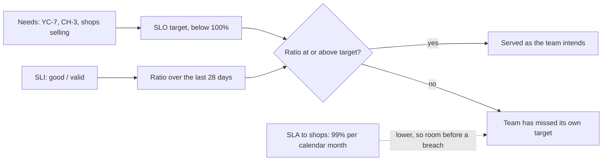

## Before you start

- [[backend.l4.service-level-indicators]] — S1 to S4 in `slo.md` are ratios of good requests to valid requests; this lesson gives each one a target and a period.
- [[management.l3.service-level-agreement]] — an SLA is a measurable promise with a consequence when it is missed; here Đơn Hàng is the one making the promise, to shops.
- [[design.l4.quality-attribute-scenarios]] — YC-7 states the measure one refund request must meet; this lesson says how often, over many requests, that measure must hold.
- [[design.l4.a-thousand-shops]] — CH-3 asks that one shop's busy day not slow the others; two targets in `slo.md` come from it.

## The situation

The product owner is preparing the first contract with another shop. The last open question in `multi-shop-requirements.md` asks what level of service shops are promised, and it must be answered before the first shop signs. You ran `slo-report.sh` this morning, and S1 read a little under `1.0000` for the hour. One teammate says to promise 100%, because every failed order is a lost sale. Another says to promise whatever S1 shows today. The product owner wants one number to put in writing that the team can keep.

What should an SLI be held to, over what period, and how does that relate to what shops are promised?

## Core concepts

- **service level objective (SLO)** — a target for one SLI over a time window, such as 99.5% of order requests not answered with a `5xx` over a rolling 28 days.
- target — the share of good events the SLI must reach or stay above; in `slo.md` every target is below 100%.
- time window — the period the SLI is counted over; a rolling window always covers the last 28 days and moves forward every day, while a calendar month starts again on the first.
- source — the need a target answers, such as YC-7 or CH-3, written next to the number so a reader can tell why it is that number.
- allowance — what the target leaves for bad events over the window, as a share of the requests, or as time if every request in that time failed.

## How it works



In the situation above, S1 already says what share of order requests the API answered well. An SLO adds a target the ratio must reach and a window it is counted over. For S1, `slo.md` sets 99.5% over a rolling 28 days: on any day, at least 99.5% of the last 28 days' order requests must not get a `5xx`. Twenty-eight days is four weeks, so every window holds the same number of weekend days. If weekend traffic differs, an extra weekend in a window would move the ratio for that reason alone.

The top path starts from a need, not from the dashboard. YC-7 asks that a refund request be answered within 2 seconds, so S4 gets a target. CH-3 asks that one shop's busy day not slow the others, so S2 and S3 get theirs.

The paths meet at the check: at or above the target, the service is as the team intends; below it, the team has missed it.

The target stays below 100%. The API depends on PostgreSQL, Redis, RabbitMQ and Keycloak, and each fails now and then. A 100% target would be missed by the first such failure. The team treats a miss as a reason to hold back risky changes and fix reliability first, so at 100% no change that might fail would be safe, a release that fixes a bug included.

The dotted arrow is a separate, lower promise. `slo.md` offers shops 99% of order requests per calendar month, below the team's 99.5%, on purpose: when S1 drops under 99.5%, the team should see it while there is room before the contract is broken.

As an allowance, 99.5% lets 0.5% of the window's order requests fail: as time, about 3 hours and 22 minutes if every request in that time failed.

## In the Đơn Hàng system

The SLO and SLA sections of `slo.md`:

```markdown file=docs/design/slo.md tag=stage-4 lines=58-77
### SLO

Cửa sổ: 28 ngày trượt, để mỗi cửa sổ có cùng số ngày cuối tuần.

| SLI | SLO | Nguồn |
|---|---|---|
| S1 | 99,5% | Cửa hàng bán được hàng; SLA với cửa hàng ở mục dưới |
| S2 | 99% | CH-3 trong `docs/team/multi-shop-requirements.md`: ngày đông của một cửa hàng không làm chậm cửa hàng khác |
| S3 | 99,5% | CH-3, như S2 |
| S4 | 99% | YC-7 trong `docs/team/refund-requirements.md` |

Không SLO nào là 100%. API phụ thuộc PostgreSQL, Redis, RabbitMQ, Keycloak,
và mỗi thứ đều có lúc lỗi; mục tiêu 100% không đạt được, và nó cấm mọi thay
đổi có chút rủi ro, kể cả các lần phát hành sửa lỗi.

### SLA với cửa hàng (giả định, chờ hợp đồng)

Chỉ cho S1: 99% request đặt đơn không lỗi trong mỗi tháng dương lịch. Tháng
nào thấp hơn, cửa hàng được bồi hoàn bằng tín dụng dịch vụ trừ vào kỳ sau. SLA
thấp hơn SLO có chủ ý: đội thấy vấn đề và sửa trước khi hợp đồng bị vi phạm.
```

The first line fixes the window for all four SLOs: a rolling 28 days. The table gives each SLI a target and a source: S1 99.5% because shops must be able to sell; S2, order requests answered within 0.512 seconds, 99%, and S3, product reads without a `5xx`, 99.5%, both from CH-3; S4 99% from YC-7. No row says "what we measure today". The paragraph under the table is the reason no target is 100%.

The SLA section promises shops less than S1's SLO, over a different window: 99% per calendar month, with a service credit against the next period when a month falls short. Its heading marks it as an assumption waiting for a contract. In the lab, `slo-report.sh` reads the last hour, not 28 days (`slo.md` says so above this excerpt).

YC-7, the source of S4:

```markdown file=docs/team/refund-requirements.md tag=stage-4 lines=43-44
- YC-7: Yêu cầu hoàn tiền của khách được nhận và trả lời trong 2 giây, kể cả
  khi cổng thanh toán không trả lời hoặc báo lỗi.
```

YC-7 is about one request: received and answered within 2 seconds, even when the payment gateway does not answer or reports an error. It gives no percentage. S4's 99% is the team's decision about how often, over 28 days, that measure may be missed.

## Trade-offs

| Choice | What it gives | What it costs | When it fits |
|---|---|---|---|
| Target 100% | no failure is ever acceptable | missed by the first dependency failure; forbids every risky change | no SLO; see the rule below the table |
| Target from a need, below 100% | a number shops and the team can explain | someone has to decide how often the need may be missed | every SLO in `slo.md` |
| Target from today's ratio | a number that is met on day one | says nothing about what shops need; can lock in a bad level or forbid change | as a first guess when no need is written down yet, if it is replaced once one is |
| Rolling 28 days | every window has the same weekend days; it can be read on any day | one bad day stays in the window for four weeks | the team's own SLOs |
| Calendar month | matches how the SLA in `slo.md` and its credits are counted | starts again on the first; months differ in length | the SLA to shops |

The SLO and the SLA are not rivals: the SLO tells the team when to act, the SLA tells a shop what it can claim.

Some needs must hold for every single request, such as YC-9: an order is never refunded twice. When a need is like that, it belongs in the design and its tests, not in a target that allows a share of failures.

## What would you choose if…

…a large shop asks for 99.9% of order requests per month in its contract? Do not sign it under the current SLO. A promise above the team's own 99.5% target would be broken before the team's target is even missed; raise the SLO first, and only if the team can keep it.

…S1 has read well above 99.5% for months, and someone proposes raising the SLO to match? Ask what shops need first. If the need has not changed, keep the target; a higher one leaves less room for the failures a release may bring.

…the lab report shows S1 under 99.5% for one hour? That is one hour, not the 28-day window. It shows that failures happened in that hour; it does not by itself mean S1's SLO is missed.

## Seniors often assume…

- **"The higher the SLO the better, so we should aim for 100%."** → Actually a 100% target is missed by the first failure of PostgreSQL, Redis, RabbitMQ or Keycloak, and every release becomes forbidden because any change can fail. You notice this when a release that fixes a bug is held back because it might cause a single `500`.
- **"Our SLO and the SLA we promise shops should be the same number."** → Actually with equal numbers, the first time the team misses its own target, the contract is already broken. `slo.md` keeps the SLA at 99% per month under S1's 99.5% so the team can see a problem before the contract is broken. You notice this when shops claim a credit for the same month the team first notices S1 falling.
- **"The right SLO is whatever the system achieves today."** → Actually today's ratio describes the system, not the shops' needs. It may be higher than anyone needs, which makes every risky change look forbidden, or lower, which turns a bad level into the promise. You notice this when a target has no source to point to, unlike the `Nguồn` column of `slo.md`.

## Try it (3 minutes)

1. Work out S1's allowance as time: 0.5% of 28 days, if every request in that time failed.
2. Work out the SLA's allowance as time: 1% of a 30-day month.
3. Compare the two, and say what the difference gives the team.

Expected result: two durations, the SLA's more than twice as long as the SLO's.

<details><summary>Suggested answer</summary>

S1's SLO: 28 × 24 × 60 = 40,320 minutes; 0.5% of that is 201.6 minutes, about 3 hours and 22 minutes. The SLA: 30 × 24 × 60 = 43,200 minutes; 1% of that is 432 minutes, 7 hours and 12 minutes. The SLA allows more than twice as long. Between the two, the team has missed its own target but still keeps the contract, which is the time `slo.md` wants for finding and fixing the problem. Both are only pictures: the targets count requests, not minutes.

</details>

## Connections

- [[backend.l4.service-level-indicators]] — prerequisite: the ratios that this lesson gives targets and windows.
- [[backend.l4.error-budget]] — the next step: what the team does with the allowance a target leaves.
- [[management.l3.service-level-agreement]] — the same kind of promise seen from the other side, as the customer of a vendor's SLA.
- [[management.l2.non-functional-requirements]] — where needs such as YC-7 and CH-3 are written; an SLO is one of them made measurable over time.
- [[design.l4.mapping-fitness-functions]] — watching a quality attribute while the system runs is one choice there; an SLO gives that watching a target.

## Five-line summary

1. An SLO sets a target below 100% for one SLI over a time window, such as 99.5% of order requests without `5xx` over 28 days.
2. A 100% target is missed by the first dependency failure and forbids every risky change, so no target in `slo.md` is 100%.
3. Each target comes from a need, such as YC-7 or CH-3, not from what the dashboard shows today.
4. The SLA to shops promises less than the SLO, 99% per calendar month, so the team can see a problem before the contract is broken.
5. Over 28 days, 99.5% allows 0.5% of the requests to fail, about 3 hours and 22 minutes if all failed.
