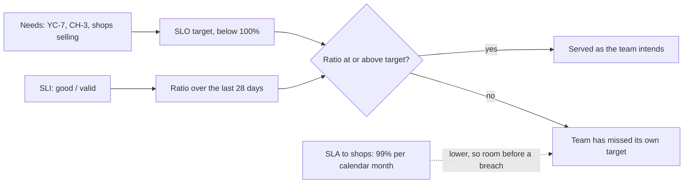

## Bạn cần biết trước

- [[backend.l4.service-level-indicators]] — S1 tới S4 trong `slo.md` là tỉ lệ giữa request tốt và request hợp lệ. Bài này cho mỗi tỉ lệ một mục tiêu và một khoảng thời gian.
- [[management.l3.service-level-agreement]] — SLA là một lời hứa đo được, kèm hậu quả khi bị lỡ. Ở đây chính Đơn Hàng là bên hứa, với các cửa hàng.
- [[design.l4.quality-attribute-scenarios]] — YC-7 nêu thước đo mà một yêu cầu hoàn tiền phải đạt. Bài này nói thước đo đó phải đúng thường xuyên tới đâu, trên rất nhiều request.
- [[design.l4.a-thousand-shops]] — CH-3 yêu cầu ngày đông khách của một cửa hàng không làm chậm các cửa hàng khác. Hai mục tiêu trong `slo.md` xuất phát từ đó.

## Tình huống

Product owner đang chuẩn bị hợp đồng đầu tiên với một cửa hàng khác. Câu hỏi còn bỏ ngỏ cuối cùng trong `multi-shop-requirements.md` là cửa hàng được hứa mức dịch vụ nào, và phải trả lời trước khi cửa hàng đầu tiên ký. Sáng nay bạn chạy `slo-report.sh`, S1 của giờ đó nhỉnh dưới `1.0000` một chút. Một đồng đội bảo cứ hứa 100%, vì mỗi đơn lỗi là một lần mất doanh thu. Người khác bảo hứa đúng con số S1 đang cho thấy hôm nay. Product owner muốn một con số duy nhất để ghi vào văn bản, và team giữ được nó.

Một SLI nên được giữ ở mức nào, trong khoảng thời gian nào, và điều đó liên quan gì tới những gì cửa hàng được hứa?

## Khái niệm cốt lõi

- **mục tiêu mức dịch vụ (SLO)** (service level objective) — mục tiêu cho một SLI trong một cửa sổ thời gian, chẳng hạn 99,5% request đặt đơn không bị trả `5xx` trong 28 ngày trượt.
- mục tiêu — phần sự kiện tốt mà SLI phải đạt hoặc giữ ở trên. Trong `slo.md`, mọi mục tiêu đều dưới 100%.
- cửa sổ thời gian — khoảng thời gian SLI được đếm. Cửa sổ trượt luôn phủ 28 ngày gần nhất và dịch tới mỗi ngày, còn tháng dương lịch thì bắt đầu lại từ ngày mùng một.
- nguồn — nhu cầu mà một mục tiêu đáp ứng, như YC-7 hay CH-3, ghi cạnh con số để người đọc biết vì sao lại là con số đó.
- phần cho phép — phần mục tiêu chừa lại cho sự kiện xấu trong cửa sổ, tính theo tỉ lệ request, hoặc theo thời gian nếu mọi request trong khoảng đó đều lỗi.

## Cơ chế hoạt động



Trong tình huống trên, S1 đã cho biết API trả lời tốt được bao nhiêu phần request đặt đơn. SLO thêm vào một mục tiêu mà tỉ lệ phải đạt và một cửa sổ để đếm tỉ lệ đó. Với S1, `slo.md` đặt 99,5% trong 28 ngày trượt: vào bất kỳ ngày nào, ít nhất 99,5% request đặt đơn của 28 ngày gần nhất không bị trả `5xx`. Hai mươi tám ngày là bốn tuần, nên cửa sổ nào cũng có cùng số ngày cuối tuần. Nếu lưu lượng cuối tuần khác ngày thường, một cửa sổ có thêm một cuối tuần sẽ làm tỉ lệ dịch chuyển chỉ vì lý do đó.

Nhánh trên cùng bắt đầu từ một nhu cầu, không phải từ dashboard. YC-7 yêu cầu yêu cầu hoàn tiền được trả lời trong 2 giây, nên S4 có mục tiêu. CH-3 yêu cầu ngày đông khách của một cửa hàng không làm chậm các cửa hàng khác, nên S2 và S3 có mục tiêu của mình.

Các nhánh gặp nhau ở bước kiểm tra: bằng hoặc trên mục tiêu thì dịch vụ đúng như team muốn, dưới mục tiêu thì team đã lỡ nó.

Mục tiêu luôn dưới 100%. API phụ thuộc PostgreSQL, Redis, RabbitMQ và Keycloak, và thỉnh thoảng thứ nào cũng lỗi. Mục tiêu 100% sẽ bị lỡ ngay từ lần lỗi đầu tiên như thế. Team coi một lần lỡ là lý do để hoãn các thay đổi rủi ro và sửa độ tin cậy trước, nên ở mức 100% không thay đổi nào có thể lỗi được coi là an toàn, kể cả một lần phát hành sửa bug.

Mũi tên chấm là một lời hứa riêng, thấp hơn. `slo.md` hứa với cửa hàng 99% request đặt đơn mỗi tháng dương lịch, thấp hơn 99,5% của team, và cố ý như vậy: khi S1 tụt dưới 99,5%, team phải thấy được trong lúc vẫn còn khoảng trống trước khi hợp đồng bị vi phạm.

Tính theo phần cho phép, 99,5% để 0,5% request đặt đơn trong cửa sổ được lỗi. Tính theo thời gian, đó là khoảng 3 giờ 22 phút nếu mọi request trong khoảng đó đều lỗi.

## Trong hệ thống Đơn Hàng

Mục SLO và mục SLA của `slo.md`:

```markdown file=docs/design/slo.md tag=stage-4 lines=58-77
### SLO

Cửa sổ: 28 ngày trượt, để mỗi cửa sổ có cùng số ngày cuối tuần.

| SLI | SLO | Nguồn |
|---|---|---|
| S1 | 99,5% | Cửa hàng bán được hàng; SLA với cửa hàng ở mục dưới |
| S2 | 99% | CH-3 trong `docs/team/multi-shop-requirements.md`: ngày đông của một cửa hàng không làm chậm cửa hàng khác |
| S3 | 99,5% | CH-3, như S2 |
| S4 | 99% | YC-7 trong `docs/team/refund-requirements.md` |

Không SLO nào là 100%. API phụ thuộc PostgreSQL, Redis, RabbitMQ, Keycloak,
và mỗi thứ đều có lúc lỗi; mục tiêu 100% không đạt được, và nó cấm mọi thay
đổi có chút rủi ro, kể cả các lần phát hành sửa lỗi.

### SLA với cửa hàng (giả định, chờ hợp đồng)

Chỉ cho S1: 99% request đặt đơn không lỗi trong mỗi tháng dương lịch. Tháng
nào thấp hơn, cửa hàng được bồi hoàn bằng tín dụng dịch vụ trừ vào kỳ sau. SLA
thấp hơn SLO có chủ ý: đội thấy vấn đề và sửa trước khi hợp đồng bị vi phạm.
```

Dòng đầu tiên cố định cửa sổ cho cả bốn SLO: 28 ngày trượt. Bảng cho mỗi SLI một mục tiêu và một nguồn. S1 là 99,5% vì cửa hàng phải bán được hàng. S2, request đặt đơn được trả lời trong 0,512 giây, là 99%, và S3, lượt đọc sản phẩm không bị trả `5xx`, là 99,5%, cả hai đều từ CH-3. S4 là 99%, từ YC-7. Không dòng nào ghi "mức đang đo được hôm nay". Đoạn dưới bảng là lý do không mục tiêu nào là 100%.

Mục SLA hứa với cửa hàng ít hơn SLO của S1, trên một cửa sổ khác: 99% mỗi tháng dương lịch, kèm tín dụng dịch vụ trừ vào kỳ sau khi một tháng không đạt. Tiêu đề của mục ghi rõ đây là giả định đang chờ hợp đồng. Trong lab, `slo-report.sh` đọc một giờ gần nhất chứ không phải 28 ngày (`slo.md` nói điều này ở phía trên đoạn trích).

YC-7, nguồn của S4:

```markdown file=docs/team/refund-requirements.md tag=stage-4 lines=43-44
- YC-7: Yêu cầu hoàn tiền của khách được nhận và trả lời trong 2 giây, kể cả
  khi cổng thanh toán không trả lời hoặc báo lỗi.
```

YC-7 nói về một request: được nhận và trả lời trong 2 giây, kể cả khi cổng thanh toán không trả lời hoặc báo lỗi. Nó không nêu phần trăm nào. Con số 99% của S4 là quyết định của team về chuyện thước đo đó được phép bị lỡ thường xuyên tới đâu trong 28 ngày.

## Đánh đổi

| Lựa chọn | Nó cho bạn | Cái giá | Khi nào hợp |
|---|---|---|---|
| Mục tiêu 100% | không lần lỗi nào được chấp nhận | bị lỡ ngay từ lần lỗi đầu tiên của một dependency; cấm mọi thay đổi có rủi ro | không SLO nào; xem quy tắc dưới bảng |
| Mục tiêu từ một nhu cầu, dưới 100% | một con số mà cửa hàng và team đều giải thích được | phải có người quyết định nhu cầu được phép bị lỡ thường xuyên tới đâu | mọi SLO trong `slo.md` |
| Mục tiêu từ tỉ lệ hôm nay | một con số đạt ngay từ ngày đầu | không nói gì về nhu cầu của cửa hàng; có thể khóa chặt một mức tệ hoặc cấm thay đổi | làm phỏng đoán đầu tiên khi chưa có nhu cầu nào được viết ra, miễn là được thay khi đã có |
| 28 ngày trượt | cửa sổ nào cũng có cùng số ngày cuối tuần; đọc được vào bất kỳ ngày nào | một ngày tệ nằm lại trong cửa sổ suốt bốn tuần | SLO của chính team |
| Tháng dương lịch | khớp với cách SLA trong `slo.md` và tín dụng của nó được tính | bắt đầu lại từ ngày mùng một; các tháng dài ngắn khác nhau | SLA với cửa hàng |

SLO và SLA không cạnh tranh nhau: SLO cho team biết khi nào phải hành động, SLA cho cửa hàng biết mình được đòi gì.

Có những nhu cầu phải đúng với từng request một, như YC-9: một đơn không bao giờ được hoàn tiền hai lần. Nhu cầu kiểu đó thuộc về thiết kế và các test của nó, không thuộc về một mục tiêu cho phép một phần thất bại.

## Bạn sẽ chọn gì nếu…

…một cửa hàng lớn đòi ghi vào hợp đồng 99,9% request đặt đơn mỗi tháng? Đừng ký với SLO hiện tại. Một lời hứa cao hơn mục tiêu 99,5% của chính team sẽ bị vi phạm trước cả khi team lỡ mục tiêu của mình. Hãy nâng SLO trước, và chỉ nâng nếu team giữ được nó.

…S1 đã ở mức cao hơn hẳn 99,5% suốt nhiều tháng, và có người đề nghị nâng SLO cho khớp? Hãy hỏi trước cửa hàng cần gì. Nếu nhu cầu không đổi, giữ nguyên mục tiêu. Mục tiêu cao hơn chừa ít chỗ hơn cho các lỗi mà một lần phát hành có thể mang tới.

…báo cáo của lab cho thấy S1 dưới 99,5% trong một giờ? Đó là một giờ, không phải cửa sổ 28 ngày. Nó cho thấy trong giờ đó có lỗi, nhưng tự nó không có nghĩa SLO của S1 đã bị lỡ.

## Senior hay nhầm rằng…

- **"SLO càng cao càng tốt, nên mình nhắm tới 100%."** → Thực ra mục tiêu 100% bị lỡ ngay từ lần lỗi đầu tiên của PostgreSQL, Redis, RabbitMQ hay Keycloak, và mọi lần phát hành đều bị cấm vì thay đổi nào cũng có thể lỗi. Bạn sẽ nhận ra khi một bản phát hành sửa bug bị giữ lại chỉ vì nó có thể gây ra một `500`.
- **"SLO của mình và SLA hứa với cửa hàng nên là cùng một con số."** → Thực ra nếu hai số bằng nhau thì lần đầu team lỡ mục tiêu của mình cũng là lúc hợp đồng đã bị vi phạm. `slo.md` giữ SLA ở 99% mỗi tháng, dưới 99,5% của S1, để team thấy vấn đề trước khi hợp đồng bị vi phạm. Bạn sẽ nhận ra khi cửa hàng đòi tín dụng cho đúng cái tháng mà team lần đầu thấy S1 tụt xuống.
- **"SLO đúng là mức hệ thống đang đạt được hôm nay."** → Thực ra tỉ lệ hôm nay mô tả hệ thống, không mô tả nhu cầu của cửa hàng. Nó có thể cao hơn mức ai cần, khiến thay đổi rủi ro nào trông cũng như bị cấm, hoặc thấp hơn, biến một mức tệ thành lời hứa. Bạn sẽ nhận ra khi một mục tiêu không có nguồn nào để chỉ vào, khác với cột `Nguồn` của `slo.md`.

## Thử ngay (3 phút)

1. Tính phần cho phép của S1 theo thời gian: 0,5% của 28 ngày, nếu mọi request trong khoảng đó đều lỗi.
2. Tính phần cho phép của SLA theo thời gian: 1% của một tháng 30 ngày.
3. So sánh hai con số, và nói phần chênh lệch cho team điều gì.

Kết quả mong đợi: hai khoảng thời gian, của SLA dài hơn gấp đôi của SLO.

<details><summary>Gợi ý đáp án</summary>

SLO của S1: 28 × 24 × 60 = 40.320 phút, 0,5% của số đó là 201,6 phút, khoảng 3 giờ 22 phút. SLA: 30 × 24 × 60 = 43.200 phút, 1% của số đó là 432 phút, tức 7 giờ 12 phút. SLA cho phép dài hơn gấp đôi. Ở khoảng giữa hai con số, team đã lỡ mục tiêu của mình nhưng vẫn giữ được hợp đồng, và đó chính là thời gian `slo.md` muốn có để tìm và sửa vấn đề. Cả hai chỉ là hình dung: các mục tiêu đếm request, không đếm phút.

</details>

## Liên hệ

- [[backend.l4.service-level-indicators]] — bài cần trước: các tỉ lệ mà bài này gắn mục tiêu và cửa sổ.
- [[backend.l4.error-budget]] — bước tiếp theo: team làm gì với phần cho phép mà một mục tiêu chừa lại.
- [[management.l3.service-level-agreement]] — cùng loại lời hứa nhìn từ phía bên kia, khi mình là khách của SLA do một vendor đưa ra.
- [[management.l2.non-functional-requirements]] — nơi các nhu cầu như YC-7 và CH-3 được viết ra. SLO là một nhu cầu như vậy được làm cho đo được theo thời gian.
- [[design.l4.mapping-fitness-functions]] — theo dõi một thuộc tính chất lượng trong lúc hệ thống chạy là một lựa chọn ở bài đó. SLO cho việc theo dõi ấy một mục tiêu.

## Tóm tắt 5 dòng

1. SLO đặt mục tiêu dưới 100% cho một SLI trong một cửa sổ thời gian, chẳng hạn 99,5% request đặt đơn không bị trả `5xx` trong 28 ngày.
2. Mục tiêu 100% bị lỡ ngay từ lần lỗi đầu tiên của một dependency và cấm mọi thay đổi có rủi ro, nên không mục tiêu nào trong `slo.md` là 100%.
3. Mỗi mục tiêu xuất phát từ một nhu cầu, như YC-7 hay CH-3, không phải từ những gì dashboard đang cho thấy hôm nay.
4. SLA với cửa hàng hứa ít hơn SLO, 99% mỗi tháng dương lịch, để team thấy vấn đề trước khi hợp đồng bị vi phạm.
5. Trong 28 ngày, 99,5% cho phép 0,5% request lỗi, khoảng 3 giờ 22 phút nếu tất cả cùng lỗi.
