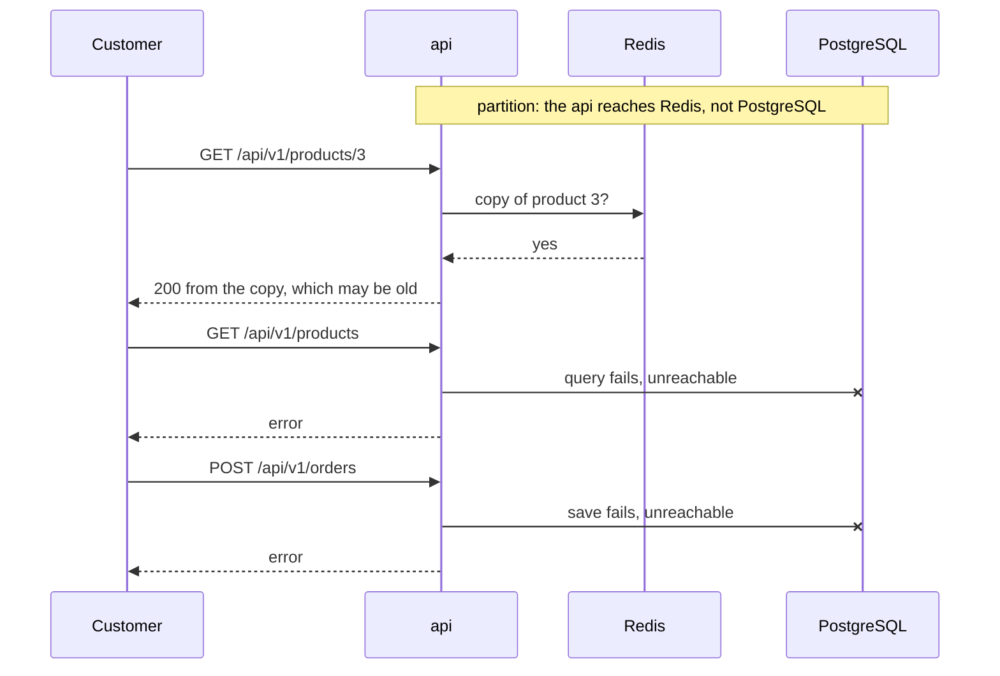

## Before you start

- [[backend.l3.eventual-consistency]] — you know that inside one PostgreSQL database a read that starts after a commit sees the change, while services joined by messages agree only later.
- [[backend.l3.read-replicas]] — you know that a read replica applies each change only after the primary commits it, so a read from it can return old data.
- [[backend.l3.graceful-degradation]] — you know that `ProductCache` treats Redis as optional and that the api cannot do its main job without PostgreSQL.

## The situation

It is stage-4. The network between the api and PostgreSQL fails for a few minutes; the api and Redis keep running. A customer opens product 3 and sees it, price included. Another opens the product list and gets `500`. A third presses the order button and also gets `500`.

In the team chat, one teammate asks why the api did not simply fail everywhere. Another asks why it did not answer everywhere, since product 3 worked. Both are asking about the same choice, and it was made once per operation.

While part of Đơn Hàng cannot reach the database, which operations should still answer, and which should refuse?

## Core concepts

- **network partition** — a fault that splits a system into parts that keep running but cannot reach each other, so each part sees the others as unreachable; in the situation above, the api and Redis are on one side and PostgreSQL on the other.
- **CAP theorem** — a classic result saying that during a network partition, a system holding copies of data cannot both answer every request and give only the latest value (strong consistency); it gives up one of the two. Its letters name three properties: consistency (only the latest value), availability (every request gets an answer) and partition tolerance (the system keeps running through a partition).
- copy — data held somewhere other than the database that owns it, such as product 3 in Redis; it can answer while the owner is unreachable, but it may be old.
- answer or refuse — the choice each operation makes while a partition lasts: answer with the copy it has, accepting that it may be old, or return an error instead of a value that may be wrong.

## How it works



Read the diagram from the top. The note is the network partition: the api still runs and still reaches Redis, but every call to PostgreSQL fails. From the api's side, a stopped database and one that is only cut off end the same way: every call to it fails, so the api must treat both as unreachable.

The first request finds a copy. Answering from it keeps product 3 readable, but the api cannot check that the copy still holds the latest value, because the only place that knows is on the other side of the partition. The next two requests have no copy to use, so the api refuses them.

This is the CAP theorem on a small scale. While a partition lasts, a part cut off from the owner of the data has two honest options. It can answer with what it holds and accept that the value may be old, or it can refuse and never return an old value. Doing both would require reaching the other side, which is exactly what the partition prevents.

A network between servers can fail in ways you cannot rule out: a broken cable, a misconfigured network between the machines. So "no partitions" is not an option you get to pick. The real question is narrower and is asked once per operation: while a partition lasts, does this operation answer with the copy it has, or refuse? The diagram shows three such choices, one per request.

## In the Đơn Hàng system

`scripts/backend/db-unreachable.sh` reproduces the situation on your machine:

```bash file=scripts/backend/db-unreachable.sh tag=stage-4 lines=33-44
# lesson: backend.l4.cap-theorem
# Stopping the container stands in for a partition between the api and its
# database: the api still runs and still reaches Redis, but not PostgreSQL.
# (A real partition can also make calls hang; a stopped server fails fast.)
docker compose stop db >/dev/null 2>&1
trap restore EXIT
echo "== db is stopped"
echo "  GET /api/v1/products/3 (the copy in Redis) -> $(status http://localhost:8080/api/v1/products/3)"
echo "  GET /api/v1/products (no copy, needs db) -> $(status http://localhost:8080/api/v1/products)"
echo "  POST /api/v1/orders (must be saved in db) -> $(status -X POST http://localhost:8080/api/v1/orders \
  -H 'Content-Type: application/json' -H "Authorization: Bearer $token" \
  -d '{"items":[{"productId":3,"quantity":1}]}')"
```

```text output=true
== db is up: read product 3, which puts a copy of it in Redis
  GET /api/v1/products/3 -> 200
  copy in Redis: yes
== db is stopped
  GET /api/v1/products/3 (the copy in Redis) -> 200
  GET /api/v1/products (no copy, needs db) -> 500
  POST /api/v1/orders (must be saved in db) -> 500
```

Before this excerpt, the script reads product 3 once, so Redis holds a copy, and gets an access token for the order request; the first three output lines show the copy. Line 37 stops the `db` container, and the `trap` on line 38 starts it again when the script ends. Lines 34–36 say where this differs from a real partition: a stopped server fails quickly, while a real partition can make each call wait until a timeout before it fails. The last three output lines are the three choices from the diagram.

The two failures are not the same kind of choice. Placing an order is a write: `PlaceOrderAsync` in `DonHang.Domain/OrderService.cs` ends with `SaveChangesAsync`, which saves the order in PostgreSQL, the database that owns orders. If a copy accepted it instead, the customer would hear "received" while the owner has no record of the order, and every read from the owner would miss it. A request accepted but never saved by its owner costs more than an error, so while the owner is unreachable the only consistent answer is to refuse.

The product list is a read, and a read can choose; it refuses only because no copy of the list exists. Product 3 answers from the copy `ProductCache` keeps in Redis, which expires 5 minutes after it was written, so once that copy expires during the partition, product 3 fails too.

Each operation's choice, with its business reason, is written in `docs/design/consistency-per-operation.md`:

```markdown file=docs/design/consistency-per-operation.md tag=stage-4 lines=11-18
| Thao tác | Dữ liệu đọc/ghi, chủ | Khi không tới được nguồn | Khi bình thường | Cơ chế hiện có | Lý do nghiệp vụ |
|---|---|---|---|---|---|
| Xem một sản phẩm (`GET /api/v1/products/{id}`) | Đọc `products`, chủ Catalog | Trả lời bằng bản sao trong Redis nếu còn; không có bản sao thì lỗi | Độ trễ thấp: bản sao có thể cũ | `ProductCache`, TTL 5 phút, xóa bản sao sau khi đổi giá | Giá hiển thị cũ vài phút là chấp nhận được |
| Danh sách sản phẩm (`GET /api/v1/products`) | Đọc `products`, chủ Catalog | Từ chối (lỗi) | Mới nhất: đọc primary mỗi lần | Truy vấn thẳng `CatalogDbContext`, không cache | Nghiệp vụ chấp nhận danh sách hơi cũ; đọc primary chỉ vì code chưa có bản sao nào khác |
| Tìm sản phẩm (tham số tìm của `GET /api/v1/products`; chưa có ở stage-4, ADR 0030) | Đọc `products` và từ tìm được trên cùng dòng, chủ Catalog | Từ chối (lỗi), như danh sách sản phẩm | Được cũ như danh sách sản phẩm: sản phẩm mới tìm được sau vài phút (giả định) | Full-text search của PostgreSQL trên primary; replica khi `capacity-plan.md` cho phép | Cùng lựa chọn với danh sách sản phẩm |
| Đặt đơn (`POST /api/v1/orders`, `/api/v2/orders`) | Ghi `orders`, `order_items`, `outbox_messages`, chủ Ordering; đọc giá qua `ICatalog` | Từ chối: đơn phải được lưu ở database của chủ | Ghi: mới nhất; giá: có thể là bản sao Redis | Một transaction trên primary; giá qua `ProductCache` | Đơn đã nhận phải còn; giá lúc đặt xem mục dưới |
| Xem đơn của mình (`GET /api/v1/orders/{id}`, `.../history`) | Đọc `orders`, `order_status_history`, chủ Ordering | Từ chối | Mới nhất: đọc primary | Đọc primary | Khách vừa đặt đơn phải thấy ngay đơn đó |
| Yêu cầu hoàn tiền (`POST /api/v1/orders/{id}/refund`) | Ghi `orders` (`refunding`) và outbox; Payments ghi `payments` rồi gọi cổng | Database lỗi: từ chối. Cổng lỗi: vẫn nhận, đơn ở `refunding` | Trả lời nhanh (YC-7); kết quả tới sau | Outbox, saga, trạng thái `refunding` | Không bao giờ báo đã hoàn tiền trước khi cổng xác nhận |
```

The table is in Vietnamese by design. Its third column is the choice when the data's source is unreachable, and its last column is the business reason. Viewing one product answers from the Redis copy while one exists, because a price a few minutes old is acceptable. The product list refuses, although the business accepts a slightly old list; the code simply has no copy to answer from. Placing an order refuses, because an order once accepted must not be lost. The search row is planned, not built at stage-4, and makes the same choice as the product list.

The refund row separates two unreachable things: with the database unreachable the request is refused, for the same reason as an order, and with the payment gateway unreachable it is still accepted and the order stays `refunding`, because no step reports a refund as done before the gateway confirms it.

## Trade-offs

| Choice for an operation during a partition | What the customer gets | What it risks | Fits when |
|---|---|---|---|
| Answer from a copy | a working answer | a value as old as the copy; an error once the copy expires | an old value harms nobody, such as the price shown for one product |
| Refuse | an error | every request of that kind fails while the partition lasts | a lost or wrong answer costs more than no answer, such as saving an order |
| Save the request, answer "not done yet", finish later | a quick answer that names an in-between state | requests pile up; the customer waits for the real result | the slow part can wait and the in-between state is shown honestly, such as `refunding` |

The third row is not a way around the theorem: a refund still refuses when the database that owns orders is unreachable; only the gateway's part waits.

## What would you choose if…

…the product list keeps failing during partitions, and the person who decides what the shop offers says a list a few minutes old is fine? The table already states that reason, so answering from a copy is allowed; the list refuses only because no copy exists. Adding one moves the operation to the first row of the trade-offs, and the cost is a copy to keep fresh. Change the row in `consistency-per-operation.md` first, with how old the list may be.

…a teammate proposes keeping each customer's orders in Redis, so that viewing an order keeps working during a partition? The table's reason for that row is that a customer who has just placed an order must see it at once. A copy can be older than the order just placed, which is the very thing that reason rules out. Keep refusing unless the business drops that reason, in writing.

## Seniors often assume…

- **"A well-built system can keep consistency, availability and partition tolerance all at once."** → Actually a design can make partitions rarer and shorter, but it cannot switch them off. During one, a part cut off from the owner of the data can answer with what it holds or refuse; it cannot answer and also guarantee the latest value. You notice this when a design promises always up and always current, and the first network fault shows which it gave up.
- **"The consistency in CAP is the same thing a database transaction keeps inside one database."** → Actually a transaction's consistency means the data still complies with the database's integrity rules, such as a foreign key pointing at an existing row, when the transaction commits. CAP's consistency is about copies: whether every read sees the latest written value, wherever it is served from. A product in Redis breaks no rule of the `products` table, yet its price can be old. You notice this when someone answers "we use transactions, so we are consistent" about a read served from Redis.
- **"CAP is chosen once for the whole system, by picking the right database."** → Actually reading product 3 and placing an order in the output above both depend on the same `db` container, yet one answers during the partition and the other refuses. The choice follows from what each operation does and what its business accepts. You notice this when a team calls the whole system "consistent" or "available" and cannot say what reading one product does while the database is unreachable.

## Try it (3 minutes)

With the lab running (`scripts/up.sh`), in a terminal in the root folder of the example repository at tag `stage-4`:

1. Run `scripts/backend/db-unreachable.sh`. It reads product 3, stops `db`, sends three requests, and starts `db` again at the end.
2. Compare the three lines under `== db is stopped`.

Expected result: product 3 answers `200`, the product list and the order answer `500`, as in the output above.

Then decide: if Redis had held no copy of product 3 when `db` stopped, what would `GET /api/v1/products/3` have answered, and why?

<details><summary>Suggested answer</summary>

It would have failed like the product list. With no copy in Redis, `ProductCache` has to ask PostgreSQL, which is unreachable. An operation can answer during a partition only with a copy made before it began, and only until that copy's 5-minute TTL ends.

</details>

## Connections

- [[backend.l3.eventual-consistency]] — prerequisite: the refund already answers `202` and finishes later; this lesson names the choice behind that answer.
- [[backend.l3.read-replicas]] — prerequisite: a replica is another copy that may be old, so reads served from it face the same choice.
- [[backend.l3.graceful-degradation]] — the same outage, seen per dependency instead of per operation.
- [[backend.l2.cache-aside]] — where the Redis copy that answers during the partition comes from.
- [[backend.l3.slow-dependencies]] — the part `db-unreachable.sh` leaves out: a real partition can make calls wait until a timeout instead of failing fast.
- [[design.l4.trade-off-points]] — the same shape: each operation's choice trades answering against staying consistent.
- [[backend.l4.pacelc]] — next in this module: the choice that remains when there is no partition at all.

## Five-line summary

1. During a network partition, each operation that relies on copies of data either answers with the copy it holds or refuses to stay consistent.
2. A network partition splits a system into running parts that cannot reach each other, and a networked system cannot rule it out.
3. The CAP theorem: during a partition, a system with copies cannot both answer every request and give only the latest value.
4. With `db` stopped, product 3 answers from Redis while the product list and orders fail; a write needing its owner's database can only refuse.
5. `consistency-per-operation.md` records each operation's choice and business reason, such as a few-minutes-old price, or no refund shown before the gateway confirms.
