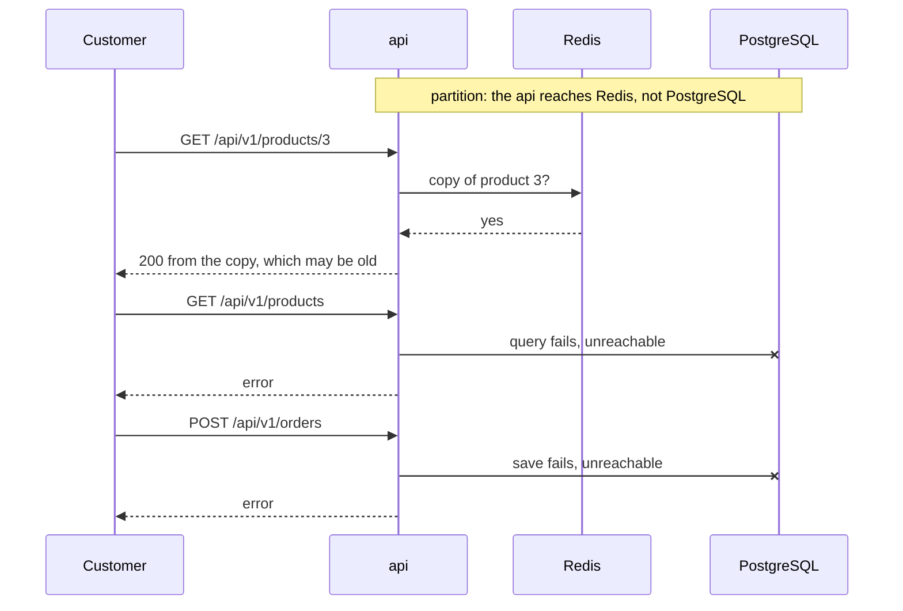

## Bạn cần biết trước

- [[backend.l3.eventual-consistency]] — bạn biết rằng trong một database PostgreSQL, lần đọc bắt đầu sau một lần commit sẽ thấy thay đổi đó, còn các service nối với nhau bằng message chỉ khớp nhau sau một lúc.
- [[backend.l3.read-replicas]] — bạn biết rằng read replica chỉ áp dụng mỗi thay đổi sau khi primary đã commit nó, nên đọc từ replica có thể nhận dữ liệu cũ.
- [[backend.l3.graceful-degradation]] — bạn biết rằng `ProductCache` coi Redis là không bắt buộc, còn api không làm được việc chính nếu thiếu PostgreSQL.

## Tình huống

Đang ở stage-4. Mạng giữa api và PostgreSQL hỏng trong vài phút, còn api và Redis vẫn chạy. Một khách mở sản phẩm 3 và thấy nó, có cả giá. Một khách khác mở danh sách sản phẩm và nhận `500`. Khách thứ ba bấm nút đặt đơn và cũng nhận `500`.

Trong nhóm chat của team, một người hỏi sao api không lỗi luôn ở mọi chỗ. Người khác hỏi sao nó không trả lời ở mọi chỗ, vì sản phẩm 3 vẫn chạy được. Cả hai đang hỏi về cùng một lựa chọn, và lựa chọn đó được đưa ra riêng cho từng thao tác.

Trong lúc một phần của Đơn Hàng không tới được database, thao tác nào nên vẫn trả lời, thao tác nào nên từ chối?

## Khái niệm cốt lõi

- **phân vùng mạng** (network partition) — sự cố chia hệ thống thành các phần vẫn chạy nhưng không liên lạc được với nhau, nên mỗi phần thấy các phần kia là không tới được. Trong tình huống trên, api và Redis ở một bên, PostgreSQL ở bên kia.
- **định lý CAP** (CAP theorem) — một kết quả kinh điển: khi có phân vùng mạng, hệ thống giữ nhiều bản dữ liệu không thể vừa trả lời mọi request vừa chỉ trả giá trị mới nhất (strong consistency), nó phải bỏ một trong hai. Ba chữ cái là tên ba tính chất: consistency (chỉ trả giá trị mới nhất), availability (request nào cũng được trả lời) và partition tolerance (hệ thống vẫn chạy qua một phân vùng mạng).
- bản sao — dữ liệu nằm ở nơi khác ngoài database làm chủ nó, chẳng hạn sản phẩm 3 trong Redis. Bản sao vẫn trả lời được khi chủ không tới được, nhưng có thể đã cũ.
- trả lời hay từ chối — lựa chọn mà mỗi thao tác phải đưa ra trong lúc phân vùng còn kéo dài: trả lời bằng bản sao đang có và chấp nhận rằng nó có thể cũ, hoặc trả về lỗi thay vì một giá trị có thể sai.

## Cơ chế hoạt động



Hãy đọc sơ đồ từ trên xuống. Dòng ghi chú chính là phân vùng mạng: api vẫn chạy và vẫn tới được Redis, nhưng mọi lần gọi PostgreSQL đều thất bại. Từ phía api, một database đã dừng và một database chỉ bị cắt mạng kết thúc giống nhau: mọi lần gọi tới nó đều lỗi, nên api phải coi cả hai là không tới được.

Request đầu tiên tìm thấy một bản sao. Trả lời bằng bản sao giúp sản phẩm 3 vẫn đọc được, nhưng api không kiểm tra được bản sao đó còn là giá trị mới nhất hay không, vì nơi duy nhất biết điều đó nằm ở bên kia phân vùng. Hai request sau không có bản sao nào để dùng, nên api từ chối.

Đây là định lý CAP ở quy mô nhỏ. Trong lúc phân vùng còn kéo dài, phần bị cắt khỏi chủ của dữ liệu có hai lựa chọn trung thực. Nó có thể trả lời bằng thứ nó đang giữ và chấp nhận giá trị có thể cũ, hoặc từ chối và không bao giờ trả giá trị cũ. Muốn làm cả hai thì phải tới được bên kia, mà đó đúng là điều phân vùng ngăn lại.

Mạng giữa các server có thể hỏng theo những cách bạn không loại trừ được: một sợi cáp đứt, một mạng giữa các máy bị cấu hình sai. Vì thế "không có phân vùng" không phải là lựa chọn bạn được chọn. Câu hỏi thật hẹp hơn, và được đặt ra cho từng thao tác: trong lúc phân vùng còn kéo dài, thao tác này trả lời bằng bản sao đang có hay từ chối? Sơ đồ cho thấy ba lựa chọn như vậy, mỗi request một lựa chọn.

## Trong hệ thống Đơn Hàng

`scripts/backend/db-unreachable.sh` dựng lại tình huống này trên máy của bạn:

```bash file=scripts/backend/db-unreachable.sh tag=stage-4 lines=33-44
# lesson: backend.l4.cap-theorem
# Stopping the container stands in for a partition between the api and its
# database: the api still runs and still reaches Redis, but not PostgreSQL.
# (A real partition can also make calls hang; a stopped server fails fast.)
docker compose stop db >/dev/null 2>&1
trap restore EXIT
echo "== db is stopped"
echo "  GET /api/v1/products/3 (the copy in Redis) -> $(status http://localhost:8080/api/v1/products/3)"
echo "  GET /api/v1/products (no copy, needs db) -> $(status http://localhost:8080/api/v1/products)"
echo "  POST /api/v1/orders (must be saved in db) -> $(status -X POST http://localhost:8080/api/v1/orders \
  -H 'Content-Type: application/json' -H "Authorization: Bearer $token" \
  -d '{"items":[{"productId":3,"quantity":1}]}')"
```

```text output=true
== db is up: read product 3, which puts a copy of it in Redis
  GET /api/v1/products/3 -> 200
  copy in Redis: yes
== db is stopped
  GET /api/v1/products/3 (the copy in Redis) -> 200
  GET /api/v1/products (no copy, needs db) -> 500
  POST /api/v1/orders (must be saved in db) -> 500
```

Trước đoạn trích này, script đọc sản phẩm 3 một lần để Redis giữ một bản sao, và lấy access token cho request đặt đơn. Ba dòng output đầu cho thấy bản sao đó. Dòng 37 dừng container `db`, còn `trap` ở dòng 38 khởi động nó lại khi script kết thúc. Dòng 34–36 nói chỗ khác với một phân vùng thật: server đã dừng thì lỗi nhanh, còn phân vùng thật có thể bắt mỗi lần gọi chờ tới khi hết thời gian chờ rồi mới lỗi. Ba dòng output cuối là ba lựa chọn trong sơ đồ.

Hai lần lỗi không cùng một kiểu lựa chọn. Đặt đơn là thao tác ghi: `PlaceOrderAsync` trong `DonHang.Domain/OrderService.cs` kết thúc bằng `SaveChangesAsync`, lưu đơn vào PostgreSQL, database làm chủ các đơn. Nếu một bản sao nhận đơn thay, khách sẽ nghe "đã nhận" trong khi chủ không có ghi nhận nào về đơn đó, và mọi lần đọc từ chủ đều không thấy nó. Một request đã nhận nhưng chủ không bao giờ lưu thì tốn kém hơn một lỗi, nên khi chủ không tới được, câu trả lời nhất quán duy nhất là từ chối.

Danh sách sản phẩm là thao tác đọc, và thao tác đọc được quyền chọn. Nó từ chối chỉ vì không có bản sao nào của danh sách. Sản phẩm 3 trả lời bằng bản sao mà `ProductCache` giữ trong Redis, bản sao này hết hạn 5 phút sau khi được ghi. Vì vậy khi bản sao hết hạn giữa lúc phân vùng, sản phẩm 3 cũng lỗi theo.

Lựa chọn của từng thao tác, kèm lý do nghiệp vụ, được ghi trong `docs/design/consistency-per-operation.md`:

```markdown file=docs/design/consistency-per-operation.md tag=stage-4 lines=11-18
| Thao tác | Dữ liệu đọc/ghi, chủ | Khi không tới được nguồn | Khi bình thường | Cơ chế hiện có | Lý do nghiệp vụ |
|---|---|---|---|---|---|
| Xem một sản phẩm (`GET /api/v1/products/{id}`) | Đọc `products`, chủ Catalog | Trả lời bằng bản sao trong Redis nếu còn; không có bản sao thì lỗi | Độ trễ thấp: bản sao có thể cũ | `ProductCache`, TTL 5 phút, xóa bản sao sau khi đổi giá | Giá hiển thị cũ vài phút là chấp nhận được |
| Danh sách sản phẩm (`GET /api/v1/products`) | Đọc `products`, chủ Catalog | Từ chối (lỗi) | Mới nhất: đọc primary mỗi lần | Truy vấn thẳng `CatalogDbContext`, không cache | Nghiệp vụ chấp nhận danh sách hơi cũ; đọc primary chỉ vì code chưa có bản sao nào khác |
| Tìm sản phẩm (tham số tìm của `GET /api/v1/products`; chưa có ở stage-4, ADR 0030) | Đọc `products` và từ tìm được trên cùng dòng, chủ Catalog | Từ chối (lỗi), như danh sách sản phẩm | Được cũ như danh sách sản phẩm: sản phẩm mới tìm được sau vài phút (giả định) | Full-text search của PostgreSQL trên primary; replica khi `capacity-plan.md` cho phép | Cùng lựa chọn với danh sách sản phẩm |
| Đặt đơn (`POST /api/v1/orders`, `/api/v2/orders`) | Ghi `orders`, `order_items`, `outbox_messages`, chủ Ordering; đọc giá qua `ICatalog` | Từ chối: đơn phải được lưu ở database của chủ | Ghi: mới nhất; giá: có thể là bản sao Redis | Một transaction trên primary; giá qua `ProductCache` | Đơn đã nhận phải còn; giá lúc đặt xem mục dưới |
| Xem đơn của mình (`GET /api/v1/orders/{id}`, `.../history`) | Đọc `orders`, `order_status_history`, chủ Ordering | Từ chối | Mới nhất: đọc primary | Đọc primary | Khách vừa đặt đơn phải thấy ngay đơn đó |
| Yêu cầu hoàn tiền (`POST /api/v1/orders/{id}/refund`) | Ghi `orders` (`refunding`) và outbox; Payments ghi `payments` rồi gọi cổng | Database lỗi: từ chối. Cổng lỗi: vẫn nhận, đơn ở `refunding` | Trả lời nhanh (YC-7); kết quả tới sau | Outbox, saga, trạng thái `refunding` | Không bao giờ báo đã hoàn tiền trước khi cổng xác nhận |
```

Bảng này cố ý viết bằng tiếng Việt. Cột thứ ba là lựa chọn khi nguồn dữ liệu không tới được, cột cuối là lý do nghiệp vụ. Xem một sản phẩm thì trả lời bằng bản sao Redis khi bản sao còn, vì giá cũ vài phút là chấp nhận được. Danh sách sản phẩm thì từ chối, dù nghiệp vụ chấp nhận danh sách hơi cũ: chỉ là code không có bản sao nào để trả lời. Đặt đơn thì từ chối, vì đơn đã nhận thì không được mất. Dòng tìm sản phẩm mới là dự định, chưa được xây ở stage-4, và chọn giống danh sách sản phẩm.

Dòng hoàn tiền tách hai thứ không tới được: khi database không tới được, request bị từ chối với cùng lý do như đặt đơn. Khi cổng thanh toán không tới được, request vẫn được nhận và đơn ở `refunding`, vì không bước nào báo hoàn tiền xong trước khi cổng xác nhận.

## Đánh đổi

| Lựa chọn cho một thao tác khi có phân vùng | Khách nhận được gì | Rủi ro | Hợp khi |
|---|---|---|---|
| Trả lời bằng bản sao | một câu trả lời dùng được | giá trị cũ bằng tuổi của bản sao, lỗi khi bản sao hết hạn | giá trị cũ không gây hại cho ai, chẳng hạn giá hiển thị của một sản phẩm |
| Từ chối | một lỗi | mọi request loại đó đều lỗi suốt thời gian phân vùng | câu trả lời mất hoặc sai tốn kém hơn không có câu trả lời, chẳng hạn lưu đơn |
| Lưu request, trả lời "chưa xong", làm nốt sau | một câu trả lời nhanh, nói rõ trạng thái đang dở | request dồn lại, khách phải chờ kết quả thật | phần chậm chờ được và trạng thái đang dở được hiển thị trung thực, chẳng hạn `refunding` |

Dòng thứ ba không phải là cách lách định lý: hoàn tiền vẫn từ chối khi database làm chủ các đơn không tới được, chỉ phần việc của cổng thanh toán là chờ.

## Bạn sẽ chọn gì nếu…

…danh sách sản phẩm cứ lỗi mỗi khi có phân vùng, và người quyết định cửa hàng bán gì nói danh sách cũ vài phút cũng được? Bảng đã ghi lý do đó, nên trả lời bằng bản sao là được phép. Danh sách từ chối chỉ vì chưa có bản sao. Thêm một bản sao sẽ đưa thao tác này lên dòng đầu của bảng đánh đổi, cái giá là phải giữ bản sao đủ mới. Hãy sửa dòng đó trong `consistency-per-operation.md` trước, ghi rõ danh sách được cũ tới mức nào.

…một đồng nghiệp đề xuất giữ đơn của từng khách trong Redis, để xem đơn vẫn chạy được khi có phân vùng? Lý do của dòng đó trong bảng là khách vừa đặt đơn phải thấy ngay đơn đó. Bản sao có thể cũ hơn đơn vừa đặt, đúng là điều lý do kia không cho phép. Hãy giữ nguyên lựa chọn từ chối, trừ khi nghiệp vụ bỏ lý do đó, bằng văn bản.

## Senior hay nhầm rằng…

- **"Một hệ thống được xây tốt có thể giữ cùng lúc consistency, availability và partition tolerance."** → Thực ra thiết kế có thể làm phân vùng hiếm hơn và ngắn hơn, nhưng không tắt được nó. Khi có phân vùng, phần bị cắt khỏi chủ của dữ liệu có thể trả lời bằng thứ nó đang giữ hoặc từ chối, nó không thể vừa trả lời vừa bảo đảm giá trị mới nhất. Bạn sẽ nhận ra khi một thiết kế hứa lúc nào cũng chạy và lúc nào cũng mới nhất, rồi sự cố mạng đầu tiên cho thấy nó đã bỏ cái nào.
- **"Consistency trong CAP cũng chính là thứ mà giao dịch giữ trong một database."** → Thực ra consistency của giao dịch nghĩa là khi giao dịch commit, dữ liệu vẫn tuân theo các quy tắc toàn vẹn của database, chẳng hạn khóa ngoại phải trỏ tới một dòng có thật. Consistency của CAP nói về các bản sao: mọi lần đọc có thấy giá trị mới ghi nhất hay không, bất kể được trả từ đâu. Một sản phẩm trong Redis không vi phạm quy tắc nào của bảng `products`, vậy mà giá của nó vẫn có thể cũ. Bạn sẽ nhận ra khi ai đó trả lời "mình dùng giao dịch nên dữ liệu nhất quán" cho một lần đọc được trả từ Redis.
- **"CAP được chọn một lần cho cả hệ thống, bằng cách chọn đúng database."** → Thực ra trong output ở trên, đọc sản phẩm 3 và đặt đơn cùng phụ thuộc vào một container `db`, vậy mà một thao tác trả lời khi có phân vùng còn thao tác kia từ chối. Lựa chọn đến từ chỗ mỗi thao tác làm gì và nghiệp vụ của nó chấp nhận gì. Bạn sẽ nhận ra khi một team gọi cả hệ thống là "nhất quán" hay "sẵn sàng" mà không nói được đọc một sản phẩm sẽ ra sao khi database không tới được.

## Thử ngay (3 phút)

Khi lab đang chạy (`scripts/up.sh`), mở terminal ở thư mục gốc của repo ví dụ tại tag `stage-4`:

1. Chạy `scripts/backend/db-unreachable.sh`. Script đọc sản phẩm 3, dừng `db`, gửi ba request, rồi khởi động lại `db` ở cuối.
2. So sánh ba dòng dưới `== db is stopped`.

Kết quả mong đợi: sản phẩm 3 trả `200`, danh sách sản phẩm và đặt đơn trả `500`, như output ở trên.

Rồi hãy xác định: nếu lúc `db` dừng mà Redis không giữ bản sao nào của sản phẩm 3, `GET /api/v1/products/3` sẽ trả gì, và vì sao?

<details><summary>Gợi ý đáp án</summary>

Nó sẽ lỗi giống danh sách sản phẩm. Không có bản sao trong Redis thì `ProductCache` phải hỏi PostgreSQL, mà PostgreSQL không tới được. Một thao tác chỉ trả lời được khi có phân vùng nếu có bản sao tạo từ trước lúc phân vùng bắt đầu, và chỉ cho tới khi TTL 5 phút của bản sao đó hết.

</details>

## Liên hệ

- [[backend.l3.eventual-consistency]] — bài tiên quyết: yêu cầu hoàn tiền đã trả `202` và làm nốt sau, bài này gọi tên lựa chọn đứng sau câu trả lời đó.
- [[backend.l3.read-replicas]] — bài tiên quyết: replica là một bản sao khác có thể cũ, nên các lần đọc từ nó gặp đúng lựa chọn này.
- [[backend.l3.graceful-degradation]] — cùng sự cố đó, nhưng nhìn theo từng phụ thuộc thay vì theo từng thao tác.
- [[backend.l2.cache-aside]] — bản sao Redis trả lời trong lúc phân vùng đến từ đây.
- [[backend.l3.slow-dependencies]] — phần mà `db-unreachable.sh` bỏ qua: phân vùng thật có thể bắt các lần gọi chờ tới khi hết thời gian chờ thay vì lỗi nhanh.
- [[design.l4.trade-off-points]] — cùng một hình dạng: lựa chọn của mỗi thao tác là đánh đổi giữa trả lời và giữ nhất quán.
- [[backend.l4.pacelc]] — bài tiếp theo trong module: lựa chọn còn lại khi không có phân vùng nào cả.

## Tóm tắt 5 dòng

1. Khi có phân vùng mạng, mỗi thao tác dựa vào bản sao dữ liệu hoặc trả lời bằng bản sao đang giữ, hoặc từ chối để giữ nhất quán.
2. Phân vùng mạng chia hệ thống thành các phần vẫn chạy nhưng không liên lạc được với nhau, và một hệ thống chạy qua mạng không loại trừ được nó.
3. Định lý CAP: khi có phân vùng, hệ thống giữ nhiều bản dữ liệu không thể vừa trả lời mọi request vừa chỉ trả giá trị mới nhất.
4. Khi `db` dừng, sản phẩm 3 trả lời từ Redis còn danh sách sản phẩm và đặt đơn đều lỗi, thao tác ghi cần database của chủ chỉ có thể từ chối.
5. `consistency-per-operation.md` ghi lựa chọn và lý do nghiệp vụ của từng thao tác, chẳng hạn giá cũ vài phút là được, hoặc không báo hoàn tiền trước khi cổng xác nhận.
