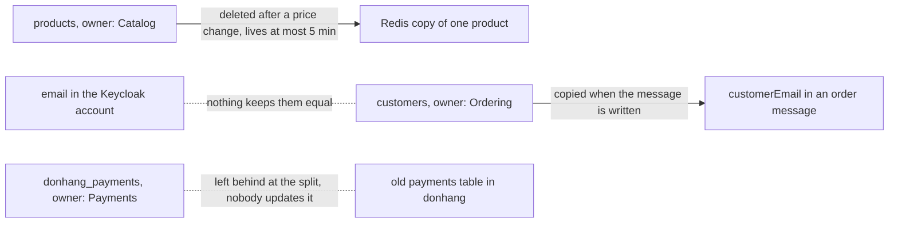

## Before you start

- [[backend.l4.pacelc]] — you know that `ProductCache` can answer from a Redis copy up to 5 minutes old, and that `consistency-per-operation.md` states such choices per operation.
- [[design.l3.module-owns-its-tables]] — you know that a module owns its tables when only its own code reads and writes them, and other modules go through its contract.
- [[backend.l3.payments-service]] — you know that `DonHang.Payments` keeps the money records in `donhang_payments`, and that `DonHang.Api` no longer reads or writes a payment row.
- [[backend.l2.validating-provider-tokens]] — you know that Keycloak holds the sign-in accounts, and that the API finds a customer through `customers.identity_subject`, the `sub` of the token.

## The situation

It is stage-4. A customer changes the email on their Keycloak account, then places an order. The order email still goes to the old address.

The same week, accounting asks which payments to trust: the old `payments` table in `donhang`, or `donhang_payments`. A refund made after Payments was split off appears in only one of them. And a teammate proposes that Payments set an order's status itself after a refund, to save a message.

Each case has the same data in two places, or two places that could write it.

When the same data sits in several places, which place decides its true value, and what keeps every other place honest?

## Core concepts

- **data ownership** — each kind of data has exactly one owner, the service or module that writes it and whose value counts when copies disagree; every other place holds a copy.
- owner — the one place allowed to write a kind of data, such as Payments with `donhang_payments` for payment records.
- copy — that data held anywhere else, such as the Redis entry for one product or the old `payments` table in `donhang`.
- a copy's rule — the stated way a copy stays current, such as a TTL or a delete after a change, or the stated reason it does not.
- a fact of a record — a value fixed at one moment that belongs to that record, such as the price an order item was bought at; it is not a copy.

## How it works



Read the diagram one pair at a time. Each solid arrow starts at an owner and ends at a copy that has a rule, such as `products` and the Redis copy of one product.

Only the owner writes its data. When a copy and its owner disagree, the owner's value counts, whichever of the two changed last.

Every copy needs a rule, written down. The Redis copy of a product is deleted after a price change, and lives at most 5 minutes even if the delete is missed. The `customerEmail` in an order message is copied when the message is written to the outbox, and on purpose never updated afterwards: the email goes out as the message says.

Payment records belong to Payments, in `donhang_payments`. The old `payments` table's rule is that nothing updates it: it was copied at the split and is kept only until accounting confirms (ADR `0008`). Its line is dotted because no change flows to it, so every payment made after the split exists only in the owner.

Some repeated values are not copies. Each order item keeps the price the customer paid. That price is a fact of the order, fixed when the order was placed, so a later change in `products` must not reach it.

The dotted line between Keycloak and `customers` is a gap. Both hold the customer's email, and nothing keeps the two equal. Order emails use the value in `customers`, so an address changed in Keycloak never reaches them.

When two places both need to change the same data, give it one owner and let the other ask that owner, by a call or by a message the owner acts on.

## In the Đơn Hàng system

The design document lists each kind of data with its owner and its copies:

```markdown file=docs/design/data-ownership.md tag=stage-4 lines=11-18
| Dữ liệu | Chủ (module/service, database) | Ai giữ bản sao | Bản sao cập nhật thế nào, hoặc vì sao không | Khi lệch thì tin ai |
|---|---|---|---|---|
| Sản phẩm, giá (`products`) | Catalog, `donhang` | Redis (`product:{id}`) | Xóa sau khi đổi giá; dù lệnh xóa bị lỡ, bản sao sống tối đa 5 phút (TTL). `order_items.unit_price_vnd` không phải bản sao: đó là giá khách đã trả, một dữ kiện của đơn, cố ý không đổi theo giá mới | `products` |
| Đơn (`orders`, `order_items`), khách (`customers`) | Ordering, `donhang` | `order_status_history` (read model); Payments chỉ giữ `order_id` | `RecordOrderStatusHistory` ghi read model cùng transaction với đơn; `order_id` bên Payments là một con số, không có khóa ngoại | `orders` |
| Thanh toán, hoàn tiền (`payments`) | Payments, `donhang_payments` | Bảng `payments` cũ trong `donhang` | Không ai cập nhật: bản chép lúc tách service (ADR 0003); kế toán đối soát với `donhang_payments`, nên bảng cũ chỉ bị xóa sau khi kế toán xác nhận (ADR 0008) | `donhang_payments` |
| Email cần gửi (`notifications`) | Notifications, `donhang_notifications` | Không còn: bảng cũ trong `donhang` đã xóa ở stage-4 (ADR 0008, bước 2) | | `donhang_notifications` |
| Tài khoản đăng nhập (email, mật khẩu, role) | Keycloak, database `keycloak` | `customers.identity_subject` trỏ tới tài khoản (`sub`) | Chỉ là khóa trỏ tới, không chép dữ liệu tài khoản | Keycloak |
| Email và tên của khách | Ordering, `customers` | Mỗi message `order.*` (`customerEmail`, `customerName`); dòng `notifications`; `requested_by` của dòng hoàn tiền | Chép lúc message được ghi vào outbox; cố ý không cập nhật về sau: email gửi theo đúng message đã nhận | `customers` |
```

The table is in Vietnamese by design. Its columns name the data, its owner, who holds copies, how each copy stays current or why not, and whom to trust. Catalog owns products, Ordering owns orders and customers, Payments owns payments, Notifications owns the emails to send, and Keycloak owns the sign-in accounts. Line 13 marks `order_items.unit_price_vnd` as no copy at all: it is the price the customer paid.

Line 14 lists `order_status_history`, a read model written in the same transaction as the order, and says Payments keeps only `order_id`, a plain number with no foreign key. Line 17 shows that `customers.identity_subject` only points to a Keycloak account and copies none of its data. Line 18 is the email copied into each `order.*` message, meaning every message whose routing key starts with `order.`, such as `order.placed`.

Line 15 is the old `payments` table. When Payments was split off, its rows were copied into `donhang_payments`, and nobody has updated the old table since. ADR `0008` records why it stays: accounting checks old payments at the end of each quarter, and objected to dropping it at once because they had not yet checked the rows copied into `donhang_payments`. So the table those rows came from is dropped only after they confirm.

The same document gives the rule for shared writes, then the gap that rule has not closed yet:

```markdown file=docs/design/data-ownership.md tag=stage-4 lines=32-44
### Khi hai nơi cùng muốn sửa một dữ liệu

Không cho cả hai cùng ghi. Dữ liệu được giao cho một chủ; nơi còn lại hỏi chủ
qua một lời gọi hay một message. Ví dụ ở stage-3: Payments không đổi trạng
thái đơn, nó gửi `payment.refunded` và API, chủ của đơn, tự đổi.

### Câu hỏi mở

Email của khách nằm ở hai nơi: tài khoản Keycloak và cột `customers.email`.
Không gì giữ hai giá trị bằng nhau. Email đơn hàng dùng giá trị trong
`customers`, nên khách đổi email ở Keycloak vẫn nhận email ở địa chỉ cũ, và
Keycloak ghi tài khoản nào đã xác minh email (`emailVerified`) còn
`customers` thì không. Chưa quyết ai là chủ.
```

Lines 34–36 say: never let both write. Payments does not change an order's status; it publishes `payment.refunded`, and the API, where Ordering, the owner of orders, lives, changes it.

Lines 40–44 record the open question from the situation. Both places show in the code: `Customer` in `DonHang.Domain/Entities.cs` has its own `Email`, and each user in `keycloak/donhang-realm.json` has its own `email` and `emailVerified`. Line 44 ends with no owner chosen. Line 48, just below the excerpt, points to ADR `0014`, a decision not built at stage-4 that a later lesson covers; until it is built, nothing keeps the two emails equal, and order emails keep trusting `customers`, as line 18 says.

## Trade-offs

| Way to handle data another place needs | Who writes | What the reader gets | Cost | Fits when |
|---|---|---|---|---|
| Ask the owner each time, by a call | the owner only | the current value | a call on every use, which fails while the owner is unreachable | the reader must see the current value |
| Keep a copy with a stated rule (TTL, delete, message) | the owner; the copy only follows | a value as old as its rule allows | the rule has to be built and kept working | a slightly old value harms nobody, such as one product's price |
| Keep a fact of a record | the record, once | the value at that moment | it never follows later changes, by design | the value belongs to the event, such as the price paid |
| Let two places write | both | whatever was written last | each writer can skip the other's rules, and no one knows whose value counts | no operation in Đơn Hàng needs it |

## What would you choose if…

…a teammate finds a wrong amount on an old payment and offers a quick `UPDATE` on the old `payments` table in `donhang`, because it sits in a database they already use? That table is a copy nobody updates, so the fix changes nothing accounting checks against, and the two tables disagree further. Make the correction in `donhang_payments`, through Payments, the owner.

…the teammate from the situation insists that Payments update `orders.status` itself after a refund, to save a message? Orders belong to Ordering, and Payments keeps only an `order_id`. Writing `orders` would make Payments a second writer of the order, and it would need to reach the `donhang` database. Keep the message: Payments publishes `payment.refunded`, and the API changes the status. The price is eventual consistency: the order shows `refunding` until the API handles the message.

## Seniors often assume…

- **"When two copies disagree, the one changed last is the correct one."** → Actually the owner's value counts, even when the copy changed later, because only the owner is allowed to write that data. A copy changed later was changed outside its owner. You notice this when a price fixed by hand in Redis goes back to the `products` value once the copy is deleted, for example at the next price change. Writing the key by hand with Redis's `SET` command, without giving a TTL, also removes its 5-minute TTL, so the wrong copy can stay until then.
- **"Data that several services need should sit in one table that all of them write."** → Actually a table with two writers has no owner: each writer brings its own rules, and nobody can say whose value counts. In `Entities.cs`, outside these excerpts, `Order.CompleteRefund` accepts the change only from `refunding`; a second service writing `orders.status` directly would skip that check. You notice this when an order ends in a status none of its methods allow, and neither team's code explains it.
- **"`order_items` repeating the product's price is duplication that should be removed."** → Actually it is not a copy of the product's price; it is the price the customer paid, a fact of the order. `Order.Total` is worked out from the items' prices, so reading the price from `products` instead would change every old order's total with each price change. You notice this when the receipt for last month's order shows today's price.

## Try it (3 minutes)

In the root folder of the example repository at tag `stage-4`:

1. Open `docs/design/data-ownership.md` and find the row for the customer's email and name, line 18.
2. Read its last two columns: how the copy in each `order.*` message is kept current, and whom to trust when the values differ.

Expected result: the copy in `customerEmail` is made when the message is written to the outbox and is on purpose never updated, and the row trusts `customers` when the values differ.

Then decide: an order message is still waiting in the outbox when `customers.email` changes for that customer. Which address does that order's email go to, and is that a bug?

<details><summary>Suggested answer</summary>

The old address. The message copied the email when it was written to the outbox, and that copy is never updated afterwards. It is not a bug: the copy's stated rule says it does not follow later changes.

</details>

## Connections

- [[backend.l4.pacelc]] — prerequisite: each operation chooses whether to answer from a copy; this lesson names whose copy it is.
- [[design.l3.module-owns-its-tables]] — the same idea one layer down, between modules inside the API.
- [[backend.l3.payments-service]] — the split that left the old `payments` table behind as a copy.
- [[backend.l2.validating-provider-tokens]] — where `customers.identity_subject` comes from, the key that points to a Keycloak account.
- [[design.l3.read-model]] — a copy with a stated rule: `order_status_history` is written in the same transaction as the order.
- [[design.l4.distributed-monolith]] — the larger problem that services sharing writes to the same data lead to.
- [[management.l3.proposing-an-adr]] — how a decision such as who owns the customer's email gets proposed and recorded.
- [[backend.l4.expand-and-contract]] — next in this module: removing old tables while the system keeps running.

## Five-line summary

1. Each kind of data has one owner, the place that writes it and whose value counts when copies disagree; everywhere else holds a copy.
2. `data-ownership.md` lists the owners: Catalog products, Ordering orders and customers, Payments payments, Notifications emails, Keycloak sign-in accounts.
3. Every copy needs a stated rule to stay current or a reason not to; an order item's price is a fact, not a copy.
4. The old `payments` table is a copy nobody updates; ADR `0008` drops it only after accounting confirms its check against `donhang_payments`.
5. When two places need to change the same data, give it one owner and let the other ask it, by a call or a message.
