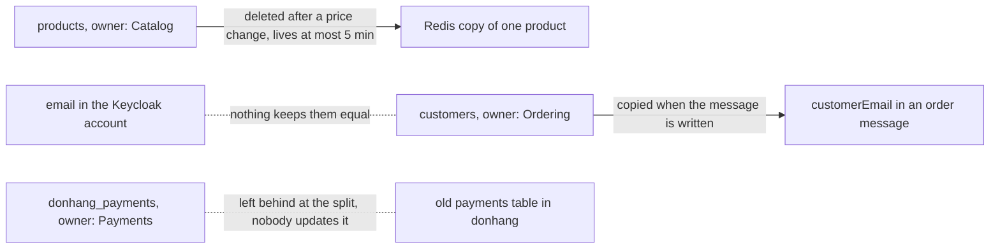

## Bạn cần biết trước

- [[backend.l4.pacelc]] — bạn biết rằng `ProductCache` có thể trả lời bằng bản sao trong Redis cũ tới 5 phút, và `consistency-per-operation.md` ghi những lựa chọn như vậy cho từng thao tác.
- [[design.l3.module-owns-its-tables]] — bạn biết rằng một module làm chủ các bảng của nó khi chỉ code của chính nó đọc và ghi chúng, còn module khác phải đi qua contract của nó.
- [[backend.l3.payments-service]] — bạn biết rằng `DonHang.Payments` giữ hồ sơ tiền trong `donhang_payments`, và `DonHang.Api` không còn đọc hay ghi dòng thanh toán nào.
- [[backend.l2.validating-provider-tokens]] — bạn biết rằng Keycloak giữ các tài khoản đăng nhập, và API tìm khách qua `customers.identity_subject`, tức `sub` của token.

## Tình huống

Đang ở stage-4. Một khách đổi email trong tài khoản Keycloak, rồi đặt đơn. Email về đơn hàng vẫn gửi tới địa chỉ cũ.

Cùng tuần đó, kế toán hỏi nên tin bảng thanh toán nào: bảng `payments` cũ trong `donhang`, hay `donhang_payments`. Một lần hoàn tiền làm sau khi tách Payments chỉ có ở một trong hai. Rồi một đồng nghiệp đề xuất để Payments tự đổi trạng thái đơn sau khi hoàn tiền, cho bớt một message.

Trường hợp nào cũng có cùng một dữ liệu nằm ở hai nơi, hoặc hai nơi cùng có thể ghi nó.

Khi cùng một dữ liệu nằm ở nhiều nơi, nơi nào quyết giá trị đúng của nó, và điều gì giữ cho mọi nơi khác không sai lệch?

## Khái niệm cốt lõi

- **quyền sở hữu dữ liệu** (data ownership) — mỗi loại dữ liệu có đúng một chủ, là service hoặc module ghi dữ liệu đó và có giá trị được tính khi các bản sao không khớp nhau, mọi nơi khác chỉ giữ bản sao.
- chủ — nơi duy nhất được ghi một loại dữ liệu, chẳng hạn Payments với `donhang_payments` cho hồ sơ thanh toán.
- bản sao — cùng dữ liệu đó nằm ở bất kỳ nơi nào khác, chẳng hạn mục Redis của một sản phẩm hay bảng `payments` cũ trong `donhang`.
- quy tắc của bản sao — cách bản sao được giữ cập nhật, ghi rõ ra, chẳng hạn TTL hay lệnh xóa sau mỗi thay đổi, hoặc lý do được ghi rõ vì sao nó không cập nhật.
- dữ kiện của một bản ghi — giá trị chốt tại một thời điểm và thuộc về bản ghi đó, chẳng hạn giá mà một dòng trong đơn đã được mua. Nó không phải bản sao.

## Cơ chế hoạt động



Hãy đọc sơ đồ từng cặp một. Mỗi mũi tên liền bắt đầu ở một chủ và kết thúc ở một bản sao có quy tắc, chẳng hạn `products` và bản sao trong Redis của một sản phẩm.

Chỉ chủ mới ghi dữ liệu của mình. Khi bản sao và chủ không khớp nhau, giá trị của chủ được tính, bất kể bên nào đổi sau cùng.

Bản sao nào cũng cần một quy tắc, ghi ra thành văn bản. Bản sao trong Redis của một sản phẩm bị xóa sau khi đổi giá, và sống tối đa 5 phút kể cả khi lệnh xóa bị lỡ. `customerEmail` trong message của đơn được chép lúc message được ghi vào outbox, và cố ý không bao giờ cập nhật về sau: email gửi đi đúng như message ghi.

Hồ sơ thanh toán thuộc về Payments, trong `donhang_payments`. Quy tắc của bảng `payments` cũ là không ai cập nhật nó: nó được chép lúc tách service và chỉ được giữ tới khi kế toán xác nhận (ADR `0008`). Đường nối của nó là nét đứt vì không có thay đổi nào chảy tới đó, nên mọi lần thanh toán sau khi tách chỉ nằm ở chủ.

Có những giá trị lặp lại mà không phải bản sao. Mỗi dòng trong đơn giữ giá khách đã trả. Giá đó là dữ kiện của đơn, chốt lúc đặt đơn, nên thay đổi về sau trong `products` không được chạm tới nó.

Đường nét đứt giữa Keycloak và `customers` là một khoảng hở. Cả hai cùng giữ email của khách, và không gì giữ hai giá trị bằng nhau. Email về đơn hàng dùng giá trị trong `customers`, nên địa chỉ đổi trong Keycloak không bao giờ tới được chúng.

Khi hai nơi cùng cần sửa một dữ liệu, hãy giao nó cho một chủ và để nơi kia hỏi chủ đó, bằng một lời gọi hoặc bằng một message mà chủ xử lý.

## Trong hệ thống Đơn Hàng

Tài liệu thiết kế liệt kê từng loại dữ liệu cùng chủ và các bản sao của nó:

```markdown file=docs/design/data-ownership.md tag=stage-4 lines=11-18
| Dữ liệu | Chủ (module/service, database) | Ai giữ bản sao | Bản sao cập nhật thế nào, hoặc vì sao không | Khi lệch thì tin ai |
|---|---|---|---|---|
| Sản phẩm, giá (`products`) | Catalog, `donhang` | Redis (`product:{id}`) | Xóa sau khi đổi giá; dù lệnh xóa bị lỡ, bản sao sống tối đa 5 phút (TTL). `order_items.unit_price_vnd` không phải bản sao: đó là giá khách đã trả, một dữ kiện của đơn, cố ý không đổi theo giá mới | `products` |
| Đơn (`orders`, `order_items`), khách (`customers`) | Ordering, `donhang` | `order_status_history` (read model); Payments chỉ giữ `order_id` | `RecordOrderStatusHistory` ghi read model cùng transaction với đơn; `order_id` bên Payments là một con số, không có khóa ngoại | `orders` |
| Thanh toán, hoàn tiền (`payments`) | Payments, `donhang_payments` | Bảng `payments` cũ trong `donhang` | Không ai cập nhật: bản chép lúc tách service (ADR 0003); kế toán đối soát với `donhang_payments`, nên bảng cũ chỉ bị xóa sau khi kế toán xác nhận (ADR 0008) | `donhang_payments` |
| Email cần gửi (`notifications`) | Notifications, `donhang_notifications` | Không còn: bảng cũ trong `donhang` đã xóa ở stage-4 (ADR 0008, bước 2) | | `donhang_notifications` |
| Tài khoản đăng nhập (email, mật khẩu, role) | Keycloak, database `keycloak` | `customers.identity_subject` trỏ tới tài khoản (`sub`) | Chỉ là khóa trỏ tới, không chép dữ liệu tài khoản | Keycloak |
| Email và tên của khách | Ordering, `customers` | Mỗi message `order.*` (`customerEmail`, `customerName`); dòng `notifications`; `requested_by` của dòng hoàn tiền | Chép lúc message được ghi vào outbox; cố ý không cập nhật về sau: email gửi theo đúng message đã nhận | `customers` |
```

Bảng này cố ý viết bằng tiếng Việt. Các cột của nó ghi dữ liệu, chủ, ai giữ bản sao, mỗi bản sao được giữ cập nhật thế nào hoặc vì sao không, và khi lệch thì tin ai. Catalog làm chủ sản phẩm, Ordering làm chủ đơn và khách, Payments làm chủ thanh toán, Notifications làm chủ các email cần gửi, còn Keycloak làm chủ tài khoản đăng nhập. Dòng 13 ghi rõ `order_items.unit_price_vnd` hoàn toàn không phải bản sao: đó là giá khách đã trả.

Dòng 14 liệt kê `order_status_history`, một read model được ghi trong cùng giao dịch với đơn, và nói Payments chỉ giữ `order_id`, một con số trơn không có khóa ngoại. Dòng 17 cho thấy `customers.identity_subject` chỉ trỏ tới một tài khoản Keycloak và không chép dữ liệu nào của nó. Dòng 18 là email được chép vào mỗi message `order.*`, tức mọi message có routing key bắt đầu bằng `order.`, chẳng hạn `order.placed`.

Dòng 15 là bảng `payments` cũ. Khi tách Payments, các dòng của nó được chép sang `donhang_payments`, và từ đó không ai cập nhật bảng cũ nữa. ADR `0008` ghi lý do nó còn đó: kế toán đối soát các khoản thanh toán cũ vào cuối mỗi quý, và đã phản đối xóa bảng ngay vì họ chưa kiểm tra các dòng đã chép sang `donhang_payments`. Vì vậy bảng nguồn của các dòng đó chỉ bị xóa sau khi họ xác nhận.

Cùng tài liệu đó đưa ra quy tắc cho trường hợp hai nơi cùng ghi, rồi tới khoảng hở mà quy tắc ấy chưa khép lại:

```markdown file=docs/design/data-ownership.md tag=stage-4 lines=32-44
### Khi hai nơi cùng muốn sửa một dữ liệu

Không cho cả hai cùng ghi. Dữ liệu được giao cho một chủ; nơi còn lại hỏi chủ
qua một lời gọi hay một message. Ví dụ ở stage-3: Payments không đổi trạng
thái đơn, nó gửi `payment.refunded` và API, chủ của đơn, tự đổi.

### Câu hỏi mở

Email của khách nằm ở hai nơi: tài khoản Keycloak và cột `customers.email`.
Không gì giữ hai giá trị bằng nhau. Email đơn hàng dùng giá trị trong
`customers`, nên khách đổi email ở Keycloak vẫn nhận email ở địa chỉ cũ, và
Keycloak ghi tài khoản nào đã xác minh email (`emailVerified`) còn
`customers` thì không. Chưa quyết ai là chủ.
```

Dòng 34–36 nói: không bao giờ cho cả hai cùng ghi. Payments không đổi trạng thái đơn. Nó gửi `payment.refunded`, và API, nơi Ordering, chủ của đơn, chạy, tự đổi trạng thái.

Dòng 40–44 ghi lại câu hỏi mở từ tình huống. Cả hai nơi đều hiện ra trong code: `Customer` trong `DonHang.Domain/Entities.cs` có `Email` riêng, và mỗi user trong `keycloak/donhang-realm.json` có `email` và `emailVerified` riêng. Dòng 44 kết thúc mà chưa chọn chủ. Dòng 48, ngay dưới đoạn trích, trỏ tới ADR `0014`, một quyết định chưa được làm ở stage-4 và sẽ có bài sau nói tới. Tới khi nó được làm, không gì giữ hai email bằng nhau, và email về đơn hàng vẫn tin `customers`, đúng như dòng 18 ghi.

## Đánh đổi

| Cách xử lý dữ liệu mà nơi khác cần | Ai ghi | Nơi đọc nhận được gì | Cái giá | Hợp khi |
|---|---|---|---|---|
| Hỏi chủ mỗi lần, bằng một lời gọi | chỉ chủ | giá trị hiện tại | một lời gọi ở mỗi lần dùng, và lời gọi thất bại khi không tới được chủ | nơi đọc phải thấy giá trị hiện tại |
| Giữ bản sao với quy tắc ghi rõ (TTL, lệnh xóa, message) | chủ, bản sao chỉ đi theo | giá trị cũ tới mức quy tắc cho phép | quy tắc phải được xây và giữ cho chạy đúng | giá trị hơi cũ không gây hại cho ai, chẳng hạn giá của một sản phẩm |
| Giữ dữ kiện của một bản ghi | chính bản ghi, một lần | giá trị tại thời điểm đó | cố ý không bao giờ theo các thay đổi về sau | giá trị thuộc về sự kiện, chẳng hạn giá đã trả |
| Cho hai nơi cùng ghi | cả hai | giá trị nào ghi sau cùng | mỗi bên ghi có thể bỏ qua quy tắc của bên kia, và không ai biết giá trị của ai được tính | không thao tác nào trong Đơn Hàng cần tới |

## Bạn sẽ chọn gì nếu…

…một đồng nghiệp thấy số tiền sai ở một khoản thanh toán cũ và đề nghị chạy nhanh một lệnh `UPDATE` trên bảng `payments` cũ trong `donhang`, vì nó nằm trong database họ vẫn dùng? Bảng đó là bản sao không ai cập nhật, nên sửa ở đó không đổi gì trong dữ liệu kế toán đối soát, mà hai bảng còn lệch nhau thêm. Hãy sửa trong `donhang_payments`, qua Payments, chủ của dữ liệu.

…đồng nghiệp trong tình huống vẫn khăng khăng để Payments tự cập nhật `orders.status` sau khi hoàn tiền, cho bớt một message? Đơn thuộc về Ordering, còn Payments chỉ giữ `order_id`. Ghi vào `orders` sẽ biến Payments thành nơi ghi thứ hai của đơn, và nó sẽ phải truy cập được database `donhang`. Hãy giữ message: Payments gửi `payment.refunded`, và API đổi trạng thái. Cái giá là eventual consistency: đơn hiện `refunding` tới khi API xử lý message.

## Senior hay nhầm rằng…

- **"Khi hai bản sao không khớp nhau, bản đổi sau cùng là bản đúng."** → Thực ra giá trị của chủ mới được tính, kể cả khi bản sao đổi sau, vì chỉ chủ được ghi dữ liệu đó. Bản sao đổi sau là bản sao bị sửa từ ngoài chủ. Bạn sẽ nhận ra khi một giá sửa tay trong Redis quay về giá trị của `products` lúc bản sao bị xóa, chẳng hạn ở lần đổi giá kế tiếp. Ghi key bằng tay bằng lệnh `SET` của Redis mà không đặt TTL còn xóa luôn TTL 5 phút của nó, nên bản sao sai có thể ở lại tới lúc đó.
- **"Dữ liệu mà nhiều service cần nên nằm trong một bảng để tất cả cùng ghi."** → Thực ra một bảng có hai nơi ghi thì không có chủ: mỗi bên ghi mang quy tắc riêng, và không ai nói được giá trị của ai được tính. Trong `Entities.cs`, ngoài các đoạn trích này, `Order.CompleteRefund` chỉ chấp nhận thay đổi từ `refunding`. Một service thứ hai ghi thẳng `orders.status` sẽ bỏ qua kiểm tra đó. Bạn sẽ nhận ra khi một đơn kết thúc ở trạng thái mà không method nào của nó cho phép, và code của cả hai team đều không giải thích được.
- **"`order_items` lặp lại giá của sản phẩm là trùng lặp cần bỏ đi."** → Thực ra đó không phải bản sao giá của sản phẩm, mà là giá khách đã trả, một dữ kiện của đơn. `Order.Total` được tính từ giá của các dòng trong đơn, nên nếu đọc giá từ `products` thì tổng của mọi đơn cũ sẽ đổi theo mỗi lần đổi giá. Bạn sẽ nhận ra khi biên nhận của đơn tháng trước hiện giá của hôm nay.

## Thử ngay (3 phút)

Ở thư mục gốc của repo ví dụ tại tag `stage-4`:

1. Mở `docs/design/data-ownership.md` và tìm dòng về email và tên của khách, dòng 18.
2. Đọc hai cột cuối của nó: bản sao trong mỗi message `order.*` được giữ cập nhật thế nào, và khi giá trị khác nhau thì tin ai.

Kết quả mong đợi: bản sao trong `customerEmail` được tạo lúc message được ghi vào outbox và cố ý không bao giờ cập nhật, và dòng này tin `customers` khi giá trị khác nhau.

Rồi hãy xác định: một message của đơn vẫn đang chờ trong outbox thì `customers.email` của khách đó đổi. Email của đơn đó gửi tới địa chỉ nào, và đó có phải lỗi không?

<details><summary>Gợi ý đáp án</summary>

Địa chỉ cũ. Message đã chép email lúc được ghi vào outbox, và bản sao đó không bao giờ được cập nhật về sau. Đó không phải lỗi: quy tắc đã ghi rõ của bản sao nói nó không theo các thay đổi về sau.

</details>

## Liên hệ

- [[backend.l4.pacelc]] — bài tiên quyết: mỗi thao tác chọn có trả lời từ bản sao hay không, bài này cho biết đó là bản sao của ai.
- [[design.l3.module-owns-its-tables]] — cùng ý tưởng ở tầng thấp hơn, giữa các module bên trong API.
- [[backend.l3.payments-service]] — lần tách service để lại bảng `payments` cũ như một bản sao.
- [[backend.l2.validating-provider-tokens]] — nơi `customers.identity_subject` xuất hiện, khóa trỏ tới một tài khoản Keycloak.
- [[design.l3.read-model]] — một bản sao có quy tắc ghi rõ: `order_status_history` được ghi trong cùng giao dịch với đơn.
- [[design.l4.distributed-monolith]] — vấn đề lớn hơn mà các service cùng ghi chung một dữ liệu dẫn tới.
- [[management.l3.proposing-an-adr]] — cách một quyết định như ai làm chủ email của khách được đề xuất và ghi lại.
- [[backend.l4.expand-and-contract]] — bài tiếp theo trong module: xóa bảng cũ trong khi hệ thống vẫn chạy.

## Tóm tắt 5 dòng

1. Mỗi loại dữ liệu có một chủ, nơi ghi nó và có giá trị được tính khi các bản sao không khớp nhau, mọi nơi khác chỉ giữ bản sao.
2. `data-ownership.md` liệt kê các chủ: Catalog với sản phẩm, Ordering với đơn và khách, Payments với thanh toán, Notifications với email, Keycloak với tài khoản đăng nhập.
3. Bản sao nào cũng cần một quy tắc ghi rõ để giữ cập nhật, hoặc lý do để không cập nhật, còn giá của một dòng trong đơn là dữ kiện, không phải bản sao.
4. Bảng `payments` cũ là bản sao không ai cập nhật, ADR `0008` chỉ xóa nó sau khi kế toán xác nhận đã đối soát xong với `donhang_payments`.
5. Khi hai nơi cần sửa cùng một dữ liệu, hãy giao nó cho một chủ và để nơi kia hỏi chủ, bằng một lời gọi hoặc một message.
