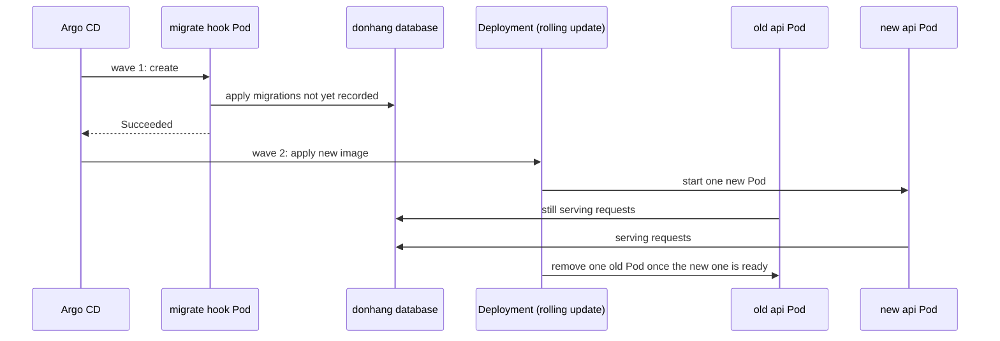

## Before you start

- [[backend.l4.data-ownership]] — you know that the emails to send belong to Notifications in `donhang_notifications`, and that ADR `0008` drops the old tables left in `donhang`.
- [[devops.l3.rollback-by-revert]] — you know that a revert restores manifests, not data: applied migrations stay, so the older api must work with the newer schema.
- [[devops.l3.ordering-a-sync]] — you know that staging runs the migration hook Pod in wave 1 and the api in wave 2, and that a wave starts only once the one before it is healthy.
- [[k8s.l1.rolling-updates]] — you know that a rolling update replaces Pods a few at a time, so both versions run side by side for a while.

## The situation

It is stage-4, and the old `notifications` table in `donhang` is due to go: Notifications has kept its emails in its own database since stage-3. You write a migration that drops the table and push the release to staging.

A teammate asks: "Won't the old api Pods break when the table is gone?" The migration runs before any new Pod starts, so for a while those old Pods answer requests against a database without that table.

At stage-3, the release that stopped using the table had left it in place on purpose.

When old and new code use one schema at the same moment, how do you change that schema without breaking either of them?

## Core concepts

- **zero-downtime migration** — a schema change made while the system keeps serving, which requires each migration to work with both the code before it and the code after it.
- **expand and contract** — splitting an incompatible change into compatible steps: expand adds the new shape next to the old, the code moves to the new shape, and contract removes the old shape once no running version uses it.
- compatible step — a migration that both the version running before it and the version released with it can work with.
- incompatible change — a change that breaks a version still running, such as dropping or renaming a table or column it reads or writes.
- old shape — the table or column the previous code uses, such as `notifications` in `donhang`.

## How it works



Follow the diagram from the top. In the situation above, the release reaches staging as one sync. Argo CD creates the migration hook Pod in wave 1, and that Pod applies every migration the database has not recorded yet. Only after the hook succeeds does wave 2 begin and the api Deployment get the new image.

The api runs 2 Pods in staging, so the rolling update adds one new Pod, waits for it to be ready, removes one old Pod, and repeats. Until it ends, an old Pod and a new Pod both answer requests, and both use the schema the migration has just changed. The old code meets the new schema; there is no moment when everything switches together.

That is why a zero-downtime migration must work with two versions at once: the code before it, still in the old Pods, and the code after it, in the new ones. A revert makes the rule stricter, because it brings the previous version back while the migration stays applied.

A change the previous code cannot survive, such as dropping a table it reads, therefore cannot go out as one step. Expand and contract spreads it across releases. Expand adds the new shape next to the old one, and both versions keep working because nothing they use is gone. Then the code moves: a release stops reading and writing the old shape. Contract removes the old shape in a later release, once no version that might still run uses it.

Each step is compatible with the release before it. The incompatible part, the removal, waits until the code it would break has stopped running.

## In the Đơn Hàng system

Moving the email jobs out of `donhang` took these steps across two tags. At stage-3, Notifications got a table of its own in `donhang_notifications`, so here the new shape sits beside the old one in another database. The api stopped mapping the old one:

```csharp file=DonHang.Infrastructure/Migrations/20261005231652_PaymentsAndNotificationsLeaveOrdering.cs tag=stage-4 lines=7-20
    // lesson: backend.l3.payments-service
    // DonHangDbContext stopped mapping `payments` and `notifications` (they
    // belong to the Payments and Notifications services from stage-3), so
    // `dotnet ef migrations add` scaffolded two DropTable calls here. They
    // were deleted by hand: both tables stay in donhang with their rows, read
    // by nobody. This migration changes nothing in the database; it only
    // records the new model in DonHangDbContextModelSnapshot.
    /// <inheritdoc />
    public partial class PaymentsAndNotificationsLeaveOrdering : Migration
    {
        /// <inheritdoc />
        protected override void Up(MigrationBuilder migrationBuilder)
        {
        }
```

Lines 8–13 are the step where the code moves. `DonHangDbContext` no longer maps `payments` or `notifications`, so `dotnet ef migrations add`, the command that writes a new migration from what changed in the mapped classes, wrote two `DropTable` calls. They were deleted by hand, and `Up` is empty. The migration still exists because it records the new mapping in the model snapshot, the file EF Core compares against next time. Neither expand nor this step removes anything a running version uses, so they may share a release; only contract has to wait.

At stage-4 comes the contract step:

```csharp file=DonHang.Infrastructure/Migrations/20261101090000_DropOldNotificationsTable.cs tag=stage-4 lines=7-22
    // lesson: backend.l4.expand-and-contract
    // The contract step for the email jobs, step 2 of ADR 0008. At stage-3
    // Notifications got its own table (expand) and PaymentsAndNotificationsLeaveOrdering
    // stopped mapping this one while leaving it in place, so the api that
    // ran before this release no longer reads or writes it: an old api Pod
    // still serving while this migration runs cannot fail on a missing table.
    // Its rows were dumped first (scripts/backend/drop-old-notifications.sh).
    // The old `payments` table stays until accounting confirms (step 3).
    /// <inheritdoc />
    public partial class DropOldNotificationsTable : Migration
    {
        /// <inheritdoc />
        protected override void Up(MigrationBuilder migrationBuilder)
        {
            migrationBuilder.DropTable(name: "notifications");
        }
```

Lines 8–12 say why the drop is safe now: the api that ran before this release is the one from the first block. When the hook drops the table in wave 1, an old Pod still serving cannot fail on a missing table, because it never asks for it.

Line 13 is step 1 of ADR `0008`, done before this migration: `scripts/backend/drop-old-notifications.sh` dumped the rows. Line 14 keeps the old `payments` table for step 3, which waits for accounting, not for the code.

A migration's `Up` runs when it is applied, and its `Down` runs when the database is moved back past it. Below the excerpt, `Down` gives the table its shape again, empty; the rows come back from the dump. Contract is the step that cannot be fully undone by code alone.

## Trade-offs

| Way to make an incompatible change | Releases | While the change rolls out | Going back by revert | Cost |
|---|---|---|---|---|
| One migration with the code that needs it | one | old Pods fail on the missing or renamed shape until the rolling update ends | the previous version meets a schema it cannot use | nothing up front, paid in errors |
| Stop the api, migrate, start the new version | one | no requests are served | the previous version still meets a schema it cannot use | a planned outage, every time |
| Expand and contract | two or more | both versions keep working at every step | safe until contract; after it, only versions that no longer use the old shape fit | extra releases, and the old shape stays around for a while |

## What would you choose if…

…a teammate wants to drop the old `payments` table in the next release, since no code reads or writes it? The code is no obstacle: no running version uses the table, so dropping it is as compatible as dropping `notifications` was. The obstacle is accounting, who have not yet confirmed their check against `donhang_payments`. Wait for step 3 of ADR `0008`: contract is ready when nobody needs the old shape, people included.

…you need to rename the column `customers.email` to `contact_email`? To the old Pods, a rename looks like their column vanished: their queries still name `email`. Expand instead: add `contact_email` as a nullable column, and release code that writes both columns. Once no older Pod is left, copy `email` into the rows that still lack `contact_email`. Then move reads to `contact_email`, and contract drops `email` in a release whose previous version no longer touches it.

…Đơn Hàng had only a few customers, and a few minutes without orders at night harmed nobody? Stopping the api for the migration is simpler and needs one release. Expand and contract earns its extra releases when the system must keep serving, and when you want a revert to stay safe.

## Seniors often assume…

- **"The migration runs first and then every new Pod starts at once, so old code never meets the new schema."** → Actually the hook finishes in wave 1 before the api's rolling update begins, and that update replaces the 2 Pods one at a time. Old Pods keep serving against the new schema until the last of them is gone. You notice this when errors about a missing table or column appear only during a deploy, from Pods running the previous image, and stop once the rollout ends.
- **"Renaming a column in one migration is fine as long as the code of the same release uses the new name."** → Actually the old Pods still run the previous release, and their queries name the old column. From the moment the hook renames it, each of those queries fails. You notice this when a deploy that renamed a column shows a burst of errors naming the old column, and a revert makes them constant instead of fixing them.
- **"Expand and contract can go into one release, as long as the migrations run in the right order."** → Actually every migration of a release runs in wave 1, before any new Pod starts, so the old shape is gone while the old Pods still use it. The order inside the release cannot help code that is not running yet. Contract needs a later release than the code move, so the old shape goes only once no running version uses it. You notice this when such a release fails exactly like the one-step change it was meant to replace.

## Try it (3 minutes)

In the root folder of the example repository at tag `stage-4`:

1. Open `DonHang.Infrastructure/Migrations/20261005231652_PaymentsAndNotificationsLeaveOrdering.cs` and `DonHang.Infrastructure/Migrations/20261101090000_DropOldNotificationsTable.cs`.
2. Compare their `Up` methods.

Expected result: the stage-3 migration has an empty `Up`, and the stage-4 migration's `Up` holds one call, `migrationBuilder.DropTable(name: "notifications")`.

Then decide: staging goes back from the stage-4 release to the stage-3 one with `git revert`. Do the stage-3 api Pods still work without `notifications`?

<details><summary>Suggested answer</summary>

Yes. The revert restores manifests, not data, so `notifications` stays dropped. But the stage-3 api no longer maps that table, as its migration's comment says. The contract step is safe for a revert for the same reason it is safe for the old Pods during the rolling update.

</details>

## Connections

- [[devops.l3.ordering-a-sync]] — prerequisite: the waves that run the migration before the api; this lesson asks what the old Pods meet.
- [[k8s.l1.rolling-updates]] — why two versions of the api run side by side during every deploy.
- [[devops.l3.rollback-by-revert]] — the other reason a migration must suit the previous version: a revert brings it back without undoing the schema.
- [[backend.l4.data-ownership]] — why the old tables were left behind: their data got a new owner.
- [[backend.l1.migrations]] — the same migrations, now judged by which versions of the code must survive them.
- [[devops.l2.migrations-in-the-pipeline]] — the step that runs migrations before the API starts, which is exactly what leaves old Pods meeting the new schema.
- [[design.l4.evolutionary-architecture]] — the same idea one layer up: change a running system in small steps it survives.
- [[backend.l4.migration-locks]] — next in this module: even a compatible migration can make queries wait.
- [[backend.l4.message-schema-evolution]] — the same rule for messages, whose readers also run old code.

## Five-line summary

1. Old and new code use one schema during every deploy, so each migration must work with both, and incompatible changes go in compatible steps.
2. Argo CD runs the migration hook in wave 1, then the rolling update replaces the 2 api Pods one at a time.
3. A zero-downtime migration works with the code before it and after it; a revert brings the code before it back.
4. Expand adds the new shape beside the old, the code moves over, and contract removes the old shape once no running version uses it.
5. Stage-3 stopped using the old `notifications` table but kept it; stage-4 dropped it after the dump ADR `0008` asks for.
