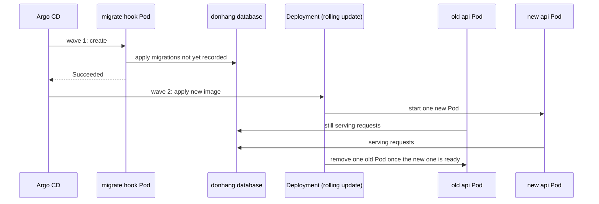

## Bạn cần biết trước

- [[backend.l4.data-ownership]] — bạn biết rằng các email cần gửi thuộc về Notifications trong `donhang_notifications`, và ADR `0008` xóa các bảng cũ còn sót trong `donhang`.
- [[devops.l3.rollback-by-revert]] — bạn biết rằng revert khôi phục manifest chứ không khôi phục dữ liệu: migration đã áp vẫn còn đó, nên api bản cũ phải chạy được với schema mới hơn.
- [[devops.l3.ordering-a-sync]] — bạn biết rằng staging chạy Pod hook migration ở wave 1 và api ở wave 2, và một wave chỉ bắt đầu khi wave trước đã healthy.
- [[k8s.l1.rolling-updates]] — bạn biết rằng rolling update thay Pod từng ít một, nên hai phiên bản chạy song song với nhau một lúc.

## Tình huống

Đang ở stage-4, và tới lúc bỏ bảng `notifications` cũ trong `donhang`: từ stage-3, Notifications đã giữ email trong database riêng. Bạn viết một migration xóa bảng đó và đẩy bản phát hành lên staging.

Một đồng nghiệp hỏi: "Bảng mất rồi thì các Pod api cũ có hỏng không?" Migration chạy trước khi bất kỳ Pod mới nào khởi động, nên trong một lúc, các Pod cũ ấy trả lời request trên một database không còn bảng đó.

Ở stage-3, bản phát hành ngừng dùng bảng này đã cố ý để nguyên nó.

Khi code cũ và code mới cùng dùng một schema tại cùng một thời điểm, làm sao đổi schema đó mà không làm hỏng bên nào?

## Khái niệm cốt lõi

- **migration không gián đoạn** (zero-downtime migration) — thay đổi schema trong lúc hệ thống vẫn phục vụ, nên mỗi migration phải chạy được với cả code trước nó lẫn code sau nó.
- **expand and contract** (chia thay đổi không tương thích thành các bước: thêm dạng mới cạnh dạng cũ, chuyển code, rồi mới bỏ dạng cũ) — tách một thay đổi không tương thích thành các bước tương thích: expand thêm dạng mới cạnh dạng cũ, code chuyển sang dạng mới, và contract bỏ dạng cũ khi không còn phiên bản nào đang chạy dùng nó.
- bước tương thích — migration mà cả phiên bản chạy trước nó lẫn phiên bản phát hành cùng nó đều chạy được.
- thay đổi không tương thích — thay đổi làm hỏng một phiên bản vẫn đang chạy, chẳng hạn xóa hay đổi tên một bảng hoặc cột mà phiên bản đó đọc hay ghi.
- dạng cũ — bảng hoặc cột mà code trước đó dùng, chẳng hạn `notifications` trong `donhang`.

## Cơ chế hoạt động



Hãy đọc sơ đồ từ trên xuống. Trong tình huống trên, bản phát hành tới staging bằng một lần sync. Argo CD tạo Pod hook migration ở wave 1, và Pod đó áp mọi migration mà database chưa ghi nhận. Chỉ khi hook thành công thì wave 2 mới bắt đầu và Deployment của api mới nhận image mới.

Ở staging, api chạy 2 Pod, nên rolling update thêm một Pod mới, chờ nó sẵn sàng, bỏ một Pod cũ, rồi lặp lại. Tới khi xong, một Pod cũ và một Pod mới cùng trả lời request, và cả hai dùng schema mà migration vừa đổi. Code cũ gặp schema mới. Không có khoảnh khắc nào mọi thứ cùng chuyển một lượt.

Vì vậy một migration không gián đoạn phải chạy được với hai phiên bản cùng lúc: code trước nó, vẫn nằm trong các Pod cũ, và code sau nó, trong các Pod mới. Revert làm quy tắc này chặt hơn, vì nó đưa phiên bản trước quay lại trong khi migration vẫn đã áp.

Do đó một thay đổi mà code trước không chịu nổi, chẳng hạn xóa một bảng nó đọc, không thể đi ra trong một bước. Expand and contract trải nó qua nhiều bản phát hành. Expand thêm dạng mới cạnh dạng cũ, và cả hai phiên bản vẫn chạy được vì không mất thứ gì chúng dùng. Rồi code chuyển: một bản phát hành ngừng đọc và ghi dạng cũ. Contract bỏ dạng cũ ở một bản phát hành sau đó, khi không còn phiên bản nào có thể vẫn chạy dùng nó.

Mỗi bước đều tương thích với bản phát hành trước nó. Phần không tương thích, tức phần xóa, phải chờ tới khi code mà nó làm hỏng đã ngừng chạy.

## Trong hệ thống Đơn Hàng

Chuyển các email cần gửi ra khỏi `donhang` đã đi qua các bước này trên hai tag. Ở stage-3, Notifications có bảng riêng trong `donhang_notifications`, nên ở đây dạng mới nằm cạnh dạng cũ nhưng trong một database khác. Api ngừng ánh xạ bảng cũ:

```csharp file=DonHang.Infrastructure/Migrations/20261005231652_PaymentsAndNotificationsLeaveOrdering.cs tag=stage-4 lines=7-20
    // lesson: backend.l3.payments-service
    // DonHangDbContext stopped mapping `payments` and `notifications` (they
    // belong to the Payments and Notifications services from stage-3), so
    // `dotnet ef migrations add` scaffolded two DropTable calls here. They
    // were deleted by hand: both tables stay in donhang with their rows, read
    // by nobody. This migration changes nothing in the database; it only
    // records the new model in DonHangDbContextModelSnapshot.
    /// <inheritdoc />
    public partial class PaymentsAndNotificationsLeaveOrdering : Migration
    {
        /// <inheritdoc />
        protected override void Up(MigrationBuilder migrationBuilder)
        {
        }
```

Dòng 8–13 là bước code chuyển. `DonHangDbContext` không còn ánh xạ `payments` hay `notifications`, nên `dotnet ef migrations add`, lệnh sinh migration mới từ những gì đã đổi trong các class được ánh xạ, đã viết hai lời gọi `DropTable`. Chúng bị xóa bằng tay, và `Up` để trống. Migration này vẫn tồn tại vì nó ghi ánh xạ mới vào model snapshot, file mà EF Core so sánh ở lần sau. Cả expand lẫn bước này đều không bỏ thứ gì một phiên bản đang chạy dùng, nên chúng có thể chung một bản phát hành. Chỉ contract phải chờ.

Tới stage-4 là bước contract:

```csharp file=DonHang.Infrastructure/Migrations/20261101090000_DropOldNotificationsTable.cs tag=stage-4 lines=7-22
    // lesson: backend.l4.expand-and-contract
    // The contract step for the email jobs, step 2 of ADR 0008. At stage-3
    // Notifications got its own table (expand) and PaymentsAndNotificationsLeaveOrdering
    // stopped mapping this one while leaving it in place, so the api that
    // ran before this release no longer reads or writes it: an old api Pod
    // still serving while this migration runs cannot fail on a missing table.
    // Its rows were dumped first (scripts/backend/drop-old-notifications.sh).
    // The old `payments` table stays until accounting confirms (step 3).
    /// <inheritdoc />
    public partial class DropOldNotificationsTable : Migration
    {
        /// <inheritdoc />
        protected override void Up(MigrationBuilder migrationBuilder)
        {
            migrationBuilder.DropTable(name: "notifications");
        }
```

Dòng 8–12 nói vì sao giờ xóa đã an toàn: api chạy trước bản phát hành này chính là api trong đoạn code đầu. Khi hook xóa bảng ở wave 1, một Pod cũ vẫn đang phục vụ không thể hỏng vì thiếu bảng, bởi nó không bao giờ hỏi tới bảng đó.

Dòng 13 là bước 1 của ADR `0008`, làm trước migration này: `scripts/backend/drop-old-notifications.sh` đã dump các dòng. Dòng 14 giữ bảng `payments` cũ cho bước 3, bước chờ kế toán chứ không chờ code.

`Up` của một migration chạy khi migration được áp, còn `Down` chạy khi database lùi về trước nó. Bên dưới đoạn trích, `Down` dựng lại hình dạng của bảng, nhưng trống. Các dòng được lấy lại từ bản dump. Contract là bước mà chỉ riêng code không hoàn tác trọn vẹn được.

## Đánh đổi

| Cách làm một thay đổi không tương thích | Số bản phát hành | Trong lúc thay đổi đang triển khai | Quay lui bằng revert | Cái giá |
|---|---|---|---|---|
| Một migration đi cùng code cần nó | một | Pod cũ hỏng vì dạng bị mất hoặc bị đổi tên, tới khi rolling update xong | phiên bản trước gặp một schema nó không dùng được | không tốn gì trước, trả bằng lỗi |
| Dừng api, chạy migration, khởi động phiên bản mới | một | không request nào được phục vụ | phiên bản trước vẫn gặp một schema nó không dùng được | một lần ngừng dịch vụ có kế hoạch, lần nào cũng vậy |
| Expand and contract | hai trở lên | cả hai phiên bản vẫn chạy được ở mọi bước | an toàn tới trước contract, sau đó chỉ những phiên bản không còn dùng dạng cũ mới hợp | thêm bản phát hành, và dạng cũ còn nằm đó một thời gian |

## Bạn sẽ chọn gì nếu…

…một đồng nghiệp muốn xóa bảng `payments` cũ ngay ở bản phát hành tới, vì không code nào đọc hay ghi nó? Code không phải trở ngại: không phiên bản nào đang chạy dùng bảng đó, nên xóa nó cũng tương thích như xóa `notifications`. Trở ngại là kế toán, họ chưa xác nhận xong phần đối soát với `donhang_payments`. Hãy chờ bước 3 của ADR `0008`: contract chỉ sẵn sàng khi không ai còn cần dạng cũ, kể cả con người.

…bạn cần đổi tên cột `customers.email` thành `contact_email`? Với các Pod cũ, đổi tên trông như cột của chúng biến mất: truy vấn của chúng vẫn gọi tên `email`. Thay vào đó hãy expand: thêm `contact_email` là cột cho phép null, và phát hành code ghi vào cả hai cột. Khi không còn Pod cũ hơn nào, chép `email` vào các dòng còn thiếu `contact_email`. Rồi chuyển phần đọc sang `contact_email`, và contract xóa `email` ở một bản phát hành mà phiên bản trước nó không còn đụng tới cột này.

…Đơn Hàng chỉ có vài khách, và vài phút không nhận đơn vào ban đêm chẳng hại ai? Dừng api để chạy migration đơn giản hơn và chỉ cần một bản phát hành. Expand and contract đáng với số bản phát hành thêm vào khi hệ thống phải tiếp tục phục vụ, và khi bạn muốn revert vẫn an toàn.

## Senior hay nhầm rằng…

- **"Migration chạy trước rồi mọi Pod mới khởi động cùng lúc, nên code cũ không bao giờ gặp schema mới."** → Thực ra hook xong ở wave 1 trước khi rolling update của api bắt đầu, và lần cập nhật đó thay 2 Pod từng cái một. Pod cũ vẫn phục vụ trên schema mới tới khi Pod cũ cuối cùng biến mất. Bạn sẽ nhận ra khi lỗi thiếu bảng hay thiếu cột chỉ xuất hiện trong lúc deploy, từ các Pod chạy image trước, và dừng khi rollout xong.
- **"Đổi tên cột trong một migration là ổn, miễn code của cùng bản phát hành dùng tên mới."** → Thực ra các Pod cũ vẫn chạy bản phát hành trước, và truy vấn của chúng gọi tên cột cũ. Từ lúc hook đổi tên cột, mọi truy vấn đó đều thất bại. Bạn sẽ nhận ra khi một lần deploy có đổi tên cột hiện ra một loạt lỗi nhắc tên cột cũ, và revert khiến lỗi xảy ra liên tục chứ không hết.
- **"Expand và contract có thể chung một bản phát hành, miễn các migration chạy đúng thứ tự."** → Thực ra mọi migration của một bản phát hành đều chạy ở wave 1, trước khi bất kỳ Pod mới nào khởi động, nên dạng cũ đã mất trong khi Pod cũ vẫn đang dùng nó. Thứ tự bên trong bản phát hành không giúp được code chưa chạy. Contract cần một bản phát hành sau bước code chuyển, để dạng cũ chỉ mất khi không còn phiên bản nào đang chạy dùng nó. Bạn sẽ nhận ra khi bản phát hành như vậy hỏng y hệt thay đổi một bước mà nó định thay thế.

## Thử ngay (3 phút)

Ở thư mục gốc của repo ví dụ tại tag `stage-4`:

1. Mở `DonHang.Infrastructure/Migrations/20261005231652_PaymentsAndNotificationsLeaveOrdering.cs` và `DonHang.Infrastructure/Migrations/20261101090000_DropOldNotificationsTable.cs`.
2. So sánh method `Up` của hai file.

Kết quả mong đợi: migration ở stage-3 có `Up` trống, còn `Up` của migration ở stage-4 chứa đúng một lời gọi, `migrationBuilder.DropTable(name: "notifications")`.

Rồi hãy xác định: staging lùi từ bản phát hành stage-4 về bản stage-3 bằng `git revert`. Các Pod api stage-3 có còn chạy được khi không có `notifications` không?

<details><summary>Gợi ý đáp án</summary>

Có. Revert khôi phục manifest chứ không khôi phục dữ liệu, nên `notifications` vẫn đã bị xóa. Nhưng api stage-3 không còn ánh xạ bảng đó, đúng như comment trong migration của nó ghi. Bước contract an toàn với revert vì cùng lý do nó an toàn với các Pod cũ trong lúc rolling update.

</details>

## Liên hệ

- [[devops.l3.ordering-a-sync]] — bài tiên quyết: các wave chạy migration trước api, bài này hỏi các Pod cũ sẽ gặp gì.
- [[k8s.l1.rolling-updates]] — vì sao hai phiên bản của api chạy song song trong mỗi lần deploy.
- [[devops.l3.rollback-by-revert]] — lý do còn lại khiến migration phải hợp với phiên bản trước: revert đưa phiên bản đó quay lại mà không hoàn tác schema.
- [[backend.l4.data-ownership]] — vì sao các bảng cũ bị bỏ lại: dữ liệu của chúng đã có chủ mới.
- [[backend.l1.migrations]] — vẫn những migration đó, giờ được đánh giá theo những phiên bản code nào phải sống sót qua chúng.
- [[devops.l2.migrations-in-the-pipeline]] — bước chạy migration trước khi API khởi động, chính là điều khiến Pod cũ gặp schema mới.
- [[design.l4.evolutionary-architecture]] — cùng ý tưởng ở tầng cao hơn: đổi một hệ thống đang chạy bằng những bước nhỏ mà nó chịu được.
- [[backend.l4.migration-locks]] — bài tiếp theo trong module: kể cả migration tương thích cũng có thể bắt truy vấn phải chờ.
- [[backend.l4.message-schema-evolution]] — cùng quy tắc cho message, nơi bên đọc cũng chạy code cũ.

## Tóm tắt 5 dòng

1. Trong mỗi lần deploy, code cũ và code mới dùng chung một schema, nên mỗi migration phải chạy được với cả hai, và thay đổi không tương thích phải đi qua các bước tương thích.
2. Argo CD chạy hook migration ở wave 1, rồi rolling update thay 2 Pod api từng cái một.
3. Migration không gián đoạn chạy được với code trước nó và code sau nó, và revert đưa code trước nó quay lại.
4. Expand thêm dạng mới cạnh dạng cũ, code chuyển sang, và contract bỏ dạng cũ khi không còn phiên bản nào đang chạy dùng nó.
5. Stage-3 ngừng dùng bảng `notifications` cũ nhưng giữ lại, stage-4 xóa nó sau khi dump như ADR `0008` yêu cầu.
