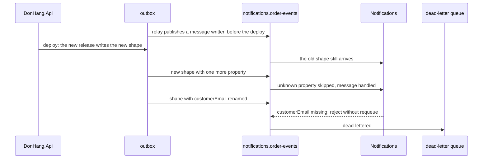

## Before you start

- [[backend.l4.expand-and-contract]] — you know that old and new code share one schema during a deploy, so an incompatible change goes out in compatible steps.
- [[backend.l3.dead-letter-queue]] — you know that Notifications rejects a poison message without requeue, and the queue moves it to `notifications.order-events.dead`, where it waits for a person.
- [[backend.l2.breaking-changes]] — you know that renaming a field a client reads breaks it, while adding a field breaks no client that reads only the fields it knows.
- [[design.l4.distributed-monolith]] — you know that each service keeps its own copy of `OrderMessage`, and that renaming a field both read still moves the services in step.

## The situation

It is stage-4. A teammate opens a pull request that renames `CustomerEmail` to `Email` in `DonHang.Domain/OrderMessage.cs`, the message the api publishes for every order event. Notifications and Payments each keep their own copy of that record, so they still build. Their argument: "Nobody else references our class, so nobody else is affected."

You picture the messages already sitting in the outbox and in RabbitMQ, written with the old name, and the copies in the other services that look for `customerEmail` (the JSON name of `CustomerEmail`).

Which changes to a message can its readers survive while they keep running, and how do you make the ones they cannot?

## Core concepts

- **schema evolution** — changing the shape of data that other programs read, such as a message body, while those programs keep running.
- message shape — the property names and types a message body carries, here the JSON of `OrderMessage`.
- reader — a program that reads a message body into its own type, such as Notifications reading its copy of `OrderMessage`.
- old-shaped message — a message written before a shape changed that is still waiting to be read, in the outbox, a queue or the dead-letter queue.

## How it works



In the situation above, schema evolution is the teammate's rename: the shape changes on the api's side, and the readers keep running the code they had.

Follow the diagram from the top. The relay, the part that reads unsent outbox rows and publishes them to RabbitMQ, still sends a row written before the deploy, and Notifications handles it in the old shape. The arrows after that compare two separate releases: one adds a property, the other renames one.

The api writes each message body into the outbox with `JsonSerializerOptions.Web`, which turns `CustomerEmail` into the JSON name `customerEmail`. Notifications and Payments read the body into their own copy of `OrderMessage` with the same options. Two rules of that reading decide everything. A JSON property the copy does not know is skipped. A property the copy has but the JSON lacks is left at its default value, which for `CustomerEmail` is `null`.

So an added property breaks no reader: it is skipped. A rename is two changes at once to the reader: an unknown property, skipped, and a missing one. Both readers treat a missing email as poison, so every renamed message is rejected without requeue and dead-lettered.

A deploy empties nothing on the way. Unsent outbox rows, messages waiting in the queue, and messages in the dead-letter queue all keep the shape they were written with. The first two arrive after the deploy on their own; the last arrive whenever a person moves them back. A reader therefore meets old-shaped messages long after every service runs the new version.

## In the Đơn Hàng system

Notifications reads every body through one method of its consumer:

```csharp file=DonHang.Notifications/OrderEventsConsumer.cs tag=stage-4 lines=128-141
    private static OrderMessage Read(byte[] body)
    {
        try
        {
            var message = JsonSerializer.Deserialize<OrderMessage>(body, JsonSerializerOptions.Web);
            if (message is null || message.OrderId < 1 || string.IsNullOrEmpty(message.CustomerEmail))
                throw new PoisonMessageException("the body is not an order message");
            return message;
        }
        catch (JsonException ex)
        {
            throw new PoisonMessageException("the body is not valid JSON", ex);
        }
    }
```

Line 5 reads the body into Notifications' own `OrderMessage`. Line 6 is what `Read` checks: an order id and an email address. Nothing else is checked here, so a body with an extra property passes, and a body whose `customerEmail` is missing does not. Payments' `RefundRequestedConsumer`, which receives the `order.refund-requested` messages, reads its copy with the same options and the same check.

`scripts/backend/message-shapes.sh` publishes both changes as `order.placed` messages, the way the relay would, each with a new message id; it keeps the first id to check later that this message was handled:

```bash file=scripts/backend/message-shapes.sh tag=stage-4 lines=34-43
# lesson: backend.l4.message-schema-evolution
# Notifications reads the body with JsonSerializerOptions.Web: a property it
# does not know is skipped. A renamed one is a property it does not know,
# and customerEmail, which it requires, is then missing: the message is
# poison, rejected without requeueing, and dead-lettered.
added=$(cat /proc/sys/kernel/random/uuid)
echo "== order.placed with one more property, giftWrap"
publish "$added" '{"orderId":2,"customerEmail":"anh.tran@example.com","customerName":"Trần Minh Anh","occurredAt":"2026-03-05T08:00:00+00:00","giftWrap":true}'
echo "== order.placed with customerEmail renamed to email"
publish "$(cat /proc/sys/kernel/random/uuid)" '{"orderId":2,"email":"anh.tran@example.com","customerName":"Trần Minh Anh","occurredAt":"2026-03-05T08:00:00+00:00"}'
```

```text output=true
messages in notifications.order-events.dead before: 0
== order.placed with one more property, giftWrap
  routed: true
== order.placed with customerEmail renamed to email
  routed: true

the message with giftWrap was handled: yes
a new email to anh.tran@example.com in Mailpit: yes
messages in notifications.order-events.dead after: 1
the dead-lettered one:
  {"orderId":2,"email":"anh.tran@example.com","customerName":"Trần Minh Anh","occurredAt":"2026-03-05T08:00:00+00:00"}
  reason: rejected
```

Both messages reached the queue. The one with `giftWrap` became an email to the customer, found in Mailpit, the mailbox where the example setup collects sent emails; the renamed one is the single message in the dead-letter queue, with the reason `rejected`.

Stage-4 also catches the rename before any message is written. `DonHang.Tests/Messaging/OrderMessageContractTests.cs` writes the api's `OrderMessage` as a JSON body with `JsonSerializerOptions.Web`, as the outbox does, then reads that body with Notifications' copy and with Payments' copy. It checks that each of the four values the copies have (order id, email, name, time) arrives unchanged. A rename or retype on either side fails there, in the pull request that makes it. A reader that starts to require a new property does not: the test sends only the api's current shape.

## Trade-offs

| Way to change a message | Readers still running old code | Old-shaped messages | Releases | Cost |
|---|---|---|---|---|
| Add a property, readers treat it as optional | skip it, keep working | still handled | one | readers must cope when it is absent |
| Rename, remove or retype a property in place | fail on new messages that lack what they need (rejected as poison, or, when `Read` accepts them but a later step fails, redelivered up to the queue's delivery limit, the most times it delivers one message, then dead-lettered) or misread them | handled only by old readers | one | messages in the dead-letter queue, services released in step |
| A reader starts to require a property | not affected | rejected as poison | one | old messages dead-lettered until none are left |
| New shape under a new routing key beside the old | keep reading the old key, if the new key is outside their binding | still handled on the old key | two or more | the api publishes twice until every reader has moved |

## What would you choose if…

…Notifications wants the order total in its emails? Add the total to the api's `OrderMessage` and to Notifications' copy, and let Notifications treat it as optional: old messages, including any moved back from the dead-letter queue, lack it. Either service can go first. The api's new property is skipped by an old Notifications, and a new Notifications finds it absent in old messages. Make it required only when you know no message without it is left anywhere.

…the order id has to become text instead of a number? A property cannot hold two types at once, so this shape has to break. Expand and contract applies to messages too: the api publishes the new shape under a new routing key beside the old one, readers move to the new key one by one, and the old key goes once none reads it. Pick the key with care: Notifications' queue is bound with `order.*`, so a key with one word after `order.` reaches it. `SubjectFor`, the method outside the excerpt that turns a routing key into an email subject, rejects a key it does not know as poison. An old Notifications would dead-letter every message under such a key, so choose one its binding does not match, such as a key with two words after `order.`.

…the rename only tidies a name and nothing forces it? Keep `customerEmail`. Every reader, every queued message and the test agree on it today, and a rename costs compatible steps over several releases, just for a name.

## Seniors often assume…

- **"Each service has its own copy of `OrderMessage`, so the api can rename its fields freely."** → Actually the copies share no class, but they share the JSON names, and a reader looks for `customerEmail` by name. A rename on the api's side leaves that property missing in every new message. You notice this when the api's build and tests stay green, yet after the deploy `notifications.order-events.dead` fills with messages whose reason is `rejected`.
- **"Once every service runs the new version, no message of the old shape can arrive."** → Actually a deploy leaves the outbox, the queue and the dead-letter queue as they are, and each message keeps the shape it was written with. You notice this when a reader that just started to require a property dead-letters messages created before the deploy, or when a message moved back from the dead-letter queue days later fails again.
- **"Adding a field to a message forces every consumer to be updated before the api that publishes it."** → Actually a reader using `JsonSerializerOptions.Web` skips a property it does not know, so an unchanged Notifications handled the message with `giftWrap`. The order matters only for a reader that would require the new field. You notice this when a release plan waits for every reader first, although the reader's code never looks at the new field.

## Try it (3 minutes)

In the root folder of the example repository at tag `stage-4`:

1. Open `DonHang.Tests/Messaging/OrderMessageContractTests.cs`.
2. Find `Message`, the line that builds `Body` from it, and the two tests that read `Body`.

Expected result: `Body` is the api's `OrderMessage` in `Message`, written as a JSON body with `JsonSerializerOptions.Web`; `Notifications_ReadsEveryValueTheApiSends` and `Payments_ReadsEveryValueTheApiSends` read it with each service's copy and compare four values.

Then decide: the api adds a fifth property, `ShopId`, to its `OrderMessage` and to the `new(...)` that builds `Message`, and neither copy changes. Do those two tests still pass?

<details><summary>Suggested answer</summary>

Yes. Each copy skips `shopId`, the property it does not know, and both tests compare only the four values the copies have. It is the same reason the message with `giftWrap` was handled: adding a property breaks no reader.

</details>

## Connections

- [[backend.l4.expand-and-contract]] — the same rule one layer over: messages, like tables, have readers still running old code, so incompatible changes go in compatible steps.
- [[backend.l2.breaking-changes]] — the same rename-against-add distinction for API responses; here the reader is a service, and its failure lands in a dead-letter queue.
- [[backend.l3.dead-letter-queue]] — where a renamed message ends up, and where old-shaped messages wait until a person moves them back.
- [[backend.l3.outbox-relay]] — why messages written before a deploy are still delivered after it.
- [[design.l4.distributed-monolith]] — the copies of `OrderMessage` stop services sharing a class, but not sharing a shape.
- [[design.l4.fitness-functions]] — the same kind of automated check, applied to a message shape on every pull request.
- [[backend.l2.api-versioning]] — the HTTP counterpart of publishing a new shape beside the old one.
- [[backend.l4.shop-data-layout]] — next in this module: where each shop's data lives.

## Five-line summary

1. A message may change only in ways that every reader, still running its own code, can read, including the messages already waiting.
2. Notifications and Payments read `OrderMessage` with `JsonSerializerOptions.Web`: unknown properties are skipped, missing ones get their default value.
3. Adding a property breaks no reader; renaming `customerEmail` sends every new message to the dead-letter queue, as `message-shapes.sh` shows.
4. A deploy leaves old-shaped messages in the outbox, the queue and the dead-letter queue, so a newly needed property stays optional.
5. A shape that must break goes under a new routing key; `OrderMessageContractTests` catches a rename or retype on either side in the pull request.
