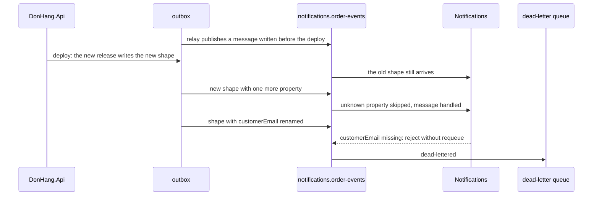

## Bạn cần biết trước

- [[backend.l4.expand-and-contract]] — bạn biết rằng trong lúc deploy, code cũ và code mới dùng chung một schema, nên một thay đổi không tương thích phải đi ra qua các bước tương thích.
- [[backend.l3.dead-letter-queue]] — bạn biết rằng Notifications từ chối một poison message mà không requeue, và queue chuyển nó sang `notifications.order-events.dead`, nơi nó chờ một người xử lý.
- [[backend.l2.breaking-changes]] — bạn biết rằng đổi tên một field mà client đọc sẽ làm client đó hỏng, còn thêm field thì không làm hỏng client nào chỉ đọc những field nó biết.
- [[design.l4.distributed-monolith]] — bạn biết rằng mỗi service giữ bản sao `OrderMessage` riêng, và đổi tên một field mà cả hai cùng đọc vẫn buộc các service phải đổi cùng nhịp.

## Tình huống

Đang ở stage-4. Một đồng nghiệp mở pull request đổi tên `CustomerEmail` thành `Email` trong `DonHang.Domain/OrderMessage.cs`, message mà api publish cho mọi sự kiện đơn hàng. Notifications và Payments mỗi bên giữ bản sao record đó riêng, nên chúng vẫn build được. Lý lẽ của đồng nghiệp: "Không ai khác tham chiếu class của mình, nên không ai khác bị ảnh hưởng."

Bạn hình dung các message đang nằm sẵn trong outbox và trong RabbitMQ, ghi bằng tên cũ, và các bản sao ở những service khác vẫn đi tìm `customerEmail` (tên JSON của `CustomerEmail`).

Thay đổi nào trên một message mà bên đọc chịu được trong khi chúng vẫn chạy, và làm sao thực hiện những thay đổi chúng không chịu được?

## Khái niệm cốt lõi

- **tiến hóa schema** (schema evolution) — đổi hình dạng của dữ liệu mà chương trình khác đọc, như thân một message, trong khi các chương trình đó vẫn chạy.
- hình dạng message — tên và kiểu các property mà thân message mang, ở đây là JSON của `OrderMessage`.
- bên đọc — chương trình đọc thân message vào kiểu riêng của nó, chẳng hạn Notifications đọc vào bản sao `OrderMessage` của mình.
- message dạng cũ — message được ghi trước khi hình dạng đổi và vẫn đang chờ được đọc, trong outbox, trong queue hay trong dead-letter queue.

## Cơ chế hoạt động



Trong tình huống trên, tiến hóa schema chính là lần đổi tên của đồng nghiệp: hình dạng đổi ở phía api, còn các bên đọc vẫn chạy code chúng đang có.

Hãy đọc sơ đồ từ trên xuống. Relay, phần đọc các dòng outbox chưa gửi và publish chúng lên RabbitMQ, vẫn gửi một dòng được ghi trước lần deploy, và Notifications xử lý nó theo dạng cũ. Các mũi tên sau đó so sánh hai bản phát hành riêng biệt: một bản thêm một property, bản kia đổi tên một property.

Api ghi mỗi thân message vào outbox bằng `JsonSerializerOptions.Web`, tùy chọn biến `CustomerEmail` thành tên JSON `customerEmail`. Notifications và Payments đọc thân message vào bản sao `OrderMessage` riêng bằng cùng tùy chọn đó. Hai quy tắc của lần đọc này quyết định mọi thứ. Property JSON nào bản sao không biết thì bị bỏ qua. Property nào bản sao có mà JSON thiếu thì giữ giá trị mặc định, với `CustomerEmail` là `null`.

Vậy thêm một property không làm hỏng bên đọc nào: nó bị bỏ qua. Đổi tên là hai thay đổi cùng lúc với bên đọc: một property lạ, bị bỏ qua, và một property bị thiếu. Cả hai bên đọc đều coi thiếu email là poison, nên mọi message đã đổi tên đều bị từ chối không requeue và bị đẩy vào dead-letter queue.

Một lần deploy không làm trống thứ gì trên đường đi. Các dòng outbox chưa gửi, các message đang chờ trong queue và các message trong dead-letter queue đều giữ nguyên hình dạng lúc chúng được ghi. Hai loại đầu tự tới sau lần deploy. Loại cuối tới bất cứ khi nào có người chuyển chúng trở lại. Vì thế bên đọc còn gặp message dạng cũ rất lâu sau khi mọi service đã chạy phiên bản mới.

## Trong hệ thống Đơn Hàng

Notifications đọc mọi thân message qua một method của consumer:

```csharp file=DonHang.Notifications/OrderEventsConsumer.cs tag=stage-4 lines=128-141
    private static OrderMessage Read(byte[] body)
    {
        try
        {
            var message = JsonSerializer.Deserialize<OrderMessage>(body, JsonSerializerOptions.Web);
            if (message is null || message.OrderId < 1 || string.IsNullOrEmpty(message.CustomerEmail))
                throw new PoisonMessageException("the body is not an order message");
            return message;
        }
        catch (JsonException ex)
        {
            throw new PoisonMessageException("the body is not valid JSON", ex);
        }
    }
```

Dòng 5 đọc thân message vào `OrderMessage` riêng của Notifications. Dòng 6 là thứ `Read` kiểm tra: một order id và một địa chỉ email. Ở đây không kiểm tra gì khác, nên thân message có thêm property vẫn qua, còn thân message thiếu `customerEmail` thì không. `RefundRequestedConsumer` của Payments, consumer nhận các message `order.refund-requested`, đọc bản sao của nó với cùng tùy chọn và cùng phép kiểm tra.

`scripts/backend/message-shapes.sh` publish cả hai thay đổi dưới dạng message `order.placed`, đúng như relay sẽ làm, mỗi message một message id mới. Script giữ lại id đầu tiên để sau đó kiểm tra message này đã được xử lý:

```bash file=scripts/backend/message-shapes.sh tag=stage-4 lines=34-43
# lesson: backend.l4.message-schema-evolution
# Notifications reads the body with JsonSerializerOptions.Web: a property it
# does not know is skipped. A renamed one is a property it does not know,
# and customerEmail, which it requires, is then missing: the message is
# poison, rejected without requeueing, and dead-lettered.
added=$(cat /proc/sys/kernel/random/uuid)
echo "== order.placed with one more property, giftWrap"
publish "$added" '{"orderId":2,"customerEmail":"anh.tran@example.com","customerName":"Trần Minh Anh","occurredAt":"2026-03-05T08:00:00+00:00","giftWrap":true}'
echo "== order.placed with customerEmail renamed to email"
publish "$(cat /proc/sys/kernel/random/uuid)" '{"orderId":2,"email":"anh.tran@example.com","customerName":"Trần Minh Anh","occurredAt":"2026-03-05T08:00:00+00:00"}'
```

```text output=true
messages in notifications.order-events.dead before: 0
== order.placed with one more property, giftWrap
  routed: true
== order.placed with customerEmail renamed to email
  routed: true

the message with giftWrap was handled: yes
a new email to anh.tran@example.com in Mailpit: yes
messages in notifications.order-events.dead after: 1
the dead-lettered one:
  {"orderId":2,"email":"anh.tran@example.com","customerName":"Trần Minh Anh","occurredAt":"2026-03-05T08:00:00+00:00"}
  reason: rejected
```

Cả hai message đều tới queue. Message có `giftWrap` thành một email gửi khách, thấy được trong Mailpit, hộp thư nơi bộ cài đặt ví dụ gom các email đã gửi. Message bị đổi tên là message duy nhất trong dead-letter queue, với lý do `rejected`.

Stage-4 còn bắt được lần đổi tên trước khi bất kỳ message nào được ghi. `DonHang.Tests/Messaging/OrderMessageContractTests.cs` ghi `OrderMessage` của api thành thân JSON bằng `JsonSerializerOptions.Web`, giống outbox, rồi đọc thân đó bằng bản sao của Notifications và bản sao của Payments. Test kiểm tra rằng cả bốn giá trị mà các bản sao có (order id, email, tên, thời điểm) tới nơi không đổi. Đổi tên hay đổi kiểu ở bất kỳ phía nào cũng hỏng ở đó, ngay trong pull request tạo ra thay đổi. Một bên đọc bắt đầu đòi một property mới thì không bị bắt: test chỉ gửi hình dạng hiện tại của api.

## Đánh đổi

| Cách đổi một message | Bên đọc vẫn chạy code cũ | Message dạng cũ | Số bản phát hành | Cái giá |
|---|---|---|---|---|
| Thêm một property, bên đọc coi nó là tùy chọn | bỏ qua nó, vẫn chạy | vẫn được xử lý | một | bên đọc phải xoay xở khi nó vắng mặt |
| Đổi tên, xóa hay đổi kiểu một property tại chỗ | hỏng với message mới thiếu thứ chúng cần (bị từ chối như poison, hoặc, khi `Read` chấp nhận nhưng một bước sau thất bại, bị giao lại tới giới hạn giao của queue, tức số lần nhiều nhất queue giao một message, rồi vào dead-letter queue) hoặc đọc sai | chỉ bên đọc cũ xử lý được | một | message nằm trong dead-letter queue, các service phát hành cùng nhịp |
| Một bên đọc bắt đầu đòi một property | không ảnh hưởng | bị từ chối như poison | một | message cũ vào dead-letter queue tới khi không còn cái nào |
| Hình dạng mới dưới routing key mới, cạnh key cũ | vẫn đọc key cũ, nếu key mới nằm ngoài binding của chúng | vẫn được xử lý trên key cũ | hai trở lên | api publish hai lần tới khi mọi bên đọc đã chuyển |

## Bạn sẽ chọn gì nếu…

…Notifications muốn có tổng tiền đơn hàng trong email? Thêm tổng tiền vào `OrderMessage` của api và vào bản sao của Notifications, và để Notifications coi nó là tùy chọn: message cũ, kể cả những message được chuyển lại từ dead-letter queue, không có nó. Service nào đi trước cũng được. Property mới của api bị một Notifications cũ bỏ qua, còn một Notifications mới thấy nó vắng mặt trong message cũ. Chỉ bắt buộc nó khi bạn biết chắc không còn message nào thiếu nó ở bất cứ đâu.

…order id phải đổi từ số sang chuỗi? Một property không thể mang hai kiểu cùng lúc, nên hình dạng này buộc phải vỡ. Expand and contract cũng áp dụng cho message: api publish hình dạng mới dưới một routing key mới cạnh key cũ, các bên đọc lần lượt chuyển sang key mới, và key cũ bị bỏ khi không còn ai đọc nó. Hãy chọn key cẩn thận: queue của Notifications được bind với `order.*`, nên key có một từ sau `order.` sẽ tới được nó. `SubjectFor`, method nằm ngoài đoạn trích, biến routing key thành tiêu đề email, từ chối key nó không biết như poison. Một Notifications cũ sẽ đẩy mọi message dưới key như vậy vào dead-letter queue, nên hãy chọn key mà binding của nó không khớp, chẳng hạn key có hai từ sau `order.`.

…lần đổi tên chỉ để tên gọn hơn và không có gì bắt buộc phải đổi? Giữ `customerEmail`. Hôm nay mọi bên đọc, mọi message đang xếp hàng và cả test đều thống nhất với tên đó, còn đổi tên tốn nhiều bước tương thích qua vài bản phát hành, chỉ vì một cái tên.

## Senior hay nhầm rằng…

- **"Mỗi service có bản sao `OrderMessage` riêng, nên api đổi tên field thoải mái."** → Thực ra các bản sao không chung class nào, nhưng chung tên JSON, và bên đọc tìm `customerEmail` theo tên. Đổi tên ở phía api khiến property đó thiếu trong mọi message mới. Bạn sẽ nhận ra khi build và test của api vẫn xanh, nhưng sau lần deploy `notifications.order-events.dead` đầy dần các message có lý do `rejected`.
- **"Khi mọi service đã chạy phiên bản mới, không message dạng cũ nào còn tới được."** → Thực ra một lần deploy để nguyên outbox, queue và dead-letter queue, và mỗi message giữ hình dạng lúc nó được ghi. Bạn sẽ nhận ra khi một bên đọc vừa bắt đầu đòi một property lại đẩy vào dead-letter queue các message tạo ra trước lần deploy, hoặc khi một message được chuyển lại từ dead-letter queue vài ngày sau lại hỏng lần nữa.
- **"Thêm một field vào message buộc mọi consumer phải cập nhật trước api publish nó."** → Thực ra bên đọc dùng `JsonSerializerOptions.Web` bỏ qua property nó không biết, nên một Notifications không đổi gì vẫn xử lý message có `giftWrap`. Thứ tự chỉ quan trọng với bên đọc sẽ đòi field mới. Bạn sẽ nhận ra khi một kế hoạch phát hành cứ chờ mọi bên đọc đi trước, dù code của bên đọc chẳng bao giờ nhìn tới field mới.

## Thử ngay (3 phút)

Ở thư mục gốc của repo ví dụ tại tag `stage-4`:

1. Mở `DonHang.Tests/Messaging/OrderMessageContractTests.cs`.
2. Tìm `Message`, dòng dựng `Body` từ nó, và hai test đọc `Body`.

Kết quả mong đợi: `Body` là `OrderMessage` của api trong `Message`, được ghi thành thân JSON bằng `JsonSerializerOptions.Web`. `Notifications_ReadsEveryValueTheApiSends` và `Payments_ReadsEveryValueTheApiSends` đọc nó bằng bản sao của từng service và so sánh bốn giá trị.

Rồi hãy xác định: api thêm property thứ năm, `ShopId`, vào `OrderMessage` của nó và vào lời gọi `new(...)` dựng `Message`, còn cả hai bản sao giữ nguyên. Hai test đó có còn qua không?

<details><summary>Gợi ý đáp án</summary>

Có. Mỗi bản sao bỏ qua `shopId`, property nó không biết, và cả hai test chỉ so sánh bốn giá trị mà các bản sao có. Đây cũng là lý do message có `giftWrap` được xử lý: thêm một property không làm hỏng bên đọc nào.

</details>

## Liên hệ

- [[backend.l4.expand-and-contract]] — cùng quy tắc ở một tầng khác: message, cũng như bảng, có bên đọc vẫn chạy code cũ, nên thay đổi không tương thích đi qua các bước tương thích.
- [[backend.l2.breaking-changes]] — cùng phân biệt giữa đổi tên và thêm mới, nhưng cho response của API. Ở đây bên đọc là một service, và lỗi của nó rơi vào dead-letter queue.
- [[backend.l3.dead-letter-queue]] — nơi message bị đổi tên rơi vào, và nơi message dạng cũ chờ tới khi có người chuyển chúng trở lại.
- [[backend.l3.outbox-relay]] — vì sao message ghi trước lần deploy vẫn được giao sau đó.
- [[design.l4.distributed-monolith]] — các bản sao `OrderMessage` khiến service không chung class, nhưng không khiến chúng thôi chung hình dạng.
- [[design.l4.fitness-functions]] — cùng loại kiểm tra tự động, áp cho hình dạng message ở mỗi pull request.
- [[backend.l2.api-versioning]] — cách làm tương ứng bên HTTP: publish hình dạng mới cạnh hình dạng cũ.
- [[backend.l4.shop-data-layout]] — bài tiếp theo trong module: dữ liệu của mỗi cửa hàng nằm ở đâu.

## Tóm tắt 5 dòng

1. Message chỉ được đổi theo cách mà mọi bên đọc, vẫn chạy code của chính nó, đọc được, kể cả các message đang chờ sẵn.
2. Notifications và Payments đọc `OrderMessage` bằng `JsonSerializerOptions.Web`: property lạ bị bỏ qua, property thiếu nhận giá trị mặc định.
3. Thêm một property không làm hỏng bên đọc nào, còn đổi tên `customerEmail` đẩy mọi message mới vào dead-letter queue, như `message-shapes.sh` cho thấy.
4. Lần deploy để lại message dạng cũ trong outbox, queue và dead-letter queue, nên property mới cần đến phải là tùy chọn.
5. Hình dạng buộc phải vỡ thì đi dưới routing key mới, còn `OrderMessageContractTests` bắt được đổi tên hay đổi kiểu ở bất kỳ phía nào ngay trong pull request.
