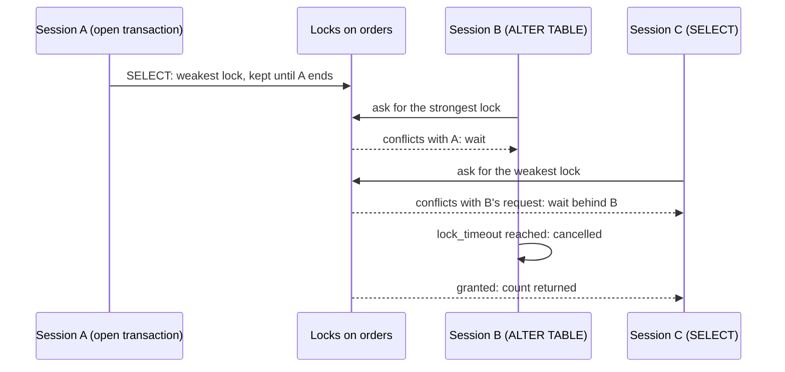

## Before you start

- [[backend.l4.expand-and-contract]] — you know which migrations old and new code can both survive; this lesson asks who waits while such a migration runs.
- [[backend.l2.skip-locked-claiming]] — you know that a row lock lasts until its transaction ends, and that a writer asking for a locked row waits.
- [[backend.l2.indexes-and-plans]] — you know why an index on a filtered column lets a query stop reading the whole table.
- [[backend.l2.transactions-in-practice]] — you know that statements between `BEGIN` and `COMMIT` form one transaction, and that a waiting `UPDATE` resumes only when the other one ends.

## The situation

It is stage-4, and you want an index on `orders (status)`, so that queries filtering orders by status stop reading the whole table. Your migration holds one `CREATE INDEX`, and you call it harmless: it changes no row, it only adds a lookup structure.

Before shipping it, you try it on `donhang_perf`, the copy with 200,000 orders. While the index builds, a `SELECT` answers at once, but an `INSERT` of a new order just waits. A teammate adds that a one-line `ALTER TABLE` once froze every query on a table, though it had almost no work to do.

If not the time a migration takes, what decides who has to wait for it?

## Core concepts

- table lock — a lock a statement takes on a whole table before using it, kept until its transaction ends; unlike a row lock, it covers every row, even rows not yet inserted.
- conflicting locks — two locks the table cannot grant at the same time, so the one asked for later waits.
- lock queue — the line of sessions waiting for a lock on a table (a session here is one connection to the database sending statements, not a login session); a new request that conflicts with a request already waiting joins the line behind it.
- `lock_timeout` — a PostgreSQL setting that cancels a statement once it has waited longer than the given time for a lock; it is off unless you set it.
- concurrent index build — `CREATE INDEX CONCURRENTLY`, which builds an index while reads and writes to the table continue.
- invalid index — what a concurrent build that fails partway leaves behind: an index queries do not use but writes still keep up to date, which you drop before trying again.

## How it works



Every statement that reads or changes a table first takes a table lock on it. Locks differ in what they let others do. A `SELECT` takes the weakest kind, which conflicts only with the strongest. A plain `CREATE INDEX` takes one that lets reads continue but conflicts with `INSERT`, `UPDATE` and `DELETE`. In the situation above, the new order waits until the index is built and the transaction commits.

`ALTER TABLE ... ADD COLUMN` may need only a moment of work, but it needs the strongest lock, which conflicts with every other one.

Follow the diagram. Session A has read `orders` in a transaction it keeps open, so it still holds the weakest lock. B's `ALTER TABLE` must wait for A. Then C sends a plain `SELECT`. A alone would let it read, but C's request conflicts with B's waiting one, so C joins the lock queue behind B. From now on, every query on `orders` waits, behind a migration that has done nothing yet.

So the wait lasts as long as the longest open transaction holding a lock on `orders`, not as long as the migration. With a `lock_timeout`, B gives up at its limit, the line behind it moves, and C gets its answer. The migration failed but changed nothing, so you can run it again at a quieter moment.

Indexes have a second way out. A concurrent index build lets writes continue, at the cost of a slower build. Before it finishes, it waits for transactions already open when it started, so one long open transaction stalls it. It cannot run inside a transaction block, that is, between `BEGIN` and `COMMIT`, and if it fails during the build, it leaves an invalid index to drop.

## In the Đơn Hàng system

`scripts/backend/migration-locks.sh` replays these cases on `donhang_perf`. Its helpers, defined above the excerpt, work on named sessions: `session` runs one `psql` command (`psql` is PostgreSQL's command-line client, which sends SQL text and prints the result); `until_state X E` waits until session X shows the wait event E; `end X` ends session X, which rolls back its open transaction. A wait event is what `pg_stat_activity`, a built-in PostgreSQL view with one row per connection, names as the thing a connection waits on: `PgSleep` while it runs `pg_sleep`, `relation` while it waits for a table lock.

```bash file=scripts/backend/migration-locks.sh tag=stage-4 lines=36-54
# lesson: backend.l4.migration-locks
# Session A builds a plain index inside a transaction and keeps it open:
# the lock CREATE INDEX took on orders stays until A ends. B can still read;
# B's INSERT would wait for A, and lock_timeout gives up after 2 seconds.
echo "== 1. A: BEGIN; CREATE INDEX orders_status_idx ON orders (status); (transaction left open)"
session A "BEGIN; CREATE INDEX orders_status_idx ON orders (status); SELECT pg_sleep(60);" >/dev/null 2>&1 &
until_state A PgSleep
echo "B: SELECT count(*) FROM orders -> $(session B "SELECT count(*) FROM orders")"
echo "B: SET lock_timeout = '2s'; INSERT INTO orders ..."
session B "SET lock_timeout = '2s';
  INSERT INTO orders (customer_id, placed_at, status) VALUES (1, now(), 'new')" 2>&1 | sed 's/^/  /' || true
end A
wait

echo "== 2. CREATE INDEX CONCURRENTLY inside a transaction block"
session A "BEGIN; CREATE INDEX CONCURRENTLY orders_status_idx ON orders (status); COMMIT;" 2>&1 | sed 's/^/  /' || true
echo "and on its own"
session A "CREATE INDEX CONCURRENTLY orders_status_idx ON orders (status)" && echo "  created"
session A "DROP INDEX orders_status_idx"
```

Line 41 (`session A "BEGIN; CREATE INDEX ...`) is the migration of the situation, slowed down: A builds the index, then sleeps inside its open transaction, so its lock stays until the script ends A (line 47), which rolls the build back. Line 43 (`SELECT count(*)`) is a read, and it answers. Lines 45–46 try an `INSERT` with a 2-second `lock_timeout`; it waits for A's lock and is cancelled. Line 51 sends the concurrent build inside `BEGIN` and `COMMIT`. PostgreSQL refuses it before building anything, so no index is left, which is why line 53 can create one with the same name.

```bash file=scripts/backend/migration-locks.sh tag=stage-4 lines=56-77
# lesson: backend.l4.migration-locks
# A has read orders in a transaction it keeps open. B's ALTER TABLE needs the
# strongest lock, so it waits for A; C's plain SELECT, arriving after B,
# waits behind B, although A would let it read. B gives up at its
# lock_timeout, and only then does C get its answer.
echo "== 3. A: BEGIN; SELECT count(*) FROM orders; (transaction left open)"
session A "BEGIN; SELECT count(*) FROM orders; SELECT pg_sleep(60);" >/dev/null 2>&1 &
until_state A PgSleep
echo "B: SET lock_timeout = '5s'; ALTER TABLE orders ADD COLUMN note text"
session B "SET lock_timeout = '5s'; ALTER TABLE orders ADD COLUMN note text" > "$tmp/b" 2>&1 &
b=$!
until_state B relation
echo "C: SELECT count(*) FROM orders"
session C "SELECT count(*) FROM orders" > "$tmp/c" 2>&1 &
c=$!
until_state C relation && echo "  C waits for a lock, behind B: yes"
wait "$b" || true
sed 's/^/  B: /' "$tmp/b"
wait "$c"
echo "  C, once B gave up: $(cat "$tmp/c")"
end A
wait
```

```text output=true
== 1. A: BEGIN; CREATE INDEX orders_status_idx ON orders (status); (transaction left open)
B: SELECT count(*) FROM orders -> 200000
B: SET lock_timeout = '2s'; INSERT INTO orders ...
  ERROR:  canceling statement due to lock timeout at character 40
== 2. CREATE INDEX CONCURRENTLY inside a transaction block
  ERROR:  CREATE INDEX CONCURRENTLY cannot run inside a transaction block
and on its own
  created
== 3. A: BEGIN; SELECT count(*) FROM orders; (transaction left open)
B: SET lock_timeout = '5s'; ALTER TABLE orders ADD COLUMN note text
C: SELECT count(*) FROM orders
  C waits for a lock, behind B: yes
  B: ERROR:  canceling statement due to lock timeout
  C, once B gave up: 200000
```

Step 3 is the diagram. Line 67 (`until_state B relation`) waits until B is waiting for a table lock; only then does C send its `SELECT`. Line 71 finds C waiting too. The output shows the order: B is cancelled first, and C's count arrives after it.

The script sends SQL by hand. Đơn Hàng's migrations go through EF Core, which runs a migration's statements in a transaction. `migrationBuilder` is the object an EF Core migration receives to list its steps, and its `Sql` method adds one raw SQL statement as a step. A `CREATE INDEX CONCURRENTLY` passed with `migrationBuilder.Sql` would fail exactly like step 2; adding `suppressTransaction: true` makes EF Core run it outside the transaction.

## Trade-offs

| How to add an index to `orders` | Writes while it builds | Build | In EF Core's migration transaction | If it fails |
|---|---|---|---|---|
| Plain `CREATE INDEX` | wait until the build commits | faster | runs as usual | rolled back with the transaction, nothing left |
| `CREATE INDEX CONCURRENTLY` with `suppressTransaction: true` | continue | slower, and it waits for open transactions | must run outside it | an invalid index stays and must be dropped |
| Plain `CREATE INDEX` while order taking is stopped | none to block | faster | runs as usual | rolled back, but the stop is a planned outage |

## What would you choose if…

…the index is for a table with few rows that staff change a few times a day? A plain `CREATE INDEX` in the migration: writes wait, but only for as long as a small build takes, and the migration stays one transaction that succeeds or rolls back whole.

…the index is for `orders`, which receives new orders all day? The concurrent build, with `suppressTransaction: true`. Placing an order keeps working while it builds. If it fails, drop the invalid index before running it again.

…you need to add a column to `orders` while a long report keeps a transaction open on it? Give the migration a `lock_timeout` of a few seconds. If the hook fails, wave 2, the rollout of the new api, never starts and the old api keeps serving; you sync again when the report has finished. When nothing holds `orders` for long, the timeout costs nothing and stays as a guard.

## Seniors often assume…

- **"A migration that finishes in a second cannot block anyone."** → Actually a migration first waits for its lock, and every query that arrives after it and conflicts with its request waits behind it. A quick `ALTER TABLE` waiting for a long transaction stops the whole table for that long. You notice this when every endpoint that reads `orders` slows down together during a deploy, while the migration itself has done no work yet.
- **"Adding an index only changes how reads work, so it is safe on a busy table."** → Actually a plain `CREATE INDEX` takes a lock that conflicts with `INSERT`, `UPDATE` and `DELETE` until the build commits. Reads keep working, which hides the problem. You notice this when reading orders answers during a deploy, but `POST /api/v1/orders` hangs until the migration ends.
- **"`CONCURRENTLY` makes an index build faster."** → Actually it is slower: it reads the table twice and waits for transactions already open when it started. What it buys is that writes continue meanwhile. You notice this when the concurrent build takes longer than a plain one did in a test.

## Try it (3 minutes)

In the root folder of the example repository at tag `stage-4`, with Docker running:

1. Run `scripts/backend/migration-locks.sh`. If `donhang_perf` is missing, the script builds it first, which makes the first run slower.
2. Read step 3 of the output.

Expected result: the line `C waits for a lock, behind B: yes`, then `B: ERROR:  canceling statement due to lock timeout`, and only after that `C, once B gave up: 200000`.

Then decide: if B had no `lock_timeout`, when would C get its count?

<details><summary>Suggested answer</summary>

Only after A's transaction ends. B would wait for A, take its lock, add the column and commit; C, queued behind B, would read after that. In the script A sleeps for 60 seconds, so C would wait about that long. In production, the wait would last as long as the longest transaction that had read `orders`.

</details>

## Connections

- [[backend.l4.expand-and-contract]] — prerequisite: which migrations both versions of the code survive; this lesson adds who waits while one runs.
- [[backend.l2.skip-locked-claiming]] — the same waiting one size down: a lock on a row there, a lock on the whole table here.
- [[backend.l2.transactions-in-practice]] — the transactions whose locks last until they end, now holding a migration back.
- [[backend.l2.indexes-and-plans]] — why you want the index; this lesson is the cost of adding it to a table in use.
- [[backend.l2.composite-indexes]] — the indexes you add next, each one a migration with these locks.
- [[backend.l3.slow-dependencies]] — the same pile-up seen from the api: a database that makes queries wait does more harm than one that refuses.
- [[backend.l4.shop-id-rollout]] — a later change to live tables, planned with these locks in mind.

## Five-line summary

1. Who waits for a migration is decided by the locks it needs and the transactions it waits behind, not by how long its work takes.
2. A plain `CREATE INDEX` lets reads continue but makes every `INSERT`, `UPDATE` and `DELETE` on the table wait until the build commits.
3. `CREATE INDEX CONCURRENTLY` lets writes continue but is slower, cannot run in a transaction block, and leaves an invalid index if the build fails.
4. EF Core runs a migration in a transaction, so a concurrent build needs `migrationBuilder.Sql` with `suppressTransaction: true`.
5. A quick `ALTER TABLE` waits behind long transactions and queues every later query; `lock_timeout` makes it fail fast so it can run again.
