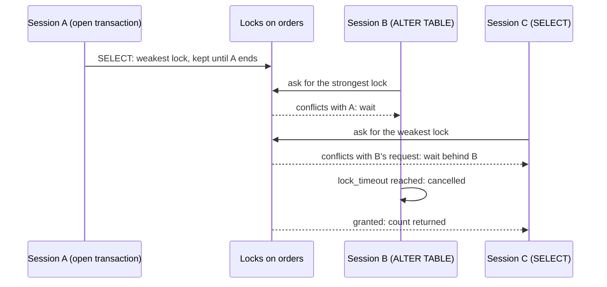

## Bạn cần biết trước

- [[backend.l4.expand-and-contract]] — bạn biết những migration nào cả code cũ lẫn code mới đều chịu được. Bài này hỏi ai phải chờ trong lúc một migration như vậy chạy.
- [[backend.l2.skip-locked-claiming]] — bạn biết khóa dòng kéo dài tới khi giao dịch của nó kết thúc, và một bên ghi muốn lấy dòng đang bị khóa thì phải chờ.
- [[backend.l2.indexes-and-plans]] — bạn biết vì sao index trên cột dùng để lọc giúp truy vấn khỏi phải đọc cả bảng.
- [[backend.l2.transactions-in-practice]] — bạn biết các câu lệnh giữa `BEGIN` và `COMMIT` tạo thành một giao dịch, và một `UPDATE` đang chờ chỉ chạy tiếp khi giao dịch kia kết thúc.

## Tình huống

Đang ở stage-4, và bạn muốn có index trên `orders (status)` để các truy vấn lọc đơn theo trạng thái thôi đọc cả bảng. Migration của bạn chỉ có một câu `CREATE INDEX`, và bạn cho là vô hại: nó không đổi dòng nào, chỉ thêm một cấu trúc tra cứu.

Trước khi phát hành, bạn thử nó trên `donhang_perf`, bản sao có 200.000 đơn. Trong lúc index đang dựng, một `SELECT` trả lời ngay, còn một `INSERT` đơn mới thì cứ đứng chờ. Một đồng nghiệp kể thêm: có lần chỉ một dòng `ALTER TABLE` đã làm đứng mọi truy vấn trên một bảng, dù nó gần như chẳng có việc gì để làm.

Nếu không phải thời gian migration chạy, thì điều gì quyết định ai phải chờ nó?

## Khái niệm cốt lõi

- khóa bảng — khóa mà một câu lệnh lấy trên cả bảng trước khi dùng bảng đó, giữ tới khi giao dịch của nó kết thúc. Khác khóa dòng, nó phủ mọi dòng, kể cả những dòng chưa được thêm vào.
- khóa xung đột — hai khóa mà bảng không thể cấp cùng lúc, nên khóa được xin sau phải chờ.
- hàng chờ khóa — hàng các session đang chờ khóa trên một bảng (session ở đây là một kết nối tới database đang gửi câu lệnh, không phải phiên đăng nhập). Một yêu cầu mới xung đột với một yêu cầu đang chờ sẽ xếp hàng phía sau nó.
- `lock_timeout` — thiết lập của PostgreSQL hủy một câu lệnh khi nó đã chờ khóa lâu hơn thời gian cho trước. Nó tắt trừ khi bạn đặt.
- dựng index đồng thời — `CREATE INDEX CONCURRENTLY`, dựng index trong khi bảng vẫn được đọc và ghi bình thường.
- index không hợp lệ — thứ mà một lần dựng đồng thời thất bại giữa chừng để lại: một index mà truy vấn không dùng nhưng thao tác ghi vẫn cập nhật, và bạn phải xóa nó trước khi thử lại.

## Cơ chế hoạt động



Mọi câu lệnh đọc hay sửa một bảng đều lấy khóa bảng trên nó trước. Các loại khóa khác nhau ở chỗ chúng cho người khác làm gì. `SELECT` lấy loại yếu nhất, chỉ xung đột với loại mạnh nhất. `CREATE INDEX` thường lấy loại cho phép đọc tiếp nhưng xung đột với `INSERT`, `UPDATE` và `DELETE`. Trong tình huống trên, đơn mới phải chờ tới khi index dựng xong và giao dịch commit.

`ALTER TABLE ... ADD COLUMN` có thể chỉ cần làm việc trong chốc lát, nhưng nó cần khóa mạnh nhất, loại xung đột với mọi khóa khác.

Hãy theo sơ đồ. Session A đã đọc `orders` trong một giao dịch nó để mở, nên vẫn giữ khóa yếu nhất. `ALTER TABLE` của B phải chờ A. Rồi C gửi một `SELECT` thường. Nếu chỉ có A thì C đọc được, nhưng yêu cầu của C xung đột với yêu cầu đang chờ của B, nên C vào hàng chờ khóa sau B. Từ lúc này, mọi truy vấn trên `orders` đều chờ, sau một migration chưa làm được gì.

Vậy thời gian chờ dài bằng giao dịch mở lâu nhất đang giữ khóa trên `orders`, chứ không bằng thời gian chạy của migration. Có `lock_timeout`, B bỏ cuộc khi tới giới hạn, hàng phía sau nó được đi tiếp, và C nhận được câu trả lời. Migration thất bại nhưng không đổi gì, nên bạn có thể chạy lại vào lúc vắng hơn.

Với index còn có lối ra thứ hai. Dựng index đồng thời cho phép ghi tiếp, đổi lại là dựng chậm hơn. Trước khi xong, nó chờ các giao dịch đã mở từ lúc nó bắt đầu, nên một giao dịch mở lâu sẽ làm nó đứng. Nó không chạy được trong một khối giao dịch, tức giữa `BEGIN` và `COMMIT`, và nếu thất bại trong lúc dựng, nó để lại một index không hợp lệ cần xóa.

## Trong hệ thống Đơn Hàng

`scripts/backend/migration-locks.sh` diễn lại các trường hợp này trên `donhang_perf`. Các hàm trợ giúp của nó, định nghĩa phía trên đoạn trích, làm việc với các session có tên: `session` chạy một lệnh `psql` (`psql` là client dòng lệnh của PostgreSQL, gửi SQL dạng văn bản và in kết quả), `until_state X E` chờ tới khi session X hiện wait event E, `end X` kết thúc session X, tức rollback giao dịch đang mở của nó. Wait event là thứ mà `pg_stat_activity`, một view có sẵn của PostgreSQL với mỗi kết nối một dòng, ghi là điều kết nối đang chờ: `PgSleep` khi nó chạy `pg_sleep`, `relation` khi nó chờ khóa bảng.

```bash file=scripts/backend/migration-locks.sh tag=stage-4 lines=36-54
# lesson: backend.l4.migration-locks
# Session A builds a plain index inside a transaction and keeps it open:
# the lock CREATE INDEX took on orders stays until A ends. B can still read;
# B's INSERT would wait for A, and lock_timeout gives up after 2 seconds.
echo "== 1. A: BEGIN; CREATE INDEX orders_status_idx ON orders (status); (transaction left open)"
session A "BEGIN; CREATE INDEX orders_status_idx ON orders (status); SELECT pg_sleep(60);" >/dev/null 2>&1 &
until_state A PgSleep
echo "B: SELECT count(*) FROM orders -> $(session B "SELECT count(*) FROM orders")"
echo "B: SET lock_timeout = '2s'; INSERT INTO orders ..."
session B "SET lock_timeout = '2s';
  INSERT INTO orders (customer_id, placed_at, status) VALUES (1, now(), 'new')" 2>&1 | sed 's/^/  /' || true
end A
wait

echo "== 2. CREATE INDEX CONCURRENTLY inside a transaction block"
session A "BEGIN; CREATE INDEX CONCURRENTLY orders_status_idx ON orders (status); COMMIT;" 2>&1 | sed 's/^/  /' || true
echo "and on its own"
session A "CREATE INDEX CONCURRENTLY orders_status_idx ON orders (status)" && echo "  created"
session A "DROP INDEX orders_status_idx"
```

Dòng 41 (`session A "BEGIN; CREATE INDEX ...`) là migration trong tình huống, được làm chậm lại: A dựng index rồi ngủ trong giao dịch đang mở, nên khóa của nó còn đó tới khi script kết thúc A (dòng 47), và lần dựng bị rollback. Dòng 43 (`SELECT count(*)`) là một lệnh đọc, và nó được trả lời. Dòng 45–46 thử một `INSERT` với `lock_timeout` 2 giây. Nó chờ khóa của A và bị hủy. Dòng 51 gửi lệnh dựng đồng thời bên trong `BEGIN` và `COMMIT`. PostgreSQL từ chối trước khi dựng bất cứ thứ gì, nên không index nào sót lại, và vì thế dòng 53 tạo được một index cùng tên.

```bash file=scripts/backend/migration-locks.sh tag=stage-4 lines=56-77
# lesson: backend.l4.migration-locks
# A has read orders in a transaction it keeps open. B's ALTER TABLE needs the
# strongest lock, so it waits for A; C's plain SELECT, arriving after B,
# waits behind B, although A would let it read. B gives up at its
# lock_timeout, and only then does C get its answer.
echo "== 3. A: BEGIN; SELECT count(*) FROM orders; (transaction left open)"
session A "BEGIN; SELECT count(*) FROM orders; SELECT pg_sleep(60);" >/dev/null 2>&1 &
until_state A PgSleep
echo "B: SET lock_timeout = '5s'; ALTER TABLE orders ADD COLUMN note text"
session B "SET lock_timeout = '5s'; ALTER TABLE orders ADD COLUMN note text" > "$tmp/b" 2>&1 &
b=$!
until_state B relation
echo "C: SELECT count(*) FROM orders"
session C "SELECT count(*) FROM orders" > "$tmp/c" 2>&1 &
c=$!
until_state C relation && echo "  C waits for a lock, behind B: yes"
wait "$b" || true
sed 's/^/  B: /' "$tmp/b"
wait "$c"
echo "  C, once B gave up: $(cat "$tmp/c")"
end A
wait
```

```text output=true
== 1. A: BEGIN; CREATE INDEX orders_status_idx ON orders (status); (transaction left open)
B: SELECT count(*) FROM orders -> 200000
B: SET lock_timeout = '2s'; INSERT INTO orders ...
  ERROR:  canceling statement due to lock timeout at character 40
== 2. CREATE INDEX CONCURRENTLY inside a transaction block
  ERROR:  CREATE INDEX CONCURRENTLY cannot run inside a transaction block
and on its own
  created
== 3. A: BEGIN; SELECT count(*) FROM orders; (transaction left open)
B: SET lock_timeout = '5s'; ALTER TABLE orders ADD COLUMN note text
C: SELECT count(*) FROM orders
  C waits for a lock, behind B: yes
  B: ERROR:  canceling statement due to lock timeout
  C, once B gave up: 200000
```

Bước 3 chính là sơ đồ. Dòng 67 (`until_state B relation`) chờ tới khi B đang chờ khóa bảng, chỉ khi đó C mới gửi `SELECT`. Dòng 71 thấy C cũng đang chờ. Output cho thấy thứ tự: B bị hủy trước, và số đếm của C đến sau đó.

Script gửi SQL bằng tay. Migration của Đơn Hàng đi qua EF Core, và EF Core chạy các câu lệnh của một migration trong một giao dịch. `migrationBuilder` là đối tượng mà một migration EF Core nhận để liệt kê các bước của nó, và method `Sql` của nó thêm một câu SQL thô làm một bước. Một `CREATE INDEX CONCURRENTLY` truyền qua `migrationBuilder.Sql` sẽ thất bại y như bước 2. Thêm `suppressTransaction: true` khiến EF Core chạy nó bên ngoài giao dịch.

## Đánh đổi

| Cách thêm index cho `orders` | Ghi trong lúc dựng | Dựng | Trong giao dịch migration của EF Core | Nếu thất bại |
|---|---|---|---|---|
| `CREATE INDEX` thường | chờ tới khi lần dựng commit | nhanh hơn | chạy như bình thường | rollback cùng giao dịch, không sót gì |
| `CREATE INDEX CONCURRENTLY` với `suppressTransaction: true` | tiếp tục | chậm hơn, và chờ các giao dịch đang mở | phải chạy bên ngoài | một index không hợp lệ còn lại, phải xóa |
| `CREATE INDEX` thường trong lúc dừng nhận đơn | không có gì để chặn | nhanh hơn | chạy như bình thường | rollback, nhưng lần dừng là một lần ngừng dịch vụ có kế hoạch |

## Bạn sẽ chọn gì nếu…

…index dành cho một bảng ít dòng mà nhân viên chỉ sửa vài lần mỗi ngày? Một `CREATE INDEX` thường trong migration: ghi phải chờ, nhưng chỉ lâu bằng lần dựng nhỏ, và migration vẫn là một giao dịch, thành công trọn vẹn hoặc rollback trọn vẹn.

…index dành cho `orders`, bảng nhận đơn mới cả ngày? Dựng đồng thời, với `suppressTransaction: true`. Đặt đơn vẫn chạy trong lúc dựng. Nếu thất bại, xóa index không hợp lệ trước khi chạy lại.

…bạn cần thêm một cột vào `orders` trong khi một báo cáo dài đang giữ giao dịch mở trên bảng đó? Đặt cho migration một `lock_timeout` vài giây. Nếu hook thất bại, wave 2, tức lần rollout api mới, không bao giờ bắt đầu và api cũ vẫn phục vụ. Bạn sync lại khi báo cáo đã xong. Khi không có gì giữ `orders` lâu, timeout chẳng tốn gì và vẫn ở đó làm lớp bảo vệ.

## Senior hay nhầm rằng…

- **"Migration xong trong một giây thì không thể chặn ai."** → Thực ra migration phải chờ khóa trước, và mọi truy vấn đến sau mà xung đột với yêu cầu của nó đều chờ phía sau nó. Một `ALTER TABLE` nhanh mà phải chờ một giao dịch dài sẽ làm đứng cả bảng ngần ấy thời gian. Bạn sẽ nhận ra khi mọi endpoint đọc `orders` cùng chậm lại trong lúc deploy, trong khi bản thân migration chưa làm được việc gì.
- **"Thêm index chỉ đổi cách đọc, nên an toàn trên bảng đang bận."** → Thực ra `CREATE INDEX` thường lấy một khóa xung đột với `INSERT`, `UPDATE` và `DELETE` cho tới khi lần dựng commit. Đọc vẫn chạy, và điều đó che mất vấn đề. Bạn sẽ nhận ra khi đọc đơn vẫn trả lời trong lúc deploy, nhưng `POST /api/v1/orders` treo tới khi migration xong.
- **"`CONCURRENTLY` giúp dựng index nhanh hơn."** → Thực ra nó chậm hơn: nó đọc bảng hai lần và chờ các giao dịch đã mở từ lúc nó bắt đầu. Thứ nó mang lại là ghi vẫn tiếp tục trong lúc đó. Bạn sẽ nhận ra khi lần dựng đồng thời mất nhiều thời gian hơn lần dựng thường trong một lần thử.

## Thử ngay (3 phút)

Ở thư mục gốc của repo ví dụ tại tag `stage-4`, với Docker đang chạy:

1. Chạy `scripts/backend/migration-locks.sh`. Nếu chưa có `donhang_perf`, script sẽ dựng nó trước, nên lần chạy đầu chậm hơn.
2. Đọc bước 3 trong output.

Kết quả mong đợi: dòng `C waits for a lock, behind B: yes`, rồi `B: ERROR:  canceling statement due to lock timeout`, và chỉ sau đó mới tới `C, once B gave up: 200000`.

Rồi hãy xác định: nếu B không có `lock_timeout`, khi nào C nhận được số đếm?

<details><summary>Gợi ý đáp án</summary>

Chỉ sau khi giao dịch của A kết thúc. B sẽ chờ A, lấy khóa, thêm cột rồi commit. C, xếp hàng sau B, đọc sau đó. Trong script, A ngủ 60 giây, nên C sẽ chờ khoảng chừng ấy. Ở production, thời gian chờ sẽ dài bằng giao dịch lâu nhất đã đọc `orders`.

</details>

## Liên hệ

- [[backend.l4.expand-and-contract]] — bài tiên quyết: những migration mà cả hai phiên bản code đều chịu được. Bài này thêm câu hỏi ai phải chờ khi một migration chạy.
- [[backend.l2.skip-locked-claiming]] — cùng kiểu chờ ở cỡ nhỏ hơn: ở đó là khóa trên một dòng, ở đây là khóa trên cả bảng.
- [[backend.l2.transactions-in-practice]] — những giao dịch giữ khóa tới khi kết thúc, giờ đang níu một migration lại.
- [[backend.l2.indexes-and-plans]] — vì sao bạn muốn có index. Bài này là cái giá khi thêm nó vào một bảng đang được dùng.
- [[backend.l2.composite-indexes]] — những index bạn sẽ thêm tiếp theo, mỗi cái là một migration với các khóa này.
- [[backend.l3.slow-dependencies]] — cùng cảnh dồn ứ nhìn từ phía api: database bắt truy vấn chờ còn gây hại hơn database từ chối thẳng.
- [[backend.l4.shop-id-rollout]] — một thay đổi sau này trên các bảng đang chạy, được lên kế hoạch có tính tới các khóa này.

## Tóm tắt 5 dòng

1. Ai phải chờ một migration là do các khóa nó cần và các giao dịch nó phải chờ quyết định, chứ không phải do phần việc của nó mất bao lâu.
2. `CREATE INDEX` thường cho đọc tiếp nhưng bắt mọi `INSERT`, `UPDATE` và `DELETE` trên bảng chờ tới khi lần dựng commit.
3. `CREATE INDEX CONCURRENTLY` cho ghi tiếp nhưng chậm hơn, không chạy được trong khối giao dịch, và để lại index không hợp lệ nếu lần dựng thất bại.
4. EF Core chạy migration trong một giao dịch, nên dựng đồng thời cần `migrationBuilder.Sql` với `suppressTransaction: true`.
5. Một `ALTER TABLE` nhanh vẫn chờ sau các giao dịch dài và kéo mọi truy vấn đến sau vào hàng chờ. `lock_timeout` khiến nó thất bại sớm để có thể chạy lại.
