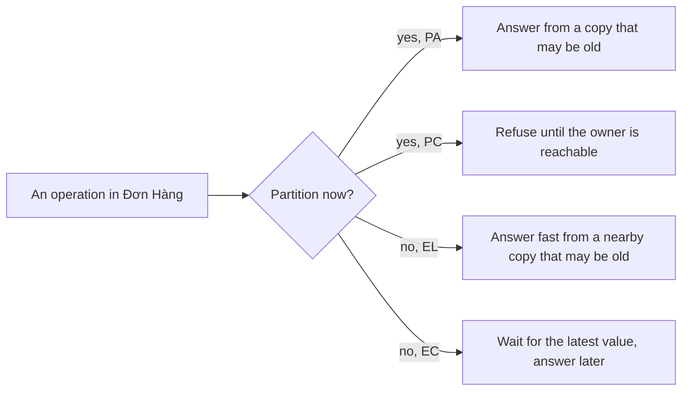

## Before you start

- [[backend.l4.cap-theorem]] — you know that during a partition each operation either answers from the copy it has or refuses, and that `consistency-per-operation.md` records that choice.
- [[backend.l2.cache-invalidation]] — you know that `ProductCache` deletes the Redis copy after a price change, and that a missed delete leaves the old price until the 5-minute TTL ends.
- [[backend.l3.read-replicas]] — you know that `db` commits a change without waiting for `db-replica`, because replication is asynchronous by default, so the replica can be behind.

## The situation

It is stage-4 and nothing is broken: the api, PostgreSQL and Redis all run. A teammate asks why some reads feel quicker than others. Reading product 3 usually comes from Redis, with no query. Viewing your own order goes to PostgreSQL every time.

They propose two speed-ups: keep orders in Redis too, and send the product list to `db-replica`. Another teammate points at the output of `replica-lag.sh`: right after a price change, the replica still returned the old price. No network failed and no server stopped, yet the quicker read was the older one.

When nothing has failed, what does each operation give up to answer faster, and where is that choice written down?

## Core concepts

- **latency** — the time from sending a request to receiving its answer.
- **PACELC** — a classic extension of the CAP theorem: if there is a partition (P), choose availability (A) or consistency (C); else (E), choose lower latency (L) or consistency (C).
- nearby copy — a copy that can answer without asking the owner of the data, such as product 3 in Redis or the rows in `db-replica`.
- keeping copies in step — the work of bringing every copy to the latest value; it takes time, so an answer either waits for it or does not.

## How it works



The two upper branches are the previous lesson: while a partition lasts, an operation answers from the copy it has (PA) or refuses (PC). PACELC adds the two lower branches, which apply the rest of the time.

Without any failure, copies still do not change together. The owner of the data takes a write first, and every other copy learns of it afterwards. Keeping copies in step therefore costs time, and each operation decides who pays it.

A read can go to a nearby copy and answer quickly (EL). In the situation above, product 3 from Redis is such a read: the answer comes without a query. If the copy has not caught up, the answer is old.

A read can instead go to the owner, which holds the latest committed value (EC). Viewing your own order does this: it waits for PostgreSQL, so an order you just placed is always there.

Writes face the same branch. A write that returns as soon as the owner has it answers quickly, while the copies catch up later (EL). A write that waits until the copies it names have it answers later, but those copies are not left behind (EC).

So fast and current are not two goals a good design simply meets together. The time a copy needs to catch up is paid either by the caller, who waits, or by the data, which may be old.

## In the Đơn Hàng system

`ProductCache` is the EL choice for reading one product:

```csharp file=DonHang.Catalog/ProductCache.cs tag=stage-4 lines=16-29
    // lesson: backend.l2.cache-invalidation
    // The longest a stale copy can live, even if a delete below is missed.
    private static readonly TimeSpan Ttl = TimeSpan.FromMinutes(5);

    // One SemaphoreSlim per key, shared by every request in this api process.
    private static readonly ConcurrentDictionary<string, SemaphoreSlim> Locks = new();

    // lesson: backend.l2.cache-aside
    // Redis first; only on a miss ask the repository inside, then keep its answer.
    public async Task<Product?> FindAsync(int id)
    {
        var key = $"product:{id}";
        var cached = await GetAsync(key);
        if (cached is not null) return cached; // cache hit: no query
```

Line 29, `if (cached is not null) return cached;`, is the latency choice: on a cache hit, `FindAsync` returns the Redis copy and PostgreSQL is never asked. After a price change, `UpdatePriceAsync`, outside this excerpt, deletes the copy so the next read loads the new price. Line 17 names what that cannot rule out: if the delete is missed, the copy stays old until the 5-minute `Ttl` on line 18 ends. The `Locks` lines belong to an earlier lesson and do not change this choice.

The same copy feeds the price when an order is placed. The section on the price at order time in `consistency-per-operation.md` records that an order in that window uses the old price, and that the team accepts this.

PostgreSQL replication, the stream of changes `db-replica` receives, is asynchronous by default: `db` commits and answers without waiting for the replica. That is why `replica-lag.sh` read the old price on `db-replica` right after the `UPDATE` returned on `db`. In the lab the replica also waits 5 seconds before applying each change, set in `db/replica/start.sh`, so the gap shows on every run.

Synchronous replication is the EC side for writes. Each commit waits until a replica that `db` is configured to wait for confirms that it has the change, so every write answers later, and in return the replica holds each change committed this way. That matters if the data on `db` is lost: a change only `db` held may be gone with it, while one the replica holds survives. A replica first receives a change and only later applies it, and a read there shows only applied changes; the lab's 5-second wait sits between the two. Which of the two a commit waits for is a setting outside this lesson.

One system makes different choices per operation. Reading one product chooses latency; the product list reads the primary every time, only because no other copy exists yet. Viewing your own order reads the primary it was written to, so a new order is always seen: read-your-writes, an EC choice. The same reason rules out keeping orders in Redis: a copy there could miss the order just placed. The design document states both choices for every operation, and judges a later change against them:

```markdown file=docs/design/consistency-per-operation.md tag=stage-4 lines=38-53
### Nếu chuyển đọc sang replica

Ở stage-4 API không đọc `db-replica`: nó chỉ có một connection string,
`ConnectionStrings:Default`, trỏ tới primary. Replica nhận thay đổi không đồng
bộ, nên một lần đọc từ replica có thể chưa thấy lần ghi vừa xong, kể cả lần
ghi của chính người gọi (không có read-your-writes).

- Được phép chuyển: danh sách sản phẩm, vì nó chấp nhận dữ liệu hơi cũ và
  không ghi lại gì từ kết quả đọc.
- Không chuyển: xem đơn của mình và lịch sử của đơn; mọi lần đọc ngay sau
  một lần ghi của cùng người gọi; một sản phẩm đọc qua `ProductCache` (cả khi
  đặt đơn). Ngay sau khi đổi giá, bản sao Redis bị xóa và lần đọc kế tiếp nạp
  lại nó; nạp từ một replica chưa có giá mới sẽ đặt giá cũ trở lại Redis thêm
  trọn một TTL.

Chuyển một thao tác khác sang replica cần sửa bảng trên trước.
```

The section is in Vietnamese by design. It starts from the facts: the api has one connection string, the setting that tells it which database server to use, and it points at the primary. A read on the asynchronous replica may miss even the caller's own write. The table earlier in the same file has one column for when the source is unreachable and one for normal running; in the second, the product list and viewing your own order both read the latest value from the primary today.

The product list may move to the replica, because its row accepts slightly old data and nothing is written back from what it reads. Viewing your own order may not: its row chose consistency so that a customer sees the order just placed. A product read through `ProductCache` may not move either: if the read after a price change reloaded the copy from a replica that has not caught up, the old price would go back into Redis for a whole TTL. The last line is the rule: change the table first.

## Trade-offs

| Choice when nothing has failed | Answer | What it risks | Fits when |
|---|---|---|---|
| Read a nearby copy (Redis, a replica) | fast | a value as old as the copy's lag or TTL | an old value harms nobody, such as one product's price or the product list |
| Read the owner | waits for the owner | every read waits on the owner and adds to its work | the caller must see the latest value, such as an order just placed |
| Write, copies catch up later (asynchronous) | fast | copies are behind for a while; if the primary's data is lost, commits not yet copied may be lost with it | reads from copies can live with lag |
| Write waits for a copy (synchronous) | slower on every write | if that copy is unreachable, commits wait | a committed change must survive losing the primary |

## What would you choose if…

…staff ask that a price change shows at once wherever the product appears, because a promotion starts at a fixed time? The product row chooses latency because a price a few minutes old is acceptable, and this request removes that reason. Either the read moves to EC, asking PostgreSQL on every product read, or the team keeps EL and plans the promotion around the TTL. For orders, the price-at-order section already says placing an order must then read the price from the primary. Change the row first, then the code.

…a teammate proposes making `db-replica` synchronous, so the product list can move there without ever being old? Every commit on `db` would wait for the replica, each order and refund request included, and a change the replica has received may not be applied yet. The list's row already accepts slightly old data, so the cost buys nothing the row asks for. Keep asynchronous replication for this case.

## Seniors often assume…

- **"Without failures there is no trade-off, so every read can be both fast and current."** → Actually copies take in a write one after another even when nothing fails, so a read either waits for the owner or answers from a copy that may be behind. You notice this when a customer sees an old price for minutes after a change, while every server reports healthy.
- **"A cache only makes reads faster; it has nothing to do with consistency."** → Actually a cache is a copy, and every copy is a consistency choice. `ProductCache` answers without asking PostgreSQL, so its answer can be as old as its TTL allows. You notice this when an order is placed at the old price shortly after staff changed it.
- **"Synchronous replication is always better, because no copy can ever fall behind."** → Actually it moves the cost onto every write: each commit waits for the replica, and if the replica cannot be reached, commits wait. You notice this when placing orders stalls while the replica restarts, although the primary is healthy.

## Try it (3 minutes)

With the lab running (`scripts/up.sh`), in a terminal in the root folder of the example repository at tag `stage-4`:

1. Run `scripts/backend/replica-lag.sh`. It starts `db-replica`, changes product 1's price on `db`, reads it at once on both servers, then waits 6 seconds, just past the replica's 5-second delay.
2. Compare the two reads under `== a new price for product 1 on db, then the same read on both servers`.

Expected result: `db` returns `1300000`, `db-replica` still returns `1250000`, and 6 seconds later the replica returns `1300000`. The `UPDATE` on `db` returned before the replica had applied the change.

Then decide: if `db-replica` became a synchronous replica, which operations of Đơn Hàng would get slower, and which would not?

<details><summary>Suggested answer</summary>

Every write that commits on `db` would get slower: placing an order, requesting a refund, changing a price. Reads that go to `db`, such as viewing your own order, would not wait for the replica, and product reads answered from Redis would not change.

</details>

## Connections

- [[backend.l4.cap-theorem]] — prerequisite: the partition branch of PACELC.
- [[backend.l2.cache-invalidation]] — prerequisite: why the Redis copy can stay old until its TTL ends.
- [[backend.l3.read-replicas]] — prerequisite: the asynchronous replica whose lag is PostgreSQL's default latency choice.
- [[backend.l3.eventual-consistency]] — the same trade one layer up: services joined by messages answer before every copy agrees.
- [[design.l4.quality-attribute-scenarios]] — a way to write down how fast an operation must answer and how old its data may be.
- [[backend.l4.data-ownership]] — next in this module: which place owns each kind of data.

## Five-line summary

1. Even when nothing has failed, each operation that uses copies of data chooses between a fast answer from a copy and a slower, current one.
2. Latency is the time from sending a request to receiving its answer; PACELC adds this else branch to the CAP theorem's partition choice.
3. `ProductCache` chooses latency: a Redis hit skips PostgreSQL, so after a missed delete the old price stays until the 5-minute TTL ends.
4. PostgreSQL replication is asynchronous by default; synchronous replication makes each commit wait for a replica: slower writes, but it holds each change committed this way.
5. `consistency-per-operation.md` states each operation's choice under a partition and in normal running, so a move such as reading from `db-replica` is judged against it.
