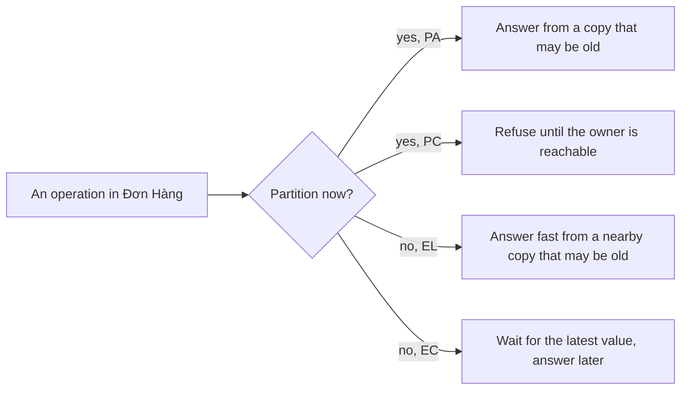

## Bạn cần biết trước

- [[backend.l4.cap-theorem]] — bạn biết rằng trong lúc có phân vùng mạng, mỗi thao tác hoặc trả lời bằng bản sao đang có, hoặc từ chối, và `consistency-per-operation.md` ghi lại lựa chọn đó.
- [[backend.l2.cache-invalidation]] — bạn biết rằng `ProductCache` xóa bản sao trong Redis sau khi đổi giá, và nếu lần xóa đó bị bỏ lỡ thì giá cũ còn lại tới khi TTL 5 phút hết.
- [[backend.l3.read-replicas]] — bạn biết rằng `db` commit một thay đổi mà không chờ `db-replica`, vì replication mặc định là không đồng bộ, nên replica có thể chậm hơn.

## Tình huống

Đang ở stage-4 và không có gì hỏng: api, PostgreSQL và Redis đều chạy. Một đồng nghiệp hỏi sao có lần đọc nhanh hơn những lần khác. Đọc sản phẩm 3 thường lấy từ Redis, không có truy vấn nào. Xem đơn của mình thì lần nào cũng đi tới PostgreSQL.

Người đó đề xuất hai cách tăng tốc: giữ cả đơn hàng trong Redis, và chuyển danh sách sản phẩm sang `db-replica`. Một đồng nghiệp khác chỉ vào output của `replica-lag.sh`: ngay sau khi đổi giá, replica vẫn trả giá cũ. Không mạng nào hỏng, không server nào dừng, vậy mà lần đọc nhanh hơn lại là lần đọc cũ hơn.

Khi không có gì hỏng, mỗi thao tác bỏ đi điều gì để trả lời nhanh hơn, và lựa chọn đó được ghi ở đâu?

## Khái niệm cốt lõi

- **độ trễ** (latency) — thời gian từ lúc gửi một request tới lúc nhận được câu trả lời.
- **PACELC** (mở rộng CAP: khi có phân vùng chọn trả lời hay nhất quán, khi bình thường chọn độ trễ thấp hay nhất quán) — một mở rộng kinh điển của định lý CAP. Tên gọi ghép từ các chữ cái: nếu có phân vùng (P), chọn availability (A) hay consistency (C), còn nếu không (E, else), chọn độ trễ thấp (L) hay consistency (C).
- bản sao ở gần — bản sao trả lời được mà không cần hỏi chủ của dữ liệu, chẳng hạn sản phẩm 3 trong Redis hay các dòng trong `db-replica`.
- giữ các bản sao khớp nhau — phần việc đưa mọi bản sao về giá trị mới nhất. Việc này tốn thời gian, nên câu trả lời hoặc chờ nó, hoặc không chờ.

## Cơ chế hoạt động



Hai nhánh trên là bài trước: trong lúc phân vùng còn kéo dài, một thao tác trả lời bằng bản sao đang có (PA) hoặc từ chối (PC). PACELC thêm hai nhánh dưới, áp dụng cho toàn bộ thời gian còn lại.

Không có sự cố nào thì các bản sao vẫn không đổi cùng lúc. Chủ của dữ liệu nhận lần ghi trước, mọi bản sao khác biết sau. Vì thế giữ các bản sao khớp nhau tốn thời gian, và mỗi thao tác quyết định ai trả phần thời gian đó.

Một lần đọc có thể tới bản sao ở gần và trả lời nhanh (EL). Trong tình huống trên, đọc sản phẩm 3 từ Redis là lần đọc như vậy: câu trả lời tới mà không cần truy vấn. Nếu bản sao chưa bắt kịp, câu trả lời là giá trị cũ.

Lần đọc cũng có thể đi tới chủ, nơi giữ giá trị mới nhất đã commit (EC). Xem đơn của mình làm đúng như vậy: nó chờ PostgreSQL, nên đơn bạn vừa đặt lúc nào cũng có ở đó.

Lần ghi cũng gặp đúng ngã rẽ này. Lần ghi trả về ngay khi chủ đã có thay đổi thì trả lời nhanh, còn các bản sao bắt kịp sau (EL). Lần ghi chờ tới khi các bản sao nó chỉ định đã có thay đổi thì trả lời chậm hơn, nhưng các bản sao đó không bị bỏ lại phía sau (EC).

Vậy nhanh và mới nhất không phải hai mục tiêu mà một thiết kế tốt cứ thế đạt cùng lúc. Thời gian một bản sao cần để bắt kịp được trả hoặc bởi người gọi, phải chờ, hoặc bởi dữ liệu, có thể đã cũ.

## Trong hệ thống Đơn Hàng

`ProductCache` là lựa chọn EL cho thao tác đọc một sản phẩm:

```csharp file=DonHang.Catalog/ProductCache.cs tag=stage-4 lines=16-29
    // lesson: backend.l2.cache-invalidation
    // The longest a stale copy can live, even if a delete below is missed.
    private static readonly TimeSpan Ttl = TimeSpan.FromMinutes(5);

    // One SemaphoreSlim per key, shared by every request in this api process.
    private static readonly ConcurrentDictionary<string, SemaphoreSlim> Locks = new();

    // lesson: backend.l2.cache-aside
    // Redis first; only on a miss ask the repository inside, then keep its answer.
    public async Task<Product?> FindAsync(int id)
    {
        var key = $"product:{id}";
        var cached = await GetAsync(key);
        if (cached is not null) return cached; // cache hit: no query
```

Dòng 29, `if (cached is not null) return cached;`, là lựa chọn độ trễ: khi cache hit, `FindAsync` trả bản sao trong Redis và không hỏi PostgreSQL. Sau khi đổi giá, `UpdatePriceAsync`, nằm ngoài đoạn trích, xóa bản sao để lần đọc kế tiếp nạp giá mới. Dòng 17 nói điều cách đó không loại trừ được: nếu lần xóa bị bỏ lỡ, bản sao vẫn cũ tới khi `Ttl` 5 phút ở dòng 18 hết. Các dòng `Locks` thuộc một bài trước và không đổi lựa chọn này.

Cũng bản sao đó cung cấp giá khi đặt đơn. Mục về giá lúc đặt đơn trong `consistency-per-operation.md` ghi rằng đơn đặt trong khoảng thời gian đó dùng giá cũ, và team chấp nhận điều này.

Replication của PostgreSQL, dòng thay đổi mà `db-replica` nhận, mặc định là không đồng bộ: `db` commit và trả lời mà không chờ replica. Đó là lý do `replica-lag.sh` đọc được giá cũ trên `db-replica` ngay sau khi lệnh `UPDATE` trên `db` trả về. Trong lab, replica còn chờ 5 giây trước khi áp dụng mỗi thay đổi, đặt trong `db/replica/start.sh`, để lần chạy nào cũng thấy khoảng chênh.

Replication đồng bộ là phía EC cho thao tác ghi. Mỗi lần commit chờ tới khi một replica mà `db` được cấu hình để chờ xác nhận đã có thay đổi, nên lần ghi nào cũng trả lời chậm hơn. Đổi lại, replica giữ mọi thay đổi được commit theo cách này. Điều đó quan trọng nếu dữ liệu trên `db` bị mất: thay đổi chỉ `db` giữ có thể mất theo, còn thay đổi replica đã giữ thì còn. Replica nhận một thay đổi trước rồi mới áp dụng nó sau, và lần đọc trên replica chỉ thấy thay đổi đã áp dụng. 5 giây chờ của lab nằm giữa hai bước đó. Lần commit chờ bước nào là một thiết lập nằm ngoài bài này.

Một hệ thống đưa ra lựa chọn khác nhau cho từng thao tác. Đọc một sản phẩm chọn độ trễ. Danh sách sản phẩm đọc primary mỗi lần, chỉ vì chưa có bản sao nào khác. Xem đơn của mình đọc primary, nơi đơn được ghi vào, nên đơn mới lúc nào cũng thấy được: read-your-writes, một lựa chọn EC. Cũng lý do đó loại bỏ ý giữ đơn hàng trong Redis: bản sao ở đó có thể thiếu đơn vừa đặt. Tài liệu thiết kế ghi cả hai lựa chọn cho từng thao tác, và đánh giá mọi thay đổi về sau dựa trên chúng:

```markdown file=docs/design/consistency-per-operation.md tag=stage-4 lines=38-53
### Nếu chuyển đọc sang replica

Ở stage-4 API không đọc `db-replica`: nó chỉ có một connection string,
`ConnectionStrings:Default`, trỏ tới primary. Replica nhận thay đổi không đồng
bộ, nên một lần đọc từ replica có thể chưa thấy lần ghi vừa xong, kể cả lần
ghi của chính người gọi (không có read-your-writes).

- Được phép chuyển: danh sách sản phẩm, vì nó chấp nhận dữ liệu hơi cũ và
  không ghi lại gì từ kết quả đọc.
- Không chuyển: xem đơn của mình và lịch sử của đơn; mọi lần đọc ngay sau
  một lần ghi của cùng người gọi; một sản phẩm đọc qua `ProductCache` (cả khi
  đặt đơn). Ngay sau khi đổi giá, bản sao Redis bị xóa và lần đọc kế tiếp nạp
  lại nó; nạp từ một replica chưa có giá mới sẽ đặt giá cũ trở lại Redis thêm
  trọn một TTL.

Chuyển một thao tác khác sang replica cần sửa bảng trên trước.
```

Mục này cố ý viết bằng tiếng Việt. Nó bắt đầu từ sự thật: api chỉ có một connection string, tức thiết lập cho api biết dùng database server nào, và nó trỏ tới primary. Một lần đọc trên replica không đồng bộ có thể không thấy cả lần ghi của chính người gọi. Bảng ở phần trước của cùng file có một cột cho lúc nguồn không tới được và một cột cho lúc bình thường. Ở cột thứ hai, danh sách sản phẩm và xem đơn của mình hiện đều đọc giá trị mới nhất từ primary.

Danh sách sản phẩm được phép chuyển sang replica, vì dòng của nó chấp nhận dữ liệu hơi cũ và không ghi lại gì từ kết quả đọc. Xem đơn của mình thì không: dòng của nó chọn consistency để khách thấy ngay đơn vừa đặt. Một sản phẩm đọc qua `ProductCache` cũng không được chuyển: nếu lần đọc sau khi đổi giá nạp lại bản sao từ một replica chưa bắt kịp, giá cũ sẽ quay lại Redis thêm trọn một TTL. Dòng cuối là quy tắc: sửa bảng trước.

## Đánh đổi

| Lựa chọn khi không có gì hỏng | Câu trả lời | Rủi ro | Hợp khi |
|---|---|---|---|
| Đọc bản sao ở gần (Redis, một replica) | nhanh | giá trị cũ bằng độ chậm hoặc TTL của bản sao | giá trị cũ không gây hại cho ai, chẳng hạn giá của một sản phẩm hay danh sách sản phẩm |
| Đọc từ chủ | chờ chủ | lần đọc nào cũng chờ chủ và cộng thêm việc cho chủ | người gọi phải thấy giá trị mới nhất, chẳng hạn đơn vừa đặt |
| Ghi, bản sao bắt kịp sau (không đồng bộ) | nhanh | bản sao chậm hơn một lúc, nếu dữ liệu của primary bị mất thì các commit chưa được sao chép có thể mất theo | lần đọc từ bản sao chấp nhận được độ chậm |
| Ghi chờ một bản sao (đồng bộ) | chậm hơn ở mọi lần ghi | nếu không tới được bản sao đó, các commit phải chờ | một thay đổi đã commit phải còn sau khi mất primary |

## Bạn sẽ chọn gì nếu…

…nhân viên muốn một lần đổi giá hiện ra ngay ở mọi nơi có sản phẩm, vì khuyến mãi bắt đầu đúng một giờ cố định? Dòng của sản phẩm chọn độ trễ vì giá cũ vài phút là chấp nhận được, và yêu cầu này bỏ đi đúng lý do đó. Hoặc lần đọc chuyển sang EC, hỏi PostgreSQL ở mọi lần đọc sản phẩm, hoặc team giữ EL và lên kế hoạch khuyến mãi tính cả TTL. Với đơn hàng, mục giá lúc đặt đơn đã ghi rằng khi đó đặt đơn phải đọc giá từ primary. Hãy sửa dòng trong bảng trước, rồi mới sửa code.

…một đồng nghiệp đề xuất cho `db-replica` chạy đồng bộ, để danh sách sản phẩm chuyển sang đó mà không bao giờ cũ? Mọi lần commit trên `db` sẽ chờ replica, kể cả mỗi lần đặt đơn và yêu cầu hoàn tiền, mà thay đổi replica đã nhận chưa chắc đã được áp dụng. Dòng của danh sách đã chấp nhận dữ liệu hơi cũ, nên cái giá đó không mua được gì dòng này cần. Hãy giữ replication không đồng bộ cho trường hợp này.

## Senior hay nhầm rằng…

- **"Không có sự cố thì không có đánh đổi, nên lần đọc nào cũng vừa nhanh vừa mới nhất được."** → Thực ra kể cả khi không có gì hỏng, các bản sao vẫn nhận một lần ghi lần lượt từng bản, nên lần đọc hoặc chờ chủ, hoặc trả lời từ một bản sao có thể đang chậm. Bạn sẽ nhận ra khi khách thấy giá cũ nhiều phút sau khi đổi giá, trong khi server nào cũng báo khỏe.
- **"Cache chỉ làm đọc nhanh hơn, nó không liên quan gì tới consistency."** → Thực ra cache là một bản sao, và bản sao nào cũng là một lựa chọn về consistency. `ProductCache` trả lời mà không hỏi PostgreSQL, nên câu trả lời có thể cũ tới mức TTL cho phép. Bạn sẽ nhận ra khi một đơn được đặt với giá cũ ngay sau khi nhân viên vừa đổi giá.
- **"Replication đồng bộ lúc nào cũng tốt hơn, vì không bản sao nào bị chậm được."** → Thực ra nó dời cái giá sang mọi lần ghi: mỗi lần commit chờ replica, và nếu không tới được replica thì các commit phải chờ. Bạn sẽ nhận ra khi đặt đơn bị treo trong lúc replica khởi động lại, dù primary vẫn khỏe.

## Thử ngay (3 phút)

Khi lab đang chạy (`scripts/up.sh`), mở terminal ở thư mục gốc của repo ví dụ tại tag `stage-4`:

1. Chạy `scripts/backend/replica-lag.sh`. Script khởi động `db-replica`, đổi giá sản phẩm 1 trên `db`, đọc ngay trên cả hai server, rồi chờ 6 giây, vừa quá 5 giây chờ của replica.
2. So sánh hai lần đọc dưới `== a new price for product 1 on db, then the same read on both servers`.

Kết quả mong đợi: `db` trả `1300000`, `db-replica` vẫn trả `1250000`, và 6 giây sau replica trả `1300000`. Lệnh `UPDATE` trên `db` đã trả về trước khi replica áp dụng thay đổi.

Rồi hãy xác định: nếu `db-replica` trở thành replica đồng bộ, thao tác nào của Đơn Hàng sẽ chậm đi, thao tác nào không?

<details><summary>Gợi ý đáp án</summary>

Mọi lần ghi commit trên `db` sẽ chậm đi: đặt đơn, yêu cầu hoàn tiền, đổi giá. Các lần đọc đi tới `db`, chẳng hạn xem đơn của mình, không chờ replica, còn lần đọc sản phẩm được Redis trả lời thì không đổi.

</details>

## Liên hệ

- [[backend.l4.cap-theorem]] — bài tiên quyết: nhánh phân vùng của PACELC.
- [[backend.l2.cache-invalidation]] — bài tiên quyết: vì sao bản sao trong Redis có thể cũ tới khi TTL hết.
- [[backend.l3.read-replicas]] — bài tiên quyết: replica không đồng bộ, độ chậm của nó là lựa chọn độ trễ mặc định của PostgreSQL.
- [[backend.l3.eventual-consistency]] — cùng đánh đổi đó ở tầng cao hơn: các service nối nhau bằng message trả lời trước khi mọi bản sao khớp nhau.
- [[design.l4.quality-attribute-scenarios]] — cách ghi rõ thao tác phải trả lời nhanh tới đâu và dữ liệu được cũ tới mức nào.
- [[backend.l4.data-ownership]] — bài tiếp theo trong module: nơi nào làm chủ từng loại dữ liệu.

## Tóm tắt 5 dòng

1. Kể cả khi không có gì hỏng, mỗi thao tác dùng bản sao dữ liệu phải chọn giữa câu trả lời nhanh từ bản sao và câu trả lời chậm hơn nhưng mới nhất.
2. Độ trễ là thời gian từ lúc gửi request tới lúc nhận câu trả lời, PACELC thêm nhánh "nếu không" này vào lựa chọn khi có phân vùng của định lý CAP.
3. `ProductCache` chọn độ trễ: cache hit trong Redis bỏ qua PostgreSQL, nên nếu lần xóa bị bỏ lỡ thì giá cũ còn tới khi TTL 5 phút hết.
4. Replication của PostgreSQL mặc định không đồng bộ, replication đồng bộ bắt mỗi lần commit chờ một replica: ghi chậm hơn, nhưng replica giữ mọi thay đổi được commit theo cách này.
5. `consistency-per-operation.md` ghi lựa chọn của từng thao tác khi có phân vùng và lúc bình thường, nên một thay đổi như đọc từ `db-replica` được đánh giá dựa trên đó.
