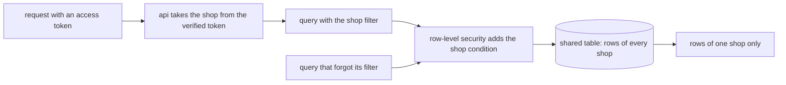

## Before you start

- [[backend.l4.message-schema-evolution]] — you know that every shape other programs read, tables and messages alike, changes in steps those programs survive; this lesson decides the shape the shop data will move to.
- [[design.l4.architecture-review-findings]] — you know that the review handed R3, data isolation between shops, to a later ADR instead of deciding it; this is that ADR.
- [[design.l4.one-deployment-for-all-shops]] — you know that ADR `0012` serves every shop from one shared deployment, so a shop is data inside the system and isolation is enforced inside it.
- [[backend.l3.row-level-security]] — you know that a policy makes PostgreSQL add the shop condition to every query of a restricted role, reading the shop from `app.shop_id`.

## The situation

It is stage-4. ADR `0012` is accepted: one deployment will serve every shop. The team lead asks you to write the next ADR, where each shop's data lives inside that deployment, before anyone writes code for it.

In the first meeting a teammate says: "Give every shop its own database. Then no bug can ever show one shop's orders to another." Another answers that the product owner wants a new shop opened on the day its contract is signed, without a release.

Both points are real, and you will have 1,000 shops in mind, not two. How do you choose a layout for shop data, and how do you write down what would make the team change it?

## Core concepts

- data layout — where each shop's rows physically live: in tables every shop shares, in a schema of its own, or in a database of its own.
- shop filter — the `WHERE shop_id = …` condition the code adds to every query, with the shop taken from the caller's verified access token.
- second guard — a check that still holds when the first one is missing; here a row-level security policy behind the shop filter.
- review condition — a situation, written into the ADR, that makes the team look at the decision again.

## How it works



The diagram is the design ADR `0013` decides; at stage-4 no code runs it yet.

In the situation above, the data layout is the question on the table. ADR `0013` weighs the three layouts you met with tenant isolation: shared tables, a schema per shop and a database per shop. It applies to each service's own database, `donhang`, `donhang_payments` and `donhang_notifications`, since each service owns its data.

The cost that decides it is migrations. A schema or a database per shop repeats every schema change once per shop: `tenancy-models.sh` adds one column with one `ALTER TABLE` per schema and one per database. With 1,000 shops, each release of a service would run its migrations 1,000 times, and opening a shop would mean creating a schema or a database and migrating it. That breaks `CH-2`, one of the numbered requirements in `multi-shop-requirements.md`: a new shop opens with no deploy, no new release and no migration run.

Shared tables keep one run per release. Follow the diagram from the left. A request's shop comes from the verified access token, never from a parameter the client sends. The code adds the shop filter to every query. A row-level security policy on `shop_id` sits behind it as the second guard, so the query at the bottom, whose author forgot the filter, still meets the shop condition and sees one shop only, as long as the service queries as a role the policy applies to.

Opening a shop becomes adding a row to `shops`, the table that lists every shop. No schema, no database, no deploy.

## In the Đơn Hàng system

The decision section of ADR `0013`:

```markdown file=docs/adr/0013-du-lieu-cua-hang-trong-bang-chung.md tag=stage-4 lines=36-49
### Quyết định

Chọn bảng chung với `shop_id` và row-level security.

Với 1.000 cửa hàng, schema hay database riêng biến mỗi lần phát hành của một
service thành 1.000 lần chạy migration, và mỗi lần mở cửa hàng thành một việc
tạo schema hoặc database (trái CH-2). Bảng chung giữ một lần chạy migration,
và mở cửa hàng là thêm một dòng vào `shops`.

Cửa hàng của một request lấy từ access token đã được kiểm, không từ tham số
do client gửi. Code lọc mọi truy vấn theo `shop_id` đó; row-level security
theo `shop_id` là lớp canh thứ hai, để một truy vấn quên bộ lọc vẫn chỉ thấy
một cửa hàng. Thứ tự đưa `shop_id` vào từng bảng ở
`docs/design/multi-shop-data-rollout.md`.
```

Line 3 is the choice: shared tables with `shop_id` and row-level security. Lines 5–8 give the reason in numbers the reader can check: 1,000 migration runs per release against one, and a new schema or database per shop against one new row in `shops`. Lines 10–13 fix the order of the guards: the shop comes from the verified access token, the code filters by it, and row-level security is the second guard. The last line hands the order of putting `shop_id` into each table to a separate plan.

The consequences, and when the team looks again:

```markdown file=docs/adr/0013-du-lieu-cua-hang-trong-bang-chung.md tag=stage-4 lines=51-64
### Hệ quả

- Mọi bảng chứa dữ liệu của một cửa hàng có `shop_id`; khóa và index bắt
  đầu bằng `shop_id`.
- Một cửa hàng đông vẫn dùng chung kết nối database và giới hạn tải với các
  cửa hàng khác (noisy neighbor). ADR này không giải quyết điều đó; giới hạn
  theo cửa hàng thuộc về kế hoạch dung lượng và SLO.
- Khôi phục riêng một cửa hàng không còn là khôi phục một database: phải trích
  các dòng của cửa hàng đó từ một bản khôi phục tạm.
- Không có code đa cửa hàng ở stage-4; ADR này chỉ quyết cách lưu.

Đội xem lại khi một cửa hàng quá lớn so với bảng chung, hoặc phải được khôi
phục riêng. Cửa hàng đó chuyển sang database riêng; các cửa hàng khác vẫn ở
bảng chung.
```

Lines 3–4 make every key and index start with `shop_id`; line 10 repeats that no multi-shop code exists yet. Lines 5–9 are what shared tables leave open. A busy shop still shares database connections and load limits with every other shop, the noisy neighbor problem; this ADR does not solve it and hands per-shop limits to separate planning work. Restoring one shop alone means extracting that shop's rows from a temporary restore. Lines 12–14 are the review conditions: a shop too large for the shared tables, or one that must be restored on its own, moves to a database of its own while the others stay shared. The ADR names no measure for "too large", and it puts a busy shop's load under per-shop limits, not under this condition.

## Trade-offs

| Layout | Isolation | Migration runs per release, 1,000 shops | Opening a shop | Restoring one shop | A busy shop |
|---|---|---|---|---|---|
| Shared tables, `shop_id`, row-level security | shop filter in code, policy as the second guard | one per service database | add a row to `shops` | extract its rows from a temporary restore | shares connections and limits with all others |
| Schema per shop | the connection names which shop's schema to use; a query that names another shop's schema still reaches it when the role has rights on it | 1,000 | create a schema, run every migration | not weighed in ADR `0013` | shares the database with all others |
| Database per shop | strongest; PostgreSQL refuses a query naming another database | 1,000 | create a database, run every migration | restore its database | has its own database; each database needs its own connections from each Pod, since a connection reaches only one database |

## What would you choose if…

…Đơn Hàng served 5 shops, each with a contract that requires restoring its data alone? A database per shop is worth weighing then. Five migration runs per release is a cost a team can carry, and restoring one shop is restoring one database. The ADR's choice rests on 1,000 shops and `CH-2`; with five shops opened by contract, both numbers change.

…one shop runs a promotion and takes 10% of the day's orders, the case `multi-shop-requirements.md` assumes for `CH-3`? Keep shared tables. Moving the data does not change who shares the api's connections and load limits; that needs limits that know the shop, a separate decision the ADR names and leaves open.

…a shop's contract requires restoring its own data to a moment before a bad import? That is a review condition. Move that one shop to a database of its own and leave the other 999 in the shared tables, which is what the ADR says to do.

## Seniors often assume…

- **"A database per shop is the only way to be sure shops never see each other's data."** → Actually shared tables give two guards: the shop filter in every query, and a row-level security policy that adds the shop condition even when the filter is missing. A database per shop isolates more strongly, but at 1,000 shops it costs 1,000 migration runs per release and a database per new shop. You notice this when a proposal for a database per shop cites `CH-1`, each shop sees and changes only its own data, and never counts migration runs or mentions `CH-2`.
- **"With row-level security on, the code no longer needs to filter by shop."** → Actually ADR `0013` keeps the shop filter as the first guard, because a policy applies only to roles that do not skip it: a superuser, a role with `BYPASSRLS` and normally the table's owner see every row. You notice this when the same query run as `donhang`, the role that owns the tables and is a superuser in the lab, in `row-level-security.sh` returns the orders of both shops.
- **"Choosing shared tables means no shop can ever get a database of its own."** → Actually the ADR writes down when one shop leaves: when it outgrows the shared tables or must be restored on its own, it moves to a database of its own while the others stay. You notice this when a large shop's restore request is treated as a reason to redo the whole layout instead of moving that one shop.

## Try it (3 minutes)

In the root folder of the example repository at tag `stage-4`:

1. Open `docs/adr/0013-du-lieu-cua-hang-trong-bang-chung.md`.
2. Find the line that says where a request's shop comes from, and the paragraph that says when the team looks at the decision again.

Expected result: file lines 45–46 (lines 10–11 of the first block above) say the shop comes from the verified access token, not from a parameter the client sends; file lines 62–64 (lines 12–14 of the second block) name two review conditions, a shop too large for the shared tables or one that must be restored on its own.

Then decide: a teammate proposes reading the shop from a `shopId` query parameter, "because the app already knows which shop it is in". Which guard would that break, and would row-level security catch it?

<details><summary>Suggested answer</summary>

It breaks the first step of the diagram: the shop would come from the client, so a caller could send another shop's id. Row-level security would not catch it. The policy adds the condition for whatever shop the api sets, so it would faithfully show the other shop's rows. Both guards depend on the shop coming from the verified access token.

</details>

## Connections

- [[design.l4.one-deployment-for-all-shops]] — the decision this one sits inside: ADR `0012` chose one deployment and left the data layout to ADR `0013`.
- [[backend.l3.tenant-isolation-models]] — the three layouts weighed here, shown one by one with `tenancy-models.sh`.
- [[backend.l3.row-level-security]] — how the second guard works; this lesson only places it behind the shop filter.
- [[backend.l3.multi-tenancy]] — the general problem: many shops on one system, with isolation built inside it.
- [[backend.l4.data-ownership]] — the same rule per service: each service puts `shop_id` into the database it owns.
- [[design.l4.a-thousand-shops]] — where the 1,000-shop drivers come from; this ADR weighs the layouts against them.
- [[backend.l4.shop-id-rollout]] — next in this module: putting `shop_id` into the live tables in steps.

## Five-line summary

1. ADR `0013` keeps every shop's data in shared tables with `shop_id`, and row-level security as a second guard behind the shop filter.
2. A schema or a database per shop repeats every migration per shop: 1,000 runs per release of each service.
3. The shop comes from the verified access token; the code filters by it, and a query that forgets still sees one shop.
4. Opening a shop is adding a row to `shops`, while a busy shop still shares connections and one shop restores by extracting rows.
5. A shop that outgrows the shared tables or must be restored alone moves to its own database; the others stay shared.
