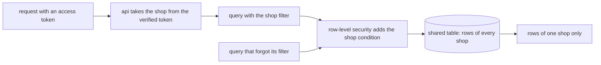

## Bạn cần biết trước

- [[backend.l4.message-schema-evolution]] — bạn biết rằng mọi hình dạng mà chương trình khác đọc, bảng cũng như message, đều đổi qua những bước mà các chương trình đó chịu được. Bài này quyết định hình dạng mà dữ liệu cửa hàng sẽ chuyển sang.
- [[design.l4.architecture-review-findings]] — bạn biết rằng buổi review đã giao R3, cách ly dữ liệu giữa các cửa hàng, cho một ADR sau thay vì quyết ngay. Đây chính là ADR đó.
- [[design.l4.one-deployment-for-all-shops]] — bạn biết rằng ADR `0012` phục vụ mọi cửa hàng từ một bản triển khai chung, nên một cửa hàng là dữ liệu bên trong hệ thống và sự cách ly phải được bảo đảm ngay bên trong nó.
- [[backend.l3.row-level-security]] — bạn biết rằng một policy khiến PostgreSQL thêm điều kiện cửa hàng vào mọi truy vấn của một role bị giới hạn, với cửa hàng đọc từ `app.shop_id`.

## Tình huống

Đang ở stage-4. ADR `0012` đã được chấp nhận: một bản triển khai sẽ phục vụ mọi cửa hàng. Trưởng nhóm nhờ bạn viết ADR tiếp theo, quyết định dữ liệu của mỗi cửa hàng nằm ở đâu trong bản triển khai đó, trước khi có ai viết code cho nó.

Trong buổi họp đầu tiên, một đồng nghiệp nói: "Cho mỗi cửa hàng một database riêng. Khi đó không bug nào có thể để lộ đơn hàng của cửa hàng này cho cửa hàng khác." Một người khác đáp rằng product owner muốn cửa hàng mới được mở ngay trong ngày ký hợp đồng, không cần phát hành.

Cả hai ý đều có thật, và bạn phải nghĩ tới 1.000 cửa hàng, không phải hai. Bạn chọn cách bố trí dữ liệu cửa hàng thế nào, và ghi lại ra sao những điều sẽ khiến đội đổi lựa chọn đó?

## Khái niệm cốt lõi

- bố cục dữ liệu — nơi các dòng của mỗi cửa hàng thực sự nằm: trong những bảng mọi cửa hàng dùng chung, trong một schema riêng, hay trong một database riêng.
- bộ lọc cửa hàng — điều kiện `WHERE shop_id = …` mà code thêm vào mọi truy vấn, với cửa hàng lấy từ access token đã được kiểm của bên gọi.
- lớp canh thứ hai — một phép kiểm vẫn giữ được khi lớp thứ nhất bị thiếu. Ở đây là một policy row-level security đứng sau bộ lọc cửa hàng.
- điều kiện xem lại — một tình huống, ghi sẵn trong ADR, khiến đội phải xem lại quyết định.

## Cơ chế hoạt động



Sơ đồ là thiết kế mà ADR `0013` quyết định. Ở stage-4 chưa có code nào chạy nó.

Trong tình huống trên, bố cục dữ liệu chính là câu hỏi đang được bàn. ADR `0013` cân ba bố cục bạn đã gặp ở bài cách ly tenant: bảng dùng chung, mỗi cửa hàng một schema và mỗi cửa hàng một database. Nó áp dụng cho database riêng của từng service, `donhang`, `donhang_payments` và `donhang_notifications`, vì mỗi service sở hữu dữ liệu của mình.

Thứ quyết định là chi phí migration. Một schema hay một database cho mỗi cửa hàng lặp lại mọi thay đổi schema một lần cho mỗi cửa hàng: `tenancy-models.sh` thêm một cột bằng một lệnh `ALTER TABLE` cho mỗi schema và một lệnh cho mỗi database. Với 1.000 cửa hàng, mỗi lần phát hành một service sẽ chạy migration 1.000 lần, và mở một cửa hàng nghĩa là tạo một schema hay một database rồi migrate nó. Điều đó trái `CH-2`, một trong các yêu cầu có đánh số trong `multi-shop-requirements.md`: cửa hàng mới mở mà không cần deploy, không cần bản phát hành mới, không cần chạy migration.

Bảng dùng chung giữ một lần chạy cho mỗi lần phát hành. Hãy đọc sơ đồ từ trái sang. Cửa hàng của một request lấy từ access token đã được kiểm, không bao giờ từ tham số do client gửi. Code thêm bộ lọc cửa hàng vào mọi truy vấn. Một policy row-level security theo `shop_id` đứng sau làm lớp canh thứ hai. Nhờ vậy truy vấn ở phía dưới, mà người viết quên bộ lọc, vẫn gặp điều kiện cửa hàng và chỉ thấy một cửa hàng, miễn là service truy vấn bằng một role mà policy áp dụng.

Mở một cửa hàng trở thành thêm một dòng vào `shops`, bảng liệt kê mọi cửa hàng. Không schema, không database, không deploy.

## Trong hệ thống Đơn Hàng

Phần quyết định của ADR `0013`:

```markdown file=docs/adr/0013-du-lieu-cua-hang-trong-bang-chung.md tag=stage-4 lines=36-49
### Quyết định

Chọn bảng chung với `shop_id` và row-level security.

Với 1.000 cửa hàng, schema hay database riêng biến mỗi lần phát hành của một
service thành 1.000 lần chạy migration, và mỗi lần mở cửa hàng thành một việc
tạo schema hoặc database (trái CH-2). Bảng chung giữ một lần chạy migration,
và mở cửa hàng là thêm một dòng vào `shops`.

Cửa hàng của một request lấy từ access token đã được kiểm, không từ tham số
do client gửi. Code lọc mọi truy vấn theo `shop_id` đó; row-level security
theo `shop_id` là lớp canh thứ hai, để một truy vấn quên bộ lọc vẫn chỉ thấy
một cửa hàng. Thứ tự đưa `shop_id` vào từng bảng ở
`docs/design/multi-shop-data-rollout.md`.
```

Dòng 3 là lựa chọn: bảng dùng chung với `shop_id` và row-level security. Dòng 5–8 đưa lý do bằng những con số người đọc kiểm được: 1.000 lần chạy migration cho mỗi lần phát hành so với một lần, và một schema hay database mới cho mỗi cửa hàng so với một dòng mới trong `shops`. Dòng 10–13 chốt thứ tự các lớp canh: cửa hàng lấy từ access token đã được kiểm, code lọc theo nó, và row-level security là lớp canh thứ hai. Dòng cuối giao thứ tự đưa `shop_id` vào từng bảng cho một kế hoạch riêng.

Các hệ quả, và khi nào đội xem lại:

```markdown file=docs/adr/0013-du-lieu-cua-hang-trong-bang-chung.md tag=stage-4 lines=51-64
### Hệ quả

- Mọi bảng chứa dữ liệu của một cửa hàng có `shop_id`; khóa và index bắt
  đầu bằng `shop_id`.
- Một cửa hàng đông vẫn dùng chung kết nối database và giới hạn tải với các
  cửa hàng khác (noisy neighbor). ADR này không giải quyết điều đó; giới hạn
  theo cửa hàng thuộc về kế hoạch dung lượng và SLO.
- Khôi phục riêng một cửa hàng không còn là khôi phục một database: phải trích
  các dòng của cửa hàng đó từ một bản khôi phục tạm.
- Không có code đa cửa hàng ở stage-4; ADR này chỉ quyết cách lưu.

Đội xem lại khi một cửa hàng quá lớn so với bảng chung, hoặc phải được khôi
phục riêng. Cửa hàng đó chuyển sang database riêng; các cửa hàng khác vẫn ở
bảng chung.
```

Dòng 3–4 buộc mọi khóa và index bắt đầu bằng `shop_id`. Dòng 10 nhắc lại rằng chưa có code đa cửa hàng nào. Dòng 5–9 là những gì bảng dùng chung để ngỏ. Một cửa hàng đông vẫn dùng chung kết nối database và giới hạn tải với mọi cửa hàng khác, đó là vấn đề noisy neighbor. ADR này không giải quyết nó và giao giới hạn theo cửa hàng cho một phần việc lập kế hoạch riêng. Khôi phục riêng một cửa hàng nghĩa là trích các dòng của cửa hàng đó từ một bản khôi phục tạm. Dòng 12–14 là các điều kiện xem lại: một cửa hàng quá lớn so với bảng dùng chung, hoặc phải được khôi phục riêng, sẽ chuyển sang database riêng, còn các cửa hàng khác vẫn dùng chung. ADR không nêu thước đo nào cho "quá lớn", và nó đặt tải của một cửa hàng đông dưới giới hạn theo cửa hàng, không dưới điều kiện này.

## Đánh đổi

| Bố cục | Cách ly | Số lần chạy migration mỗi lần phát hành, 1.000 cửa hàng | Mở một cửa hàng | Khôi phục một cửa hàng | Một cửa hàng đông |
|---|---|---|---|---|---|
| Bảng dùng chung, `shop_id`, row-level security | bộ lọc cửa hàng trong code, policy là lớp canh thứ hai | một lần cho mỗi database của service | thêm một dòng vào `shops` | trích các dòng của nó từ một bản khôi phục tạm | dùng chung kết nối và giới hạn với mọi cửa hàng khác |
| Mỗi cửa hàng một schema | kết nối chỉ định dùng schema của cửa hàng nào, nhưng truy vấn nêu tên schema của cửa hàng khác vẫn tới được nó khi role có quyền trên schema đó | 1.000 | tạo một schema, chạy mọi migration | ADR `0013` không cân | dùng chung database với mọi cửa hàng khác |
| Mỗi cửa hàng một database | mạnh nhất, PostgreSQL từ chối truy vấn nêu tên database khác | 1.000 | tạo một database, chạy mọi migration | khôi phục database của nó | có database riêng, và mỗi database cần kết nối riêng từ mỗi Pod, vì một kết nối chỉ tới được một database |

## Bạn sẽ chọn gì nếu…

…Đơn Hàng phục vụ 5 cửa hàng, mỗi cửa hàng có hợp đồng đòi khôi phục riêng dữ liệu của mình? Khi đó mỗi cửa hàng một database đáng để cân nhắc. Năm lần chạy migration cho mỗi lần phát hành là chi phí một đội gánh được, và khôi phục một cửa hàng là khôi phục một database. Lựa chọn của ADR dựa trên 1.000 cửa hàng và `CH-2`. Với năm cửa hàng được mở theo hợp đồng, cả hai con số đó đều đổi.

…một cửa hàng chạy khuyến mãi và chiếm 10% số đơn trong ngày, đúng trường hợp `multi-shop-requirements.md` giả định cho `CH-3`? Giữ bảng dùng chung. Chuyển dữ liệu đi không đổi được việc ai dùng chung kết nối và giới hạn tải của api. Điều đó cần những giới hạn biết cửa hàng, một quyết định riêng mà ADR có nêu tên và để ngỏ.

…hợp đồng của một cửa hàng đòi khôi phục dữ liệu của riêng nó về thời điểm trước một lần import hỏng? Đó là một điều kiện xem lại. Chuyển riêng cửa hàng đó sang database của nó và để 999 cửa hàng còn lại trong bảng dùng chung, đúng như ADR nói.

## Senior hay nhầm rằng…

- **"Mỗi cửa hàng một database là cách duy nhất để chắc chắn các cửa hàng không bao giờ thấy dữ liệu của nhau."** → Thực ra bảng dùng chung cho hai lớp canh: bộ lọc cửa hàng trong mọi truy vấn, và một policy row-level security thêm điều kiện cửa hàng ngay cả khi thiếu bộ lọc. Mỗi cửa hàng một database cách ly mạnh hơn, nhưng ở 1.000 cửa hàng nó tốn 1.000 lần chạy migration cho mỗi lần phát hành và một database cho mỗi cửa hàng mới. Bạn sẽ nhận ra khi một đề xuất mỗi cửa hàng một database dẫn `CH-1`, mỗi cửa hàng chỉ thấy và chỉ sửa dữ liệu của mình, mà không bao giờ đếm số lần chạy migration hay nhắc tới `CH-2`.
- **"Đã bật row-level security thì code không cần lọc theo cửa hàng nữa."** → Thực ra ADR `0013` giữ bộ lọc cửa hàng làm lớp canh thứ nhất, vì policy chỉ áp dụng cho những role không bỏ qua nó: superuser, role có `BYPASSRLS` và thường cả chủ sở hữu bảng đều thấy mọi dòng. Bạn sẽ nhận ra khi cùng truy vấn đó chạy bằng `donhang`, role sở hữu các bảng và là superuser trong lab, trong `row-level-security.sh` lại trả về đơn hàng của cả hai cửa hàng.
- **"Đã chọn bảng dùng chung thì không cửa hàng nào có thể có database riêng."** → Thực ra ADR ghi rõ khi nào một cửa hàng rời đi: khi nó vượt quá bảng dùng chung hoặc phải được khôi phục riêng, nó chuyển sang database riêng, còn các cửa hàng khác ở lại. Bạn sẽ nhận ra khi yêu cầu khôi phục của một cửa hàng lớn bị coi là lý do làm lại toàn bộ bố cục, thay vì chỉ chuyển một cửa hàng đó.

## Thử ngay (3 phút)

Ở thư mục gốc của repo ví dụ tại tag `stage-4`:

1. Mở `docs/adr/0013-du-lieu-cua-hang-trong-bang-chung.md`.
2. Tìm dòng nói cửa hàng của một request lấy từ đâu, và đoạn nói khi nào đội xem lại quyết định.

Kết quả mong đợi: dòng 45–46 của file (dòng 10–11 của khối đầu tiên ở trên) nói cửa hàng lấy từ access token đã được kiểm, không từ tham số do client gửi. Dòng 62–64 của file (dòng 12–14 của khối thứ hai) nêu hai điều kiện xem lại: một cửa hàng quá lớn so với bảng dùng chung, hoặc một cửa hàng phải được khôi phục riêng.

Rồi hãy xác định: một đồng nghiệp đề xuất đọc cửa hàng từ query parameter `shopId`, "vì app vốn đã biết mình đang ở cửa hàng nào". Đề xuất đó phá lớp canh nào, và row-level security có bắt được không?

<details><summary>Gợi ý đáp án</summary>

Nó phá bước đầu tiên của sơ đồ: cửa hàng sẽ đến từ client, nên bên gọi có thể gửi id của cửa hàng khác. Row-level security không bắt được. Policy thêm điều kiện cho bất kỳ cửa hàng nào api đặt vào, nên nó sẽ trung thành trả về các dòng của cửa hàng kia. Cả hai lớp canh đều dựa vào việc cửa hàng đến từ access token đã được kiểm.

</details>

## Liên hệ

- [[design.l4.one-deployment-for-all-shops]] — quyết định bao quanh quyết định này: ADR `0012` chọn một bản triển khai và để bố cục dữ liệu lại cho ADR `0013`.
- [[backend.l3.tenant-isolation-models]] — ba bố cục được cân ở đây, lần lượt từng cái với `tenancy-models.sh`.
- [[backend.l3.row-level-security]] — lớp canh thứ hai hoạt động thế nào. Bài này chỉ đặt nó sau bộ lọc cửa hàng.
- [[backend.l3.multi-tenancy]] — bài toán chung: nhiều cửa hàng trên một hệ thống, với sự cách ly dựng ngay bên trong nó.
- [[backend.l4.data-ownership]] — cùng quy tắc nhưng theo từng service: mỗi service đưa `shop_id` vào database nó sở hữu.
- [[design.l4.a-thousand-shops]] — nơi các yếu tố của 1.000 cửa hàng xuất phát. ADR này cân các bố cục theo chúng.
- [[backend.l4.shop-id-rollout]] — bài tiếp theo trong module: đưa `shop_id` vào các bảng đang chạy theo từng bước.

## Tóm tắt 5 dòng

1. ADR `0013` giữ dữ liệu mọi cửa hàng trong bảng dùng chung có `shop_id`, với row-level security làm lớp canh thứ hai sau bộ lọc cửa hàng.
2. Mỗi cửa hàng một schema hay một database lặp lại mọi migration theo từng cửa hàng: 1.000 lần chạy cho mỗi lần phát hành của mỗi service.
3. Cửa hàng lấy từ access token đã được kiểm, code lọc theo nó, và truy vấn quên bộ lọc vẫn chỉ thấy một cửa hàng.
4. Mở cửa hàng là thêm một dòng vào `shops`, còn cửa hàng đông vẫn dùng chung kết nối và khôi phục một cửa hàng phải trích từng dòng.
5. Cửa hàng vượt quá bảng dùng chung hoặc phải khôi phục riêng sẽ chuyển sang database riêng, các cửa hàng khác vẫn dùng chung.
