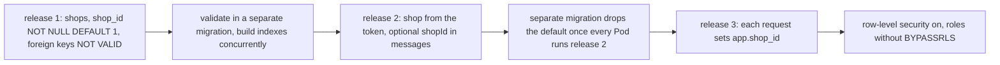

## Before you start

- [[backend.l4.shop-data-layout]] — you know that ADR `0013` keeps every shop's data in shared tables with `shop_id` and row-level security; this lesson plans how the live tables get there.
- [[backend.l4.migration-locks]] — you know that a migration's locks decide who waits, and that `CONCURRENTLY` and `lock_timeout` keep a change from stalling writes.
- [[backend.l4.message-schema-evolution]] — you know that a property readers start to need stays optional while messages of the old shape are still waiting.

## The situation

At stage-4, ADR `0013` is accepted. The team lead asks you to plan how `shop_id` gets into the tables. `orders` and `customers` are live: the api takes orders all day, each deploy's rolling update replaces the 2 api Pods one at a time, and the outbox still holds messages written by the code before.

A teammate drafts one migration: add `shop_id`, set it to 1 on every row, make it `NOT NULL`, and turn on row-level security in the same release. It is five lines of SQL.

Which of those steps would stall writes, which would break the Pods still running the old code, and in what order can they go out safely?

## Core concepts

- release — one deploy of new code together with the migrations that go with it; the plan has three, and each starts only when the one before it runs on every Pod.
- constant default — a `DEFAULT` that is the same value for every row, such as `1`, which PostgreSQL 17 records once instead of writing it into each existing row.
- `NOT VALID` foreign key — a foreign key that checks new and changed rows at once and leaves the existing rows to a later `VALIDATE CONSTRAINT`.
- rollback target — the version you deploy again when a release goes wrong; it works only while the schema left behind still suits that version's code.

## How it works



Each box is a step of `multi-shop-data-rollout.md`, a plan not yet run at stage-4, for every table that holds one shop's data, in each service's own database.

Release 1 changes only the schema. Old code never names `shop_id`, so its rows get the default 1, today's shop. In PostgreSQL 17, adding a column with a constant default stores the value in the table's metadata, so no existing row is rewritten. The statement still takes the table's strongest lock, which makes every other read and write on the table wait, but holds it only briefly once granted. `lock_timeout` bounds how long queries queue behind it: a statement not granted the lock in time aborts and can be retried.

The foreign keys to `shops` go in `NOT VALID`, which skips checking the existing rows; `VALIDATE CONSTRAINT` checks them in a separate migration without blocking writes. The indexes that start with `shop_id` are built with `CREATE INDEX CONCURRENTLY`.

Release 2 changes the code. The shop comes from the caller's access token, every new row gets it, every query filters by it, and every message carries `shopId` as a new optional property. Only when every Pod runs release 2 does a separate migration drop the default. Dropped earlier, a Pod still on release 1 would insert without `shop_id` and fail on `NOT NULL`.

Release 3 starts with code in which each request sets its shop with `SET LOCAL app.shop_id`. Only once every request sets it does row-level security go on, with each service on a role the policy applies to; a request that has not set it would see none of its shop's rows.

Each box leaves a schema the code of the box before still runs on: the rule of expand and contract, applied three times.

## In the Đơn Hàng system

The plan adds `shop_id` to `customers`, `orders`, `order_items`, `order_status_history` and `products` in `donhang`, to `payments` in `donhang_payments` and to `notifications` in `donhang_notifications`. Outbox and inbox tables get none: the shop travels in the message body. `shops` lives in `donhang`, so Payments and Notifications keep `shop_id` as a plain number with no foreign key.

Release 1:

```markdown file=docs/design/multi-shop-data-rollout.md tag=stage-4 lines=19-34
### Release 1: thêm cột, chưa ai dùng

1. Tạo `shops`, thêm cửa hàng hôm nay làm cửa hàng 1.
2. Thêm `shop_id integer NOT NULL DEFAULT 1` vào mọi bảng ở trên. Với
   PostgreSQL 17, một default là hằng số không ghi lại bảng: dòng cũ nhận giá
   trị 1 mà không giữ khóa lâu.
3. Khóa ngoại tới `shops` thêm với `NOT VALID` (chỉ kiểm dòng mới), rồi
   `VALIDATE CONSTRAINT` trong một migration riêng, không chặn ghi.
4. Index bắt đầu bằng `shop_id` (ví dụ `orders (shop_id, customer_id)`) tạo
   bằng `CREATE INDEX CONCURRENTLY`, ngoài transaction
   (`suppressTransaction: true`), với `SET lock_timeout`.
5. Index unique mới `customers (shop_id, email)` tạo cùng cách; index unique
   cũ trên `email` vẫn giữ.

Quay lui: code trước release 1 không biết các cột mới, mọi dòng nó ghi nhận
default 1.
```

Line 4 is the column; lines 5–6 say why it is safe on a live table. Lines 7–8 split each foreign key into `NOT VALID` and a later `VALIDATE CONSTRAINT`, and lines 9–11 bring back `CONCURRENTLY`, `suppressTransaction: true` and `lock_timeout` from the lesson on locks. Lines 12–13 build the unique index `customers (shop_id, email)` the same way and keep the old unique index on `email` for now. Lines 15–16 are the rollback: old code gets shop 1.

Release 2:

```markdown file=docs/design/multi-shop-data-rollout.md tag=stage-4 lines=36-49
### Release 2: code biết cửa hàng

1. Access token mang cửa hàng của người gọi (claim `shop_id`, Keycloak thêm
   vào); API và Payments lấy cửa hàng từ đó, không từ tham số của client.
2. Code ghi `shop_id` vào mọi dòng mới và lọc mọi truy vấn theo nó.
3. Message `order.*` và `payment.*` thêm thuộc tính tùy chọn `shopId`;
   Payments và Notifications lưu `shopId` nhận được, thiếu thì dùng 1, vì
   message dạng cũ còn trong outbox và hàng đợi.
4. Khi mọi Pod đã chạy code release 2, một migration riêng bỏ default của
   `shop_id` và bỏ index unique cũ trên `email`. Từ đó không dòng mới nào
   nhận cửa hàng 1 do sơ ý.

Quay lui: trước bước 4, deploy lại release 1 vẫn chạy (default còn). Sau bước
4, chỉ quay lui về release 2.
```

Lines 3–4 take the shop from a `shop_id` value that Keycloak writes into the access token's payload (a claim), never from a client parameter. Lines 6–8 apply the message rule: `shopId` is optional, and a reader that finds none uses 1, because old-shaped messages still wait in the outbox and the queues. Lines 9–11 are the only removals in this release, the default and the old unique index on `email` that `customers (shop_id, email)` now replaces; both wait until every Pod runs release 2. Lines 13–14 state the cost: after that step, the rollback target is release 2.

Release 3 (file lines 51–67) is outside these excerpts. `app.shop_id` is a named setting on the database connection; `SET LOCAL` gives it a value only until the current transaction ends, and the policy compares `shop_id` with it. Each service moves to its own role that is not a superuser and has no `BYPASSRLS`. A superuser, such as `donhang` today, is a role that row-level security policies never apply to; `BYPASSRLS` is a role setting that makes PostgreSQL skip every policy for that role. Table owners normally skip policies too, so the new role must not own the tables either. The rollback turns row-level security off and points the service's connection string (the host, database, user and password it connects with) back at the old role; release 3's code still filters by `shop_id`.

## Trade-offs

| Plan | Writes wait for | Old Pods during the deploy | Rollback target |
|---|---|---|---|
| One migration: add, fill with `UPDATE`, `SET NOT NULL`, policy on | the `UPDATE` locks every row until it commits; `SET NOT NULL` checks every row under the strongest lock | inserts fail on `NOT NULL`, since the column has no default and the old code never sets it | none without undoing the migration |
| The plan, but the default dropped in release 2's own migration | moments, as in the plan | Pods still on release 1 fail on `NOT NULL` until they are replaced | release 2 only, from the start |
| The plan as written: three releases | a moment per statement, bounded by `lock_timeout` | keep working at every step | the version before; after the default is dropped, release 2 |

The plan pays for this with three deploys, each waiting until the one before it runs on every Pod.

## What would you choose if…

…a table were small and its service could be stopped for a minute? Adding, filling and requiring `shop_id` in one migration is acceptable for that table, because nothing writes during the stop and the version started afterwards already writes `shop_id`, so no Pod inserts without it. Row-level security still waits for code that sets the shop.

…a customer could buy from several shops with one Keycloak account? The plan lists this as an open question at the end of `multi-shop-data-rollout.md`: release 2 assumes each account belongs to one shop, so the shop would have to come from somewhere else, and release 2 must be redesigned before it ships. Release 1 can still go out, since it only adds columns holding today's shop.

…a bug in release 2 shows up a day after the default was dropped? Deploying release 1 is no longer a way back, since its inserts would fail without the default; the way out is a fixed release 2. That is why the plan keeps the drop as a separate step and runs it only once release 2 has been running on every Pod.

## Seniors often assume…

- **"Adding `shop_id` is one migration: add the column, fill it and make it required at once."** → Actually filling every row with an `UPDATE` locks each row until it commits, `SET NOT NULL` checks every row under the strongest lock, and the Pods still on the old code insert without `shop_id`, and with no default those inserts fail on `NOT NULL`. You notice this when writes to `orders` queue behind the migration, or an old Pod's insert fails on `NOT NULL` in the middle of the rolling update.
- **"Giving every existing row a `shop_id` means rewriting the whole table under a lock."** → Actually in PostgreSQL 17 a constant default is recorded once and read for existing rows, so `ADD COLUMN ... NOT NULL DEFAULT 1` needs the strongest lock only for a moment. You notice this when a plan books a quiet window for release 1 that its `ADD COLUMN` statements do not need.
- **"Row-level security can be turned on in the same release that adds the column."** → Actually the policy compares `shop_id` with `app.shop_id`, which no code sets before release 3, and the token carries no shop before release 2. Under a role the policy applies to, the code could not see its own shop's rows. While the services still connect as the superuser `donhang`, the policy changes nothing. You notice this when a check of the policy run as `donhang` shows every shop's rows, which proves nothing about isolation.

## Try it (3 minutes)

In the root folder of the example repository at tag `stage-4`:

1. Open `docs/design/multi-shop-data-rollout.md`.
2. Read the three paragraphs that start with `Quay lui:` (rollback), at file lines 33, 48 and 66.

Expected result: release 1 rolls back because old code's rows get the default 1; release 2 rolls back to release 1 only before its step 4; release 3 rolls back by turning row-level security off and returning to the old role, while its code still filters by `shop_id`.

Then decide: a teammate proposes dropping the default in release 2's own migration, which Argo CD runs in wave 1, before it syncs the api in wave 2 and the api's rolling update replaces the 2 Pods one at a time. What goes wrong?

<details><summary>Suggested answer</summary>

The default is gone before any Pod runs release 2. Until each api Pod is replaced, the ones still on release 1 insert orders without `shop_id`, and those inserts fail on `NOT NULL`. Release 1 also stops being a rollback target at once. Run the drop as a separate migration after every Pod runs release 2, as line 9 of the second block says.

</details>

## Connections

- [[backend.l4.expand-and-contract]] — the rule this plan applies three times: each step works with the code before it and after it.
- [[backend.l4.migration-locks]] — why each statement here is short or concurrent; the locks, `CONCURRENTLY` and `lock_timeout` come from there.
- [[backend.l4.message-schema-evolution]] — the message half of release 2: `shopId` stays optional while old-shaped messages still wait.
- [[backend.l4.shop-data-layout]] — the decision this plan carries out, ADR `0013`.
- [[backend.l3.row-level-security]] — how the policy of release 3 works; this lesson only places it last.
- [[design.l4.evolutionary-architecture]] — the same habit at the scale of a whole system: change it in steps that each keep it working.
## Five-line summary

1. Adding `shop_id` to live tables takes three releases, not one migration, and each leaves a schema the code before it still runs on.
2. Release 1 adds `shops` and `shop_id NOT NULL DEFAULT 1`; in PostgreSQL 17 a constant default writes no existing row.
3. Foreign keys go in `NOT VALID` and are validated later, and `shop_id` indexes are built concurrently, so writes wait only moments.
4. Release 2 takes the shop from the access token and adds optional `shopId` to messages; the default is dropped only after every Pod runs it.
5. Release 3 sets `app.shop_id` per request, then turns on row-level security under roles that are not superusers, lack `BYPASSRLS` and own no tables.
