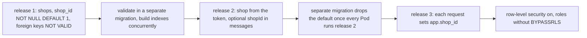

## Bạn cần biết trước

- [[backend.l4.shop-data-layout]] — bạn biết ADR `0013` giữ dữ liệu của mọi cửa hàng trong bảng dùng chung, với `shop_id` và row-level security. Bài này lên kế hoạch đưa các bảng đang chạy tới đó.
- [[backend.l4.migration-locks]] — bạn biết các khóa mà migration giữ quyết định ai phải chờ, và `CONCURRENTLY` cùng `lock_timeout` giúp một thay đổi không làm đứng thao tác ghi.
- [[backend.l4.message-schema-evolution]] — bạn biết một thuộc tính mà bên đọc bắt đầu cần thì vẫn phải là tùy chọn, chừng nào message dạng cũ còn đang chờ.

## Tình huống

Đang ở stage-4, ADR `0013` đã được chấp nhận. Trưởng nhóm nhờ bạn lên kế hoạch đưa `shop_id` vào các bảng. `orders` và `customers` đang chạy: api nhận đơn cả ngày, mỗi lần deploy thì rolling update thay 2 Pod api lần lượt từng cái, và outbox vẫn còn message do code cũ ghi.

Một đồng nghiệp phác ra một migration duy nhất: thêm `shop_id`, đặt nó bằng 1 trên mọi dòng, chuyển thành `NOT NULL` và bật row-level security, tất cả trong cùng một lần phát hành. Chỉ năm dòng SQL.

Bước nào trong đó sẽ làm đứng thao tác ghi, bước nào sẽ làm hỏng các Pod còn chạy code cũ, và chúng phải đi theo thứ tự nào mới an toàn?

## Khái niệm cốt lõi

- lần phát hành — một lần deploy code mới cùng các migration đi kèm. Kế hoạch có ba lần, và mỗi lần chỉ bắt đầu khi lần trước đã chạy trên mọi Pod.
- default hằng số — một `DEFAULT` có cùng giá trị cho mọi dòng, như `1`, mà PostgreSQL 17 ghi lại một lần thay vì ghi vào từng dòng đang có.
- khóa ngoại `NOT VALID` — khóa ngoại kiểm ngay các dòng mới và dòng bị sửa, còn các dòng đang có thì để dành cho một lần `VALIDATE CONSTRAINT` sau.
- đích quay lui — phiên bản bạn deploy lại khi một lần phát hành gặp sự cố. Nó chỉ dùng được chừng nào schema còn lại vẫn hợp với code của phiên bản đó.

## Cơ chế hoạt động



Mỗi ô là một bước của `multi-shop-data-rollout.md`, một kế hoạch chưa chạy ở stage-4, áp cho mọi bảng chứa dữ liệu của một cửa hàng, trong database riêng của từng service.

Lần phát hành 1 chỉ đổi schema. Code cũ không hề nhắc tới `shop_id`, nên các dòng nó ghi nhận default 1, tức cửa hàng hôm nay. Trong PostgreSQL 17, thêm một cột có default hằng số chỉ lưu giá trị vào metadata của bảng, nên không dòng nào đang có bị ghi lại. Câu lệnh vẫn lấy khóa mạnh nhất trên bảng, khiến mọi thao tác đọc và ghi khác trên bảng phải chờ, nhưng khi đã được cấp thì chỉ giữ nó trong chốc lát. `lock_timeout` giới hạn thời gian các truy vấn xếp hàng phía sau: câu lệnh không được cấp khóa kịp sẽ bị hủy và có thể chạy lại.

Khóa ngoại tới `shops` được thêm với `NOT VALID`, bỏ qua bước kiểm các dòng đang có. `VALIDATE CONSTRAINT` kiểm chúng trong một migration riêng mà không chặn ghi. Các index bắt đầu bằng `shop_id` được dựng bằng `CREATE INDEX CONCURRENTLY`.

Lần phát hành 2 đổi code. Cửa hàng lấy từ access token của bên gọi, mọi dòng mới đều ghi nó, mọi truy vấn đều lọc theo nó, và mọi message mang `shopId` dưới dạng một thuộc tính tùy chọn mới. Chỉ khi mọi Pod đã chạy lần phát hành 2, một migration riêng mới bỏ default. Bỏ sớm hơn, một Pod còn ở lần phát hành 1 sẽ thêm dòng không có `shop_id` và thất bại vì `NOT NULL`.

Lần phát hành 3 bắt đầu bằng code trong đó mỗi request đặt cửa hàng của mình bằng `SET LOCAL app.shop_id`. Chỉ khi mọi request đều đặt nó, row-level security mới được bật, với mỗi service dùng một role mà policy áp lên. Một request chưa đặt nó sẽ không thấy dòng nào của cửa hàng mình.

Mỗi ô để lại một schema mà code của ô trước vẫn chạy được: đó là quy tắc expand and contract, áp ba lần.

## Trong hệ thống Đơn Hàng

Kế hoạch thêm `shop_id` vào `customers`, `orders`, `order_items`, `order_status_history` và `products` trong `donhang`, vào `payments` trong `donhang_payments` và vào `notifications` trong `donhang_notifications`. Bảng outbox và inbox không có cột này: cửa hàng đi trong thân message. `shops` nằm trong `donhang`, nên Payments và Notifications giữ `shop_id` là một số thường, không có khóa ngoại.

Lần phát hành 1:

```markdown file=docs/design/multi-shop-data-rollout.md tag=stage-4 lines=19-34
### Release 1: thêm cột, chưa ai dùng

1. Tạo `shops`, thêm cửa hàng hôm nay làm cửa hàng 1.
2. Thêm `shop_id integer NOT NULL DEFAULT 1` vào mọi bảng ở trên. Với
   PostgreSQL 17, một default là hằng số không ghi lại bảng: dòng cũ nhận giá
   trị 1 mà không giữ khóa lâu.
3. Khóa ngoại tới `shops` thêm với `NOT VALID` (chỉ kiểm dòng mới), rồi
   `VALIDATE CONSTRAINT` trong một migration riêng, không chặn ghi.
4. Index bắt đầu bằng `shop_id` (ví dụ `orders (shop_id, customer_id)`) tạo
   bằng `CREATE INDEX CONCURRENTLY`, ngoài transaction
   (`suppressTransaction: true`), với `SET lock_timeout`.
5. Index unique mới `customers (shop_id, email)` tạo cùng cách; index unique
   cũ trên `email` vẫn giữ.

Quay lui: code trước release 1 không biết các cột mới, mọi dòng nó ghi nhận
default 1.
```

Dòng 4 là cột mới, dòng 5–6 nói vì sao nó an toàn trên bảng đang chạy. Dòng 7–8 tách mỗi khóa ngoại thành `NOT VALID` và một lần `VALIDATE CONSTRAINT` sau đó, còn dòng 9–11 đưa lại `CONCURRENTLY`, `suppressTransaction: true` và `lock_timeout` từ bài về khóa. Dòng 12–13 dựng index unique `customers (shop_id, email)` theo cùng cách và tạm giữ index unique cũ trên `email`. Dòng 15–16 là cách quay lui: code cũ nhận cửa hàng 1.

Lần phát hành 2:

```markdown file=docs/design/multi-shop-data-rollout.md tag=stage-4 lines=36-49
### Release 2: code biết cửa hàng

1. Access token mang cửa hàng của người gọi (claim `shop_id`, Keycloak thêm
   vào); API và Payments lấy cửa hàng từ đó, không từ tham số của client.
2. Code ghi `shop_id` vào mọi dòng mới và lọc mọi truy vấn theo nó.
3. Message `order.*` và `payment.*` thêm thuộc tính tùy chọn `shopId`;
   Payments và Notifications lưu `shopId` nhận được, thiếu thì dùng 1, vì
   message dạng cũ còn trong outbox và hàng đợi.
4. Khi mọi Pod đã chạy code release 2, một migration riêng bỏ default của
   `shop_id` và bỏ index unique cũ trên `email`. Từ đó không dòng mới nào
   nhận cửa hàng 1 do sơ ý.

Quay lui: trước bước 4, deploy lại release 1 vẫn chạy (default còn). Sau bước
4, chỉ quay lui về release 2.
```

Dòng 3–4 lấy cửa hàng từ giá trị `shop_id` mà Keycloak ghi vào phần nội dung của access token (gọi là một claim), không bao giờ từ tham số của client. Dòng 6–8 áp quy tắc cho message: `shopId` là tùy chọn, và bên đọc không thấy nó thì dùng 1, vì message dạng cũ vẫn còn chờ trong outbox và các hàng đợi. Dòng 9–11 là những thứ duy nhất bị bỏ trong lần phát hành này: default, và index unique cũ trên `email` mà giờ `customers (shop_id, email)` thay thế. Cả hai đều chờ tới khi mọi Pod chạy lần phát hành 2. Dòng 13–14 nêu cái giá: sau bước đó, đích quay lui là lần phát hành 2.

Lần phát hành 3 (dòng 51–67 của file) nằm ngoài các đoạn trích này. `app.shop_id` là một thiết lập có tên trên kết nối database. `SET LOCAL` chỉ gán giá trị cho nó tới khi giao dịch hiện tại kết thúc, và policy so `shop_id` với giá trị đó. Mỗi service chuyển sang role riêng của mình, không phải superuser và không có `BYPASSRLS`. Superuser, như `donhang` hiện nay, là role mà policy row-level security không bao giờ áp lên. `BYPASSRLS` là một thiết lập của role khiến PostgreSQL bỏ qua mọi policy cho role đó. Chủ sở hữu bảng thường cũng bỏ qua policy, nên role mới cũng không được sở hữu các bảng. Cách quay lui là tắt row-level security và trỏ connection string của service (host, database, user và mật khẩu nó dùng để kết nối) về role cũ. Code của lần phát hành 3 vẫn lọc theo `shop_id`.

## Đánh đổi

| Kế hoạch | Thao tác ghi phải chờ | Pod cũ trong lúc deploy | Đích quay lui |
|---|---|---|---|
| Một migration: thêm cột, điền bằng `UPDATE`, `SET NOT NULL`, bật policy | `UPDATE` khóa mọi dòng tới khi commit, `SET NOT NULL` kiểm mọi dòng dưới khóa mạnh nhất | lệnh thêm dòng thất bại vì `NOT NULL`, do cột không có default và code cũ không bao giờ đặt nó | không có, trừ khi gỡ migration |
| Theo kế hoạch, nhưng bỏ default ngay trong migration của lần phát hành 2 | chốc lát, như trong kế hoạch | Pod còn ở lần phát hành 1 thất bại vì `NOT NULL` tới khi bị thay | chỉ lần phát hành 2, ngay từ đầu |
| Đúng kế hoạch: ba lần phát hành | chốc lát cho mỗi câu lệnh, giới hạn bởi `lock_timeout` | vẫn chạy được ở mọi bước | phiên bản trước đó; sau khi bỏ default thì là lần phát hành 2 |

Kế hoạch trả giá cho điều này bằng ba lần deploy, lần sau chờ tới khi lần trước đã chạy trên mọi Pod.

## Bạn sẽ chọn gì nếu…

…một bảng nhỏ và service của nó có thể dừng một phút? Thêm, điền và bắt buộc `shop_id` trong một migration là chấp nhận được với bảng đó, vì không có gì ghi trong lúc dừng, và phiên bản khởi động sau đó đã ghi `shop_id`, nên không Pod nào thêm dòng thiếu nó. Row-level security vẫn phải chờ code đặt cửa hàng.

…một khách hàng có thể mua ở nhiều cửa hàng bằng một tài khoản Keycloak? Kế hoạch ghi điều này là câu hỏi còn mở ở cuối `multi-shop-data-rollout.md`: lần phát hành 2 giả định mỗi tài khoản thuộc một cửa hàng, nên cửa hàng sẽ phải lấy từ chỗ khác, và lần phát hành 2 phải thiết kế lại trước khi ra mắt. Lần phát hành 1 vẫn đi được, vì nó chỉ thêm các cột giữ cửa hàng hôm nay.

…một bug trong lần phát hành 2 lộ ra một ngày sau khi default đã bị bỏ? Deploy lần phát hành 1 không còn là đường lui, vì lệnh thêm dòng của nó sẽ thất bại khi thiếu default. Lối ra là một bản sửa của lần phát hành 2. Đó là lý do kế hoạch giữ việc bỏ default thành một bước riêng, chỉ chạy khi lần phát hành 2 đã chạy trên mọi Pod.

## Senior hay nhầm rằng…

- **"Thêm `shop_id` là một migration: thêm cột, điền giá trị và bắt buộc nó cùng lúc."** → Thực ra điền mọi dòng bằng `UPDATE` sẽ khóa từng dòng tới khi commit, `SET NOT NULL` kiểm mọi dòng dưới khóa mạnh nhất, và các Pod còn chạy code cũ thêm dòng không có `shop_id`, mà không có default thì các lệnh đó thất bại vì `NOT NULL`. Bạn sẽ nhận ra khi thao tác ghi vào `orders` xếp hàng sau migration, hoặc lệnh thêm dòng của một Pod cũ thất bại vì `NOT NULL` giữa chừng rolling update.
- **"Gán `shop_id` cho mọi dòng đang có nghĩa là ghi lại cả bảng dưới khóa."** → Thực ra trong PostgreSQL 17, một default hằng số được ghi một lần và được đọc ra cho các dòng đang có, nên `ADD COLUMN ... NOT NULL DEFAULT 1` chỉ cần khóa mạnh nhất trong chốc lát. Bạn sẽ nhận ra khi một kế hoạch đặt trước một khoảng thời gian vắng cho lần phát hành 1 mà các câu `ADD COLUMN` của nó không cần tới.
- **"Có thể bật row-level security ngay trong lần phát hành thêm cột."** → Thực ra policy so `shop_id` với `app.shop_id`, thứ mà chưa code nào đặt trước lần phát hành 3, và token chưa mang cửa hàng trước lần phát hành 2. Dưới một role mà policy áp lên, code sẽ không thấy được dòng của chính cửa hàng mình. Còn khi các service vẫn kết nối bằng superuser `donhang`, policy chẳng thay đổi gì. Bạn sẽ nhận ra khi một lần kiểm tra policy chạy dưới `donhang` hiện ra dòng của mọi cửa hàng, điều không chứng minh được gì về sự cách ly.

## Thử ngay (3 phút)

Ở thư mục gốc của repo ví dụ tại tag `stage-4`:

1. Mở `docs/design/multi-shop-data-rollout.md`.
2. Đọc ba đoạn bắt đầu bằng `Quay lui:` (quay lui), ở dòng 33, 48 và 66 của file.

Kết quả mong đợi: lần phát hành 1 quay lui được vì các dòng code cũ ghi nhận default 1. Lần phát hành 2 chỉ quay lui về lần phát hành 1 được trước bước 4 của nó. Lần phát hành 3 quay lui bằng cách tắt row-level security và trở về role cũ, trong khi code của nó vẫn lọc theo `shop_id`.

Rồi hãy xác định: một đồng nghiệp đề xuất bỏ default ngay trong migration của lần phát hành 2, migration mà Argo CD chạy ở wave 1, trước khi sync api ở wave 2 và rolling update của api thay 2 Pod lần lượt từng cái. Chuyện gì sẽ hỏng?

<details><summary>Gợi ý đáp án</summary>

Default biến mất trước khi có Pod nào chạy lần phát hành 2. Cho tới khi từng Pod api được thay, những Pod còn ở lần phát hành 1 thêm đơn không có `shop_id`, và các lệnh đó thất bại vì `NOT NULL`. Lần phát hành 1 cũng lập tức không còn là đích quay lui. Hãy chạy việc bỏ default thành một migration riêng sau khi mọi Pod đã chạy lần phát hành 2, như dòng 9 của khối thứ hai ghi.

</details>

## Liên hệ

- [[backend.l4.expand-and-contract]] — quy tắc mà kế hoạch này áp ba lần: mỗi bước chạy được với code trước nó và sau nó.
- [[backend.l4.migration-locks]] — vì sao mỗi câu lệnh ở đây ngắn hoặc chạy đồng thời. Các khóa, `CONCURRENTLY` và `lock_timeout` đến từ bài đó.
- [[backend.l4.message-schema-evolution]] — nửa phần message của lần phát hành 2: `shopId` vẫn là tùy chọn chừng nào message dạng cũ còn chờ.
- [[backend.l4.shop-data-layout]] — quyết định mà kế hoạch này thực hiện, ADR `0013`.
- [[backend.l3.row-level-security]] — policy của lần phát hành 3 hoạt động ra sao. Bài này chỉ đặt nó vào bước cuối.
- [[design.l4.evolutionary-architecture]] — cùng thói quen đó ở cỡ cả hệ thống: thay đổi theo từng bước, bước nào cũng giữ cho hệ thống chạy được.
## Tóm tắt 5 dòng

1. Thêm `shop_id` vào bảng đang chạy cần ba lần phát hành chứ không phải một migration, và mỗi lần để lại một schema mà code trước nó vẫn chạy được.
2. Lần phát hành 1 thêm `shops` và `shop_id NOT NULL DEFAULT 1`. Trong PostgreSQL 17, default hằng số không ghi vào dòng nào đang có.
3. Khóa ngoại được thêm với `NOT VALID` rồi kiểm sau, index trên `shop_id` được dựng đồng thời, nên thao tác ghi chỉ phải chờ chốc lát.
4. Lần phát hành 2 lấy cửa hàng từ access token và thêm `shopId` tùy chọn vào message. Default chỉ bị bỏ sau khi mọi Pod đã chạy nó.
5. Lần phát hành 3 đặt `app.shop_id` cho từng request, rồi bật row-level security dưới các role không phải superuser, không có `BYPASSRLS` và không sở hữu bảng nào.
