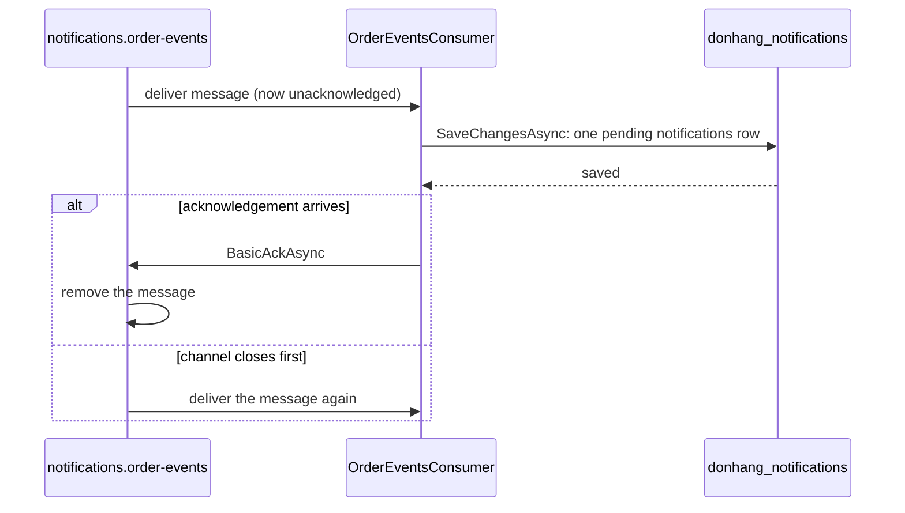

## Before you start

- [[backend.l3.outbox-relay]] — you know that the relay marks an outbox row published only after RabbitMQ confirms it, and that a crash can publish a row twice.
- [[backend.l2.at-least-once-jobs]] — you know that doing the work first and recording it afterwards is at-least-once: never lost, sometimes repeated.
- [[design.l2.driving-and-driven-adapters]] — you know that a driving adapter, such as `OrdersController`, turns a call from outside into a call to the code at the core.

## The situation

It is stage-3. A customer places an order, and its `order.placed` message waits in the queue `notifications.order-events`. The Notifications service (`DonHang.Notifications`) takes the message. At that moment you redeploy the service, and its process stops before it has saved anything.

RabbitMQ has already handed the message to the service. The service never wrote the email's row. If RabbitMQ forgot the message as soon as it handed it over, the customer would never get the email, and nothing would show that it went missing.

When may RabbitMQ forget a message it has handed to the Notifications service?

## Core concepts

- **message consumer** — code that receives messages from a queue and handles them; in the situation above, `OrderEventsConsumer`, the part of `DonHang.Notifications` that takes messages from `notifications.order-events`.
- acknowledgement — the consumer's answer telling RabbitMQ that a delivered message has been handled and may be removed from the queue.
- manual acknowledgement — a consumer setting, `autoAck: false` in code, under which RabbitMQ waits for that answer; with automatic acknowledgement it counts a message as handled as soon as it sends it.
- unacknowledged message — a message RabbitMQ has delivered to a consumer and still keeps, because no acknowledgement has arrived yet.
- channel — a path inside one connection to RabbitMQ; a consumer receives its messages, and sends its acknowledgements, on one channel.

## How it works



`OrderEventsConsumer` is the receiving end of the path the relay starts. `DonHang.Notifications` registers it as a hosted service, so it runs in that service's process, beside `NotificationSender`, which sends the saved rows as emails.

Like `OrdersController`, the consumer is a driving adapter. The controller turns an HTTP request into a call to the service's own code; the consumer does the same with a message. Its method `HandleAsync` reads the message and saves one `pending` row in the `notifications` table of `donhang_notifications`, the Notifications service's own database.

When the consumer starts, it subscribes to `notifications.order-events` with manual acknowledgement. RabbitMQ pushes each message to it and marks the message unacknowledged instead of removing it. The message stays in the queue, and no other consumer receives it, until the consumer answers it or the channel it came on closes.

If the consumer acknowledges it, RabbitMQ removes it for good. If the channel closes first, because the process stopped or the connection dropped, RabbitMQ returns the message to the queue and delivers it again.

`OrderEventsConsumer` acknowledges only after `HandleAsync` has saved its rows. A crash before the save loses nothing: the message comes back. A crash after the save and before the acknowledgement brings it back too, so the consumer receives it twice. Consuming is at-least-once, like publishing.

Several copies of `DonHang.Notifications` may consume the one queue. RabbitMQ hands each delivery to one of them, in turn, so a second copy shares the work instead of doubling it. (A message that comes back to the queue may then go to a different copy.)

## In the Đơn Hàng system

Where the consumer subscribes, in `DonHang.Notifications/OrderEventsConsumer.cs`:

```csharp file=DonHang.Notifications/OrderEventsConsumer.cs tag=stage-3 lines=42-57
    // autoAck: false turns on manual acknowledgement: RabbitMQ keeps every
    // message it delivers until this consumer acknowledges it, and delivers it
    // again if the channel closes first. Prefetch 10: at most ten unacknowledged
    // messages are on their way to this copy of the service at a time.
    private async Task ConsumeAsync(CancellationToken stoppingToken)
    {
        var open = await connection.GetAsync(stoppingToken);
        await using var channel = await open.CreateChannelAsync(cancellationToken: stoppingToken);
        await RabbitMqTopology.DeclareAsync(channel, stoppingToken);
        await channel.BasicQosAsync(prefetchSize: 0, prefetchCount: 10, global: false, stoppingToken);

        var consumer = new AsyncEventingBasicConsumer(channel);
        consumer.ReceivedAsync += (_, delivery) => OnReceivedAsync(channel, delivery);
        await channel.BasicConsumeAsync(RabbitMqTopology.Queue, autoAck: false, consumer, stoppingToken);
        await Task.Delay(Timeout.Infinite, stoppingToken);
    }
```

Line 49 (`await using var channel = …`) opens the channel the messages arrive on; when it closes, every message still unacknowledged on it goes back to the queue. Line 50 declares the queue and its binding, as in the exchanges lesson. Line 51 sets prefetch, which is outside this lesson. Line 54 makes `OnReceivedAsync` run for each delivered message, and line 55 subscribes with `autoAck: false`. Line 56 waits until the service stops; leaving the method then disposes the channel from line 49, which closes it.

What happens to each delivered message:

```csharp file=DonHang.Notifications/OrderEventsConsumer.cs tag=stage-3 lines=67-87
    private async Task OnReceivedAsync(IChannel channel, BasicDeliverEventArgs delivery)
    {
        // lesson: backend.l3.tracing-through-the-outbox
        // A span for this delivery, a child of the publish span in its header.
        using var activity = MessageTracing.StartConsume(delivery.BasicProperties, RabbitMqTopology.Queue);
        try
        {
            await HandleAsync(delivery.BasicProperties.MessageId, delivery.RoutingKey, delivery.Body.ToArray());
            await channel.BasicAckAsync(delivery.DeliveryTag, multiple: false);
        }
        catch (PoisonMessageException ex)
        {
            logger.LogWarning(ex, "Rejecting message {MessageId}: {Reason}", delivery.BasicProperties.MessageId, ex.Message);
            await channel.BasicRejectAsync(delivery.DeliveryTag, requeue: false);
        }
        catch (Exception ex)
        {
            logger.LogError(ex, "Handling message {MessageId} failed; returning it to the queue", delivery.BasicProperties.MessageId);
            await channel.BasicNackAsync(delivery.DeliveryTag, multiple: false, requeue: true);
        }
    }
```

Lines 69–71 belong to a later module; skip them. Line 74 (`await HandleAsync(…)`) saves the `notifications` row, and line 75 (`await channel.BasicAckAsync(…)`) acknowledges only once that call has returned. `DeliveryTag` names the one message being acknowledged, and `multiple: false` acknowledges that message alone. Lines 77–86 handle a `HandleAsync` that throws; they are RabbitMQ's other answers, not acknowledgements, and belong to the dead-letter lesson of this module. Here, notice that line 75 is the only `BasicAckAsync`, and it runs only after line 74.

## Seniors often assume…

- **"RabbitMQ deletes a message from the queue as soon as it hands it to a consumer."** → Actually that happens only with automatic acknowledgement. With `autoAck: false`, RabbitMQ keeps the delivered message as unacknowledged and delivers it again if the consumer's channel closes first. You notice this when RabbitMQ's counts for `notifications.order-events` show messages as unacknowledged rather than ready, and they count as ready again once the service stops.
- **"The consumer should acknowledge first and save afterwards, so RabbitMQ is not kept waiting."** → Actually acknowledging first lets RabbitMQ remove the message before its row exists. A crash between the two loses that email for good: consuming becomes at-most-once. You notice this when a redeploy during a burst of orders leaves an order with no `notifications` row and nothing left in the queue.
- **"Two copies of the Notifications service reading one queue each receive every message."** → Actually consumers of one queue share it: RabbitMQ hands each message to one of them. A service gets its own copy of every message only by binding its own queue, as with publish/subscribe. You notice this when you run two copies and each `Saved the … email for order` line, which `HandleAsync` logs after it saves a row, appears in one copy's log, not in both.

## Try it (3 minutes)

In the root folder of the example repository at `stage-3`, with Docker running:

1. Run `dotnet test DonHang.Tests --filter Running_MessageOnTheExchange_SavedThenAcknowledged`. The test starts a throwaway RabbitMQ and PostgreSQL with Testcontainers, runs `OrderEventsConsumer`, publishes one `order.shipped` message, waits for its row, stops the consumer, and counts the messages left in `notifications.order-events`.
2. Then decide: if lines 74 and 75 traded places and the process stopped right after the acknowledgement, what would the queue and `notifications` hold after the restart?

Expected result: one test runs and passes; its last assertion finds `0` messages left in the queue, because the consumer acknowledged the message after saving its row. For step 2, check your answer below.

<details><summary>Suggested answer</summary>

The acknowledgement would reach RabbitMQ before any row existed, so RabbitMQ would remove the message. The restarted service would never receive it again. The queue would be empty and `notifications` would have no row for that order: the customer gets no email, and neither the queue nor the table shows that one is missing.

</details>

## Connections

- [[backend.l3.outbox-relay]] — the same handshake on the sending side: the relay waits for RabbitMQ's confirm as RabbitMQ waits for the consumer's acknowledgement.
- [[backend.l3.idempotent-consumer]] — the fix for the repeated deliveries this lesson leaves open.
- [[backend.l3.dead-letter-queue]] — what happens to a message the consumer can never handle, the paths on lines 77–86.
- [[backend.l2.at-least-once-jobs]] — the same trade-off one step later: `NotificationSender` sends first and records `sent` afterwards.
- [[backend.l2.skip-locked-claiming]] — the database version of sharing work: copies claim different rows, as consumers receive different messages.
- [[backend.l2.hosted-services]] — the kind of class `OrderEventsConsumer` is, with its loop in `ExecuteAsync`.

## Five-line summary

1. RabbitMQ keeps a delivered message until the consumer acknowledges it, so the consumer acknowledges only after its work is saved.
2. `OrderEventsConsumer` is a hosted service and a driving adapter: it turns each message from `notifications.order-events` into a `pending` row.
3. With `autoAck: false`, a message whose channel closes before the acknowledgement goes back to the queue and is delivered again.
4. Saving before acknowledging loses nothing on a crash, but a crash between the two delivers the message twice: consuming is at-least-once.
5. Copies of one service consuming one queue share its messages; each delivery goes to only one of them.
