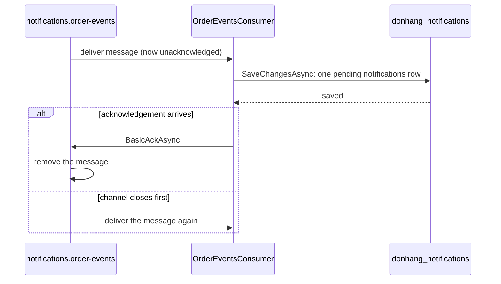

## Bạn cần biết trước

- [[backend.l3.outbox-relay]] — bạn biết rằng relay chỉ đánh dấu một dòng outbox là đã publish sau khi RabbitMQ xác nhận nó, và một lần crash có thể khiến một dòng bị publish hai lần.
- [[backend.l2.at-least-once-jobs]] — bạn biết rằng làm việc trước rồi ghi nhận sau là at-least-once: không bao giờ mất, đôi khi bị lặp.
- [[design.l2.driving-and-driven-adapters]] — bạn biết rằng một driving adapter, chẳng hạn `OrdersController`, biến một lời gọi từ bên ngoài thành lời gọi tới phần code lõi.

## Tình huống

Đang ở stage-3. Một khách hàng đặt đơn, và message `order.placed` của đơn đó nằm chờ trong hàng đợi `notifications.order-events`. Service Notifications (`DonHang.Notifications`) nhận message. Đúng lúc ấy bạn deploy lại service, và process của nó dừng trước khi kịp lưu bất cứ thứ gì.

RabbitMQ đã giao message cho service. Service chưa hề ghi dòng của email. Nếu RabbitMQ quên message ngay khi giao đi, khách hàng sẽ không bao giờ nhận được email, và không có gì cho thấy nó đã mất.

Vậy khi nào RabbitMQ mới được quên một message đã giao cho service Notifications?

## Khái niệm cốt lõi

- **message consumer** (Code nhận message từ một queue và xử lý chúng) — code nhận message từ một hàng đợi và xử lý chúng. Trong tình huống trên, đó là `OrderEventsConsumer`, phần của `DonHang.Notifications` nhận message từ `notifications.order-events`.
- acknowledgement — câu trả lời của consumer báo cho RabbitMQ rằng một message đã giao đã được xử lý xong và có thể xóa khỏi hàng đợi.
- manual acknowledgement — một thiết lập của consumer, trong code là `autoAck: false`, khiến RabbitMQ chờ câu trả lời đó. Với automatic acknowledgement, RabbitMQ coi message là đã xử lý ngay khi gửi nó đi.
- unacknowledged message — message RabbitMQ đã giao cho một consumer nhưng vẫn còn giữ, vì chưa nhận được acknowledgement.
- channel — một đường đi bên trong một kết nối tới RabbitMQ. Consumer nhận message, và gửi acknowledgement, trên cùng một channel.

## Cơ chế hoạt động



`OrderEventsConsumer` là đầu nhận của con đường mà relay khởi đầu. `DonHang.Notifications` đăng ký nó làm hosted service, nên nó chạy trong process của service đó, cạnh `NotificationSender`, thành phần gửi các dòng đã lưu thành email.

Giống `OrdersController`, consumer là một driving adapter. Controller biến một HTTP request thành lời gọi tới code của chính service, còn consumer làm điều tương tự với một message. Method `HandleAsync` của nó đọc message và lưu một dòng `pending` vào bảng `notifications` của `donhang_notifications`, database riêng của service Notifications.

Khi khởi động, consumer đăng ký nhận từ `notifications.order-events` với manual acknowledgement. RabbitMQ đẩy từng message tới nó và đánh dấu message là unacknowledged thay vì xóa đi. Message vẫn nằm trong hàng đợi, và không consumer nào khác nhận nó, cho tới khi consumer trả lời hoặc channel mà message đi qua bị đóng.

Nếu consumer acknowledge, RabbitMQ xóa message hẳn. Nếu channel đóng trước, do process dừng hay kết nối đứt, RabbitMQ đưa message trở lại hàng đợi và giao lại lần nữa.

`OrderEventsConsumer` chỉ acknowledge sau khi `HandleAsync` đã lưu các dòng của nó. Crash trước khi lưu thì không mất gì: message quay lại. Crash sau khi lưu mà trước khi acknowledge cũng khiến message quay lại, nên consumer nhận nó hai lần. Phía nhận cũng at-least-once, giống phía publish.

Có thể có nhiều bản chạy của `DonHang.Notifications` cùng nhận từ một hàng đợi. RabbitMQ giao mỗi message cho một bản, lần lượt, nên bản thứ hai chia bớt việc chứ không làm lặp lại. (Một message quay lại hàng đợi khi đó có thể được giao cho một bản khác.)

## Trong hệ thống Đơn Hàng

Chỗ consumer đăng ký nhận, trong `DonHang.Notifications/OrderEventsConsumer.cs`:

```csharp file=DonHang.Notifications/OrderEventsConsumer.cs tag=stage-3 lines=42-57
    // autoAck: false turns on manual acknowledgement: RabbitMQ keeps every
    // message it delivers until this consumer acknowledges it, and delivers it
    // again if the channel closes first. Prefetch 10: at most ten unacknowledged
    // messages are on their way to this copy of the service at a time.
    private async Task ConsumeAsync(CancellationToken stoppingToken)
    {
        var open = await connection.GetAsync(stoppingToken);
        await using var channel = await open.CreateChannelAsync(cancellationToken: stoppingToken);
        await RabbitMqTopology.DeclareAsync(channel, stoppingToken);
        await channel.BasicQosAsync(prefetchSize: 0, prefetchCount: 10, global: false, stoppingToken);

        var consumer = new AsyncEventingBasicConsumer(channel);
        consumer.ReceivedAsync += (_, delivery) => OnReceivedAsync(channel, delivery);
        await channel.BasicConsumeAsync(RabbitMqTopology.Queue, autoAck: false, consumer, stoppingToken);
        await Task.Delay(Timeout.Infinite, stoppingToken);
    }
```

Dòng 49 (`await using var channel = …`) mở channel mà message đi tới. Khi channel này đóng, mọi message còn unacknowledged trên nó quay về hàng đợi. Dòng 50 khai báo hàng đợi và binding của nó, như trong bài về exchange. Dòng 51 đặt prefetch, phần này nằm ngoài bài. Dòng 54 khiến `OnReceivedAsync` chạy cho mỗi message được giao, còn dòng 55 đăng ký nhận với `autoAck: false`. Dòng 56 chờ tới khi service dừng. Khi đó method kết thúc và dispose channel của dòng 49, tức là đóng nó.

Điều xảy ra với mỗi message được giao:

```csharp file=DonHang.Notifications/OrderEventsConsumer.cs tag=stage-3 lines=67-87
    private async Task OnReceivedAsync(IChannel channel, BasicDeliverEventArgs delivery)
    {
        // lesson: backend.l3.tracing-through-the-outbox
        // A span for this delivery, a child of the publish span in its header.
        using var activity = MessageTracing.StartConsume(delivery.BasicProperties, RabbitMqTopology.Queue);
        try
        {
            await HandleAsync(delivery.BasicProperties.MessageId, delivery.RoutingKey, delivery.Body.ToArray());
            await channel.BasicAckAsync(delivery.DeliveryTag, multiple: false);
        }
        catch (PoisonMessageException ex)
        {
            logger.LogWarning(ex, "Rejecting message {MessageId}: {Reason}", delivery.BasicProperties.MessageId, ex.Message);
            await channel.BasicRejectAsync(delivery.DeliveryTag, requeue: false);
        }
        catch (Exception ex)
        {
            logger.LogError(ex, "Handling message {MessageId} failed; returning it to the queue", delivery.BasicProperties.MessageId);
            await channel.BasicNackAsync(delivery.DeliveryTag, multiple: false, requeue: true);
        }
    }
```

Dòng 69–71 thuộc về một module sau, bạn bỏ qua. Dòng 74 (`await HandleAsync(…)`) lưu dòng `notifications`, và dòng 75 (`await channel.BasicAckAsync(…)`) chỉ acknowledge khi lời gọi đó đã trả về. `DeliveryTag` chỉ đúng message đang được acknowledge, còn `multiple: false` nghĩa là chỉ acknowledge riêng message đó. Dòng 77–86 xử lý trường hợp `HandleAsync` ném exception. Đó là những câu trả lời khác của RabbitMQ, không phải acknowledgement, và thuộc về bài dead-letter của module này. Ở đây, bạn chỉ cần để ý dòng 75 là `BasicAckAsync` duy nhất, và nó chỉ chạy sau dòng 74.

## Senior hay nhầm rằng…

- **"RabbitMQ xóa message khỏi hàng đợi ngay khi giao nó cho consumer."** → Thực ra điều đó chỉ xảy ra với automatic acknowledgement. Với `autoAck: false`, RabbitMQ giữ message đã giao ở trạng thái unacknowledged và giao lại nếu channel của consumer đóng trước. Bạn sẽ nhận ra khi số liệu của RabbitMQ cho `notifications.order-events` hiện message ở dạng unacknowledged chứ không phải ready, và chúng được tính là ready trở lại ngay khi service dừng.
- **"Consumer nên acknowledge trước rồi mới lưu, để RabbitMQ khỏi phải chờ."** → Thực ra acknowledge trước cho phép RabbitMQ xóa message khi dòng của nó chưa tồn tại. Một lần crash giữa hai bước làm mất email đó vĩnh viễn: phía nhận trở thành at-most-once. Bạn sẽ nhận ra khi một lần deploy lại giữa lúc đơn dồn dập để lại một đơn không có dòng `notifications` nào, và hàng đợi cũng chẳng còn gì.
- **"Hai bản chạy của service Notifications cùng đọc một hàng đợi thì bản nào cũng nhận đủ mọi message."** → Thực ra các consumer của một hàng đợi chia nhau hàng đợi đó: RabbitMQ giao mỗi message cho một consumer. Một service chỉ nhận được bản riêng của mọi message khi bind hàng đợi riêng của mình, như với publish/subscribe. Bạn sẽ nhận ra khi chạy hai bản và mỗi dòng `Saved the … email for order`, dòng log `HandleAsync` ghi sau khi lưu một dòng, chỉ xuất hiện trong log của một bản, không phải cả hai.

## Thử ngay (3 phút)

Ở thư mục gốc của repo ví dụ tại `stage-3`, khi Docker đang chạy:

1. Chạy `dotnet test DonHang.Tests --filter Running_MessageOnTheExchange_SavedThenAcknowledged`. Test này dựng một RabbitMQ và một PostgreSQL dùng xong bỏ bằng Testcontainers, chạy `OrderEventsConsumer`, publish một message `order.shipped`, chờ dòng của nó, dừng consumer, rồi đếm số message còn lại trong `notifications.order-events`.
2. Rồi hãy xác định: nếu dòng 74 và 75 đổi chỗ cho nhau và process dừng ngay sau khi acknowledge, thì sau khi khởi động lại, hàng đợi và `notifications` sẽ chứa gì?

Kết quả mong đợi: một test chạy và pass. Assertion cuối cùng của nó thấy `0` message còn lại trong hàng đợi, vì consumer acknowledge message sau khi đã lưu dòng của nó. Ở bước 2, hãy đối chiếu với đáp án bên dưới.

<details><summary>Gợi ý đáp án</summary>

Acknowledgement sẽ tới RabbitMQ trước khi có dòng nào, nên RabbitMQ xóa message. Service sau khi khởi động lại sẽ không bao giờ nhận lại nó. Hàng đợi trống và `notifications` không có dòng nào cho đơn đó: khách hàng không nhận được email, và cả hàng đợi lẫn bảng đều không cho thấy có một email bị thiếu.

</details>

## Liên hệ

- [[backend.l3.outbox-relay]] — cùng kiểu bắt tay ở phía gửi: relay chờ xác nhận của RabbitMQ giống như RabbitMQ chờ acknowledgement của consumer.
- [[backend.l3.idempotent-consumer]] — cách xử lý những lần giao lặp mà bài này còn bỏ ngỏ.
- [[backend.l3.dead-letter-queue]] — điều xảy ra với một message mà consumer không bao giờ xử lý được, tức các nhánh ở dòng 77–86.
- [[backend.l2.at-least-once-jobs]] — cùng đánh đổi đó ở một bước sau: `NotificationSender` gửi trước rồi mới ghi `sent`.
- [[backend.l2.skip-locked-claiming]] — cách chia việc tương tự trong database: các bản chạy nhận những dòng khác nhau, như các consumer nhận những message khác nhau.
- [[backend.l2.hosted-services]] — loại class mà `OrderEventsConsumer` thuộc về, với vòng lặp nằm trong `ExecuteAsync`.

## Tóm tắt 5 dòng

1. RabbitMQ giữ một message đã giao cho tới khi consumer acknowledge nó, nên consumer chỉ acknowledge sau khi việc của mình đã được lưu.
2. `OrderEventsConsumer` vừa là hosted service vừa là driving adapter: nó biến mỗi message từ `notifications.order-events` thành một dòng `pending`.
3. Với `autoAck: false`, message nào có channel đóng trước khi acknowledge sẽ quay về hàng đợi và được giao lại.
4. Lưu trước rồi acknowledge thì crash không làm mất gì, nhưng crash giữa hai bước sẽ giao message hai lần: phía nhận là at-least-once.
5. Các bản chạy của một service cùng nhận từ một hàng đợi sẽ chia nhau message, mỗi lần giao chỉ tới một bản.
