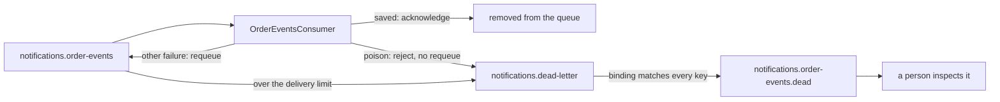

## Before you start

- [[backend.l3.idempotent-consumer]] — you know that `OrderEventsConsumer` acknowledges a message only after `HandleAsync` has saved its rows, and that `HandleAsync` stops a message with no usable id; this lesson says where such a message goes.
- [[backend.l2.retry-with-backoff]] — you know that `NotificationSender` retries a failed email a fixed number of times, then marks the row `failed`, so it is never retried automatically.

## The situation

It is stage-3. A developer testing from RabbitMQ's management page, the web page for watching queues and publishing by hand, publishes a message to `donhang.orders` with the routing key `order.placed`, but types plain text as its body instead of JSON. The binding `order.*` lets it into `notifications.order-events`, and `OrderEventsConsumer` receives it.

The consumer cannot read the body, so it cannot save an email row. Acknowledging the message would make RabbitMQ delete it, and nobody could ever look at it. Returning it to the queue would only bring it back: the body is just as broken on every later delivery.

What should a consumer do with a message it will never be able to handle?

## Core concepts

- **poison message** — a message the consumer can never handle, however often it is delivered; in the situation above, the `order.placed` message whose body is not JSON.
- requeue — the consumer's answer that returns a delivered message to its queue, so RabbitMQ delivers it again; rejecting without requeue tells RabbitMQ that the queue should not keep it.
- dead-letter exchange — an exchange that a queue names in its settings; RabbitMQ publishes to it each message the queue gives up on.
- **dead-letter queue** — an ordinary queue that receives the messages another queue gives up on, so a person can inspect them later; for `notifications.order-events` it is `notifications.order-events.dead`.
- delivery limit — a queue setting that caps how many times a message may be returned to the queue before the queue gives up on it.

## How it works



`OrderEventsConsumer` gives every delivered message one of three answers. When `HandleAsync` saves its rows, the consumer acknowledges, and the message leaves the queue for good.

When `HandleAsync` finds that a message can never be handled, it throws `PoisonMessageException`. In the situation above, the cause is a body that is not JSON. A message with no id counts too, and so does a routing key with no email subject: `HandleAsync` picks the email's subject from the routing key, so a key such as `order.unknown` fails on every delivery. The consumer then rejects the message without requeue. Requeueing it would only repeat that failure, forever.

A rejected message is not simply dropped here, because `notifications.order-events` names a dead-letter exchange, `notifications.dead-letter`. RabbitMQ publishes the rejected message to that exchange, which, through a binding that matches every routing key, routes it to `notifications.order-events.dead`. Without a dead-letter exchange, the same rejection would discard the message.

Every other failure, such as the database being down, may pass, so the consumer requeues the message for another try. The requeued message can be delivered again right away, with no wait between tries, so this helps only with a failure that clears within a few deliveries. The queue's delivery limit stops the tries: once a message has been returned more times than the limit, the queue dead-letters it too. With a limit of 5, its sixth failed delivery is its last.

When RabbitMQ dead-letters a message, it adds headers to it that name the queue it left and the reason. Nothing consumes the dead-letter queue at stage-3: its messages wait there until a person reads them and decides what to do.

## In the Đơn Hàng system

How the queue's dead-letter side is declared, in `DonHang.Notifications/RabbitMqTopology.cs`:

```csharp file=DonHang.Notifications/RabbitMqTopology.cs tag=stage-3 lines=29-50
        // lesson: backend.l3.dead-letter-queue
        // Where the queue's given-up messages go: an exchange of their own,
        // and one queue bound to it with #, which matches every routing key.
        await channel.ExchangeDeclareAsync(DeadLetterExchange, ExchangeType.Topic, durable: true,
            cancellationToken: cancellationToken);
        await channel.QueueDeclareAsync(DeadLetterQueue, durable: true, exclusive: false, autoDelete: false,
            cancellationToken: cancellationToken);
        await channel.QueueBindAsync(DeadLetterQueue, DeadLetterExchange, "#", cancellationToken: cancellationToken);
    }

    // lesson: backend.l3.dead-letter-queue
    // A quorum queue, the kind RabbitMQ recommends for messages that must not
    // be lost. It sends a message to the dead-letter exchange when a consumer
    // rejects it without requeueing, or when consumers have returned it to the
    // queue more than 5 times (x-delivery-limit: its 6th failed delivery is
    // its last), so no message goes round forever.
    private static Dictionary<string, object?> QueueArguments() => new()
    {
        ["x-queue-type"] = "quorum",
        ["x-delivery-limit"] = 5,
        ["x-dead-letter-exchange"] = DeadLetterExchange,
    };
```

Lines 32–36 declare the dead-letter side: the topic exchange `notifications.dead-letter`, which matches routing keys against binding patterns such as `order.*` or `#`, and the queue `notifications.order-events.dead`, bound with `#`. Their other arguments are ordinary settings that do not matter for dead-lettering. A dead-lettered message keeps its routing key, such as `order.placed`, and `#` matches every key, so every one gets in. Lines 45–50 build the arguments that line 26, outside the excerpt, passes when it declares `notifications.order-events`. Line 47 (`x-queue-type`) makes it a quorum queue: RabbitMQ has more than one kind of queue, and the delivery limit works only on this kind. Line 48 (`x-delivery-limit`) sets the limit to 5, and line 49 (`x-dead-letter-exchange`) names the dead-letter exchange.

What the consumer answers, in `DonHang.Notifications/OrderEventsConsumer.cs`:

```csharp file=DonHang.Notifications/OrderEventsConsumer.cs tag=stage-3 lines=67-87
    private async Task OnReceivedAsync(IChannel channel, BasicDeliverEventArgs delivery)
    {
        // lesson: backend.l3.tracing-through-the-outbox
        // A span for this delivery, a child of the publish span in its header.
        using var activity = MessageTracing.StartConsume(delivery.BasicProperties, RabbitMqTopology.Queue);
        try
        {
            await HandleAsync(delivery.BasicProperties.MessageId, delivery.RoutingKey, delivery.Body.ToArray());
            await channel.BasicAckAsync(delivery.DeliveryTag, multiple: false);
        }
        catch (PoisonMessageException ex)
        {
            logger.LogWarning(ex, "Rejecting message {MessageId}: {Reason}", delivery.BasicProperties.MessageId, ex.Message);
            await channel.BasicRejectAsync(delivery.DeliveryTag, requeue: false);
        }
        catch (Exception ex)
        {
            logger.LogError(ex, "Handling message {MessageId} failed; returning it to the queue", delivery.BasicProperties.MessageId);
            await channel.BasicNackAsync(delivery.DeliveryTag, multiple: false, requeue: true);
        }
    }
```

Lines 69–71 belong to a later module; skip them. The checks that throw `PoisonMessageException` sit further down the file, outside the excerpt, inside the code line 74 calls. Line 80 answers a poison message with `requeue: false`, so it is dead-lettered at once. Line 85 answers any other exception with `requeue: true`, which returns the message to `notifications.order-events` and counts toward the delivery limit. `BasicNackAsync` is RabbitMQ's other negative answer; for one message (`multiple: false`) it does the same as `BasicRejectAsync`, so the two lines differ only in `requeue`. The poison `catch` comes before `catch (Exception)` because C# uses the first `catch` clause that matches.

## Seniors often assume…

- **"A message that fails should go back in the queue until it finally works."** → Actually only a failure that can pass is worth another delivery. A poison message fails the same way every time, so requeueing it only repeats the failure; even for failures that may pass, the delivery limit caps the tries. You notice this when the Notifications log shows `Handling message … failed; returning it to the queue` for one message id six times in a row, after which the message sits in `notifications.order-events.dead`.
- **"Messages in the dead-letter queue are retried automatically after a while."** → Actually `notifications.order-events.dead` is an ordinary queue, and at stage-3 no consumer reads it. RabbitMQ does not move its messages anywhere by itself, so each stays until a person removes it. You notice this when the customer of a dead-lettered `order.shipped` message never gets that email, however long you wait.
- **"A dead-letter queue is a special component that needs a server of its own."** → Actually it is an ordinary exchange and queue on the same RabbitMQ server, declared by `RabbitMqTopology` beside the main queue and wired to it by one queue argument. You notice this when RabbitMQ's management page lists `notifications.order-events.dead` among the other queues, and `docker-compose.yml` has no service for it.

## Try it (3 minutes)

With the lab running (`scripts/up.sh`), in the root folder of the example repository:

1. Run `scripts/backend/dead-letter.sh`. It empties `notifications.order-events.dead`, publishes one `order.placed` message whose body is `this is not JSON`, and waits for it to be dead-lettered. Then it takes that message from the dead-letter queue, which also removes it, and prints it with RabbitMQ's headers.
2. Then decide: if line 80 passed `requeue: true` instead, where would the message end up, and after how many deliveries?

Expected result: `routed: true` (the exchange found a queue for the message), then `0` messages in `notifications.order-events` and `1` in `notifications.order-events.dead`. The printed message keeps `"routing_key": "order.placed"` and its body (`payload`), and shows `"x-first-death-queue": "notifications.order-events"` and `"x-first-death-reason": "rejected"`, with one `x-death` entry whose `count` is `1`, the number of times it was dead-lettered from that queue for that reason. For step 2, check your answer below.

<details><summary>Suggested answer</summary>

It would still reach `notifications.order-events.dead`, but only once the delivery limit ran out: the comment on lines 39–44 says its sixth failed delivery is its last. Each of those deliveries would fail on the same body, so one broken message would cost six attempts instead of one.

</details>

## Connections

- [[backend.l3.consumer-acknowledgements]] — the acknowledgement this lesson completes with the two other answers, reject and requeue.
- [[backend.l3.exchanges-and-bindings]] — the same routing used again: the dead-letter exchange is a topic exchange whose `#` binding matches every key.
- [[backend.l2.retry-with-backoff]] — the same give-up idea for email jobs: a fixed number of tries, then a state no automatic retry touches.
- [[backend.l3.idempotent-consumer]] — prerequisite: a message without a usable id is one of the poison messages handled here.
- [[backend.l3.queue-backlog-metrics]] — where the number of messages waiting in a queue becomes a metric you can watch.

## Five-line summary

1. A message the consumer cannot handle moves to a dead-letter queue, where it waits for a person instead of failing forever or vanishing.
2. A poison message, such as a body that is not JSON, fails on every delivery, so the consumer rejects it without requeue.
3. `notifications.order-events` names the dead-letter exchange `notifications.dead-letter`, which routes those messages to `notifications.order-events.dead`.
4. Other failures are requeued, and the queue's delivery limit of 5 dead-letters a message that keeps coming back.
5. RabbitMQ adds headers naming the queue a message left and why; nothing retries it automatically.
