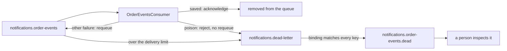

## Bạn cần biết trước

- [[backend.l3.idempotent-consumer]] — bạn biết rằng `OrderEventsConsumer` chỉ acknowledge một message sau khi `HandleAsync` đã lưu các dòng của nó, và `HandleAsync` chặn message không có id dùng được. Bài này nói message đó đi đâu.
- [[backend.l2.retry-with-backoff]] — bạn biết rằng `NotificationSender` thử gửi lại một email lỗi với số lần cố định, rồi đánh dấu dòng đó là `failed`, nên nó không bao giờ được tự động thử lại.

## Tình huống

Đang ở stage-3. Một developer thử nghiệm từ trang quản lý của RabbitMQ, trang web để theo dõi queue và publish message bằng tay. Người đó publish một message lên `donhang.orders` với routing key `order.placed`, nhưng gõ phần thân là chữ thường thay vì JSON. Binding `order.*` cho message vào `notifications.order-events`, và `OrderEventsConsumer` nhận nó.

Consumer không đọc được phần thân, nên không lưu được dòng email nào. Acknowledge message thì RabbitMQ sẽ xóa nó, và không ai còn xem lại được nữa. Trả nó về queue thì nó chỉ quay lại: ở mọi lần giao sau, phần thân vẫn hỏng y như cũ.

Consumer nên làm gì với một message mà nó sẽ không bao giờ xử lý được?

## Khái niệm cốt lõi

- **poison message** (Message mà consumer không bao giờ xử lý được, lần giao nào cũng lỗi) — message mà consumer không thể xử lý, dù được giao bao nhiêu lần. Trong tình huống trên, đó là message `order.placed` có phần thân không phải JSON.
- requeue — câu trả lời của consumer để đưa một message đã giao về lại queue của nó, nên RabbitMQ sẽ giao lại. Reject mà không requeue là báo cho RabbitMQ rằng queue không nên giữ message đó.
- dead-letter exchange — một exchange mà queue ghi tên trong phần cấu hình của mình. RabbitMQ publish lên đó mọi message mà queue bỏ cuộc.
- **dead-letter queue** (Queue nhận các message mà queue khác bỏ cuộc, để người xem xét sau) — một queue bình thường, nhận các message mà một queue khác bỏ cuộc, để sau này có người xem xét. Với `notifications.order-events`, đó là `notifications.order-events.dead`.
- delivery limit — một thiết lập của queue, giới hạn số lần một message được trả về queue trước khi queue bỏ cuộc với nó.

## Cơ chế hoạt động



`OrderEventsConsumer` trả lời mỗi message được giao bằng một trong ba cách. Khi `HandleAsync` lưu được các dòng của nó, consumer acknowledge, và message rời khỏi queue hẳn.

Khi `HandleAsync` thấy một message không bao giờ xử lý được, nó ném `PoisonMessageException`. Trong tình huống trên, nguyên nhân là phần thân không phải JSON. Message không có id cũng tính, và routing key không có tiêu đề email tương ứng cũng vậy: `HandleAsync` lấy tiêu đề email từ routing key, nên một key như `order.unknown` sẽ lỗi ở mọi lần giao. Khi đó consumer reject message mà không requeue. Requeue chỉ khiến lỗi đó lặp lại mãi mãi.

Ở đây message bị reject không bị bỏ đi luôn, vì `notifications.order-events` có ghi tên một dead-letter exchange là `notifications.dead-letter`. RabbitMQ publish message bị reject lên exchange đó. Qua một binding khớp với mọi routing key, exchange route nó tới `notifications.order-events.dead`. Nếu không có dead-letter exchange, cùng lần reject đó sẽ xóa mất message.

Mọi lỗi khác, chẳng hạn database đang sập, đều có thể tự hết, nên consumer requeue message để thử thêm lần nữa. Message được requeue có thể được giao lại ngay, không có khoảng chờ giữa các lần thử, nên cách này chỉ giúp được với lỗi hết trong vài lần giao. Delivery limit của queue chặn các lần thử lại: khi một message đã bị trả về nhiều hơn giới hạn, queue cũng chuyển nó sang dead-letter. Với giới hạn 5, lần giao lỗi thứ sáu là lần cuối của nó.

Khi RabbitMQ chuyển một message sang dead-letter, nó gắn thêm các header ghi tên queue mà message vừa rời và lý do. Ở stage-3 không có gì consume dead-letter queue: message nằm chờ ở đó cho tới khi có người đọc và quyết định làm gì.

## Trong hệ thống Đơn Hàng

Cách khai báo phía dead-letter của queue, trong `DonHang.Notifications/RabbitMqTopology.cs`:

```csharp file=DonHang.Notifications/RabbitMqTopology.cs tag=stage-3 lines=29-50
        // lesson: backend.l3.dead-letter-queue
        // Where the queue's given-up messages go: an exchange of their own,
        // and one queue bound to it with #, which matches every routing key.
        await channel.ExchangeDeclareAsync(DeadLetterExchange, ExchangeType.Topic, durable: true,
            cancellationToken: cancellationToken);
        await channel.QueueDeclareAsync(DeadLetterQueue, durable: true, exclusive: false, autoDelete: false,
            cancellationToken: cancellationToken);
        await channel.QueueBindAsync(DeadLetterQueue, DeadLetterExchange, "#", cancellationToken: cancellationToken);
    }

    // lesson: backend.l3.dead-letter-queue
    // A quorum queue, the kind RabbitMQ recommends for messages that must not
    // be lost. It sends a message to the dead-letter exchange when a consumer
    // rejects it without requeueing, or when consumers have returned it to the
    // queue more than 5 times (x-delivery-limit: its 6th failed delivery is
    // its last), so no message goes round forever.
    private static Dictionary<string, object?> QueueArguments() => new()
    {
        ["x-queue-type"] = "quorum",
        ["x-delivery-limit"] = 5,
        ["x-dead-letter-exchange"] = DeadLetterExchange,
    };
```

Dòng 32–36 khai báo phía dead-letter: topic exchange `notifications.dead-letter`, loại exchange so routing key với các mẫu binding như `order.*` hay `#`, và queue `notifications.order-events.dead`, được bind bằng `#`. Các tham số còn lại của chúng là thiết lập thông thường, không liên quan tới dead-letter. Message bị chuyển sang dead-letter vẫn giữ routing key của nó, chẳng hạn `order.placed`, và `#` khớp với mọi key, nên message nào cũng vào được. Dòng 45–50 tạo các tham số mà dòng 26, ngoài đoạn trích, truyền vào khi khai báo `notifications.order-events`. Dòng 47 (`x-queue-type`) biến nó thành quorum queue: RabbitMQ có nhiều loại queue, và delivery limit chỉ hoạt động với loại này. Dòng 48 (`x-delivery-limit`) đặt giới hạn là 5, còn dòng 49 (`x-dead-letter-exchange`) ghi tên dead-letter exchange.

Cách consumer trả lời, trong `DonHang.Notifications/OrderEventsConsumer.cs`:

```csharp file=DonHang.Notifications/OrderEventsConsumer.cs tag=stage-3 lines=67-87
    private async Task OnReceivedAsync(IChannel channel, BasicDeliverEventArgs delivery)
    {
        // lesson: backend.l3.tracing-through-the-outbox
        // A span for this delivery, a child of the publish span in its header.
        using var activity = MessageTracing.StartConsume(delivery.BasicProperties, RabbitMqTopology.Queue);
        try
        {
            await HandleAsync(delivery.BasicProperties.MessageId, delivery.RoutingKey, delivery.Body.ToArray());
            await channel.BasicAckAsync(delivery.DeliveryTag, multiple: false);
        }
        catch (PoisonMessageException ex)
        {
            logger.LogWarning(ex, "Rejecting message {MessageId}: {Reason}", delivery.BasicProperties.MessageId, ex.Message);
            await channel.BasicRejectAsync(delivery.DeliveryTag, requeue: false);
        }
        catch (Exception ex)
        {
            logger.LogError(ex, "Handling message {MessageId} failed; returning it to the queue", delivery.BasicProperties.MessageId);
            await channel.BasicNackAsync(delivery.DeliveryTag, multiple: false, requeue: true);
        }
    }
```

Dòng 69–71 thuộc về một module sau, bạn bỏ qua. Các chỗ kiểm tra ném `PoisonMessageException` nằm phía dưới trong file, ngoài đoạn trích, bên trong phần code mà dòng 74 gọi. Dòng 80 trả lời poison message bằng `requeue: false`, nên nó được chuyển sang dead-letter ngay. Dòng 85 trả lời mọi exception khác bằng `requeue: true`, đưa message về lại `notifications.order-events` và tính vào delivery limit. `BasicNackAsync` là câu trả lời từ chối còn lại của RabbitMQ. Với một message (`multiple: false`), nó làm giống hệt `BasicRejectAsync`, nên hai dòng chỉ khác nhau ở `requeue`. `catch` cho poison message đứng trước `catch (Exception)` vì C# dùng mệnh đề `catch` đầu tiên khớp.

## Senior hay nhầm rằng…

- **"Message lỗi thì nên trả về queue cho tới khi nó chạy được."** → Thực ra chỉ lỗi có thể tự hết mới đáng giao thêm lần nữa. Poison message lần nào cũng lỗi y hệt, nên requeue nó chỉ lặp lại lỗi. Ngay cả với lỗi có thể tự hết, delivery limit cũng giới hạn số lần thử. Bạn sẽ nhận ra khi log của Notifications in `Handling message … failed; returning it to the queue` sáu lần liền cho cùng một message id, rồi sau đó message nằm trong `notifications.order-events.dead`.
- **"Message trong dead-letter queue sẽ được tự động thử lại sau một lúc."** → Thực ra `notifications.order-events.dead` là một queue bình thường, và ở stage-3 không consumer nào đọc nó. RabbitMQ không tự chuyển message của nó đi đâu, nên mỗi message nằm đó cho tới khi có người lấy ra. Bạn sẽ nhận ra khi khách hàng của một message `order.shipped` đã bị chuyển sang dead-letter không bao giờ nhận được email đó, dù chờ bao lâu.
- **"Dead-letter queue là một thành phần đặc biệt, cần server riêng."** → Thực ra nó là một exchange và một queue bình thường trên cùng server RabbitMQ, được `RabbitMqTopology` khai báo cạnh queue chính và nối vào queue đó bằng một tham số. Bạn sẽ nhận ra khi trang quản lý của RabbitMQ liệt kê `notifications.order-events.dead` cùng các queue khác, và `docker-compose.yml` không có service nào cho nó.

## Thử ngay (3 phút)

Khi lab đang chạy (`scripts/up.sh`), ở thư mục gốc của repo ví dụ:

1. Chạy `scripts/backend/dead-letter.sh`. Script làm rỗng `notifications.order-events.dead`, publish một message `order.placed` có phần thân là `this is not JSON`, rồi chờ message đó bị chuyển sang dead-letter. Sau đó nó lấy message ra khỏi dead-letter queue, cũng là xóa nó khỏi đó, và in message kèm các header của RabbitMQ.
2. Rồi hãy xác định: nếu dòng 80 truyền `requeue: true`, message sẽ kết thúc ở đâu, và sau bao nhiêu lần giao?

Kết quả mong đợi: `routed: true` (exchange tìm được một queue cho message), rồi `0` message trong `notifications.order-events` và `1` trong `notifications.order-events.dead`. Message được in ra vẫn giữ `"routing_key": "order.placed"` và phần thân (`payload`), có `"x-first-death-queue": "notifications.order-events"` và `"x-first-death-reason": "rejected"`, cùng một mục `x-death` có `count` là `1`, tức số lần message bị chuyển sang dead-letter từ queue đó vì lý do đó. Ở bước 2, hãy đối chiếu với đáp án bên dưới.

<details><summary>Gợi ý đáp án</summary>

Message vẫn tới `notifications.order-events.dead`, nhưng chỉ sau khi hết delivery limit: comment ở dòng 39–44 nói lần giao lỗi thứ sáu là lần cuối của nó. Lần giao nào cũng lỗi ở cùng phần thân đó, nên một message hỏng tốn sáu lần thử thay vì một.

</details>

## Liên hệ

- [[backend.l3.consumer-acknowledgements]] — acknowledgement mà bài này bổ sung thêm hai câu trả lời còn lại: reject và requeue.
- [[backend.l3.exchanges-and-bindings]] — cùng cách route được dùng lại: dead-letter exchange là một topic exchange có binding `#` khớp với mọi key.
- [[backend.l2.retry-with-backoff]] — cùng ý tưởng bỏ cuộc cho job gửi email: thử một số lần cố định, rồi chuyển sang trạng thái không lần thử lại tự động nào chạm tới.
- [[backend.l3.idempotent-consumer]] — bài cần học trước: message không có id dùng được là một trong các poison message mà bài này xử lý.
- [[backend.l3.queue-backlog-metrics]] — nơi số message đang chờ trong queue trở thành một metric bạn theo dõi được.

## Tóm tắt 5 dòng

1. Message mà consumer không xử lý được sẽ chuyển sang dead-letter queue, nằm chờ người xem thay vì lỗi mãi hay biến mất.
2. Poison message, như phần thân không phải JSON, lỗi ở mọi lần giao, nên consumer reject nó mà không requeue.
3. `notifications.order-events` ghi tên dead-letter exchange `notifications.dead-letter`, exchange này route các message đó tới `notifications.order-events.dead`.
4. Các lỗi khác được requeue, và delivery limit 5 của queue chuyển sang dead-letter message cứ quay lại mãi.
5. RabbitMQ gắn header ghi queue mà message vừa rời và lý do, và không có gì tự động thử lại nó.
