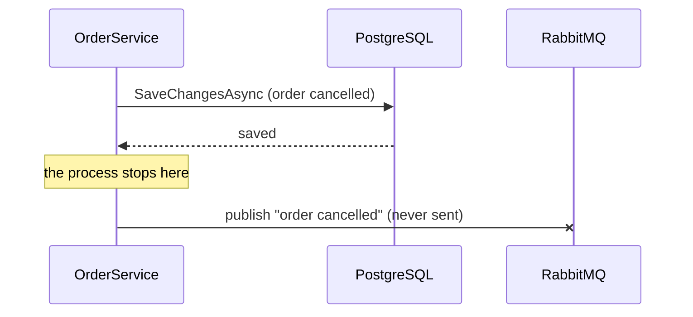

## Before you start

- [[backend.l3.exchanges-and-bindings]] — you know that `DonHang.Api` publishes each message to the exchange `donhang.orders`, and RabbitMQ passes it to the queues bound there.
- [[backend.l2.at-least-once-jobs]] — you know that a process can stop between two steps, and that no order of "send" and "save" gives exactly once across Mailpit and PostgreSQL.
- [[design.l3.dispatching-domain-events]] — you know that handlers only add rows to the shared `DonHangDbContext`, so one save stores the order's change and every reaction, or none.
- [[backend.l2.optimistic-concurrency]] — you know that a save whose order changed since it was read throws `DbUpdateConcurrencyException` and writes nothing.

## The situation

It is the end of stage-2, and the team is planning stage-3. Order emails will move to their own service, `DonHang.Notifications`, with its own database, and `DonHang.Api` will reach it through RabbitMQ. Today, `notifier.Send(order, "order cancelled")` in `OrderService` only adds a row next to the order. A teammate suggests replacing that line with a publish to RabbitMQ. With the stage-3 dispatcher, that publish would sit in a handler, which also runs before `SaveChangesAsync`.

You open `CancelOrderAsync` to decide where the publish goes: after `SaveChangesAsync`, before it, or inside a transaction around both.

Where can the publish go so that an order's change and its message are always kept together, or lost together?

## Core concepts

- **dual write** — one operation that must write to two separate systems, such as PostgreSQL and RabbitMQ, with no transaction in the system covering both writes.
- `SaveChangesAsync` — the EF Core call that sends all tracked changes to PostgreSQL; EF Core applies the changes of one call inside one database transaction.
- the gap — the moment between the two writes of a dual write, when one system has the change and the other does not yet.

## How it works



In the situation above, cancelling an order now writes to two systems. PostgreSQL stores the new status, and RabbitMQ must accept the message for Notifications. That is a dual write. A PostgreSQL transaction covers only PostgreSQL's own rows. RabbitMQ is a separate server that keeps its own messages, and nothing in Đơn Hàng joins the two into one transaction. Each of the three places for the publish leaves a gap.

Publish after `SaveChangesAsync`. The save succeeds, then the process stops before the publish, for example because it crashes or is killed. The order is cancelled in the database, and the message never existed outside the process's memory. Nothing records that a message is still owed, so no email goes out.

Publish before `SaveChangesAsync`. Now a message can announce a change that is never saved. Two staff members ship and cancel the same order at the same moment. Both requests read the order while it is still waiting to be shipped; the ship saves first, so the cancel's save throws `DbUpdateConcurrencyException` and writes nothing. Its message is already in RabbitMQ, and the customer reads "order cancelled" about an order on its way.

Publish inside a transaction you open around both: start it, save, publish, then finish it. If finishing fails, for example because the connection to PostgreSQL drops, PostgreSQL rolls the order's change back. RabbitMQ never took part, so it keeps the message it already accepted. Moving the publish after the transaction ends only brings back the first gap.

## In the Đơn Hàng system

The line your teammate wants to replace, in `DonHang.Domain/OrderService.cs`:

```csharp file=DonHang.Domain/OrderService.cs tag=stage-2 lines=36-49
    // lesson: design.l2.domain-model
    // Find, let the order decide, notify, save. An order that is already
    // cancelled or shipped makes order.Cancel() throw OrderStatusException.
    // The notification is saved with the order, by the same SaveChangesAsync.
    public async Task<Order> CancelOrderAsync(int orderId)
    {
        var order = await repository.FindAsync(orderId)
            ?? throw new KeyNotFoundException($"order {orderId} not found");

        order.Cancel();
        notifier.Send(order, "order cancelled");
        await repository.SaveChangesAsync();
        return order;
    }
```

Line 46 is the call to replace. Today it writes nothing by itself; line 47 runs one `SaveChangesAsync`, so the new status and the email job are stored together or not at all, as the comment on line 39 says. If line 47 throws `DbUpdateConcurrencyException`, the middleware answers `409`, and neither row is stored. That all-or-nothing behaviour is what a publish in place of line 46 would lose.

What `notifier.Send` does at stage-2, in `DonHang.Infrastructure/QueuedNotifier.cs`:

```csharp file=DonHang.Infrastructure/QueuedNotifier.cs tag=stage-2 lines=5-24
// lesson: backend.l2.database-job-queue
// Sends nothing itself: it adds a pending notifications row to the same
// DbContext the order is in and leaves the saving to OrderService.
// NotificationSender (DonHang.Api/Jobs) picks the row up a few seconds later.
public sealed class QueuedNotifier(DonHangDbContext db) : INotifier
{
    public void Send(Order order, string subject)
    {
        var now = DateTimeOffset.UtcNow;
        db.Notifications.Add(new Notification
        {
            Order = order, // EF Core fills in order_id when it saves both
            Channel = "email",
            Subject = subject,
            Status = "pending",
            CreatedAt = now,
            NextAttemptAt = now,
        });
    }
}
```

Line 14 adds a `notifications` row to the same `DonHangDbContext` that holds the order, and the class saves nothing. That is why stage-2 has no dual write: the email job is one more row in the same database. At stage-3 the email job lives in `DonHang.Notifications`, in its own database `donhang_notifications`, which `DonHang.Api` does not connect to. The message that starts it has to reach RabbitMQ, a second system, and that is where the dual write appears.

## Seniors often assume…

- **"Publishing right after `SaveChangesAsync` is safe, since the order is already saved by then."** → Actually the saved order is the problem: the database has the change, while the message exists only in the process's memory until RabbitMQ accepts it. A process that stops in between loses the message for good, because nothing stored says one is due. You notice this when a customer whose order shows as cancelled says no email came, and the API crashed or was killed around that time.
- **"A `try`/`catch` around the publish is enough: if publishing fails, try it again."** → Actually a `catch` block runs only while the process is alive. A stop between the save and the publish skips it, and a retry loop held in memory ends with the process. You notice this when the missing emails line up with crashes of the API, not with RabbitMQ errors in its logs.
- **"If the publish runs inside the database transaction, a rollback cancels the message too."** → Actually the rollback belongs to PostgreSQL alone; RabbitMQ never joined that transaction and keeps what it accepted. You notice this when Notifications emails "order cancelled" for an order whose cancellation failed and that is still not cancelled.

## Try it (3 minutes)

In the root folder of the example repository:

1. Run `git grep -n SaveChangesAsync stage-2 -- DonHang.Domain/OrderService.cs`.
2. Run `git show stage-2:DonHang.Domain/OrderService.cs` and read `PlaceOrderAsync` (lines 15–34). Line 19 looks up an earlier order with the same key. Imagine line 31 becomes a publish of "order placed", still before `SaveChangesAsync` on line 32. A client sends `POST /api/v1/orders` twice at the same moment with the same `Idempotency-Key`. The `orders` table has a unique index on `idempotency_key`: PostgreSQL refuses a second row with the same key, and the middleware answers that failed save with `409`. For each request, decide: is an order stored, and is a message published?

Expected result: step 1 prints five lines, numbered 30, 32, 39, 47 and 59. Lines 32, 47 and 59 are the calls; lines 30 and 39 are comments. Each use case writes everything through exactly one call. For step 2, one request stores an order and the other gets `409`; check the messages against the answer below.

<details><summary>Suggested answer</summary>

Both requests find no earlier order on line 19, and both reach line 31, so both publish. Then both try to insert. The unique index lets only the first `INSERT` through; the second save fails with `409`. One order is stored and two "order placed" messages exist, one of them about an order that was never saved. Moving the publish after line 32 stops the failed request from publishing, but brings back the other gap: a stop right after the save loses the only message.

</details>

## Connections

- [[backend.l3.outbox-pattern]] — the fix for the problem in this lesson: the message is saved in the same transaction as the order, and published later.
- [[design.l3.dispatching-domain-events]] — where the publish would sit at stage-3: its handlers run before `SaveChangesAsync`, so a publish in one is the "publish before" case.
- [[backend.l2.at-least-once-jobs]] — the same kind of gap one step later, between sending an email and saving `sent`.
- [[backend.l2.optimistic-concurrency]] — the source of the failed save that makes an early publish announce a change that never happened.
- [[foundation.l1.transaction-intro]] — the guarantee a dual write loses: all of the changes, or none.
- [[backend.l2.transactions-in-practice]] — how transactions behave inside PostgreSQL, the only system they cover here.

## Five-line summary

1. Changing an order and publishing its message is a dual write to PostgreSQL and RabbitMQ, and nothing in Đơn Hàng puts both in one transaction.
2. At stage-2 the email job is a row in the same database, so one `SaveChangesAsync` keeps both or loses both.
3. Publishing after the save loses the message if the process stops in between; the order is saved and no email goes out.
4. Publishing before the save can announce a change that is never saved, such as a cancellation that fails on a concurrency conflict.
5. Publishing inside a database transaction does not help, because a rollback cannot take back a message RabbitMQ has already accepted.
