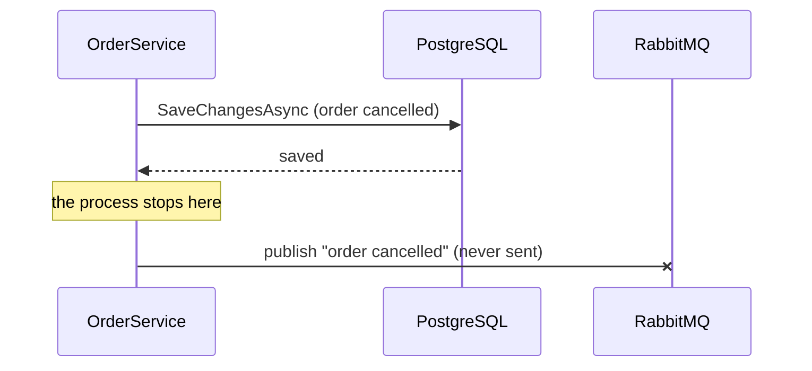

## Bạn cần biết trước

- [[backend.l3.exchanges-and-bindings]] — bạn biết rằng `DonHang.Api` gửi mỗi message tới exchange `donhang.orders`, và RabbitMQ chuyển nó tới các hàng đợi có binding ở đó.
- [[backend.l2.at-least-once-jobs]] — bạn biết rằng một process có thể dừng giữa hai bước, và dù xếp "gửi" và "lưu" theo thứ tự nào thì cũng không có đúng một lần trên cả Mailpit lẫn PostgreSQL.
- [[design.l3.dispatching-domain-events]] — bạn biết rằng các handler chỉ thêm dòng vào `DonHangDbContext` dùng chung, nên một lần lưu sẽ lưu cả thay đổi của đơn lẫn mọi phản ứng, hoặc không lưu gì.
- [[backend.l2.optimistic-concurrency]] — bạn biết rằng khi đơn đã đổi kể từ lúc đọc, lần lưu sẽ ném `DbUpdateConcurrencyException` và không ghi gì.

## Tình huống

Stage-2 sắp xong, và nhóm đang lên kế hoạch cho stage-3. Email về đơn hàng sẽ chuyển sang service riêng, `DonHang.Notifications`, với database riêng, và `DonHang.Api` sẽ nói chuyện với nó qua RabbitMQ. Hôm nay, `notifier.Send(order, "order cancelled")` trong `OrderService` chỉ thêm một dòng bên cạnh đơn. Một đồng nghiệp đề xuất thay dòng đó bằng lệnh publish lên RabbitMQ. Với dispatcher của stage-3, lệnh publish đó sẽ nằm trong một handler, mà handler cũng chạy trước `SaveChangesAsync`.

Bạn mở `CancelOrderAsync` để quyết định đặt lệnh publish ở đâu: sau `SaveChangesAsync`, trước nó, hay trong một giao dịch bao quanh cả hai.

Đặt lệnh publish ở đâu để thay đổi của đơn và message của nó luôn cùng còn, hoặc cùng mất?

## Khái niệm cốt lõi

- **dual write** (một thao tác phải ghi vào hai hệ thống, như database và message broker, mà không transaction nào bao cả hai) — một thao tác phải ghi vào hai hệ thống tách biệt, như PostgreSQL và RabbitMQ, trong khi hệ thống không có giao dịch nào bao được cả hai lần ghi.
- `SaveChangesAsync` — lệnh EF Core gửi mọi thay đổi đang được theo dõi xuống PostgreSQL. EF Core áp dụng các thay đổi của một lần gọi trong một giao dịch database.
- khoảng hở — khoảnh khắc giữa hai lần ghi của một dual write, khi một hệ thống đã có thay đổi còn hệ thống kia thì chưa.

## Cơ chế hoạt động



Trong tình huống trên, hủy một đơn giờ phải ghi vào hai hệ thống. PostgreSQL lưu trạng thái mới, còn RabbitMQ phải nhận message cho Notifications. Đó là một dual write. Giao dịch của PostgreSQL chỉ bao các dòng của chính PostgreSQL. RabbitMQ là một server khác, giữ message của riêng nó, và trong Đơn Hàng không có gì gộp hai bên vào một giao dịch. Cả ba chỗ đặt lệnh publish đều để lại một khoảng hở.

Publish sau `SaveChangesAsync`. Lần lưu thành công, rồi process dừng trước khi publish, chẳng hạn vì crash hoặc bị kill. Đơn đã bị hủy trong database, còn message chưa từng tồn tại ở đâu ngoài bộ nhớ của process. Không có gì ghi lại rằng vẫn còn nợ một message, nên không email nào được gửi.

Publish trước `SaveChangesAsync`. Giờ một message có thể báo một thay đổi không bao giờ được lưu. Hai nhân viên cùng lúc giao và hủy một đơn. Cả hai request đều đọc đơn khi nó còn đang chờ giao. Lệnh giao lưu trước, nên lần lưu của lệnh hủy ném `DbUpdateConcurrencyException` và không ghi gì. Nhưng message của nó đã nằm trong RabbitMQ, và khách đọc "order cancelled" về một đơn đang trên đường tới.

Publish trong một giao dịch bạn tự mở bao quanh cả hai: mở giao dịch, lưu, publish, rồi kết thúc giao dịch. Nếu bước kết thúc thất bại, chẳng hạn vì mất kết nối tới PostgreSQL, PostgreSQL rollback thay đổi của đơn. RabbitMQ không hề tham gia, nên vẫn giữ message nó đã nhận. Dời lệnh publish ra sau khi giao dịch kết thúc thì chỉ đưa khoảng hở đầu tiên quay lại.

## Trong hệ thống Đơn Hàng

Dòng mà đồng nghiệp muốn thay, trong `DonHang.Domain/OrderService.cs`:

```csharp file=DonHang.Domain/OrderService.cs tag=stage-2 lines=36-49
    // lesson: design.l2.domain-model
    // Find, let the order decide, notify, save. An order that is already
    // cancelled or shipped makes order.Cancel() throw OrderStatusException.
    // The notification is saved with the order, by the same SaveChangesAsync.
    public async Task<Order> CancelOrderAsync(int orderId)
    {
        var order = await repository.FindAsync(orderId)
            ?? throw new KeyNotFoundException($"order {orderId} not found");

        order.Cancel();
        notifier.Send(order, "order cancelled");
        await repository.SaveChangesAsync();
        return order;
    }
```

Dòng 46 là lời gọi cần thay. Hôm nay tự nó không ghi gì. Dòng 47 chạy một `SaveChangesAsync`, nên trạng thái mới và job email được lưu cùng nhau hoặc không lưu gì, đúng như comment ở dòng 39 nói. Nếu dòng 47 ném `DbUpdateConcurrencyException`, middleware trả `409`, và không dòng nào được lưu. Chính tính chất được cả hoặc không gì đó sẽ mất nếu đặt lệnh publish vào chỗ dòng 46.

`notifier.Send` làm gì ở stage-2, trong `DonHang.Infrastructure/QueuedNotifier.cs`:

```csharp file=DonHang.Infrastructure/QueuedNotifier.cs tag=stage-2 lines=5-24
// lesson: backend.l2.database-job-queue
// Sends nothing itself: it adds a pending notifications row to the same
// DbContext the order is in and leaves the saving to OrderService.
// NotificationSender (DonHang.Api/Jobs) picks the row up a few seconds later.
public sealed class QueuedNotifier(DonHangDbContext db) : INotifier
{
    public void Send(Order order, string subject)
    {
        var now = DateTimeOffset.UtcNow;
        db.Notifications.Add(new Notification
        {
            Order = order, // EF Core fills in order_id when it saves both
            Channel = "email",
            Subject = subject,
            Status = "pending",
            CreatedAt = now,
            NextAttemptAt = now,
        });
    }
}
```

Dòng 14 thêm một dòng `notifications` vào chính `DonHangDbContext` đang giữ đơn, và class này không lưu gì. Vì vậy stage-2 không có dual write: job email chỉ là thêm một dòng trong cùng database. Sang stage-3, job email nằm trong `DonHang.Notifications`, trong database riêng `donhang_notifications` mà `DonHang.Api` không kết nối tới. Message khởi động job đó phải tới được RabbitMQ, một hệ thống thứ hai, và dual write xuất hiện từ đây.

## Senior hay nhầm rằng…

- **"Publish ngay sau `SaveChangesAsync` là an toàn, vì lúc đó đơn đã được lưu rồi."** → Thực ra đơn đã lưu mới chính là vấn đề: database đã có thay đổi, còn message chỉ nằm trong bộ nhớ của process cho tới khi RabbitMQ nhận. Process dừng giữa chừng là message mất hẳn, vì không có gì được lưu để nói rằng còn nợ một message. Bạn sẽ nhận ra khi một khách có đơn hiện trạng thái đã hủy báo rằng không nhận được email, và API bị crash hoặc bị kill quanh thời điểm đó.
- **"Bọc lệnh publish trong `try`/`catch` là đủ: publish lỗi thì thử lại."** → Thực ra khối `catch` chỉ chạy khi process còn sống. Process dừng giữa lần lưu và lệnh publish thì bỏ qua nó luôn, còn vòng thử lại giữ trong bộ nhớ thì kết thúc cùng process. Bạn sẽ nhận ra khi các email bị thiếu trùng với những lần API crash, chứ không trùng với lỗi RabbitMQ trong log của nó.
- **"Nếu publish chạy bên trong giao dịch database, rollback sẽ hủy luôn message."** → Thực ra rollback chỉ thuộc về PostgreSQL. RabbitMQ chưa bao giờ tham gia giao dịch đó và vẫn giữ những gì nó đã nhận. Bạn sẽ nhận ra khi Notifications gửi email "order cancelled" cho một đơn mà lệnh hủy đã thất bại và đơn vẫn chưa bị hủy.

## Thử ngay (3 phút)

Ở thư mục gốc của repo ví dụ:

1. Chạy `git grep -n SaveChangesAsync stage-2 -- DonHang.Domain/OrderService.cs`.
2. Chạy `git show stage-2:DonHang.Domain/OrderService.cs` và đọc `PlaceOrderAsync` (dòng 15–34). Dòng 19 tìm một đơn trước đó có cùng key. Hãy hình dung dòng 31 thành lệnh publish "order placed", vẫn nằm trước `SaveChangesAsync` ở dòng 32. Một client gửi `POST /api/v1/orders` hai lần cùng lúc với cùng `Idempotency-Key`. Bảng `orders` có unique index trên `idempotency_key`: PostgreSQL từ chối dòng thứ hai có cùng key, và middleware trả `409` cho lần lưu thất bại đó. Với từng request, hãy xác định: có đơn nào được lưu không, và có message nào được publish không?

Kết quả mong đợi: bước 1 in ra năm dòng, số 30, 32, 39, 47 và 59. Dòng 32, 47 và 59 là các lời gọi, còn dòng 30 và 39 là comment. Mỗi use case ghi mọi thứ qua đúng một lời gọi. Ở bước 2, một request lưu được đơn và request kia nhận `409`. Hãy đối chiếu phần message với đáp án bên dưới.

<details><summary>Gợi ý đáp án</summary>

Cả hai request đều không tìm thấy đơn nào trước đó ở dòng 19, và cả hai đều tới dòng 31, nên cả hai đều publish. Sau đó cả hai cùng thử insert. Unique index chỉ cho `INSERT` đầu tiên đi qua, lần lưu thứ hai thất bại với `409`. Kết quả là một đơn được lưu và có hai message "order placed", trong đó một message nói về một đơn chưa từng được lưu. Dời lệnh publish ra sau dòng 32 thì request thất bại không publish nữa, nhưng lại đưa khoảng hở kia quay lại: process dừng ngay sau lần lưu là mất message duy nhất.

</details>

## Liên hệ

- [[backend.l3.outbox-pattern]] — cách sửa vấn đề của bài này: message được lưu trong cùng giao dịch với đơn, rồi publish sau.
- [[design.l3.dispatching-domain-events]] — nơi lệnh publish sẽ nằm ở stage-3: các handler ở đó chạy trước `SaveChangesAsync`, nên publish trong một handler chính là trường hợp "publish trước".
- [[backend.l2.at-least-once-jobs]] — cùng kiểu khoảng hở, ở một bước sau đó: giữa lúc gửi email và lúc lưu `sent`.
- [[backend.l2.optimistic-concurrency]] — nguồn gốc của lần lưu thất bại khiến lệnh publish sớm báo một thay đổi chưa từng xảy ra.
- [[foundation.l1.transaction-intro]] — bảo đảm mà dual write đánh mất: hoặc mọi thay đổi, hoặc không thay đổi nào.
- [[backend.l2.transactions-in-practice]] — giao dịch hoạt động thế nào bên trong PostgreSQL, hệ thống duy nhất mà chúng bao được ở đây.

## Tóm tắt 5 dòng

1. Đổi một đơn rồi publish message của nó là một dual write vào PostgreSQL và RabbitMQ, và trong Đơn Hàng không có gì đặt cả hai vào một giao dịch.
2. Ở stage-2, job email là một dòng trong cùng database, nên một `SaveChangesAsync` giữ cả hai hoặc mất cả hai.
3. Publish sau khi lưu thì mất message nếu process dừng giữa chừng: đơn đã lưu mà không email nào được gửi.
4. Publish trước khi lưu có thể báo một thay đổi không bao giờ được lưu, như một lệnh hủy thất bại vì xung đột concurrency.
5. Publish bên trong giao dịch database cũng không giúp gì, vì rollback không lấy lại được message RabbitMQ đã nhận.
