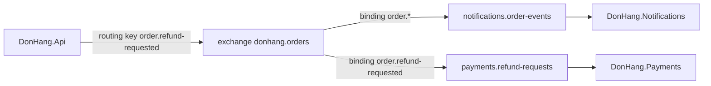

## Before you start

- [[backend.l3.message-broker]] — you know that RabbitMQ keeps messages in a queue, `notifications.order-events`, until the Notifications service takes them.
- [[design.l3.domain-events]] — you know that a domain event such as `OrderCancelled` records what happened and names no reaction.
- [[design.l2.observer-pattern]] — you know that with the Observer pattern a subject calls every subscriber without knowing what each one does.

## The situation

It is stage-3, and refunds have arrived. When a customer asks for a refund, `DonHang.Api` must tell two services at once. Notifications emails the customer "refund requested", and `DonHang.Payments`, the new refunds service, starts paying the money back. Each service reads its own queue: `notifications.order-events` and `payments.refund-requests`.

So far you have pictured the API putting each message into Notifications' queue. If it worked that way, the API would now have to know both queues, and every future service that cares about orders would mean another change to the API.

How can one message from the API reach every service that wants it, while the API names none of their queues?

## Core concepts

- **exchange (RabbitMQ)** — the named place in RabbitMQ that a publisher sends messages to; it keeps none of them and passes a copy of each to the queues whose bindings match. The API publishes to `donhang.orders`, a topic exchange: it reads a routing key as words separated by dots and matches binding patterns word by word.
- **routing key** — a short string the publisher attaches to each message, such as `order.placed`, which the exchange compares with its bindings.
- **binding (RabbitMQ)** — a rule linking one queue to one exchange with a pattern, saying which routing keys the queue receives; `notifications.order-events` is bound to `donhang.orders` with `order.*`.
- **publish/subscribe** — a way of sending messages in which the sender does not know the receivers and every subscriber gets its own copy; in RabbitMQ, a service subscribes by binding its own queue.

## How it works



In the situation above, the API publishes one message about a refund request. It sends it to the exchange `donhang.orders` with the routing key `order.refund-requested`, and names no queue. A publisher never writes into a queue directly; the exchange decides where the message goes.

The exchange holds two bindings: `notifications.order-events` with `order.*`, and `payments.refund-requests` with `order.refund-requested`. `donhang.orders` is a topic exchange. In a pattern, `*` stands for exactly one word and `#` for zero or more words. `order.*` therefore matches `order.placed`, `order.cancelled` and `order.shipped`, but not `order` alone or `order.placed.again`. A pattern with no `*` or `#` matches only the identical key.

Both bindings match `order.refund-requested`, so each queue receives its own copy. Notifications emails the customer and Payments starts the refund; neither takes the message away from the other. An `order.placed` message matches only the first binding, so only Notifications gets it.

This is publish/subscribe. When a third service wants order events, it declares its own queue and binds it to `donhang.orders` with the pattern it needs. Nothing in `DonHang.Api` changes, because the API never knew the queues.

The binding has to exist first. By default, an exchange drops a message that no binding matches; nothing keeps it for a queue that appears later. Each Đơn Hàng service therefore declares its queue and binding as soon as it connects, before it reads. Declaring creates each one if it is missing and changes nothing if it already exists with the same settings.

## In the Đơn Hàng system

The receiving side declares its own binding, in `DonHang.Notifications/RabbitMqTopology.cs`:

```csharp file=DonHang.Notifications/RabbitMqTopology.cs tag=stage-3 lines=11-27
    public const string OrdersExchange = "donhang.orders";
    public const string Queue = "notifications.order-events";
    public const string DeadLetterExchange = "notifications.dead-letter";
    public const string DeadLetterQueue = "notifications.order-events.dead";

    public static async Task DeclareAsync(IChannel channel, CancellationToken cancellationToken)
    {
        // lesson: backend.l3.exchanges-and-bindings
        // DonHang.Api publishes to the topic exchange donhang.orders. Binding
        // this queue with order.* gives it a copy of every message whose
        // routing key is `order.` and one more word: order.placed,
        // order.cancelled, order.refunded... Durable: both survive a restart.
        await channel.ExchangeDeclareAsync(OrdersExchange, ExchangeType.Topic, durable: true,
            cancellationToken: cancellationToken);
        await channel.QueueDeclareAsync(Queue, durable: true, exclusive: false, autoDelete: false,
            arguments: QueueArguments(), cancellationToken: cancellationToken);
        await channel.QueueBindAsync(Queue, OrdersExchange, "order.*", cancellationToken: cancellationToken);
```

Lines 11–12 name the exchange and the queue. `channel` is the object the service sends its RabbitMQ commands through, over its connection; here you can read `channel.` as "ask RabbitMQ to". Line 23 declares `donhang.orders` as a topic exchange, and line 25 declares the queue. The queue's other flags, its arguments on line 26 and lines 13–14 belong to later lessons. Line 27 is the binding: this queue, that exchange, the pattern `order.*`.

`OrderEventsConsumer`, outside this excerpt, calls `DeclareAsync` each time it connects, before it starts reading. `DonHang.Payments` has its own `RabbitMqTopology.cs`, which binds `payments.refund-requests` with `order.refund-requested`.

The sending side, in `DonHang.Messaging/RabbitMqPublisher.cs`:

```csharp file=DonHang.Messaging/RabbitMqPublisher.cs tag=stage-3 lines=14-38
    // lesson: backend.l3.exchanges-and-bindings
    // lesson: backend.l3.outbox-relay
    // The message goes to the exchange with its routing key, never to a queue:
    // the exchange's bindings decide which queues get a copy. Persistent asks
    // RabbitMQ to write it to disk in a durable queue. With publisher confirms
    // on, this call returns only once RabbitMQ has taken responsibility for the
    // message, and throws if RabbitMQ refuses it or the connection drops first.
    public async Task PublishAsync(OutboxMessage message, CancellationToken cancellationToken)
    {
        var open = await OpenChannelAsync(cancellationToken);
        var properties = new BasicProperties
        {
            MessageId = message.Id.ToString(),
            ContentType = "application/json",
            Persistent = true,
        };
        // lesson: backend.l3.tracing-through-the-outbox
        // The relay's publish span is current here; its traceparent travels in
        // the message headers. Without one (no tracing), the row's own goes.
        var traceParent = MessageTracing.CurrentTraceParent() ?? message.TraceParent;
        if (traceParent is not null)
            properties.Headers = new Dictionary<string, object?> { [MessageTracing.TraceParentHeader] = traceParent };
        await open.BasicPublishAsync(exchange, message.RoutingKey, mandatory: false, properties,
            Encoding.UTF8.GetBytes(message.Body), cancellationToken);
    }
```

Look at line 36: `BasicPublishAsync` takes an exchange and a routing key, and no queue. The `exchange` comes from the class's constructor; `DonHang.Api/Program.cs`, outside this excerpt, sets it to `donhang.orders`. `mandatory: false` tells RabbitMQ not to hand back a message that matches no binding.

The routing key travels with each message. It is chosen by `NotifyCustomerOnOrderEvents` in `DonHang.Domain`, the class that turns each recorded domain event into a message to publish and names the key after the event: `OrderPlaced` becomes `order.placed`. How that message then reaches `PublishAsync` belongs to later lessons. Lines 16–17 restate this lesson; the rest of the comment and lines 23–35 (the channel, the message properties, the trace header) belong to later lessons.

## Seniors often assume…

- **"The API sends each message straight into the Notifications service's queue."** → Actually it publishes to `donhang.orders` with a routing key, and the binding of `notifications.order-events` decides that the queue gets a copy. The API's code names the exchange, never the queue. You notice this when you search `DonHang.Api` and `DonHang.Messaging` for `notifications.order-events` and find nothing.
- **"When two queues are bound to the same exchange, they share its messages, each getting about half."** → Actually every queue whose binding matches receives its own full copy, and a queue whose binding does not match receives nothing. Two bindings never split one stream between them. You notice this when one refund request produces both a "refund requested" email to the customer and a refund in Payments.
- **"If no queue is bound yet, RabbitMQ keeps the message until one is."** → Actually an exchange stores nothing: a message that matches no binding is dropped, and with `mandatory: false` the publisher is not told. Only a queue keeps messages, and only those routed to it after its binding exists. You notice this when a service binds a new queue and it starts empty, without the events published before it.

## Try it (3 minutes)

With the lab running (`scripts/up.sh`), in the root folder of the example repository:

1. Run `scripts/backend/rabbitmq-topology.sh`. It lists the exchanges, queues and bindings, then publishes test messages to a throwaway topic exchange whose only queue is bound with `order.*`, and finally one message to `donhang.orders` with a key no binding matches. It publishes through RabbitMQ's management HTTP API, which answers each publish with whether any queue received it; `DonHang.Api`, publishing with `mandatory: false`, gets no such answer.
2. Before you read each `routed:` value, compare its routing key with `order.*` yourself.

Expected result: the bindings section shows `donhang.orders --[order.*]--> notifications.order-events` and `donhang.orders --[order.refund-requested]--> payments.refund-requests`. In the demo, `order.placed` and `order.refund-requested` report `routed: true`, while `order`, `order.placed.again` and `invoice.created` report `routed: false`. The last line, on `donhang.orders`, reads `invoice.created -> routed: false`.

## Connections

- [[backend.l3.message-broker]] — the step before: the queue that lesson watched is filled through the exchange and binding described here.
- [[design.l2.observer-pattern]] — the same idea between processes: Observer calls each subscriber in turn, while publish/subscribe gives each subscriber's queue its own copy.
- [[design.l3.domain-events]] — the source of the routing keys: each key names a domain event, such as `OrderPlaced` and `order.placed`.
- [[design.l3.context-map]] — a binding is a downstream context choosing which of the upstream context's events it receives.
- [[backend.l3.dual-write]] — the next problem: making sure the message is published at all once the order is saved.
- [[backend.l3.consumer-acknowledgements]] — what happens after routing: how a service takes messages off its queue.

## Five-line summary

1. A publisher sends each message to an exchange with a routing key, and the exchange's bindings decide which queues receive a copy.
2. At stage-3 `notifications.order-events` is bound to the topic exchange `donhang.orders` with the pattern `order.*`.
3. In a topic pattern, `*` matches exactly one dot-separated word and `#` zero or more, so `order.*` matches `order.placed`.
4. Every queue whose binding matches gets its own copy, so a new service subscribes by binding its own queue, without changing `DonHang.Api`.
5. An exchange drops a message that no binding matches, so a queue must be bound before the messages it needs are published.
