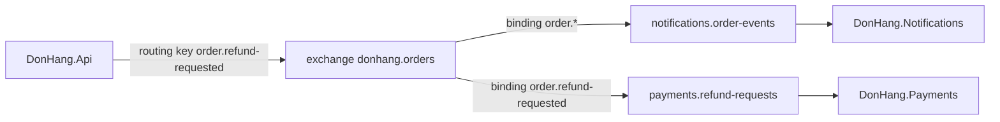

## Bạn cần biết trước

- [[backend.l3.message-broker]] — bạn biết rằng RabbitMQ giữ message trong một hàng đợi, `notifications.order-events`, cho tới khi service Notifications lấy đi.
- [[design.l3.domain-events]] — bạn biết rằng một domain event như `OrderCancelled` ghi lại chuyện đã xảy ra và không nêu phản ứng nào.
- [[design.l2.observer-pattern]] — bạn biết rằng với Observer pattern, subject gọi từng bên đăng ký mà không cần biết mỗi bên làm gì.

## Tình huống

Giờ là stage-3, và tính năng hoàn tiền đã tới. Khi khách yêu cầu hoàn tiền, `DonHang.Api` phải báo cho hai service cùng lúc. Notifications gửi email "refund requested" cho khách, còn `DonHang.Payments`, service hoàn tiền mới, bắt đầu trả tiền lại. Mỗi service đọc hàng đợi của riêng nó: `notifications.order-events` và `payments.refund-requests`.

Tới giờ, bạn vẫn hình dung API đặt từng message vào hàng đợi của Notifications. Nếu đúng là như vậy, API giờ phải biết cả hai hàng đợi, và mỗi service sau này quan tâm tới đơn hàng lại kéo theo một lần sửa API.

Làm sao một message từ API tới được mọi service muốn nhận nó, trong khi API không nêu tên hàng đợi nào của chúng?

## Khái niệm cốt lõi

- **exchange (RabbitMQ)** (nơi publisher gửi message tới trong RabbitMQ, nó chép message sang các queue có binding khớp) — chỗ có tên trong RabbitMQ mà bên gửi gửi message tới. Exchange không giữ lại message nào, chỉ chuyển một bản của mỗi message tới các hàng đợi có binding khớp. API gửi tới `donhang.orders`, một topic exchange: nó đọc routing key thành các từ ngăn bởi dấu chấm và so với mẫu của binding theo từng từ.
- **routing key** (chuỗi publisher gắn vào message, được exchange so với binding để chọn queue, như `order.placed`) — một chuỗi ngắn bên gửi gắn vào mỗi message, chẳng hạn `order.placed`, để exchange so với các binding của nó.
- **binding (RabbitMQ)** (quy tắc nối một queue với một exchange, cho biết queue nhận những message nào) — một quy tắc nối một hàng đợi với một exchange bằng một mẫu, cho biết hàng đợi nhận những routing key nào. `notifications.order-events` được nối với `donhang.orders` bằng mẫu `order.*`.
- **publish/subscribe** (cách gửi message mà bên gửi không biết ai nhận, mỗi bên đăng ký nhận được một bản riêng) — cách gửi message trong đó bên gửi không biết những ai nhận, và mỗi bên đăng ký nhận được bản riêng của mình. Trong RabbitMQ, một service đăng ký bằng cách tạo binding cho hàng đợi của chính nó.

## Cơ chế hoạt động



Trong tình huống trên, API gửi đi một message về một yêu cầu hoàn tiền. API gửi message tới exchange `donhang.orders` với routing key `order.refund-requested`, và không nêu tên hàng đợi nào. Bên gửi không bao giờ ghi thẳng vào hàng đợi. Exchange mới là bên quyết định message đi đâu.

Exchange giữ hai binding: `notifications.order-events` với `order.*`, và `payments.refund-requests` với `order.refund-requested`. `donhang.orders` là một topic exchange. Trong mẫu, `*` thay cho đúng một từ, còn `#` thay cho không hoặc nhiều từ. Vì vậy `order.*` khớp với `order.placed`, `order.cancelled` và `order.shipped`, nhưng không khớp với `order` đứng một mình hay `order.placed.again`. Một mẫu không có `*` hay `#` chỉ khớp với đúng key y hệt nó.

Cả hai binding đều khớp với `order.refund-requested`, nên mỗi hàng đợi nhận một bản riêng. Notifications gửi email cho khách, Payments bắt đầu hoàn tiền, và không bên nào lấy mất message của bên kia. Một message `order.placed` chỉ khớp binding đầu tiên, nên chỉ Notifications nhận được.

Đây là publish/subscribe. Khi một service thứ ba muốn nhận message về đơn hàng, service đó khai báo hàng đợi riêng và tạo binding nối hàng đợi ấy với `donhang.orders`, với mẫu nó cần. Trong `DonHang.Api` không có gì phải đổi, vì API chưa bao giờ biết các hàng đợi.

Binding phải có trước. Mặc định, exchange bỏ đi message không khớp binding nào, và không có gì giữ message đó lại cho một hàng đợi xuất hiện sau. Vì vậy mỗi service của Đơn Hàng khai báo hàng đợi và binding của mình ngay khi kết nối, trước khi đọc. Lệnh khai báo tạo mỗi thứ nếu chưa có, và không đổi gì nếu thứ đó đã tồn tại với cùng thiết lập.

## Trong hệ thống Đơn Hàng

Phía nhận tự khai báo binding của mình, trong `DonHang.Notifications/RabbitMqTopology.cs`:

```csharp file=DonHang.Notifications/RabbitMqTopology.cs tag=stage-3 lines=11-27
    public const string OrdersExchange = "donhang.orders";
    public const string Queue = "notifications.order-events";
    public const string DeadLetterExchange = "notifications.dead-letter";
    public const string DeadLetterQueue = "notifications.order-events.dead";

    public static async Task DeclareAsync(IChannel channel, CancellationToken cancellationToken)
    {
        // lesson: backend.l3.exchanges-and-bindings
        // DonHang.Api publishes to the topic exchange donhang.orders. Binding
        // this queue with order.* gives it a copy of every message whose
        // routing key is `order.` and one more word: order.placed,
        // order.cancelled, order.refunded... Durable: both survive a restart.
        await channel.ExchangeDeclareAsync(OrdersExchange, ExchangeType.Topic, durable: true,
            cancellationToken: cancellationToken);
        await channel.QueueDeclareAsync(Queue, durable: true, exclusive: false, autoDelete: false,
            arguments: QueueArguments(), cancellationToken: cancellationToken);
        await channel.QueueBindAsync(Queue, OrdersExchange, "order.*", cancellationToken: cancellationToken);
```

Dòng 11–12 đặt tên exchange và hàng đợi. `channel` là đối tượng mà service gửi các lệnh RabbitMQ qua đó, trên kết nối của nó. Ở đây bạn có thể đọc `channel.` là "nhờ RabbitMQ". Dòng 23 khai báo `donhang.orders` là một topic exchange, và dòng 25 khai báo hàng đợi. Các cờ khác của hàng đợi, các argument ở dòng 26 và dòng 13–14 thuộc về các bài sau. Dòng 27 là binding: hàng đợi này, exchange kia, mẫu `order.*`.

`OrderEventsConsumer`, nằm ngoài đoạn trích này, gọi `DeclareAsync` mỗi lần kết nối, trước khi bắt đầu đọc. `DonHang.Payments` có `RabbitMqTopology.cs` riêng, nơi binding nối `payments.refund-requests` với mẫu `order.refund-requested`.

Phía gửi, trong `DonHang.Messaging/RabbitMqPublisher.cs`:

```csharp file=DonHang.Messaging/RabbitMqPublisher.cs tag=stage-3 lines=14-38
    // lesson: backend.l3.exchanges-and-bindings
    // lesson: backend.l3.outbox-relay
    // The message goes to the exchange with its routing key, never to a queue:
    // the exchange's bindings decide which queues get a copy. Persistent asks
    // RabbitMQ to write it to disk in a durable queue. With publisher confirms
    // on, this call returns only once RabbitMQ has taken responsibility for the
    // message, and throws if RabbitMQ refuses it or the connection drops first.
    public async Task PublishAsync(OutboxMessage message, CancellationToken cancellationToken)
    {
        var open = await OpenChannelAsync(cancellationToken);
        var properties = new BasicProperties
        {
            MessageId = message.Id.ToString(),
            ContentType = "application/json",
            Persistent = true,
        };
        // lesson: backend.l3.tracing-through-the-outbox
        // The relay's publish span is current here; its traceparent travels in
        // the message headers. Without one (no tracing), the row's own goes.
        var traceParent = MessageTracing.CurrentTraceParent() ?? message.TraceParent;
        if (traceParent is not null)
            properties.Headers = new Dictionary<string, object?> { [MessageTracing.TraceParentHeader] = traceParent };
        await open.BasicPublishAsync(exchange, message.RoutingKey, mandatory: false, properties,
            Encoding.UTF8.GetBytes(message.Body), cancellationToken);
    }
```

Hãy nhìn dòng 36: `BasicPublishAsync` nhận một exchange và một routing key, không nhận hàng đợi nào. `exchange` đến từ constructor của class. `DonHang.Api/Program.cs`, nằm ngoài đoạn trích này, đặt nó là `donhang.orders`. `mandatory: false` bảo RabbitMQ đừng trả lại message không khớp binding nào.

Routing key đi cùng mỗi message. Người chọn nó là `NotifyCustomerOnOrderEvents` trong `DonHang.Domain`, class biến mỗi domain event đã ghi nhận thành một message cần gửi và đặt tên key theo event: `OrderPlaced` thành `order.placed`. Message đó tới `PublishAsync` bằng đường nào là chuyện của các bài sau. Dòng 16–17 nhắc lại nội dung bài này. Phần còn lại của comment và dòng 23–35 (channel, các thuộc tính của message, header trace) thuộc về các bài sau.

## Senior hay nhầm rằng…

- **"API gửi thẳng từng message vào hàng đợi của service Notifications."** → Thực ra API gửi tới `donhang.orders` kèm một routing key, và binding của `notifications.order-events` quyết định hàng đợi đó nhận một bản. Code của API nêu tên exchange, không bao giờ nêu tên hàng đợi. Bạn sẽ nhận ra khi tìm `notifications.order-events` trong `DonHang.Api` và `DonHang.Messaging` mà không thấy gì.
- **"Khi hai hàng đợi cùng nối với một exchange, chúng chia nhau message của exchange, mỗi bên khoảng một nửa."** → Thực ra mỗi hàng đợi có binding khớp nhận một bản đầy đủ của riêng nó, còn hàng đợi có binding không khớp chẳng nhận gì. Hai binding không bao giờ chia đôi một dòng message. Bạn sẽ nhận ra khi một yêu cầu hoàn tiền vừa sinh ra email "refund requested" cho khách, vừa sinh ra một lần hoàn tiền trong Payments.
- **"Nếu chưa có hàng đợi nào có binding, RabbitMQ giữ message lại cho tới khi có."** → Thực ra exchange không lưu gì: message không khớp binding nào bị bỏ đi, và với `mandatory: false` bên gửi không được báo. Chỉ hàng đợi giữ message, và chỉ giữ những message tới nó sau khi binding của nó đã có. Bạn sẽ nhận ra khi một service tạo binding cho một hàng đợi mới và hàng đợi đó bắt đầu trống trơn, không có các event đã gửi trước đó.

## Thử ngay (3 phút)

Khi lab đang chạy (`scripts/up.sh`), ở thư mục gốc của repo ví dụ:

1. Chạy `scripts/backend/rabbitmq-topology.sh`. Script liệt kê các exchange, hàng đợi và binding, rồi gửi vài message thử tới một topic exchange dùng xong bỏ, có hàng đợi duy nhất được nối bằng mẫu `order.*`, và cuối cùng gửi một message tới `donhang.orders` với một key không binding nào khớp. Script gửi qua HTTP API quản lý của RabbitMQ, API này trả lời mỗi lần gửi rằng có hàng đợi nào nhận message hay không. `DonHang.Api` gửi với `mandatory: false`, nên không nhận được câu trả lời như vậy.
2. Trước khi đọc từng giá trị `routed:`, hãy tự so routing key của nó với `order.*`.

Kết quả mong đợi: phần bindings hiện `donhang.orders --[order.*]--> notifications.order-events` và `donhang.orders --[order.refund-requested]--> payments.refund-requests`. Trong phần demo, `order.placed` và `order.refund-requested` báo `routed: true`, còn `order`, `order.placed.again` và `invoice.created` báo `routed: false`. Dòng cuối, trên `donhang.orders`, là `invoice.created -> routed: false`.

## Liên hệ

- [[backend.l3.message-broker]] — bước trước đó: hàng đợi mà bài đó quan sát được đổ message vào qua exchange và binding mô tả ở đây.
- [[design.l2.observer-pattern]] — cùng ý tưởng, nhưng giữa các process: Observer gọi lần lượt từng bên đăng ký, còn publish/subscribe trao cho hàng đợi của mỗi bên đăng ký một bản riêng.
- [[design.l3.domain-events]] — nguồn của các routing key: mỗi key gọi tên một domain event, như `OrderPlaced` và `order.placed`.
- [[design.l3.context-map]] — một binding là cách một context downstream chọn nhận những event nào của context upstream.
- [[backend.l3.dual-write]] — vấn đề tiếp theo: bảo đảm message thực sự được gửi đi khi đơn đã lưu.
- [[backend.l3.consumer-acknowledgements]] — chuyện xảy ra sau khi định tuyến: service lấy message khỏi hàng đợi của nó thế nào.

## Tóm tắt 5 dòng

1. Bên gửi gửi mỗi message tới một exchange kèm routing key, và các binding của exchange quyết định hàng đợi nào nhận một bản.
2. Ở stage-3, `notifications.order-events` được nối với topic exchange `donhang.orders` bằng mẫu `order.*`.
3. Trong mẫu của topic exchange, `*` khớp đúng một từ ngăn bởi dấu chấm, `#` khớp không hoặc nhiều từ, nên `order.*` khớp với `order.placed`.
4. Mỗi hàng đợi có binding khớp nhận một bản riêng, nên service mới đăng ký nhận bằng cách tạo binding cho hàng đợi của chính nó, không cần sửa `DonHang.Api`.
5. Exchange bỏ đi message không khớp binding nào, nên hàng đợi phải có binding trước khi những message nó cần được gửi đi.
