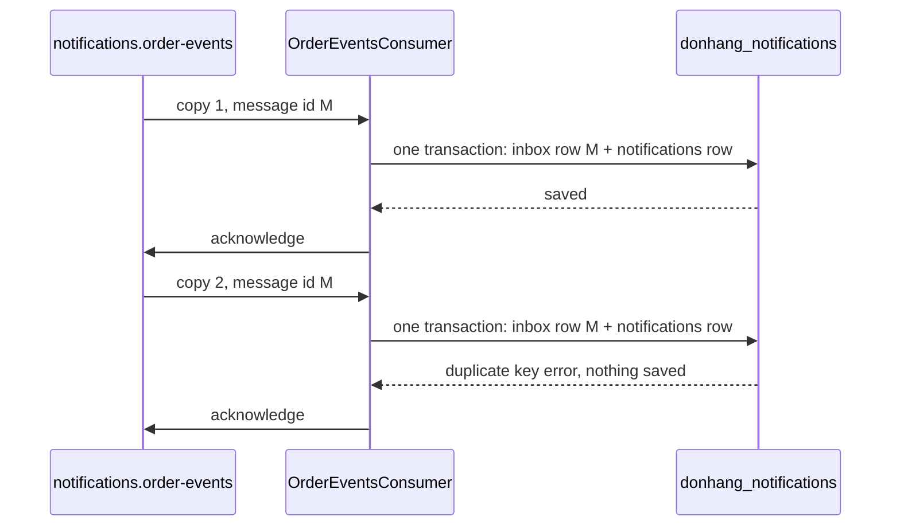

## Before you start

- [[backend.l3.consumer-acknowledgements]] — you know that `OrderEventsConsumer` acknowledges a message only after saving its row, so a crash between the two delivers the message again. From the lesson before it, you also know that the relay sets `published_at` only after RabbitMQ's confirm, so a stop between the two publishes the row again.
- [[backend.l2.idempotent-endpoints]] — you know that a key saved in the same transaction as the order, under a unique index, turns a retried `POST` into one order.
- [[foundation.l1.transaction-intro]] — you know that the changes made in one transaction all survive or all disappear.

## The situation

It is stage-3. Order 2 ships, and `OutboxRelay` publishes its `order.shipped` message. RabbitMQ confirms it, and then the API process stops before the relay records `published_at`. After the restart, the relay publishes the same outbox row again.

`OrderEventsConsumer` now receives two copies of one message. If it simply saved a `pending` email row for every message, it would save two, and `NotificationSender` would send both. The customer would get two "order shipped" emails for one parcel, and no part of the system did anything wrong.

How can the consumer receive the same message twice and still create only one email?

## Core concepts

- **idempotent consumer** — a message consumer that, given a message it has already handled, does not repeat that message's effect; in the situation above, a consumer that turns two copies of `order.shipped` into one email row.
- message id — an identifier carried with each message; `OutboxRelay` sets it to the outbox row's id, so every copy of one row carries the same id.
- **inbox (messaging)** — the receiver's table of the message ids it has handled, saved in the same transaction as the work each message caused; in the `donhang_notifications` database it is `inbox_messages`.
- duplicate key error — PostgreSQL's refusal to save a row whose value for a primary key or unique index is already in the table; here, the primary key of `inbox_messages`.

## How it works



Two things repeat messages in Đơn Hàng. The relay publishes a row again when it stops between RabbitMQ's confirm and its commit. RabbitMQ delivers a message again when the consumer's channel closes between the save and the acknowledgement. Swapping either order would lose messages instead: a relay that recorded `published_at` first and then stopped would never publish the row, and a consumer that acknowledged first and then stopped would never save its row. So the consumer must expect any message more than once.

To spot a repeat, the consumer needs a value that both copies share and no other message has: the message id. Two copies of one outbox row carry the same id; two different events about the same order carry different ids.

In the situation above, the first copy arrives with id M. The consumer adds a row with M to `inbox_messages` and a `pending` row to `notifications`, and saves both in one transaction. `message_id` is the primary key of `inbox_messages`. Then it acknowledges.

The second copy arrives with the same M, and the consumer tries the same two inserts. PostgreSQL refuses the inbox row with a duplicate key error, and the transaction rolls back, so the second `notifications` row is not saved either. The consumer treats that error as "handled before" and acknowledges the copy.

This works because the inbox row and the effect commit together: neither ever exists without the other. A crash before the commit leaves neither, and the next copy is handled normally. If the handled ids were kept in another system, such as Redis, recording the id and saving the email row would be two separate writes, and a crash between them would lose an email or repeat it.

## In the Đơn Hàng system

How `HandleAsync` records the message id, in `DonHang.Notifications/OrderEventsConsumer.cs`:

```csharp file=DonHang.Notifications/OrderEventsConsumer.cs tag=stage-3 lines=89-113
    // lesson: backend.l3.idempotent-consumer
    // The message id, which OutboxRelay copied from the outbox row, goes into
    // inbox_messages in the same SaveChangesAsync as the new notifications
    // row. A repeated message breaks inbox_messages' primary key, so nothing
    // is saved; it was handled before, and the caller acknowledges it.
    public async Task HandleAsync(string? messageId, string routingKey, byte[] body)
    {
        var subject = SubjectFor(routingKey);
        var message = Read(body);
        if (!Guid.TryParse(messageId, out var id)) throw new PoisonMessageException("the message has no id");

        using var scope = scopeFactory.CreateScope();
        var db = scope.ServiceProvider.GetRequiredService<NotificationsDbContext>();
        db.InboxMessages.Add(new InboxMessage { MessageId = id });
        db.Notifications.Add(NewEmail(message, subject));
        try
        {
            await db.SaveChangesAsync();
            logger.LogInformation("Saved the {Subject} email for order {OrderId}", subject, message.OrderId);
        }
        catch (DbUpdateException ex) when (Inbox.IsDuplicate(ex))
        {
            logger.LogInformation("Message {MessageId} was handled before; skipping it", id);
        }
    }
```

Line 98 stops a message that has no usable id; what happens to it belongs to a later lesson of this module. Lines 100–101 take a `NotificationsDbContext` from a new scope for this one message. Lines 102–103 add the two rows, and line 106 saves them with one `SaveChangesAsync`, which EF Core runs as one transaction.

Line 109 catches only the error `Inbox.IsDuplicate` recognises; that method, in `DonHang.Messaging/Inbox.cs` outside the excerpt, checks for the duplicate key error on the `inbox_messages` primary key. Any other failure leaves `HandleAsync` as an exception, as in the previous lesson. After line 111 logs the skip, `HandleAsync` returns normally, so `OnReceivedAsync`, the method that received the delivery, acknowledges the copy.

Where the inbox table is defined, in `DonHang.Notifications/NotificationsDbContext.cs`:

```csharp file=DonHang.Notifications/NotificationsDbContext.cs tag=stage-3 lines=34-45
        // lesson: backend.l3.idempotent-consumer
        // One row per message OrderEventsConsumer has handled. message_id is
        // the primary key, so PostgreSQL refuses a second row for the same
        // message; the consumer saves this row and the notifications row in
        // one SaveChangesAsync, so a repeated message adds neither.
        modelBuilder.Entity<InboxMessage>(e =>
        {
            e.ToTable("inbox_messages");
            e.HasKey(m => m.MessageId);
            e.Property(m => m.MessageId).HasColumnName("message_id");
            e.Property(m => m.HandledAt).HasColumnName("handled_at");
        });
```

Line 42 makes `MessageId` the primary key, and line 43 maps it to the column `message_id`. That key is the whole check: the consumer never reads the table first, it lets PostgreSQL refuse the second insert. The table lives in `donhang_notifications`, the same database as `notifications`, which is what lets one transaction hold both rows.

## Seniors often assume…

- **"RabbitMQ drops duplicate messages, so a consumer never sees the same one twice."** → Actually RabbitMQ does not compare message ids when it routes or queues a message: two publishes are two messages, and a message whose channel closed is delivered again. Spotting repeats is the receiver's job. You notice this when `scripts/backend/duplicate-message.sh` publishes one message id twice and both publishes report `routed: true`.
- **"Skipping a message when its order already has a `notifications` row is enough to stop duplicates."** → Actually one order produces several messages, each with its own email: `SubjectFor`, further down `OrderEventsConsumer.cs`, maps `order.placed`, `order.shipped`, `order.cancelled` and three refund keys to subjects. A check by order would skip the shipping email of every order that already had its "order placed" email. Only the message id tells a copy apart from a different message about the same order. You notice this when shipped orders stop producing `order shipped` rows.
- **"Saving the message id after the email has been sent is just as safe."** → Actually the id and the effect are then two steps, and a crash between sending and saving leaves a sent email with no record; the next copy sends it again. `OrderEventsConsumer` sends nothing itself: it saves the id and a `pending` row in one transaction, and `NotificationSender` sends later. You notice this when a redeploy leaves a customer with two identical emails and a single matching `inbox_messages` row.

## Try it (3 minutes)

With the lab running (`scripts/up.sh`), in the root folder of the example repository:

1. Run `scripts/backend/duplicate-message.sh`. It publishes one `order.shipped` message for order 2 twice, both times with the same message id, straight to RabbitMQ, the way the relay would. Then it lists the email rows created since the first publish and counts the `inbox_messages` rows with that id.
2. Then decide: if `HandleAsync` saved the inbox row with its own `SaveChangesAsync` and the email row with a second one, and the process stopped between the two, what would the next copy of the message do?

Expected result: both publishes print `routed: true`, the email list shows one line, `2 | order shipped`, and the count prints `1`. For step 2, check your answer below.

<details><summary>Suggested answer</summary>

The first save would commit the inbox row; the email row would never be saved, and no acknowledgement would be sent. RabbitMQ would deliver the message again, the consumer would hit the duplicate key error on the inbox row and acknowledge it. The customer would get no email, and `inbox_messages` would claim the message was handled.

</details>

## Connections

- [[backend.l3.consumer-acknowledgements]] — the cause this lesson handles: acknowledging after the save delivers a message again after a crash.
- [[backend.l3.outbox-relay]] — the other source of repeats, and the place where the message id is set from the outbox row.
- [[backend.l2.idempotent-endpoints]] — the same idea one layer up: a key saved with the effect, refused the second time, on the HTTP side.
- [[backend.l2.at-least-once-jobs]] — the step after this one: `NotificationSender` sends first and records `sent` afterwards, so the inbox prevents duplicate rows, not every duplicate send.
- [[backend.l3.dead-letter-queue]] — what happens to a message the consumer can never handle, such as one without an id.

## Five-line summary

1. An idempotent consumer saves each message's id in the same transaction as its effect, so a repeated message changes nothing.
2. The outbox relay and a missing acknowledgement can both repeat a message, so a consumer must expect any message twice.
3. `OutboxRelay` sets the message id to the outbox row's id, so every copy of one message carries the same id.
4. `inbox_messages` uses that id as primary key; a repeat gets a duplicate key error, nothing is saved, and the consumer acknowledges.
5. The check holds only because the inbox row and the effect commit together; an id kept in another system could not.
