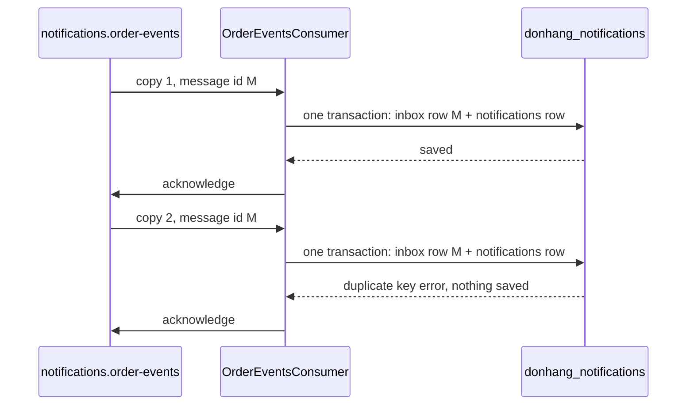

## Bạn cần biết trước

- [[backend.l3.consumer-acknowledgements]] — bạn biết rằng `OrderEventsConsumer` chỉ acknowledge một message sau khi đã lưu dòng của nó, nên crash giữa hai bước sẽ khiến message được giao lại. Từ bài trước đó, bạn cũng biết relay chỉ ghi `published_at` sau khi có xác nhận của RabbitMQ, nên dừng giữa hai bước sẽ khiến dòng đó bị publish lại.
- [[backend.l2.idempotent-endpoints]] — bạn biết rằng một key được lưu cùng giao dịch với đơn, dưới một unique index, biến một `POST` gửi lại thành đúng một đơn.
- [[foundation.l1.transaction-intro]] — bạn biết rằng các thay đổi trong một giao dịch hoặc cùng còn lại, hoặc cùng biến mất.

## Tình huống

Đang ở stage-3. Đơn 2 được giao đi, và `OutboxRelay` publish message `order.shipped` của nó. RabbitMQ xác nhận, rồi process API dừng trước khi relay kịp ghi `published_at`. Sau khi khởi động lại, relay publish chính dòng outbox đó thêm lần nữa.

Giờ `OrderEventsConsumer` nhận hai bản của cùng một message. Nếu với mỗi message nó chỉ đơn giản lưu một dòng email `pending`, nó sẽ lưu hai dòng, và `NotificationSender` sẽ gửi cả hai. Khách hàng nhận hai email "order shipped" cho một kiện hàng, dù không phần nào của hệ thống làm sai.

Làm sao để consumer nhận cùng một message hai lần mà vẫn chỉ tạo một email?

## Khái niệm cốt lõi

- **idempotent consumer** (Consumer nhận lại một message đã xử lý mà không làm lại việc của nó) — message consumer mà khi gặp một message đã xử lý thì không lặp lại tác động của message đó. Trong tình huống trên, đó là consumer biến hai bản `order.shipped` thành một dòng email.
- message id — định danh đi kèm mỗi message. `OutboxRelay` đặt nó bằng id của dòng outbox, nên mọi bản của cùng một dòng đều mang cùng id.
- **inbox (messaging)** (Bảng của bên nhận ghi id các message đã xử lý, lưu cùng transaction với việc message gây ra) — bảng của bên nhận chứa id các message nó đã xử lý, được lưu trong cùng giao dịch với việc mà mỗi message gây ra. Trong database `donhang_notifications`, đó là bảng `inbox_messages`.
- lỗi trùng khóa (duplicate key error) — PostgreSQL từ chối lưu một dòng có giá trị khóa chính hoặc unique index đã có trong bảng. Ở đây là khóa chính của `inbox_messages`.

## Cơ chế hoạt động



Trong Đơn Hàng có hai chỗ làm message bị lặp. Relay publish lại một dòng khi nó dừng giữa xác nhận của RabbitMQ và lúc commit. RabbitMQ giao lại một message khi channel của consumer đóng giữa lúc lưu và lúc acknowledge. Đảo thứ tự ở chỗ nào cũng sẽ làm mất message: relay ghi `published_at` trước rồi dừng thì không bao giờ publish dòng đó, còn consumer acknowledge trước rồi dừng thì không bao giờ lưu dòng của nó. Vì thế consumer phải tính tới chuyện bất kỳ message nào cũng có thể tới nhiều lần.

Để nhận ra một bản lặp, consumer cần một giá trị mà cả hai bản cùng có và không message nào khác có: message id. Hai bản của cùng một dòng outbox mang cùng id. Hai event khác nhau về cùng một đơn mang id khác nhau.

Trong tình huống trên, bản đầu tiên tới với id M. Consumer thêm một dòng chứa M vào `inbox_messages` và một dòng `pending` vào `notifications`, rồi lưu cả hai trong một giao dịch. `message_id` là khóa chính của `inbox_messages`. Sau đó consumer acknowledge.

Bản thứ hai tới với cùng M, và consumer thử đúng hai câu insert đó. PostgreSQL từ chối dòng inbox bằng lỗi trùng khóa, giao dịch bị rollback, nên dòng `notifications` thứ hai cũng không được lưu. Consumer coi lỗi đó là "đã xử lý rồi" và acknowledge bản này.

Cách này đúng vì dòng inbox và tác động của message được commit cùng nhau: không bao giờ có cái này mà thiếu cái kia. Crash trước khi commit thì không còn gì cả, và bản tiếp theo được xử lý như bình thường. Nếu id đã xử lý được giữ ở một hệ thống khác, chẳng hạn Redis, thì ghi id và lưu dòng email sẽ là hai lần ghi riêng, và crash giữa hai lần đó sẽ làm mất một email hoặc lặp nó.

## Trong hệ thống Đơn Hàng

Cách `HandleAsync` ghi lại message id, trong `DonHang.Notifications/OrderEventsConsumer.cs`:

```csharp file=DonHang.Notifications/OrderEventsConsumer.cs tag=stage-3 lines=89-113
    // lesson: backend.l3.idempotent-consumer
    // The message id, which OutboxRelay copied from the outbox row, goes into
    // inbox_messages in the same SaveChangesAsync as the new notifications
    // row. A repeated message breaks inbox_messages' primary key, so nothing
    // is saved; it was handled before, and the caller acknowledges it.
    public async Task HandleAsync(string? messageId, string routingKey, byte[] body)
    {
        var subject = SubjectFor(routingKey);
        var message = Read(body);
        if (!Guid.TryParse(messageId, out var id)) throw new PoisonMessageException("the message has no id");

        using var scope = scopeFactory.CreateScope();
        var db = scope.ServiceProvider.GetRequiredService<NotificationsDbContext>();
        db.InboxMessages.Add(new InboxMessage { MessageId = id });
        db.Notifications.Add(NewEmail(message, subject));
        try
        {
            await db.SaveChangesAsync();
            logger.LogInformation("Saved the {Subject} email for order {OrderId}", subject, message.OrderId);
        }
        catch (DbUpdateException ex) when (Inbox.IsDuplicate(ex))
        {
            logger.LogInformation("Message {MessageId} was handled before; skipping it", id);
        }
    }
```

Dòng 98 chặn message không có id dùng được. Điều gì xảy ra với message đó thuộc về một bài sau của module này. Dòng 100–101 lấy một `NotificationsDbContext` từ một scope mới, riêng cho message này. Dòng 102–103 thêm hai dòng, và dòng 106 lưu cả hai bằng một lần `SaveChangesAsync`, được EF Core chạy trong một giao dịch.

Dòng 109 chỉ bắt lỗi mà `Inbox.IsDuplicate` nhận ra. Method này nằm trong `DonHang.Messaging/Inbox.cs`, ngoài đoạn trích, và kiểm tra xem đó có phải lỗi trùng khóa trên khóa chính của `inbox_messages` không. Mọi lỗi khác đi ra khỏi `HandleAsync` dưới dạng exception, như ở bài trước. Sau khi dòng 111 ghi log việc bỏ qua, `HandleAsync` trả về bình thường, nên `OnReceivedAsync`, method nhận lần giao đó, acknowledge bản này.

Chỗ định nghĩa bảng inbox, trong `DonHang.Notifications/NotificationsDbContext.cs`:

```csharp file=DonHang.Notifications/NotificationsDbContext.cs tag=stage-3 lines=34-45
        // lesson: backend.l3.idempotent-consumer
        // One row per message OrderEventsConsumer has handled. message_id is
        // the primary key, so PostgreSQL refuses a second row for the same
        // message; the consumer saves this row and the notifications row in
        // one SaveChangesAsync, so a repeated message adds neither.
        modelBuilder.Entity<InboxMessage>(e =>
        {
            e.ToTable("inbox_messages");
            e.HasKey(m => m.MessageId);
            e.Property(m => m.MessageId).HasColumnName("message_id");
            e.Property(m => m.HandledAt).HasColumnName("handled_at");
        });
```

Dòng 42 đặt `MessageId` làm khóa chính, và dòng 43 ánh xạ nó sang cột `message_id`. Toàn bộ phần kiểm tra nằm ở khóa đó: consumer không bao giờ đọc bảng trước, nó để PostgreSQL từ chối câu insert thứ hai. Bảng nằm trong `donhang_notifications`, cùng database với `notifications`, nhờ vậy một giao dịch mới giữ được cả hai dòng.

## Senior hay nhầm rằng…

- **"RabbitMQ tự bỏ message trùng, nên consumer không bao giờ thấy cùng một message hai lần."** → Thực ra RabbitMQ không so message id khi route hay xếp message vào hàng đợi: publish hai lần là hai message, và message có channel bị đóng sẽ được giao lại. Nhận ra bản lặp là việc của bên nhận. Bạn sẽ nhận ra khi `scripts/backend/duplicate-message.sh` publish một message id hai lần và cả hai lần đều báo `routed: true`.
- **"Bỏ qua message khi đơn của nó đã có dòng `notifications` là đủ để chặn trùng."** → Thực ra một đơn sinh ra nhiều message, mỗi message có email riêng: `SubjectFor`, nằm phía dưới trong `OrderEventsConsumer.cs`, ánh xạ `order.placed`, `order.shipped`, `order.cancelled` và ba routing key về hoàn tiền sang tiêu đề email. Kiểm tra theo đơn sẽ bỏ qua email giao hàng của mọi đơn đã có email "order placed". Chỉ message id mới phân biệt được một bản lặp với một message khác về cùng đơn. Bạn sẽ nhận ra khi các đơn đã giao không còn sinh ra dòng `order shipped`.
- **"Lưu message id sau khi đã gửi email cũng an toàn y như vậy."** → Thực ra khi đó id và tác động là hai bước, và crash giữa lúc gửi và lúc lưu để lại một email đã gửi mà không có bản ghi nào. Bản tiếp theo sẽ gửi lại email đó. `OrderEventsConsumer` không tự gửi gì: nó lưu id và một dòng `pending` trong một giao dịch, rồi `NotificationSender` gửi sau. Bạn sẽ nhận ra khi một lần deploy lại để một khách hàng nhận hai email giống hệt nhau mà chỉ có một dòng `inbox_messages` tương ứng.

## Thử ngay (3 phút)

Khi lab đang chạy (`scripts/up.sh`), ở thư mục gốc của repo ví dụ:

1. Chạy `scripts/backend/duplicate-message.sh`. Script publish một message `order.shipped` cho đơn 2 hai lần, cả hai lần cùng một message id, thẳng lên RabbitMQ, giống cách relay làm. Sau đó nó liệt kê các dòng email được tạo từ lần publish đầu tiên và đếm số dòng `inbox_messages` có id đó.
2. Rồi hãy xác định: nếu `HandleAsync` lưu dòng inbox bằng một lần `SaveChangesAsync` riêng và dòng email bằng lần thứ hai, và process dừng giữa hai lần đó, thì bản tiếp theo của message sẽ làm gì?

Kết quả mong đợi: cả hai lần publish in ra `routed: true`, danh sách email có một dòng, `2 | order shipped`, và phần đếm in ra `1`. Ở bước 2, hãy đối chiếu với đáp án bên dưới.

<details><summary>Gợi ý đáp án</summary>

Lần lưu đầu sẽ commit dòng inbox. Dòng email không bao giờ được lưu, và không có acknowledgement nào được gửi. RabbitMQ sẽ giao message lại, consumer gặp lỗi trùng khóa ở dòng inbox và acknowledge nó. Khách hàng không nhận được email nào, còn `inbox_messages` lại khẳng định message đã được xử lý.

</details>

## Liên hệ

- [[backend.l3.consumer-acknowledgements]] — nguyên nhân mà bài này xử lý: acknowledge sau khi lưu khiến message được giao lại sau một lần crash.
- [[backend.l3.outbox-relay]] — nguồn lặp còn lại, và là nơi message id được đặt từ dòng outbox.
- [[backend.l2.idempotent-endpoints]] — cùng ý tưởng ở một tầng trên, phía HTTP: một key lưu cùng tác động, bị từ chối ở lần thứ hai.
- [[backend.l2.at-least-once-jobs]] — bước ngay sau bài này: `NotificationSender` gửi trước rồi mới ghi `sent`, nên inbox chặn được dòng trùng chứ không chặn được mọi lần gửi trùng.
- [[backend.l3.dead-letter-queue]] — điều xảy ra với một message mà consumer không bao giờ xử lý được, chẳng hạn message không có id.

## Tóm tắt 5 dòng

1. Idempotent consumer lưu id của mỗi message trong cùng giao dịch với tác động của nó, nên một message lặp lại không thay đổi gì.
2. Outbox relay và một acknowledgement bị thiếu đều có thể làm lặp message, nên consumer phải tính tới chuyện mọi message có thể tới hai lần.
3. `OutboxRelay` đặt message id bằng id của dòng outbox, nên mọi bản của một message đều mang cùng id.
4. `inbox_messages` dùng id đó làm khóa chính: bản lặp gặp lỗi trùng khóa, không gì được lưu, và consumer acknowledge.
5. Phần kiểm tra chỉ đứng vững vì dòng inbox và tác động được commit cùng nhau, còn id giữ ở một hệ thống khác thì không làm được vậy.
