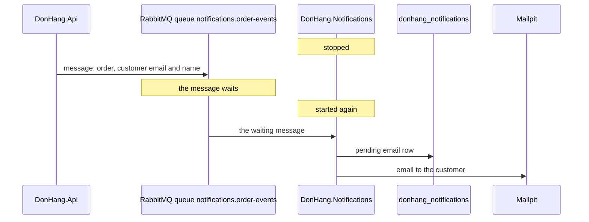

## Before you start

- [[design.l3.before-extracting-a-module]] — you know that a module run as its own service must receive, and keep, the data it used to share.
- [[design.l3.when-to-extract-a-service]] — you know that a split turns method calls into network calls that can be slow or fail.
- [[backend.l2.database-job-queue]] — you know how the stage-2 email job waited as a `pending` row until `NotificationSender` took it.

## The situation

It is stage-3. Order emails are no longer the API's job: `DonHang.Notifications` sends them, as a service of its own with its own database, `donhang_notifications`. `DonHang.Api`'s only database is `donhang`, so it can no longer stage a `pending` row next to the order, the way `QueuedNotifier` did at stage-2.

A teammate suggests the obvious fix: when an order is placed, the API calls Notifications over HTTP and asks it to send the email. You picture the next deploy of Notifications, its container restarting, and a customer placing an order at that moment.

How can the API hand an email to a service that may not be running when the order is placed?

## Core concepts

- **message broker** — a server that accepts messages from one program and keeps them until another program takes them, so the sender does not need the receiver to be running.
- **message queue** — a named place inside a message broker that holds messages until a program takes them; the Notifications service's queue is `notifications.order-events`.
- **RabbitMQ** — the open-source message broker Đơn Hàng uses from stage-3, run as the `rabbitmq` service in Compose.
- message — a small JSON document about one change to an order, such as "order 13 was placed", carrying what the receiver needs to act on it.

## How it works



Read the diagram from top to bottom. At the start, `DonHang.Notifications` is stopped, for a deploy or after a crash.

A customer places an order, and the API answers `201` as usual. Shortly after the order is saved, the API sends a message about it to RabbitMQ: which order, plus the customer's email address and name. The API does not wait for Notifications and does not need to know whether it is running. How the API makes sure a saved order never misses its message is a later lesson.

In the situation above, the message broker is RabbitMQ, and the message queue is `notifications.order-events`, the queue the Notifications service reads. The message waits there while the service is down.

When Notifications starts again, the waiting message reaches it. The service turns it into a `pending` row in its own database, and its `NotificationSender` emails the customer through Mailpit, the same job the API's sender did at stage-2. The email goes out late, but it goes out.

Compare the HTTP call the teammate suggested. The API would wait for Notifications' answer while the customer waits for theirs. If Notifications were slow, placing an order would be slow. If it were down, the API would have to fail the order or give up on the email. With a broker in between, neither side needs the other to be running at the same moment; each only talks to RabbitMQ.

## In the Đơn Hàng system

The broker itself, in `docker-compose.yml`:

```yaml file=docker-compose.yml tag=stage-3 lines=258-279
  # lesson: backend.l3.message-broker
  # The message broker, from stage-3. The api publishes to it; Notifications
  # and Payments consume from it, so none of them needs another to be up.
  # Its data lives in a volume, so durable queues and persistent messages
  # survive `docker compose restart rabbitmq`. The management page, at
  # http://localhost:15672 (user donhang, RABBITMQ_PASSWORD in .env), shows
  # the exchanges, queues and messages.
  # lesson: backend.l3.queue-backlog-metrics
  # The image turns on the rabbitmq_prometheus plugin too: the same numbers
  # for Prometheus, on port 15692, which only the donhang network reaches.
  rabbitmq:
    image: rabbitmq:4.1.8-management-alpine
    container_name: donhang-rabbitmq
    # RabbitMQ names its node, and its data directory, after the hostname.
    hostname: rabbitmq
    environment:
      RABBITMQ_DEFAULT_USER: "donhang"
      RABBITMQ_DEFAULT_PASS: "${RABBITMQ_PASSWORD}"
    volumes:
      - rabbitmq-data:/var/lib/rabbitmq
    ports:
      - "15672:15672"
```

Lines 259–260 name who talks to the broker: the API sends to it; Notifications and Payments, the refunds service of a later lesson, receive from it. Line 269 runs RabbitMQ 4.1 from the `rabbitmq` image, in its `-management` variant. Line 277 keeps its data in the volume `rabbitmq-data`, and the queue and its messages are written there to be kept, so messages waiting in `notifications.order-events` are still there after `docker compose restart rabbitmq`. Line 279 makes the management page reachable on port `15672`, where you can watch the queues and the messages waiting in them; the exchanges it also shows are the next lesson. Lines 265–267 belong to a later lesson, and lines 271–272 are a setup detail; skip both here.

The receiving side, in `DonHang.Notifications/Program.cs`:

```csharp file=DonHang.Notifications/Program.cs tag=stage-3 lines=11-26
// lesson: backend.l3.message-broker
// The Notifications service, on its own from stage-3. Its database is
// donhang_notifications, which no other service opens; it learns about
// orders only from RabbitMQ, so it runs, and keeps sending, whether or not
// DonHang.Api is up, and the api places orders whether or not this is up.
var connectionString = builder.Configuration.GetConnectionString("Default")
    ?? throw new InvalidOperationException("ConnectionStrings:Default is not set");
builder.Services.AddDbContext<NotificationsDbContext>(options => options.UseNpgsql(connectionString));

// lesson: backend.l3.consumer-acknowledgements
// Two hosted services in one process: OrderEventsConsumer turns each message
// into a pending notifications row, and NotificationSender sends those rows
// as emails, exactly as it did inside the api until stage-2.
var rabbitMq = builder.Configuration.GetSection("RabbitMq").Get<RabbitMqSettings>() ?? new RabbitMqSettings();
builder.Services.AddRabbitMq(rabbitMq, clientName: "donhang-notifications");
builder.Services.AddHostedService<OrderEventsConsumer>();
```

Line 18 registers the service's only DbContext, and Compose points it at the database `donhang_notifications`. Lines 13–14 state the consequence: the service learns about orders only from RabbitMQ. Lines 24–25 read the `RabbitMq` settings and register the service's connection to the broker. Line 26 registers `OrderEventsConsumer`, the hosted service that turns each message into a `pending` row; it runs as soon as the service starts. `NotificationSender`, the second hosted service, is registered further down the same file, outside this excerpt.

Since the service cannot read `customers`, each message must carry what the email needs. `NotifyCustomerOnOrderEvents` in `DonHang.Domain`, on the API side and outside these excerpts, puts the customer's email and full name into every message. `OrderMessage` in `DonHang.Notifications` receives them as `CustomerEmail` and `CustomerName`.

## Seniors often assume…

- **"A message broker is just a slower way of calling the other service's API."** → Actually a call needs the other side to answer now, while a message needs only the broker to accept it; the receiver takes it when it can. Placing an order no longer depends on Notifications being up or fast. When the caller needs an answer before it can go on, such as a yes or no that decides the response, a direct call is the right tool, because a one-way message like the order message brings no answer back. You notice the difference when Notifications is redeployed and placing an order still answers `201` the whole time.
- **"If the Notifications service is down when an order is placed, that order's email is lost."** → Actually the message waits in `notifications.order-events` until the service is back, and the email goes out then. You notice this when emails for orders placed while Notifications was stopped appear in Mailpit shortly after it starts again.
- **"The Notifications service can still look up what it needs in Đơn Hàng's database."** → Actually it connects only to `donhang_notifications`; `customers` lives in `donhang`, which belongs to the API. Reading that table would tie the two services together again, and the split would have bought nothing. That is why each message carries the email address and name. You notice it when the email needs a field `OrderMessage` lacks: if the services are to stay apart, the field is added to the message, not read from `donhang`.

## Try it (3 minutes)

With the lab running (`scripts/up.sh`), in the root folder of the example repository:

1. Run `scripts/backend/notifications-down.sh`. It stops `notifications`, places an order as customer 1, counts the messages waiting in `notifications.order-events`, then starts the service again and waits for the email job.
2. Read the output in two halves: before and after the line `notifications is back`.

Expected result: the order answers `-> 201`, then `messages waiting in notifications.order-events: 1` and `email jobs for the new order in donhang_notifications: 0`. After `notifications is back`, the queue shows `0` messages waiting and the last line reads `the new order's email job: sent`.

## Connections

- [[backend.l2.work-outside-the-request]] — the same move one step further: that lesson took the email out of the request, this one takes it out of the process.
- [[design.l3.module-owns-its-tables]] — the same rule between services: Notifications reads only its own tables, so the message must carry the data.
- [[backend.l2.database-job-queue]] — the stage-2 queue inside PostgreSQL; the broker's queue does that job between two services.
- [[backend.l3.exchanges-and-bindings]] — the next step: how a message sent by the API ends up in `notifications.order-events`.
- [[backend.l3.outbox-pattern]] — how the API makes sure a saved order never misses its message.

## Five-line summary

1. A message broker keeps a message in a queue until the receiving service takes it, so the sender never needs the receiver running.
2. At stage-3 `DonHang.Notifications` sends order emails from its own database, `donhang_notifications`, which `DonHang.Api` does not open.
3. Calling Notifications over HTTP would make placing an order fail or wait whenever Notifications is down or slow.
4. With `notifications` stopped, an order still answers `201`, and its message waits in `notifications.order-events` until the service is back.
5. Each message carries the customer's email address and name, because Notifications no longer reads the `customers` table.
