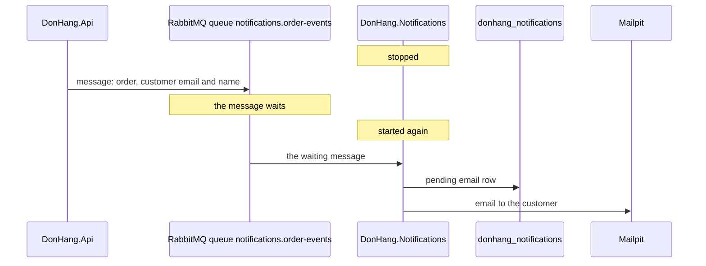

## Bạn cần biết trước

- [[design.l3.before-extracting-a-module]] — bạn biết rằng một module chạy thành service riêng phải được nhận, và tự giữ, phần dữ liệu trước đây nó dùng chung.
- [[design.l3.when-to-extract-a-service]] — bạn biết rằng tách ra sẽ biến lời gọi method thành lời gọi qua mạng, thứ có thể chậm hoặc hỏng.
- [[backend.l2.database-job-queue]] — bạn biết job email ở stage-2 nằm chờ thành một dòng `pending` cho tới khi `NotificationSender` lấy nó.

## Tình huống

Giờ là stage-3. Email đơn hàng không còn là việc của API nữa: `DonHang.Notifications` gửi chúng, như một service riêng với database riêng là `donhang_notifications`. Database duy nhất của `DonHang.Api` là `donhang`, nên API không thể đặt sẵn một dòng `pending` cạnh đơn như `QueuedNotifier` từng làm ở stage-2.

Một đồng nghiệp đề xuất cách sửa hiển nhiên: khi có đơn mới, API gọi Notifications qua HTTP và nhờ nó gửi email. Bạn hình dung lần deploy tới của Notifications, container của nó đang khởi động lại, và đúng lúc đó một khách đặt đơn.

Làm sao API giao được một email cho một service có thể đang không chạy lúc đơn được đặt?

## Khái niệm cốt lõi

- **message broker** (server nhận message từ một chương trình và giữ chúng cho tới khi chương trình khác lấy đi) — một server nhận message từ chương trình này và giữ lại cho tới khi chương trình kia lấy, nên bên gửi không cần bên nhận đang chạy.
- **hàng đợi message** (message queue) — một chỗ có tên bên trong message broker, giữ message cho tới khi có chương trình lấy đi. Hàng đợi của service Notifications là `notifications.order-events`.
- **RabbitMQ** (message broker mã nguồn mở mà Đơn Hàng dùng từ stage-3 để các service gửi message cho nhau) — message broker mã nguồn mở Đơn Hàng dùng từ stage-3, chạy thành service `rabbitmq` trong Compose.
- message — một văn bản JSON nhỏ về một thay đổi của một đơn, kiểu "đơn 13 vừa được đặt", mang đủ những gì bên nhận cần để xử lý.

## Cơ chế hoạt động



Đọc sơ đồ từ trên xuống. Lúc đầu, `DonHang.Notifications` đang dừng, vì đang deploy hoặc vừa sập.

Một khách đặt đơn, và API vẫn trả `201` như thường. Ngay sau khi đơn được lưu, API gửi một message về đơn đó tới RabbitMQ: đơn nào, kèm địa chỉ email và tên khách. API không chờ Notifications, cũng không cần biết Notifications có đang chạy hay không. Làm sao để một đơn đã lưu không bao giờ lỡ message của nó là chuyện của một bài sau.

Trong tình huống trên, message broker là RabbitMQ, còn hàng đợi message là `notifications.order-events`, hàng đợi mà service Notifications đọc. Message nằm chờ ở đó trong lúc service đang dừng.

Khi Notifications chạy lại, message đang chờ tới được tay nó. Service biến message thành một dòng `pending` trong database của chính nó, rồi `NotificationSender` của nó gửi email cho khách qua Mailpit, đúng việc bộ gửi của API từng làm ở stage-2. Email đi ra trễ, nhưng vẫn đi ra.

Hãy so với lời gọi HTTP mà đồng nghiệp đề xuất. API sẽ phải chờ Notifications trả lời, trong khi khách đang chờ API trả lời. Notifications chậm thì đặt đơn cũng chậm. Notifications sập thì API phải chọn: hoặc cho đơn thất bại, hoặc bỏ email. Có broker ở giữa, không bên nào cần bên kia chạy cùng lúc với mình. Mỗi bên chỉ nói chuyện với RabbitMQ.

## Trong hệ thống Đơn Hàng

Bản thân broker, trong `docker-compose.yml`:

```yaml file=docker-compose.yml tag=stage-3 lines=258-279
  # lesson: backend.l3.message-broker
  # The message broker, from stage-3. The api publishes to it; Notifications
  # and Payments consume from it, so none of them needs another to be up.
  # Its data lives in a volume, so durable queues and persistent messages
  # survive `docker compose restart rabbitmq`. The management page, at
  # http://localhost:15672 (user donhang, RABBITMQ_PASSWORD in .env), shows
  # the exchanges, queues and messages.
  # lesson: backend.l3.queue-backlog-metrics
  # The image turns on the rabbitmq_prometheus plugin too: the same numbers
  # for Prometheus, on port 15692, which only the donhang network reaches.
  rabbitmq:
    image: rabbitmq:4.1.8-management-alpine
    container_name: donhang-rabbitmq
    # RabbitMQ names its node, and its data directory, after the hostname.
    hostname: rabbitmq
    environment:
      RABBITMQ_DEFAULT_USER: "donhang"
      RABBITMQ_DEFAULT_PASS: "${RABBITMQ_PASSWORD}"
    volumes:
      - rabbitmq-data:/var/lib/rabbitmq
    ports:
      - "15672:15672"
```

Dòng 259–260 nêu ai nói chuyện với broker: API gửi tới nó, còn Notifications và Payments, service hoàn tiền của một bài sau, nhận từ nó. Dòng 269 chạy RabbitMQ 4.1 từ image `rabbitmq`, bản `-management`. Dòng 277 giữ dữ liệu của nó trong volume `rabbitmq-data`, và hàng đợi cùng các message của nó được ghi vào đó để giữ lại, nên message đang chờ trong `notifications.order-events` vẫn còn sau `docker compose restart rabbitmq`. Dòng 279 mở trang quản lý ở cổng `15672`, nơi bạn xem được các hàng đợi và message đang chờ trong đó. Các exchange mà trang này cũng hiện ra là chuyện của bài tiếp theo. Dòng 265–267 thuộc về một bài sau, còn dòng 271–272 là chi tiết cài đặt, bỏ qua cả hai ở đây.

Phía nhận, trong `DonHang.Notifications/Program.cs`:

```csharp file=DonHang.Notifications/Program.cs tag=stage-3 lines=11-26
// lesson: backend.l3.message-broker
// The Notifications service, on its own from stage-3. Its database is
// donhang_notifications, which no other service opens; it learns about
// orders only from RabbitMQ, so it runs, and keeps sending, whether or not
// DonHang.Api is up, and the api places orders whether or not this is up.
var connectionString = builder.Configuration.GetConnectionString("Default")
    ?? throw new InvalidOperationException("ConnectionStrings:Default is not set");
builder.Services.AddDbContext<NotificationsDbContext>(options => options.UseNpgsql(connectionString));

// lesson: backend.l3.consumer-acknowledgements
// Two hosted services in one process: OrderEventsConsumer turns each message
// into a pending notifications row, and NotificationSender sends those rows
// as emails, exactly as it did inside the api until stage-2.
var rabbitMq = builder.Configuration.GetSection("RabbitMq").Get<RabbitMqSettings>() ?? new RabbitMqSettings();
builder.Services.AddRabbitMq(rabbitMq, clientName: "donhang-notifications");
builder.Services.AddHostedService<OrderEventsConsumer>();
```

Dòng 18 đăng ký DbContext duy nhất của service, và Compose trỏ nó tới database `donhang_notifications`. Dòng 13–14 nói hệ quả: service chỉ biết về đơn hàng qua RabbitMQ. Dòng 24–25 đọc phần cấu hình `RabbitMq` và đăng ký kết nối của service tới broker. Dòng 26 đăng ký `OrderEventsConsumer`, hosted service biến mỗi message thành một dòng `pending`. Nó chạy ngay khi service khởi động. `NotificationSender`, hosted service thứ hai, được đăng ký ở phía dưới cùng file, ngoài đoạn trích này.

Vì service không đọc được `customers`, mỗi message phải mang theo những gì email cần. `NotifyCustomerOnOrderEvents` trong `DonHang.Domain`, ở phía API và nằm ngoài các đoạn trích này, đưa email và họ tên đầy đủ của khách vào mọi message. `OrderMessage` trong `DonHang.Notifications` nhận chúng dưới tên `CustomerEmail` và `CustomerName`.

## Senior hay nhầm rằng…

- **"Message broker chẳng qua là gọi API của service kia, chỉ chậm hơn."** → Thực ra một lời gọi cần bên kia trả lời ngay, còn một message chỉ cần broker nhận lấy, bên nhận lấy nó khi nào nhận được. Đặt đơn không còn phụ thuộc vào việc Notifications đang chạy hay đang nhanh. Khi bên gọi cần câu trả lời mới đi tiếp được, chẳng hạn một câu có hay không quyết định response, gọi trực tiếp mới là công cụ đúng, vì một message một chiều như message đơn hàng không mang câu trả lời nào về. Bạn sẽ nhận ra khác biệt khi Notifications được deploy lại mà đặt đơn vẫn trả `201` suốt thời gian đó.
- **"Nếu service Notifications đang sập lúc đơn được đặt thì email của đơn đó mất."** → Thực ra message nằm chờ trong `notifications.order-events` cho tới khi service quay lại, và email đi ra lúc đó. Bạn sẽ nhận ra khi email của các đơn đặt trong lúc Notifications dừng xuất hiện trong Mailpit ngay sau khi nó chạy lại.
- **"Service Notifications vẫn tra được những gì nó cần trong database của Đơn Hàng."** → Thực ra nó chỉ kết nối tới `donhang_notifications`, còn `customers` nằm trong `donhang`, database thuộc về API. Đọc bảng đó sẽ buộc hai service vào nhau lần nữa, và tách ra coi như chẳng được gì. Vì vậy mỗi message mang theo địa chỉ email và tên. Bạn sẽ nhận ra khi email cần một trường mà `OrderMessage` không có: nếu muốn hai service tiếp tục tách rời, trường đó được thêm vào message, không đọc từ `donhang`.

## Thử ngay (3 phút)

Khi lab đang chạy (`scripts/up.sh`), ở thư mục gốc của repo ví dụ:

1. Chạy `scripts/backend/notifications-down.sh`. Script dừng `notifications`, đặt một đơn với tư cách khách 1, đếm số message đang chờ trong `notifications.order-events`, rồi khởi động lại service và chờ job email.
2. Đọc output thành hai nửa: trước và sau dòng `notifications is back`.

Kết quả mong đợi: đơn trả `-> 201`, rồi `messages waiting in notifications.order-events: 1` và `email jobs for the new order in donhang_notifications: 0`. Sau `notifications is back`, hàng đợi còn `0` message đang chờ và dòng cuối là `the new order's email job: sent`.

## Liên hệ

- [[backend.l2.work-outside-the-request]] — cùng một bước, đi xa thêm một nấc: bài đó đưa email ra khỏi request, bài này đưa nó ra khỏi process.
- [[design.l3.module-owns-its-tables]] — cùng quy tắc đó, giữa các service: Notifications chỉ đọc bảng của chính nó, nên message phải mang dữ liệu theo.
- [[backend.l2.database-job-queue]] — hàng đợi ở stage-2 nằm trong PostgreSQL, còn hàng đợi của broker làm việc đó giữa hai service.
- [[backend.l3.exchanges-and-bindings]] — bước tiếp theo: message API gửi đi tới được `notifications.order-events` bằng cách nào.
- [[backend.l3.outbox-pattern]] — cách API bảo đảm một đơn đã lưu không bao giờ lỡ message của nó.

## Tóm tắt 5 dòng

1. Message broker giữ message trong hàng đợi cho tới khi service nhận lấy đi, nên bên gửi không bao giờ cần bên nhận đang chạy.
2. Ở stage-3, `DonHang.Notifications` gửi email đơn hàng từ database riêng của nó, `donhang_notifications`, database mà `DonHang.Api` không mở.
3. Gọi Notifications qua HTTP sẽ khiến đặt đơn thất bại hoặc phải chờ mỗi khi Notifications sập hay chậm.
4. Khi `notifications` dừng, đơn vẫn trả `201`, và message của nó chờ trong `notifications.order-events` cho tới khi service quay lại.
5. Mỗi message mang theo địa chỉ email và tên khách, vì Notifications không còn đọc bảng `customers`.
