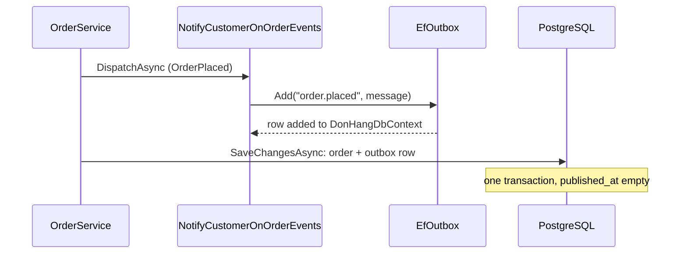

## Before you start

- [[backend.l3.dual-write]] — you know that writing an order to PostgreSQL and its message to RabbitMQ is a dual write, and every place for the publish leaves a gap.
- [[design.l3.dispatching-domain-events]] — you know that handlers run before `SaveChangesAsync` and only add rows to the shared `DonHangDbContext`, so one save stores the order's change and every reaction.
- [[backend.l2.database-job-queue]] — you know that at stage-2 an email job is a `notifications` row saved in the order's own transaction and sent later by `NotificationSender`.

## The situation

It is stage-3. Notifications now runs as its own service and learns about orders only through RabbitMQ. You expect to find, somewhere in `DonHang.Api`, a call that publishes "order placed" while the order is being placed.

You open `NotifyCustomerOnOrderEvents`, the handler that reacts to `OrderPlaced`. It never mentions RabbitMQ. It calls `outbox.Add(...)`, and nothing in it saves or sends anything. Yet every placed order still ends up with its message stored in the database, waiting to go out.

How does the API keep an order and its message together when it cannot put a PostgreSQL save and a RabbitMQ publish in one transaction?

## Core concepts

- **outbox** — a table in the sender's own database where a message is saved by the same transaction as the change it describes, to be published afterwards.
- `outbox_messages` — Đơn Hàng's outbox table, in the `donhang` database, mapped by `DonHangDbContext` like `orders`.
- `IOutbox` — the interface a handler calls to add a message; its `Add` method only adds a row and never saves or publishes.
- `published_at` — the column of an outbox row that stays empty until the message has reached RabbitMQ.

## How it works



In the situation above, the outbox is `outbox_messages`. The handler does not try to reach RabbitMQ at all. It writes the message into the same database as the order, where a transaction can cover both.

Follow the diagram in order. `OrderService` places the order, and `DispatchAsync` hands `OrderPlaced` to `NotifyCustomerOnOrderEvents`. The handler builds the message and calls `IOutbox.Add` with the routing key `order.placed`. `EfOutbox`, the implementation, adds an `OutboxMessage` to `DonHangDbContext`. No row is written to PostgreSQL yet.

Then `OrderService` calls `SaveChangesAsync` once. EF Core writes the new order and the outbox row in one database transaction. Either both rows exist afterwards or neither does. There is no moment when the order is saved and its message is not, and no message can describe a change that was rolled back. The dual write has become a single write to one system.

The row then waits with `published_at` empty. Publishing it to RabbitMQ is a separate, later step, and the next lesson shows who takes it. That step can be retried as often as needed, because the message is now stored, not held in the memory of one request.

This is the stage-2 `notifications` table again. There, the email job was a row saved with the order and sent later by `NotificationSender`. The outbox does the same for any message meant for another service.

## In the Đơn Hàng system

The handler that adds the messages, in `DonHang.Domain/NotifyCustomerOnOrderEvents.cs`:

```csharp file=DonHang.Domain/NotifyCustomerOnOrderEvents.cs tag=stage-3 lines=11-35
public sealed class NotifyCustomerOnOrderEvents(IOutbox outbox, ICustomerRepository customers)
    : IDomainEventHandler<OrderPlaced>, IDomainEventHandler<OrderCancelled>, IDomainEventHandler<OrderShipped>,
      IDomainEventHandler<OrderRefundRequested>, IDomainEventHandler<OrderRefunded>, IDomainEventHandler<OrderRefundFailed>
{
    public Task HandleAsync(OrderPlaced domainEvent) => AddMessage("order.placed", domainEvent);

    public Task HandleAsync(OrderCancelled domainEvent) => AddMessage("order.cancelled", domainEvent);

    public Task HandleAsync(OrderShipped domainEvent) => AddMessage("order.shipped", domainEvent);

    public Task HandleAsync(OrderRefundRequested domainEvent) => AddMessage("order.refund-requested", domainEvent);

    public Task HandleAsync(OrderRefunded domainEvent) => AddMessage("order.refunded", domainEvent);

    public Task HandleAsync(OrderRefundFailed domainEvent) => AddMessage("order.refund-failed", domainEvent);

    // The order's id is known here, even for a new order: the repository took
    // it from the database before the handlers ran (OrderService).
    private async Task AddMessage(string routingKey, IDomainEvent domainEvent)
    {
        var order = domainEvent.Order;
        var customer = await customers.FindAsync(order.CustomerId)
            ?? throw new InvalidOperationException($"customer {order.CustomerId} of order {order.Id} does not exist");
        outbox.Add(routingKey, new OrderMessage(order.Id, customer.Email, customer.FullName, domainEvent.OccurredAt));
    }
```

Lines 15–19 map `OrderPlaced`, `OrderCancelled` and `OrderShipped` to their routing keys; the three refund events belong to a later module. Line 34 builds an `OrderMessage` (order id, customer email and name, and when the event happened) and passes it to `outbox.Add`; that is all the handler does with it. The comment matters because the message needs `order.Id`; how the repository gets it early is outside this lesson. The class depends on `IOutbox`, not on RabbitMQ or EF Core. If line 33 throws, the use case stops before `SaveChangesAsync`, and neither the order's change nor a message is saved.

What `Add` does, in `DonHang.Infrastructure/EfOutbox.cs`:

```csharp file=DonHang.Infrastructure/EfOutbox.cs tag=stage-3 lines=7-22
// lesson: backend.l3.outbox-pattern
// Adds the message as a row of outbox_messages to the same DonHangDbContext
// as the order, and saves nothing: OrderService's SaveChangesAsync writes the
// order's change and this row in one transaction. The body is JSON with
// camelCase names; published_at stays empty until OutboxRelay has sent it.
public sealed class EfOutbox(DonHangDbContext db) : IOutbox
{
    public void Add(string routingKey, object message)
    {
        db.OutboxMessages.Add(new OutboxMessage
        {
            RoutingKey = routingKey,
            Body = JsonSerializer.Serialize(message, message.GetType(), JsonSerializerOptions.Web),
        });
    }
}
```

Line 12 receives the same `DonHangDbContext` that holds the order, and line 16 only adds the row to it; there is no `SaveChangesAsync` in this class. Each row gets the routing key (line 18) and the message as JSON (line 19); `JsonSerializerOptions.Web` writes property names in camelCase, such as `orderId`. The `OutboxMessage` class, outside this excerpt, gives every row a new `Guid` id and leaves `PublishedAt` empty; `DonHangDbContext` maps these to columns of `outbox_messages`. `OutboxRelay`, named in the comment, is the later step that publishes the waiting rows; the next lesson covers it.

## Seniors often assume…

- **"The outbox is a queue inside RabbitMQ."** → Actually it is a table in the sender's own PostgreSQL database, `outbox_messages` in `donhang`, because only there can the same transaction cover the order's change. RabbitMQ sees a message only after a later step publishes the row. You notice this when you list RabbitMQ's queues looking for an outbox and find only queues such as `notifications.order-events`, while the rows sit in PostgreSQL.
- **"Saving the outbox row with a second `SaveChangesAsync`, right after the order's, is just as safe."** → Actually two calls, with no transaction opened around them as in Đơn Hàng, are two transactions, so a process that stops between them keeps the order and loses its message: the dual write again, inside one database. Using the same database is not enough; the order and the row must be saved by the same transaction. You notice this when an order has no row in `outbox_messages`, and its customer never got an email.
- **"With an outbox, the message is published at the moment the order is saved."** → Actually saving only stores the row, with `published_at` empty; publishing is a later, separate step. The API answers the request without waiting for RabbitMQ. You notice this when a row for an order you just placed still has an empty `published_at` after the API has already answered.

## Try it (3 minutes)

In the root folder of the example repository:

1. Run `git grep -n SaveChangesAsync stage-3 -- DonHang.Domain/NotifyCustomerOnOrderEvents.cs DonHang.Domain/IOutbox.cs DonHang.Infrastructure/EfOutbox.cs`.
2. Imagine `EfOutbox` were changed so that `OrderService` first saves the order, and the outbox row is then added and saved by a second `SaveChangesAsync`. The process is killed between the two saves. Decide: is an order stored, is an outbox row stored, and will a message ever be published?

Expected result: step 1 prints two lines, `IOutbox.cs` line 6 and `EfOutbox.cs` line 9. Both are comments that name the caller's save; none of the three files calls `SaveChangesAsync` itself. For step 2, check your answer below.

<details><summary>Suggested answer</summary>

The first save commits, so the order is stored. The second save never runs, so no outbox row exists. Nothing stored says a message is owed, so no message is ever published, and no email goes out. This is the "publish after the save" gap from the dual-write lesson, moved inside one database. Adding the row before the single save, as Đơn Hàng does, closes it.

</details>

## Connections

- [[backend.l3.dual-write]] — the problem this lesson fixes: one save to PostgreSQL replaces a write to two systems.
- [[backend.l3.outbox-relay]] — the next step: who publishes the waiting rows to RabbitMQ and when `published_at` is set.
- [[backend.l2.database-job-queue]] — the same idea at stage-2, for email jobs in the `notifications` table.
- [[design.l3.dispatching-domain-events]] — why the handler's row is added before the save: handlers run first, then one `SaveChangesAsync`.
- [[foundation.l1.transaction-intro]] — the guarantee the outbox relies on: all of the changes, or none.
- [[design.l3.domain-events]] — the events, such as `OrderPlaced`, that each outbox message describes.

## Five-line summary

1. An outbox saves a message in the sender's own database, in the same transaction as the change it describes, to publish afterwards.
2. At stage-3, `NotifyCustomerOnOrderEvents` reacts to order events by adding one `outbox_messages` row through `IOutbox`, before `SaveChangesAsync` runs.
3. One `SaveChangesAsync` stores the order's change and its outbox row together, so neither exists without the other.
4. Each row holds a new id, the routing key and the JSON body; `published_at` stays empty until the message reaches RabbitMQ.
5. The stage-2 `notifications` table worked this way for emails; the outbox does the same for messages to any service.
