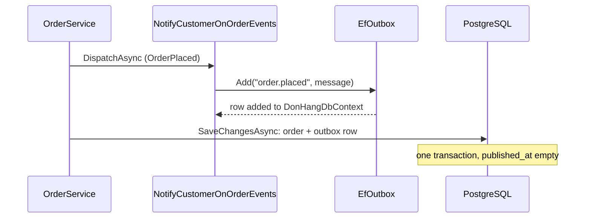

## Bạn cần biết trước

- [[backend.l3.dual-write]] — bạn biết rằng ghi một đơn vào PostgreSQL và ghi message của nó vào RabbitMQ là một dual write, và đặt lệnh publish ở đâu cũng để lại một khoảng hở.
- [[design.l3.dispatching-domain-events]] — bạn biết rằng các handler chạy trước `SaveChangesAsync` và chỉ thêm dòng vào `DonHangDbContext` dùng chung, nên một lần lưu sẽ lưu cả thay đổi của đơn lẫn mọi phản ứng.
- [[backend.l2.database-job-queue]] — bạn biết rằng ở stage-2, một job email là một dòng `notifications` được lưu trong chính giao dịch của đơn, rồi `NotificationSender` gửi sau.

## Tình huống

Đã sang stage-3. Notifications giờ chạy thành service riêng và chỉ biết về đơn hàng qua RabbitMQ. Bạn đoán rằng đâu đó trong `DonHang.Api` có một lời gọi publish "order placed" ngay trong lúc đặt đơn.

Bạn mở `NotifyCustomerOnOrderEvents`, handler phản ứng với `OrderPlaced`. Trong đó không hề nhắc tới RabbitMQ. Nó gọi `outbox.Add(...)`, và không có dòng nào lưu hay gửi gì cả. Vậy mà mọi đơn được đặt vẫn có message nằm sẵn trong database, chờ được gửi đi.

API giữ đơn và message của đơn đi cùng nhau bằng cách nào, khi không thể đặt một lần lưu vào PostgreSQL và một lần publish lên RabbitMQ chung một giao dịch?

## Khái niệm cốt lõi

- **outbox** (Bảng trong database của bên gửi, lưu message cùng transaction với thay đổi, để publish sau) — một bảng trong database của chính bên gửi, nơi message được lưu bởi cùng giao dịch với thay đổi mà nó mô tả, rồi được publish sau đó.
- `outbox_messages` — bảng outbox của Đơn Hàng, nằm trong database `donhang`, được `DonHangDbContext` ánh xạ giống như `orders`.
- `IOutbox` — interface mà handler gọi để thêm message. Phương thức `Add` của nó chỉ thêm một dòng, không bao giờ lưu hay publish.
- `published_at` — cột của một dòng outbox, để trống cho tới khi message đã tới RabbitMQ.

## Cơ chế hoạt động



Trong tình huống trên, outbox chính là `outbox_messages`. Handler hoàn toàn không cố liên lạc với RabbitMQ. Nó ghi message vào cùng database với đơn, nơi một giao dịch bao được cả hai.

Hãy đi theo sơ đồ từ trên xuống. `OrderService` đặt đơn, và `DispatchAsync` chuyển `OrderPlaced` cho `NotifyCustomerOnOrderEvents`. Handler dựng message rồi gọi `IOutbox.Add` với routing key `order.placed`. `EfOutbox`, lớp cài đặt, thêm một `OutboxMessage` vào `DonHangDbContext`. Lúc này chưa có dòng nào được ghi xuống PostgreSQL.

Sau đó `OrderService` gọi `SaveChangesAsync` đúng một lần. EF Core ghi đơn mới và dòng outbox trong một giao dịch database. Sau lần lưu, hoặc cả hai dòng cùng tồn tại, hoặc không dòng nào. Không có lúc nào đơn đã lưu mà message thì chưa, và cũng không message nào mô tả một thay đổi đã bị rollback. Dual write đã trở thành một lần ghi duy nhất vào một hệ thống.

Rồi dòng đó nằm chờ với `published_at` để trống. Publish nó lên RabbitMQ là một bước riêng, diễn ra sau, và bài kế tiếp cho thấy ai đảm nhận bước đó. Bước này thử lại bao nhiêu lần cũng được, vì message giờ đã được lưu, không còn chỉ nằm trong bộ nhớ của một request.

Đây lại là bảng `notifications` của stage-2. Ở đó, job email là một dòng được lưu cùng đơn và được `NotificationSender` gửi sau. Outbox làm đúng như vậy cho mọi message gửi tới service khác.

## Trong hệ thống Đơn Hàng

Handler thêm các message, trong `DonHang.Domain/NotifyCustomerOnOrderEvents.cs`:

```csharp file=DonHang.Domain/NotifyCustomerOnOrderEvents.cs tag=stage-3 lines=11-35
public sealed class NotifyCustomerOnOrderEvents(IOutbox outbox, ICustomerRepository customers)
    : IDomainEventHandler<OrderPlaced>, IDomainEventHandler<OrderCancelled>, IDomainEventHandler<OrderShipped>,
      IDomainEventHandler<OrderRefundRequested>, IDomainEventHandler<OrderRefunded>, IDomainEventHandler<OrderRefundFailed>
{
    public Task HandleAsync(OrderPlaced domainEvent) => AddMessage("order.placed", domainEvent);

    public Task HandleAsync(OrderCancelled domainEvent) => AddMessage("order.cancelled", domainEvent);

    public Task HandleAsync(OrderShipped domainEvent) => AddMessage("order.shipped", domainEvent);

    public Task HandleAsync(OrderRefundRequested domainEvent) => AddMessage("order.refund-requested", domainEvent);

    public Task HandleAsync(OrderRefunded domainEvent) => AddMessage("order.refunded", domainEvent);

    public Task HandleAsync(OrderRefundFailed domainEvent) => AddMessage("order.refund-failed", domainEvent);

    // The order's id is known here, even for a new order: the repository took
    // it from the database before the handlers ran (OrderService).
    private async Task AddMessage(string routingKey, IDomainEvent domainEvent)
    {
        var order = domainEvent.Order;
        var customer = await customers.FindAsync(order.CustomerId)
            ?? throw new InvalidOperationException($"customer {order.CustomerId} of order {order.Id} does not exist");
        outbox.Add(routingKey, new OrderMessage(order.Id, customer.Email, customer.FullName, domainEvent.OccurredAt));
    }
```

Dòng 15–19 gắn `OrderPlaced`, `OrderCancelled` và `OrderShipped` với routing key tương ứng. Ba event về hoàn tiền thuộc một module sau. Dòng 34 dựng một `OrderMessage` (id đơn, email và tên khách, thời điểm event xảy ra) rồi chuyển cho `outbox.Add`, và handler chỉ làm có vậy với message đó. Comment quan trọng vì message cần `order.Id`, còn repository lấy được id đó sớm bằng cách nào thì nằm ngoài bài này. Class phụ thuộc vào `IOutbox`, không phụ thuộc vào RabbitMQ hay EF Core. Nếu dòng 33 ném exception, use case dừng trước `SaveChangesAsync`, và cả thay đổi của đơn lẫn message đều không được lưu.

`Add` làm gì, trong `DonHang.Infrastructure/EfOutbox.cs`:

```csharp file=DonHang.Infrastructure/EfOutbox.cs tag=stage-3 lines=7-22
// lesson: backend.l3.outbox-pattern
// Adds the message as a row of outbox_messages to the same DonHangDbContext
// as the order, and saves nothing: OrderService's SaveChangesAsync writes the
// order's change and this row in one transaction. The body is JSON with
// camelCase names; published_at stays empty until OutboxRelay has sent it.
public sealed class EfOutbox(DonHangDbContext db) : IOutbox
{
    public void Add(string routingKey, object message)
    {
        db.OutboxMessages.Add(new OutboxMessage
        {
            RoutingKey = routingKey,
            Body = JsonSerializer.Serialize(message, message.GetType(), JsonSerializerOptions.Web),
        });
    }
}
```

Dòng 12 nhận chính `DonHangDbContext` đang giữ đơn, và dòng 16 chỉ thêm dòng vào đó. Class này không có `SaveChangesAsync` nào. Mỗi dòng có routing key (dòng 18) và message dạng JSON (dòng 19). `JsonSerializerOptions.Web` viết tên thuộc tính theo camelCase, chẳng hạn `orderId`. Class `OutboxMessage`, nằm ngoài đoạn trích này, cho mỗi dòng một id `Guid` mới và để trống `PublishedAt`. `DonHangDbContext` ánh xạ chúng thành các cột của `outbox_messages`. `OutboxRelay`, cái tên nhắc trong comment, là bước sau publish các dòng đang chờ, và bài kế tiếp sẽ nói về nó.

## Senior hay nhầm rằng…

- **"Outbox là một hàng đợi bên trong RabbitMQ."** → Thực ra nó là một bảng trong database PostgreSQL của chính bên gửi, là `outbox_messages` trong `donhang`, vì chỉ ở đó cùng một giao dịch mới bao được thay đổi của đơn. RabbitMQ chỉ thấy message sau khi một bước khác publish dòng đó. Bạn sẽ nhận ra khi liệt kê các hàng đợi của RabbitMQ để tìm outbox và chỉ thấy những hàng đợi như `notifications.order-events`, còn các dòng thì nằm trong PostgreSQL.
- **"Lưu dòng outbox bằng một `SaveChangesAsync` thứ hai, ngay sau lần lưu đơn, cũng an toàn y như vậy."** → Thực ra hai lời gọi, khi không có giao dịch nào mở bao quanh như trong Đơn Hàng, là hai giao dịch, nên process dừng giữa chừng thì đơn còn mà message mất: lại là dual write, chỉ khác là trong một database. Dùng chung database thì chưa đủ, đơn và dòng outbox phải được lưu bởi cùng một giao dịch. Bạn sẽ nhận ra khi một đơn không có dòng nào trong `outbox_messages`, và khách của đơn đó không bao giờ nhận được email.
- **"Có outbox thì message được publish ngay lúc đơn được lưu."** → Thực ra lần lưu chỉ cất dòng đó, với `published_at` để trống. Publish là một bước riêng, diễn ra sau. API trả lời request mà không chờ RabbitMQ. Bạn sẽ nhận ra khi dòng outbox của một đơn bạn vừa đặt vẫn có `published_at` trống, dù API đã trả lời xong.

## Thử ngay (3 phút)

Ở thư mục gốc của repo ví dụ:

1. Chạy `git grep -n SaveChangesAsync stage-3 -- DonHang.Domain/NotifyCustomerOnOrderEvents.cs DonHang.Domain/IOutbox.cs DonHang.Infrastructure/EfOutbox.cs`.
2. Hãy hình dung `EfOutbox` bị sửa sao cho `OrderService` lưu đơn trước, rồi dòng outbox mới được thêm và lưu bằng một `SaveChangesAsync` thứ hai. Process bị kill giữa hai lần lưu. Hãy xác định: đơn có được lưu không, dòng outbox có được lưu không, và message có bao giờ được publish không?

Kết quả mong đợi: bước 1 in ra hai dòng, `IOutbox.cs` dòng 6 và `EfOutbox.cs` dòng 9. Cả hai đều là comment nhắc tới lần lưu của bên gọi, không file nào trong ba file tự gọi `SaveChangesAsync`. Ở bước 2, hãy đối chiếu với đáp án bên dưới.

<details><summary>Gợi ý đáp án</summary>

Lần lưu đầu tiên commit, nên đơn được lưu. Lần lưu thứ hai không bao giờ chạy, nên không có dòng outbox nào. Không có gì được lưu để nói rằng còn nợ một message, nên message không bao giờ được publish, và không email nào được gửi. Đây chính là khoảng hở "publish sau khi lưu" trong bài dual write, chỉ là dời vào bên trong một database. Thêm dòng outbox trước lần lưu duy nhất, như Đơn Hàng đang làm, sẽ bịt khoảng hở đó.

</details>

## Liên hệ

- [[backend.l3.dual-write]] — vấn đề mà bài này giải quyết: một lần lưu vào PostgreSQL thay cho hai lần ghi vào hai hệ thống.
- [[backend.l3.outbox-relay]] — bước tiếp theo: ai publish các dòng đang chờ lên RabbitMQ, và `published_at` được điền khi nào.
- [[backend.l2.database-job-queue]] — cùng ý tưởng ở stage-2, cho các job email trong bảng `notifications`.
- [[design.l3.dispatching-domain-events]] — vì sao dòng của handler được thêm trước lần lưu: các handler chạy trước, rồi mới tới một `SaveChangesAsync`.
- [[foundation.l1.transaction-intro]] — bảo đảm mà outbox dựa vào: hoặc mọi thay đổi, hoặc không thay đổi nào.
- [[design.l3.domain-events]] — các event, như `OrderPlaced`, mà mỗi message trong outbox mô tả.

## Tóm tắt 5 dòng

1. Outbox lưu message trong database của chính bên gửi, cùng giao dịch với thay đổi mà nó mô tả, để publish sau.
2. Ở stage-3, `NotifyCustomerOnOrderEvents` phản ứng với các event của đơn bằng cách thêm một dòng `outbox_messages` qua `IOutbox`, trước khi `SaveChangesAsync` chạy.
3. Một `SaveChangesAsync` lưu thay đổi của đơn cùng dòng outbox của nó, nên không bên nào tồn tại thiếu bên kia.
4. Mỗi dòng có một id mới, routing key và phần thân JSON, còn `published_at` để trống cho tới khi message tới RabbitMQ.
5. Bảng `notifications` của stage-2 đã làm như vậy cho email, outbox làm đúng như thế cho message gửi tới bất kỳ service nào.
