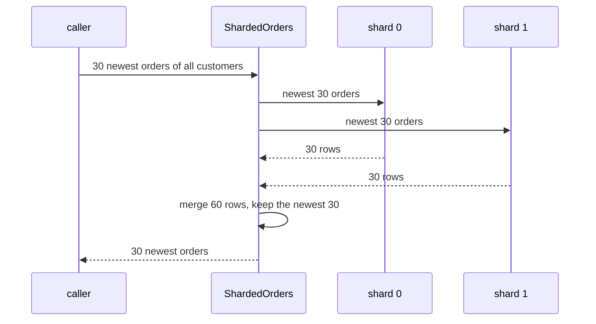

## Before you start

- [[backend.l3.sharding]] — you know each row lives on the one shard its shard key picks, and a query or transaction reaches one database only.
- [[backend.l2.cursor-pagination]] — you know a list page is rows read in a fixed sort order and cut at a limit; here each shard returns such a list.
- [[backend.l3.saga]] — you know a saga replaces one transaction across services with a chain of local transactions.
- [[design.l3.read-model]] — you know a read model stores data in the shape one query needs, written from the write side's changes.

## The situation

The team has settled on `customer_id` as the shard key for orders. Before touching Đơn Hàng, you rehearse with two databases filled from `donhang_perf`, the 200,000-order practice database. Customer 7 opens their order history: the code computes `7 % 2 = 1` and reads the second database only, one query as before. Then you need what a staff screen would show: the 30 newest orders of all customers. That request names no customer, so the shard key points to no database. Your first idea is to take the 15 newest from each.

How do you get the 30 newest orders when the shard key cannot tell you where they are?

## Core concepts

- **scatter-gather** — sending the same query to every shard at once, then merging their answers into one; in the situation, asking both databases for their newest orders and keeping the 30 newest of the combined lists.
- single-shard query — a query that contains the shard key, such as one customer's history, so the code sends it to exactly one shard.
- the slowest shard — in a scatter-gather, the shard that answers last; the merged answer cannot be ready before it.

## How it works



In the diagram, the caller asks `ShardedOrders` for the 30 newest orders of all customers. The request has no customer id, so no shard can be ruled out. `ShardedOrders` sends the same query to both shards at once: that is the scatter. Each shard sorts its own orders newest first and returns its top 30. Then the merge puts the 60 rows in one list, sorts them the same way and keeps the first 30: that is the gather.

Each shard returns 30, not 15, because nothing says how the newest orders are spread. In the lab, the output below shows 20 of the 30 newest on shard 1. A shard that returned only 15 could leave out some of the true newest, and the merge cannot know they are missing.

A scatter-gather has two costs a single-shard query does not. It is ready only when the slowest shard answers, so one busy shard slows every such request. And it needs every shard: if one is down, the result is an error or a list that quietly lacks that shard's orders. When such a query runs often, look at the reads. If most of them lack the key, the shard key is wrong. If most use it and a few frequent ones do not, serve those from a read model in its own database, filled by messages from every shard, so it is eventually consistent.

Writes meet the same wall. Orders on two shards change in two transactions, and one can commit while the other fails. Keeping them consistent needs the tools for a change across two services, such as a saga.

## In the Đơn Hàng system

Đơn Hàng itself is not sharded at stage-3. `shard-split.sh` builds two lab shards from `donhang_perf` and runs the `sharded-orders` sample against them. Above the excerpt, it builds `donhang_perf` if missing and defines `psql_in_db`, which runs PostgreSQL's command-line client, `psql`, inside the `db` container:

```bash file=scripts/backend/shard-split.sh tag=stage-3 lines=14-36
# lesson: backend.l3.cross-shard-queries
# Two shards, each its own database with the same orders table. Real shards
# sit on separate servers; in the lab both live on db. One database cannot
# read another's tables, so the rows travel out of donhang_perf with COPY
# and into the shard the same way.
for shard in 0 1; do
  psql_in_db --dbname postgres --command "SET client_min_messages TO warning" \
             --command "DROP DATABASE IF EXISTS donhang_shard_$shard WITH (FORCE)" \
             --command "CREATE DATABASE donhang_shard_$shard"
  psql_in_db --dbname "donhang_shard_$shard" --file - < db/sharding/shard-schema.sql
  psql_in_db --dbname donhang_perf --command \
      "COPY (SELECT id, customer_id, placed_at, status FROM orders WHERE customer_id % 2 = $shard) TO STDOUT" \
    | psql_in_db --dbname "donhang_shard_$shard" --command "COPY orders FROM STDIN"
  psql_in_db --dbname "donhang_shard_$shard" --tuples-only --no-align \
             --command "ANALYZE orders" \
             --command "SELECT 'donhang_shard_$shard: ' || count(*) || ' orders' FROM orders"
done
echo

# The sample connects from this machine, to the port db publishes.
PGPASSWORD=$(grep '^POSTGRES_PASSWORD=' .env | cut -d= -f2-)
export PGPASSWORD
dotnet run --project samples/DonHang.Samples --verbosity quiet -- sharded-orders
```

```text output=true
donhang_shard_0: 20000 orders
donhang_shard_1: 180000 orders

customer 7 is on shard 1; its 3 newest orders:
  order 199986, shard 1
  order 199886, shard 1
  order 199786, shard 1
the 30 newest orders of all customers (each shard returned 30):
  orders 199971 to 200000
  10 from shard 0, 20 from shard 1
with 15 from each shard instead: 5 of the 30 are not among the newest
```

The loop creates `donhang_shard_0` and `donhang_shard_1`, gives each the same `orders` table, and copies every order into the shard whose number equals `customer_id % 2`. The first `COPY` writes the selected rows to its output, the pipe carries them, and the second `COPY` reads them from its input into the shard's `orders` table. `ANALYZE orders` then collects the statistics the query planner uses about the newly filled table. Both databases sit on one PostgreSQL server, the `db` container that `scripts/up.sh` starts. Shard 1 gets 180,000 orders: the odd customer ids, including customer 1 with 81% of all orders.

In the output, customer 7's orders all come from shard 1. In `ShardedOrders.cs`, outside the excerpt below, `ShardFor` returns the customer id modulo the number of shards, and `LatestForCustomerAsync` asks only that shard: `7 % 2 = 1`. The 30 newest orders of all customers split 10 and 20, so 15 from each would have been wrong: the last line counts 5 of those 30 that are not among the true newest.

```csharp file=samples/DonHang.Samples/Samples/Data/Sharding/ShardedOrders.cs tag=stage-3 lines=28-52
    // lesson: backend.l3.cross-shard-queries
    // No shard key: scatter the query to every shard at once, gather the
    // lists, keep the newest `count`. Each shard returns `count` orders, not
    // count / shards: the newest ones may all sit on one shard. The answer
    // waits for the slowest shard, and fails if any shard fails.
    public async Task<List<ShardedOrder>> LatestAcrossShardsAsync(
        int count, CancellationToken cancellationToken)
    {
        var queries = new List<Task<List<ShardedOrder>>>();
        for (var shard = 0; shard < shards.Count; shard++)
        {
            queries.Add(LatestOnShardAsync(shard, count, cancellationToken));
        }

        var perShard = await Task.WhenAll(queries);
        return Merge(perShard, count);
    }

    // The newest `count` orders of all the shards' lists together.
    public static List<ShardedOrder> Merge(IEnumerable<IReadOnlyList<ShardedOrder>> perShard, int count) =>
        perShard.SelectMany(orders => orders)
            .OrderByDescending(order => order.PlacedAt)
            .ThenByDescending(order => order.Id)
            .Take(count)
            .ToList();
```

The loop starts one `LatestOnShardAsync` per shard and keeps its task without awaiting it, so the shard queries are in progress together. `Task.WhenAll` completes only when every one of them has completed: that is the wait for the slowest shard. If any of them throws, the `await` throws as well, so a failed shard fails the whole call instead of returning a shorter list. `Merge` is the gather: it flattens the lists, sorts by `PlacedAt` and then `Id`, newest first, so orders placed at the same moment always come out in the same order, and takes `count`.

## Seniors often assume…

- **"To get the 10 newest orders from 2 shards, I take the 5 newest from each."** → Actually each shard must return all 10, because nothing guarantees the newest orders are split evenly. In the lab, the 30 newest split 10 and 20, so 15 from each kept 5 older orders from shard 0 and dropped 5 newer ones from shard 1. You notice this when an order on one shard is newer than the last row of the "newest orders" list, yet the list skips it.
- **"If one shard is down, a query over all shards still gives a correct answer from the others."** → Actually the others can only give their own rows; the down shard's orders are simply absent, and the merged list still looks complete. `LatestAcrossShardsAsync` fails instead, because `Task.WhenAll` passes the error on. You notice this when a version that skips failed shards, with shard 1 unreachable, lists newest orders from even customer ids only.
- **"Two orders on different shards can still be updated in one transaction, as before."** → Actually a transaction belongs to one connection, and a connection reaches one database. Changing orders of customers 7 and 8 takes one transaction on shard 1 and another on shard 0, and one can commit while the other fails. The tools for a change across services apply, such as a saga with a compensating action. You notice this when, after an error, one of the two orders shows the change and the other does not.

## Try it (3 minutes)

1. With the example system running (`scripts/up.sh`), run `scripts/backend/shard-split.sh` from the repository root. It runs the sample on your machine, so it needs the .NET SDK there. If `donhang_perf` does not exist yet, the script builds it first and takes longer; the 3 minutes assume it exists.
2. Read the last three lines of the output.
3. Work out why taking 15 from each shard gets exactly 5 of the 30 wrong.

Expected result: the first lines show `donhang_shard_0: 20000 orders` and `donhang_shard_1: 180000 orders`; the end shows `10 from shard 0, 20 from shard 1` and `5 of the 30 are not among the newest`.

<details><summary>Suggested answer</summary>

Shard 0 holds only 10 of the true 30 newest, so its 15 include 5 older orders. Shard 1 holds 20 of them but returned only 15, so 5 of the newest never reach the merge. The 30 merged rows are 15 plus 15, and the 5 older orders from shard 0 take the places of the 5 missing ones.

</details>

## Connections

- [[backend.l3.sharding]] — the prerequisite that picks the shard key; this lesson is what a query without it has to do.
- [[backend.l3.rebalancing-shards]] — the next lesson: adding a shard while every query still finds the shard it needs.
- [[backend.l3.timeouts]] — the way to cap how long a scatter-gather waits for its slowest shard.
- [[backend.l3.two-phase-commit]] — the tool that could make two shards commit together, at the cost of locks held while waiting.
- [[design.l3.read-model]] — where a frequent query without the shard key can be served instead.
- [[backend.l3.saga]] — the way to change rows on two shards without one transaction.

## Five-line summary

1. A query without the shard key cannot tell which shard holds its rows, so it asks every shard and merges the answers: scatter-gather.
2. `ShardedOrders` sends one customer's query to shard `customer_id % 2` alone, and asks both lab shards for the newest orders of all customers.
3. For the N newest overall, each shard must return N rows, because the newest may all sit on one shard; 15 from each missed 5.
4. A scatter-gather waits for its slowest shard and fails when any shard fails; a frequent one points to a wrong key or a read model.
5. Rows on two shards change in two transactions, so keeping them consistent needs the tools for a change across services, such as a saga.
