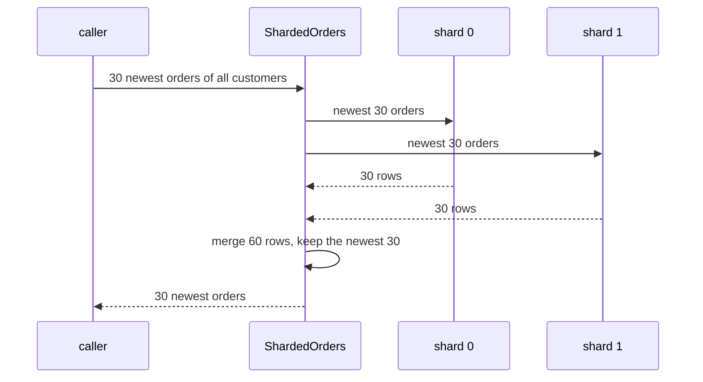

## Bạn cần biết trước

- [[backend.l3.sharding]] — bạn biết mỗi dòng nằm trên đúng một shard do shard key của nó chọn, và một truy vấn hay một giao dịch chỉ tới được một database.
- [[backend.l2.cursor-pagination]] — bạn biết một trang danh sách là các dòng được đọc theo một thứ tự sắp xếp cố định rồi cắt ở một giới hạn. Ở bài này, mỗi shard trả về một danh sách như vậy.
- [[backend.l3.saga]] — bạn biết saga thay một giao dịch xuyên nhiều service bằng một chuỗi giao dịch cục bộ.
- [[design.l3.read-model]] — bạn biết read model lưu dữ liệu theo đúng hình dạng một truy vấn cần, được ghi từ các thay đổi của phía ghi.

## Tình huống

Nhóm đã chốt `customer_id` làm shard key cho đơn. Trước khi đụng vào Đơn Hàng, bạn diễn tập với hai database được nạp từ `donhang_perf`, database thực hành có 200.000 đơn. Khách 7 mở lịch sử đơn: code tính `7 % 2 = 1` và chỉ đọc database thứ hai, vẫn một truy vấn như trước. Rồi bạn cần thứ mà một màn hình cho nhân viên sẽ hiển thị: 30 đơn mới nhất của mọi khách. Yêu cầu này không nêu khách nào, nên shard key không chỉ tới database nào cả. Ý đầu tiên của bạn là lấy 15 đơn mới nhất từ mỗi database.

Làm sao lấy được 30 đơn mới nhất khi shard key không cho biết chúng nằm ở đâu?

## Khái niệm cốt lõi

- **scatter-gather** (gửi cùng một truy vấn tới mọi shard rồi gộp các kết quả lại) — gửi cùng một truy vấn tới mọi shard cùng lúc, rồi gộp các câu trả lời thành một. Trong tình huống trên, đó là hỏi cả hai database lấy các đơn mới nhất của chúng, rồi giữ 30 đơn mới nhất trong hai danh sách gộp lại.
- truy vấn một shard — truy vấn có chứa shard key, như lịch sử đơn của một khách, nên code gửi nó tới đúng một shard.
- shard chậm nhất — trong một scatter-gather, shard trả lời sau cùng. Câu trả lời đã gộp không thể xong trước khi shard này trả lời.

## Cơ chế hoạt động



Trong sơ đồ, bên gọi xin `ShardedOrders` 30 đơn mới nhất của mọi khách. Yêu cầu không có mã khách, nên không loại được shard nào. `ShardedOrders` gửi cùng một truy vấn tới cả hai shard cùng lúc: đó là phần scatter. Mỗi shard tự sắp đơn của mình từ mới đến cũ và trả về 30 đơn đầu. Sau đó bước gộp đặt 60 dòng vào một danh sách, sắp lại theo cùng thứ tự và giữ 30 dòng đầu: đó là phần gather.

Mỗi shard trả 30 đơn chứ không phải 15, vì không có gì cho biết các đơn mới nhất được chia ra sao. Trong bài thực hành, kết quả bên dưới cho thấy 20 trong 30 đơn mới nhất nằm ở shard 1. Một shard chỉ trả 15 đơn có thể bỏ sót vài đơn thật sự mới nhất, và bước gộp không có cách nào biết chúng bị thiếu.

Scatter-gather có hai cái giá mà truy vấn một shard không phải trả. Nó chỉ xong khi shard chậm nhất trả lời, nên một shard bận làm chậm mọi yêu cầu kiểu này. Và nó cần mọi shard: nếu một shard sập, kết quả là một lỗi, hoặc một danh sách lặng lẽ thiếu các đơn của shard đó. Khi một truy vấn như vậy chạy thường xuyên, hãy xem lại các lần đọc. Nếu phần lớn chúng không có khóa, shard key đã chọn sai. Nếu phần lớn có dùng khóa và chỉ vài truy vấn hay chạy thì không, hãy phục vụ những truy vấn đó từ một read model trong database riêng, được nạp bằng message từ mọi shard, tức là chấp nhận eventual consistency.

Phần ghi cũng vấp đúng bức tường này. Đơn trên hai shard thay đổi trong hai giao dịch, và một giao dịch có thể commit trong khi giao dịch kia thất bại. Muốn giữ chúng nhất quán thì cần các công cụ dành cho một thay đổi xuyên hai service, chẳng hạn saga.

## Trong hệ thống Đơn Hàng

Ở stage-3, bản thân Đơn Hàng chưa được sharding. `shard-split.sh` dựng hai shard thực hành từ `donhang_perf` và chạy mẫu `sharded-orders` trên chúng. Phía trên đoạn trích, script dựng `donhang_perf` nếu database này chưa có, và định nghĩa `psql_in_db`, hàm chạy `psql`, chương trình dòng lệnh của PostgreSQL, bên trong container `db`:

```bash file=scripts/backend/shard-split.sh tag=stage-3 lines=14-36
# lesson: backend.l3.cross-shard-queries
# Two shards, each its own database with the same orders table. Real shards
# sit on separate servers; in the lab both live on db. One database cannot
# read another's tables, so the rows travel out of donhang_perf with COPY
# and into the shard the same way.
for shard in 0 1; do
  psql_in_db --dbname postgres --command "SET client_min_messages TO warning" \
             --command "DROP DATABASE IF EXISTS donhang_shard_$shard WITH (FORCE)" \
             --command "CREATE DATABASE donhang_shard_$shard"
  psql_in_db --dbname "donhang_shard_$shard" --file - < db/sharding/shard-schema.sql
  psql_in_db --dbname donhang_perf --command \
      "COPY (SELECT id, customer_id, placed_at, status FROM orders WHERE customer_id % 2 = $shard) TO STDOUT" \
    | psql_in_db --dbname "donhang_shard_$shard" --command "COPY orders FROM STDIN"
  psql_in_db --dbname "donhang_shard_$shard" --tuples-only --no-align \
             --command "ANALYZE orders" \
             --command "SELECT 'donhang_shard_$shard: ' || count(*) || ' orders' FROM orders"
done
echo

# The sample connects from this machine, to the port db publishes.
PGPASSWORD=$(grep '^POSTGRES_PASSWORD=' .env | cut -d= -f2-)
export PGPASSWORD
dotnet run --project samples/DonHang.Samples --verbosity quiet -- sharded-orders
```

```text output=true
donhang_shard_0: 20000 orders
donhang_shard_1: 180000 orders

customer 7 is on shard 1; its 3 newest orders:
  order 199986, shard 1
  order 199886, shard 1
  order 199786, shard 1
the 30 newest orders of all customers (each shard returned 30):
  orders 199971 to 200000
  10 from shard 0, 20 from shard 1
with 15 from each shard instead: 5 of the 30 are not among the newest
```

Vòng lặp tạo `donhang_shard_0` và `donhang_shard_1`, cho mỗi database cùng một bảng `orders`, rồi chép từng đơn vào shard có số thứ tự bằng `customer_id % 2`. Lệnh `COPY` thứ nhất ghi các dòng được chọn ra đầu ra của nó, đường ống chuyển chúng đi, và lệnh `COPY` thứ hai đọc chúng từ đầu vào vào bảng `orders` của shard. Sau đó `ANALYZE orders` thu thập số liệu thống kê mà query planner dùng về bảng vừa được nạp. Cả hai database nằm trên một server PostgreSQL, container `db` mà `scripts/up.sh` khởi động. Shard 1 nhận 180.000 đơn: các mã khách lẻ, trong đó có khách 1 với 81% tổng số đơn.

Trong kết quả, mọi đơn của khách 7 đều đến từ shard 1. Trong `ShardedOrders.cs`, ngoài đoạn trích bên dưới, `ShardFor` trả về số dư của mã khách khi chia cho số shard, và `LatestForCustomerAsync` chỉ hỏi shard đó: `7 % 2 = 1`. 30 đơn mới nhất của mọi khách chia thành 10 và 20, nên lấy 15 từ mỗi shard là sai: dòng cuối đếm được 5 trong 30 đơn đó không nằm trong số mới nhất thật sự.

```csharp file=samples/DonHang.Samples/Samples/Data/Sharding/ShardedOrders.cs tag=stage-3 lines=28-52
    // lesson: backend.l3.cross-shard-queries
    // No shard key: scatter the query to every shard at once, gather the
    // lists, keep the newest `count`. Each shard returns `count` orders, not
    // count / shards: the newest ones may all sit on one shard. The answer
    // waits for the slowest shard, and fails if any shard fails.
    public async Task<List<ShardedOrder>> LatestAcrossShardsAsync(
        int count, CancellationToken cancellationToken)
    {
        var queries = new List<Task<List<ShardedOrder>>>();
        for (var shard = 0; shard < shards.Count; shard++)
        {
            queries.Add(LatestOnShardAsync(shard, count, cancellationToken));
        }

        var perShard = await Task.WhenAll(queries);
        return Merge(perShard, count);
    }

    // The newest `count` orders of all the shards' lists together.
    public static List<ShardedOrder> Merge(IEnumerable<IReadOnlyList<ShardedOrder>> perShard, int count) =>
        perShard.SelectMany(orders => orders)
            .OrderByDescending(order => order.PlacedAt)
            .ThenByDescending(order => order.Id)
            .Take(count)
            .ToList();
```

Vòng lặp khởi động một `LatestOnShardAsync` cho mỗi shard và giữ task của nó mà không `await`, nên các truy vấn tới các shard chạy song song. `Task.WhenAll` chỉ hoàn tất khi mọi task đều đã hoàn tất: đó chính là chờ shard chậm nhất. Nếu bất kỳ task nào ném lỗi, `await` cũng ném lỗi theo, nên một shard hỏng làm hỏng cả lời gọi thay vì trả về một danh sách ngắn hơn. `Merge` là phần gather: nó trải phẳng các danh sách, sắp theo `PlacedAt` rồi `Id`, từ mới đến cũ, để các đơn đặt cùng thời điểm luôn ra theo cùng một thứ tự, và lấy `count` dòng.

## Senior hay nhầm rằng…

- **"Muốn lấy 10 đơn mới nhất từ 2 shard, tôi lấy 5 đơn mới nhất từ mỗi shard."** → Thực ra mỗi shard phải trả đủ 10, vì không có gì bảo đảm các đơn mới nhất được chia đều. Trong bài thực hành, 30 đơn mới nhất chia thành 10 và 20, nên lấy 15 từ mỗi shard đã giữ 5 đơn cũ hơn từ shard 0 và bỏ 5 đơn mới hơn từ shard 1. Bạn sẽ nhận ra khi một đơn trên một shard mới hơn dòng cuối của danh sách "đơn mới nhất", vậy mà danh sách lại bỏ qua nó.
- **"Nếu một shard sập, truy vấn qua mọi shard vẫn cho kết quả đúng từ các shard còn lại."** → Thực ra các shard còn lại chỉ đưa được dòng của chính chúng. Đơn của shard sập đơn giản là vắng mặt, và danh sách đã gộp trông vẫn đầy đủ. `LatestAcrossShardsAsync` thì báo lỗi, vì `Task.WhenAll` chuyển tiếp lỗi đó. Bạn sẽ nhận ra khi một phiên bản bỏ qua shard hỏng, lúc shard 1 không kết nối được, chỉ liệt kê đơn mới nhất của các mã khách chẵn.
- **"Hai đơn trên hai shard khác nhau vẫn cập nhật được trong một giao dịch, như trước."** → Thực ra một giao dịch thuộc về một connection, và một connection chỉ tới được một database. Thay đổi đơn của khách 7 và khách 8 cần một giao dịch trên shard 1 và một giao dịch khác trên shard 0, và một bên có thể commit trong khi bên kia thất bại. Lúc này phải dùng các công cụ cho một thay đổi xuyên service, chẳng hạn saga với một hành động bù. Bạn sẽ nhận ra khi, sau một lỗi, một trong hai đơn có thay đổi còn đơn kia thì không.

## Thử ngay (3 phút)

1. Khi hệ thống ví dụ đang chạy (`scripts/up.sh`), chạy `scripts/backend/shard-split.sh` từ thư mục gốc của repository. Script chạy mẫu trên máy của bạn, nên máy cần có .NET SDK. Nếu `donhang_perf` chưa có, script dựng nó trước và mất lâu hơn. 3 phút là tính khi database này đã có sẵn.
2. Đọc ba dòng cuối của kết quả.
3. Tìm ra vì sao lấy 15 từ mỗi shard lại sai đúng 5 trong 30 đơn.

Kết quả mong đợi: các dòng đầu cho `donhang_shard_0: 20000 orders` và `donhang_shard_1: 180000 orders`. Phần cuối cho `10 from shard 0, 20 from shard 1` và `5 of the 30 are not among the newest`.

<details><summary>Gợi ý đáp án</summary>

Shard 0 chỉ giữ 10 trong 30 đơn mới nhất thật sự, nên 15 đơn của nó có 5 đơn cũ hơn. Shard 1 giữ 20 đơn trong số đó nhưng chỉ trả 15, nên 5 đơn mới nhất không bao giờ tới được bước gộp. 30 dòng đã gộp là 15 cộng 15, và 5 đơn cũ hơn từ shard 0 chiếm chỗ của 5 đơn bị thiếu.

</details>

## Liên hệ

- [[backend.l3.sharding]] — bài cần học trước, nơi chọn shard key. Bài này nói một truy vấn thiếu khóa đó phải làm gì.
- [[backend.l3.rebalancing-shards]] — bài tiếp theo: thêm một shard mà mọi truy vấn vẫn tìm đúng shard nó cần.
- [[backend.l3.timeouts]] — cách giới hạn thời gian một scatter-gather chờ shard chậm nhất.
- [[backend.l3.two-phase-commit]] — công cụ có thể cho hai shard commit cùng nhau, với cái giá là giữ lock trong lúc chờ.
- [[design.l3.read-model]] — nơi có thể phục vụ thay một truy vấn hay chạy mà không có shard key.
- [[backend.l3.saga]] — cách thay đổi dòng trên hai shard mà không cần một giao dịch.

## Tóm tắt 5 dòng

1. Truy vấn không có shard key không biết shard nào giữ các dòng của nó, nên phải hỏi mọi shard rồi gộp câu trả lời: scatter-gather.
2. `ShardedOrders` gửi truy vấn của một khách chỉ tới shard `customer_id % 2`, và hỏi cả hai shard thực hành để lấy các đơn mới nhất của mọi khách.
3. Muốn N đơn mới nhất trên toàn bộ, mỗi shard phải trả N dòng, vì các đơn mới nhất có thể nằm hết trên một shard. Lấy 15 từ mỗi shard đã sót 5.
4. Scatter-gather chờ shard chậm nhất và hỏng khi bất kỳ shard nào hỏng. Một truy vấn kiểu này chạy thường xuyên là dấu hiệu của khóa sai hoặc cần một read model.
5. Dòng trên hai shard thay đổi trong hai giao dịch, nên muốn giữ chúng nhất quán thì cần các công cụ cho thay đổi xuyên service, chẳng hạn saga.
