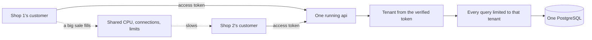

## Before you start

- [[backend.l2.resource-based-authorization]] — you know `OrderOwnerHandler` lets an order's owner or anyone with the `staff` role read it, and answers everyone else with `403`.
- [[backend.l2.validating-provider-tokens]] — you know the api checks each access token's signature with Keycloak's public key, so the caller cannot change the `sub` inside it.

## The situation

A second shop asks to sell through Đơn Hàng: its own products, its own customers, its own staff, on the same api and the same PostgreSQL. You look at what would have to change. The `orders` table has `customer_id`, but nothing says which shop an order belongs to. Worse, `OrderOwnerHandler` lets anyone with the `staff` role read any order, so the new shop's staff would see all of the first shop's orders on their first day. And when the first shop runs a big sale, the second shop's customers would wait on the same database.

How can one running system serve many shops so that none of them can see another's data, and what do they still share?

## Core concepts

- **tenant** — one organisation that uses a shared system as if it were its own; in the situation above, each shop is a tenant.
- **multi-tenancy** — one running system, its code and its databases, serving many tenants at once, instead of one installation per tenant.
- **tenant isolation** — the guarantee that no request can read or change another tenant's data, whatever the caller sends.
- **noisy neighbor** — a tenant that uses so much of the shared capacity, such as CPU or database connections, that the other tenants slow down.

## How it works



Đơn Hàng serves one shop through stage-3, and this module does not change that. Its later lessons store several shops' data in practice databases made only for those lessons, and Đơn Hàng's own database stays as it is; choosing a way for Đơn Hàng is left to a later stage. What follows is what any multi-tenant version would need.

In the situation above, both shops' customers would call the same running api, which reads and writes the same PostgreSQL. That is multi-tenancy: one copy of the code to deploy and run for every shop. The price is that the api's own logic, not a separate installation, is what keeps the shops apart.

Tenant isolation rests on the two middle steps of the diagram. First, the api must learn the caller's tenant from something the caller cannot forge. Đơn Hàng already does this for customers: it takes the customer from the access token's `sub`, which Keycloak signed and the api verified. A shop has to be found the same way, from the verified identity, never from a value in the request. Second, every query must be limited to that tenant. One query, handler or report that forgets the limit returns other tenants' rows, and nothing in the system fails when it does.

The dotted lines are the other problem. Tenants share the api's CPU, its database connections and any limit set for all callers together. When one shop's sale uses them up, the other shop's requests wait or are refused: the shop with the sale is a noisy neighbor. Limiting each request to its own tenant's rows does nothing about it.

## In the Đơn Hàng system

How `OrdersController` limits a list to the caller, at stage-2:

```csharp file=DonHang.Api/Controllers/OrdersController.cs tag=stage-2 lines=104-124
    [Authorize]
    [HttpGet]
    public async Task<ActionResult<List<OrderSummaryDto>>> List(
        [FromQuery, Range(0, int.MaxValue)] int after = 0,
        [FromQuery, Range(1, MaxPageSize)] int limit = 20)
    {
        var customer = await CurrentCustomerAsync();
        if (customer is null) return Forbid();

        var orders = await repository.ListByCustomerAsync(customer.Id, after, limit);
        return Ok(orders.Select(o => new OrderSummaryDto(o.Id, o.Status, o.CustomerName)).ToList());
    }

    // lesson: backend.l2.validating-provider-tokens
    // `sub` is Keycloak's id for the caller, not a customers.id, so it is
    // looked up in customers.identity_subject instead of parsed as a number.
    private async Task<Customer?> CurrentCustomerAsync()
    {
        var subject = User.FindFirstValue("sub");
        return subject is null ? null : await customers.FindByIdentitySubjectAsync(subject);
    }
```

`List` never asks the caller who they are. Line 110 calls `CurrentCustomerAsync`, which reads `sub` on line 122 and finds the customer row by it. A caller with no row in `customers`, such as a staff member, gets `Forbid()` on line 111: `403`. Line 113 passes the row's id to `ListByCustomerAsync`, which returns only that customer's orders. `Create`, outside this excerpt, takes the customer the same way; its comment says `customer_id` comes from the token's `sub`, never from the request body. A shop would need the same path.

The check that `Get` and `Cancel` ask for by name, the `OrderOwner` policy, before they answer:

```csharp file=DonHang.Api/Authorization/OrderOwnerHandler.cs tag=stage-2 lines=16-35
public sealed class OrderOwnerHandler(ICustomerRepository customers)
    : AuthorizationHandler<OrderOwnerRequirement, Order>
{
    protected override async Task HandleRequirementAsync(
        AuthorizationHandlerContext context, OrderOwnerRequirement requirement, Order order)
    {
        if (context.User.IsInRole("staff"))
        {
            context.Succeed(requirement);
            return;
        }

        var subject = context.User.FindFirstValue("sub");
        var caller = subject is null ? null : await customers.FindByIdentitySubjectAsync(subject);
        if (caller is not null && caller.Id == order.CustomerId)
        {
            context.Succeed(requirement);
        }
    }
}
```

Line 22 lets anyone with the `staff` role through, before the order's owner is looked at. With one shop, that is the rule the shop wants. With two, it is the forgotten limit: nothing compares the order's shop with the caller's shop, because neither exists yet. `Ship`, outside these excerpts, has the same gap: it asks for the `StaffOnly` policy, which lets in any caller with the `staff` role and checks nothing else.

## Seniors often assume…

- **"Each shop can send its shop id in a header, and the API filters every query by it."** → Actually a header holds whatever the caller puts there, so a customer of shop 2 can send shop 1's id and the filter will obey it. That is why `Create` takes the customer from the signed `sub`, not from the body. The shop has to come from the same kind of source: the verified token, or a row the api finds from it. You notice this when a request with one changed header returns orders the caller has never placed.
- **"If every query in the code filters by shop today, the shops are isolated for good."** → Actually the isolation lasts only until the next query, endpoint, report or script that forgets the filter, and none of them fails when it does: it returns more rows. `OrderOwnerHandler` shows a quieter form, a rule that was right before the second tenant existed. That is why a later lesson in this module has PostgreSQL add the shop condition to every query on its own. You notice this when a new report shows totals larger than any one shop's.
- **"Multi-tenancy means each shop gets its own copy of the application."** → Actually a copy per shop is many single-shop installations, each one more thing to deploy, update and watch. Multi-tenancy runs one copy for all shops; how their data is kept apart is a separate choice, covered in the next lesson. You notice the difference when a fix ships: once for a multi-tenant system, once per shop for copies.

## Try it (3 minutes)

1. Open `DonHang.Api/Controllers/OrdersController.cs` at `stage-2`. For each of its five endpoints, find the line that decides whose orders the caller can read or change.
2. Imagine shop 2's staff signing in to the same Keycloak with the `staff` role. Mark each endpoint where they could reach shop 1's orders.

Expected result: a list of the five endpoints, each with the line that limits it and a yes or no for shop 2's staff.

<details><summary>Suggested answer</summary>

`Create` and `List` use the customer found from `sub`, so they only touch the caller's own orders; a staff member has no customer row and gets `403`. `Get` and `Cancel` run the `OrderOwner` policy, whose staff rule lets any staff member through: shop 2's staff could read and cancel shop 1's orders. `Ship` uses `StaffOnly`, so they could ship them too. Every fix needs the same two facts: the caller's shop, from the verified identity, and the order's shop, compared on each request.

</details>

## Connections

- [[backend.l3.tenant-isolation-models]] — the next lesson: where the line between one shop's data and the next can sit inside PostgreSQL.
- [[backend.l3.row-level-security]] — the fix for the forgotten filter: PostgreSQL adds the shop condition to every query itself.
- [[backend.l2.resource-based-authorization]] — the check this lesson extends: the shop is one more attribute of the caller and of the order to compare.
- [[backend.l3.rate-limiting]] — a limit kept per customer on placing orders: it stops one customer from placing too many, not one shop with many customers.
- [[backend.l3.bulkhead]] — a cap shared by all callers, so every tenant would share it too, and a noisy neighbor could fill it.

## Five-line summary

1. One running system can serve many tenants, such as shops, only if every request is limited to its caller's tenant.
2. A tenant is one organisation using a shared system as its own; Đơn Hàng serves one shop, and this module tries more on lab databases.
3. The tenant must come from the verified identity, as `OrdersController` takes the customer from `sub`, never from a header or body.
4. One query or check that forgets the tenant breaks isolation; `OrderOwnerHandler`'s staff rule would let every shop's staff read every order.
5. Tenants share CPU, database connections and limits, so a noisy neighbor slows the others even when their data stays apart.
