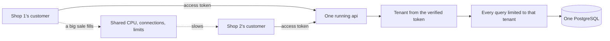

## Bạn cần biết trước

- [[backend.l2.resource-based-authorization]] — bạn biết `OrderOwnerHandler` cho chủ của đơn hàng hoặc bất kỳ ai có role `staff` đọc đơn đó, và trả lời mọi người khác bằng `403`.
- [[backend.l2.validating-provider-tokens]] — bạn biết api kiểm tra chữ ký của mỗi access token bằng public key của Keycloak, nên người gọi không thể sửa `sub` bên trong token.

## Tình huống

Một cửa hàng thứ hai xin bán hàng qua Đơn Hàng: sản phẩm riêng, khách riêng, nhân viên riêng, trên cùng api và cùng PostgreSQL. Bạn xem thử phải đổi những gì. Bảng `orders` có `customer_id`, nhưng không có gì cho biết đơn thuộc cửa hàng nào. Tệ hơn, `OrderOwnerHandler` cho bất kỳ ai có role `staff` đọc mọi đơn, nên ngay ngày đầu, nhân viên cửa hàng mới sẽ thấy toàn bộ đơn của cửa hàng thứ nhất. Còn khi cửa hàng thứ nhất chạy một đợt giảm giá lớn, khách của cửa hàng thứ hai sẽ phải chờ trên cùng một database.

Làm sao để một hệ thống đang chạy phục vụ nhiều cửa hàng mà không cửa hàng nào thấy được dữ liệu của cửa hàng khác, và chúng vẫn dùng chung những gì?

## Khái niệm cốt lõi

- **tenant** (một tổ chức dùng chung một hệ thống như của riêng mình, ví dụ một cửa hàng trên nền tảng bán hàng) — một tổ chức dùng một hệ thống chung như thể hệ thống đó là của riêng mình. Trong tình huống trên, mỗi cửa hàng là một tenant.
- **multi-tenancy** (một hệ thống đang chạy, gồm code và database, phục vụ nhiều tenant cùng lúc) — một hệ thống đang chạy, với code và database của nó, phục vụ nhiều tenant cùng lúc, thay vì mỗi tenant một bản cài đặt.
- **cách ly tenant** (tenant isolation) — bảo đảm không request nào đọc hay sửa được dữ liệu của tenant khác, dù người gọi gửi gì đi nữa.
- **noisy neighbor** (một tenant dùng nhiều tài nguyên chung đến mức làm chậm các tenant khác) — một tenant dùng nhiều năng lực chung, như CPU hay kết nối database, đến mức các tenant còn lại chậm đi.

## Cơ chế hoạt động



Tới hết stage-3, Đơn Hàng vẫn phục vụ một cửa hàng, và module này không đổi điều đó. Các bài sau trong module lưu dữ liệu của nhiều cửa hàng trong những database thực hành làm riêng cho các bài đó, còn database của Đơn Hàng giữ nguyên. Chọn cách nào cho Đơn Hàng là việc của một stage sau. Phần dưới đây là những gì mọi phiên bản multi-tenant đều cần.

Trong tình huống trên, khách của cả hai cửa hàng sẽ gọi cùng một api đang chạy, và api đó đọc ghi cùng một PostgreSQL. Đó là multi-tenancy: một bản code để deploy và vận hành cho mọi cửa hàng. Cái giá là chính logic của api, chứ không phải một bản cài đặt riêng, giữ các cửa hàng tách khỏi nhau.

Cách ly tenant dựa trên hai bước ở giữa sơ đồ. Thứ nhất, api phải biết tenant của người gọi từ một thứ người gọi không giả mạo được. Đơn Hàng đã làm vậy với khách hàng: nó lấy khách từ `sub` của access token, thứ Keycloak đã ký và api đã kiểm tra. Cửa hàng cũng phải được xác định theo cách đó, từ danh tính đã kiểm tra, không bao giờ từ một giá trị trong request. Thứ hai, mọi truy vấn phải giới hạn trong tenant đó. Chỉ cần một truy vấn, một handler hay một báo cáo quên giới hạn này là trả về dòng của tenant khác, và không có gì trong hệ thống báo lỗi khi chuyện đó xảy ra.

Các đường nét đứt là vấn đề còn lại. Các tenant dùng chung CPU của api, kết nối database của nó và mọi giới hạn đặt chung cho tất cả người gọi. Khi đợt giảm giá của một cửa hàng dùng hết những thứ đó, request của cửa hàng kia phải chờ hoặc bị từ chối: cửa hàng đang giảm giá là một noisy neighbor. Giới hạn mỗi request trong dòng của tenant mình không giúp gì cho chuyện này.

## Trong hệ thống Đơn Hàng

Cách `OrdersController` giới hạn danh sách đơn theo người gọi, ở stage-2:

```csharp file=DonHang.Api/Controllers/OrdersController.cs tag=stage-2 lines=104-124
    [Authorize]
    [HttpGet]
    public async Task<ActionResult<List<OrderSummaryDto>>> List(
        [FromQuery, Range(0, int.MaxValue)] int after = 0,
        [FromQuery, Range(1, MaxPageSize)] int limit = 20)
    {
        var customer = await CurrentCustomerAsync();
        if (customer is null) return Forbid();

        var orders = await repository.ListByCustomerAsync(customer.Id, after, limit);
        return Ok(orders.Select(o => new OrderSummaryDto(o.Id, o.Status, o.CustomerName)).ToList());
    }

    // lesson: backend.l2.validating-provider-tokens
    // `sub` is Keycloak's id for the caller, not a customers.id, so it is
    // looked up in customers.identity_subject instead of parsed as a number.
    private async Task<Customer?> CurrentCustomerAsync()
    {
        var subject = User.FindFirstValue("sub");
        return subject is null ? null : await customers.FindByIdentitySubjectAsync(subject);
    }
```

`List` không bao giờ hỏi người gọi là ai. Dòng 110 gọi `CurrentCustomerAsync`, hàm này đọc `sub` ở dòng 122 và tìm dòng khách hàng theo giá trị đó. Người gọi không có dòng nào trong `customers`, chẳng hạn một nhân viên, nhận `Forbid()` ở dòng 111: `403`. Dòng 113 truyền id của dòng đó cho `ListByCustomerAsync`, và hàm này chỉ trả về đơn của khách đó. `Create`, nằm ngoài đoạn trích này, lấy khách theo cùng cách. Comment của nó ghi `customer_id` lấy từ `sub` của token, không bao giờ từ body của request. Cửa hàng cũng cần đi đúng con đường đó.

Phép kiểm tra mà `Get` và `Cancel` gọi tên, policy `OrderOwner`, trước khi trả lời:

```csharp file=DonHang.Api/Authorization/OrderOwnerHandler.cs tag=stage-2 lines=16-35
public sealed class OrderOwnerHandler(ICustomerRepository customers)
    : AuthorizationHandler<OrderOwnerRequirement, Order>
{
    protected override async Task HandleRequirementAsync(
        AuthorizationHandlerContext context, OrderOwnerRequirement requirement, Order order)
    {
        if (context.User.IsInRole("staff"))
        {
            context.Succeed(requirement);
            return;
        }

        var subject = context.User.FindFirstValue("sub");
        var caller = subject is null ? null : await customers.FindByIdentitySubjectAsync(subject);
        if (caller is not null && caller.Id == order.CustomerId)
        {
            context.Succeed(requirement);
        }
    }
}
```

Dòng 22 cho bất kỳ ai có role `staff` đi qua, trước khi xét tới chủ của đơn. Với một cửa hàng, đó đúng là quy tắc cửa hàng muốn. Với hai cửa hàng, đó chính là giới hạn bị quên: không có gì so cửa hàng của đơn với cửa hàng của người gọi, vì cả hai thứ đó đều chưa tồn tại. `Ship`, nằm ngoài các đoạn trích này, có cùng lỗ hổng: nó dùng policy `StaffOnly`, policy này cho mọi người gọi có role `staff` vào và không kiểm tra gì thêm.

## Senior hay nhầm rằng…

- **"Mỗi cửa hàng có thể gửi id cửa hàng của mình trong một header, và API lọc mọi truy vấn theo đó."** → Thực ra header chứa bất cứ thứ gì người gọi đặt vào, nên khách của cửa hàng 2 có thể gửi id của cửa hàng 1 và bộ lọc sẽ làm theo. Đó là lý do `Create` lấy khách từ `sub` đã được ký, không lấy từ body. Cửa hàng phải đến từ cùng loại nguồn đó: token đã kiểm tra, hoặc một dòng mà api tìm ra từ token. Bạn sẽ nhận ra khi một request chỉ đổi một header mà trả về những đơn người gọi chưa từng đặt.
- **"Nếu hôm nay mọi truy vấn trong code đều lọc theo cửa hàng thì các cửa hàng được cách ly mãi mãi."** → Thực ra sự cách ly chỉ kéo dài tới truy vấn, endpoint, báo cáo hay script kế tiếp quên bộ lọc, và không cái nào báo lỗi khi quên: nó chỉ trả về nhiều dòng hơn. `OrderOwnerHandler` cho thấy một dạng âm thầm hơn: một quy tắc vốn đúng trước khi có tenant thứ hai. Vì thế một bài sau trong module này để PostgreSQL tự thêm điều kiện cửa hàng vào mọi truy vấn. Bạn sẽ nhận ra khi một báo cáo mới cho tổng lớn hơn tổng của bất kỳ cửa hàng nào.
- **"Multi-tenancy nghĩa là mỗi cửa hàng có một bản ứng dụng riêng."** → Thực ra mỗi cửa hàng một bản là nhiều bản cài đặt cho một cửa hàng, bản nào cũng thêm một thứ phải deploy, cập nhật và theo dõi. Multi-tenancy chạy một bản cho mọi cửa hàng. Dữ liệu của chúng được tách ra thế nào là một lựa chọn khác, nằm ở bài kế tiếp. Bạn sẽ nhận ra khác biệt khi phát hành một bản sửa lỗi: một lần cho hệ thống multi-tenant, mỗi cửa hàng một lần nếu là các bản riêng.

## Thử ngay (3 phút)

1. Mở `DonHang.Api/Controllers/OrdersController.cs` ở `stage-2`. Với từng endpoint trong năm endpoint của nó, tìm dòng quyết định người gọi được đọc hay sửa đơn của ai.
2. Hình dung nhân viên của cửa hàng 2 đăng nhập vào cùng Keycloak với role `staff`. Đánh dấu từng endpoint mà họ có thể chạm tới đơn của cửa hàng 1.

Kết quả mong đợi: danh sách năm endpoint, mỗi endpoint kèm dòng giới hạn nó và "có" hoặc "không" cho nhân viên cửa hàng 2.

<details><summary>Gợi ý đáp án</summary>

`Create` và `List` dùng khách tìm được từ `sub`, nên chỉ chạm tới đơn của chính người gọi. Nhân viên không có dòng khách hàng nên nhận `403`. `Get` và `Cancel` chạy policy `OrderOwner`, mà quy tắc cho nhân viên trong đó cho mọi nhân viên đi qua: nhân viên cửa hàng 2 có thể đọc và hủy đơn của cửa hàng 1. `Ship` dùng `StaffOnly`, nên họ cũng có thể giao các đơn đó. Mọi cách sửa đều cần cùng hai dữ kiện: cửa hàng của người gọi, lấy từ danh tính đã kiểm tra, và cửa hàng của đơn, đem so với nhau ở mỗi request.

</details>

## Liên hệ

- [[backend.l3.tenant-isolation-models]] — bài kế tiếp: ranh giới giữa dữ liệu của cửa hàng này và cửa hàng khác có thể nằm ở đâu bên trong PostgreSQL.
- [[backend.l3.row-level-security]] — cách chữa bộ lọc bị quên: PostgreSQL tự thêm điều kiện cửa hàng vào mọi truy vấn.
- [[backend.l2.resource-based-authorization]] — phép kiểm tra mà bài này mở rộng: cửa hàng là thêm một thuộc tính của người gọi và của đơn để so sánh.
- [[backend.l3.rate-limiting]] — một giới hạn tính theo từng khách khi đặt đơn: nó ngăn một khách đặt quá nhiều, không ngăn một cửa hàng có nhiều khách.
- [[backend.l3.bulkhead]] — một mức trần dùng chung cho mọi người gọi, nên mọi tenant cũng dùng chung nó, và một noisy neighbor có thể lấp đầy nó.

## Tóm tắt 5 dòng

1. Một hệ thống đang chạy chỉ phục vụ được nhiều tenant, như các cửa hàng, khi mọi request đều giới hạn trong tenant của người gọi.
2. Tenant là một tổ chức dùng hệ thống chung như của riêng mình. Đơn Hàng phục vụ một cửa hàng, và module này thử nhiều cửa hàng trên database thực hành.
3. Tenant phải đến từ danh tính đã kiểm tra, giống cách `OrdersController` lấy khách từ `sub`, không bao giờ từ header hay body.
4. Chỉ một truy vấn hay phép kiểm tra quên tenant là phá vỡ cách ly. Quy tắc cho `staff` trong `OrderOwnerHandler` sẽ cho nhân viên mọi cửa hàng đọc mọi đơn.
5. Các tenant dùng chung CPU, kết nối database và các giới hạn, nên một noisy neighbor làm chậm tenant khác dù dữ liệu vẫn tách biệt.
